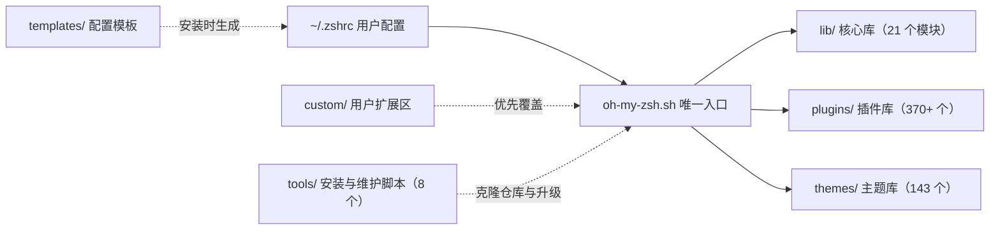
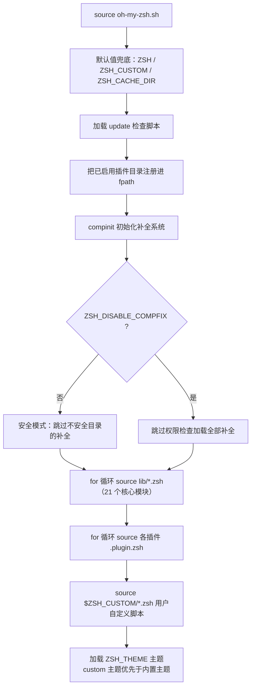

本页面向初次接触 Oh My Zsh 的开发者，从项目定位、核心能力、目录架构到启动加载流程，建立一份可对照源码验证的全局认知地图。读完本页，你将理解这个框架"是什么、由什么组成、如何运转"，并为后续的安装与配置实践做好准备。

## 定位：它是什么，不是什么

Oh My Zsh 官方对自己的定义非常明确：**"一个开源、社区驱动的框架，用于管理你的 zsh 配置"**（"an open source, community-driven framework for managing your zsh configuration"）。理解这一定位有两个关键点。其一，它不是 Shell 本身——底层的命令解释器始终是 [zsh](https://www.zsh.org)，框架只是管理配置的"脚手架"，因此安装前提中明确要求系统已装有 zsh（v4.3.9 以上，推荐 5.0.8+）、`curl`/`wget` 以及 `git`。其二，"社区驱动"不是口号：仓库中的 370 余个插件目录与 143 个主题文件绝大多数来自全球贡献者，每个插件都必须附带 README 说明文档，这正是社区协作的产物。

值得初学者注意的一个趣味事实：README 开篇便自嘲"Oh My Zsh 不会让你变成 10 倍效率的开发者……但你可能会有这种感觉"——它的核心价值在于通过主题、插件与别名体系，把终端从"能用"提升到"好用"。

Sources: [README.md](README.md#L3-L15)
Sources: [README.md](README.md#L101-L105)

## 核心能力一览

框架的价值浓缩为四大支柱：**插件生态**（内置海量即插即用的补全、别名与工具函数）、**主题体系**（README 宣称"已捆绑超过 150 个主题"，仓库树中实际存在 143 个 `.zsh-theme` 文件）、**别名体系**（为常用命令提供快捷输入），以及**自动更新机制**（后台检查新版本并提醒升级）。下表将能力与配置入口一一对应：

| 能力 | 说明 | 配置入口 |
| :--- | :--- | :--- |
| 插件系统 | 为特定工具（git、docker、k8s 等）提供补全与别名 | `~/.zshrc` 中的 `plugins=(...)` 数组 |
| 主题系统 | 自定义提示符外观，含 Git 分支状态等信息展示 | `~/.zshrc` 中的 `ZSH_THEME` 变量 |
| 核心库 | 补全、历史记录、目录跳转、键绑定等基础体验 | 自动加载，无需配置 |
| 自动更新 | 定期检查上游更新，可控制频率与模式 | `zstyle ':omz:update' ...` |
| 自定义目录 | 用户私有插件与主题的存放处，升级不被覆盖 | `$ZSH/custom`（`ZSH_CUSTOM` 变量） |

Sources: [README.md](README.md#L133-L138)
Sources: [README.md](README.md#L174-L177)
Sources: [templates/zshrc.zsh-template](templates/zshrc.zsh-template#L26-L35)

## 五大目录：架构总览

仓库顶层结构遵循"**一个入口 + 四大资源区**"的组织模式。理解这张图是读懂整个项目的钥匙——后续所有文档页讨论的文件，都能在下表中找到坐标：



上图的阅读前提：箭头表示"加载/驱动"关系，虚线表示一次性或覆盖性动作。各目录职责如下：

| 目录 | 职责 | 规模 | 典型代表 |
| :--- | :--- | :--- | :--- |
| `oh-my-zsh.sh` | 全框架唯一入口，编排加载顺序 | 单文件 348 行 | — |
| `lib/` | 核心功能模块（补全、历史、键绑定、Git 别名等） | 21 个 `.zsh` 文件 | `completion.zsh`、`git.zsh`、`cli.zsh` |
| `plugins/` | 每个子目录一个独立插件 | 370+ 个目录 | `git/`、`extract/`、`fzf/` |
| `themes/` | 提示符主题，一个文件一个主题 | 143 个文件 | `robbyrussell.zsh-theme`（默认） |
| `tools/` | 安装、升级、卸载、诊断等运维脚本 | 8 个脚本 | `install.sh`、`upgrade.sh` |
| `templates/` | `~/.zshrc` 的出厂模板 | 2 个模板 | `zshrc.zsh-template` |
| `custom/`（安装后生成） | 用户自定义插件/主题，升级时不受影响 | — | `$ZSH_CUSTOM/plugins/` |

Sources: [oh-my-zsh.sh](oh-my-zsh.sh#L50-L68)

## 启动加载流程：一条清晰的流水线

当你打开终端，zsh 读取 `~/.zshrc`，而模板生成的 `.zshrc` 末尾只有一句关键代码：`source $ZSH/oh-my-zsh.sh`。随后入口脚本按**固定顺序**完成初始化。下图是这条流水线的完整路径（阅读前提：节点按执行先后自上而下排列，菱形表示分支判断）：



流程中有三个对初学者有直接价值的细节。第一，**插件查找采用"自定义优先"策略**：入口脚本中的 `is_plugin` 函数先检查 `$ZSH_CUSTOM/plugins/<名称>/<名称>.plugin.zsh` 是否存在，再回退到内置 `plugins/` 目录，且补全文件 `_<名称>` 也被认定为合法插件结构——这就是为什么你可以在不修改框架文件的情况下"覆盖"内置插件。第二，**补全系统的安全防线**：默认情况下 `compinit -i` 会配合 `lib/compfix.zsh` 检查补全目录权限，存在不安全目录时仅加载安全部分并给出警告，这是防 root 提权攻击的经典实践。第三，**每个 lib 与插件文件都通过统一的 `_omz_source` 函数加载**，该函数会读取 `zstyle ':omz:...' aliases` 开关——这为后续"按模块跳过别名"的定制能力提供了机制基础。

Sources: [templates/zshrc.zsh-template](templates/zshrc.zsh-template#L71-L78)
Sources: [oh-my-zsh.sh](oh-my-zsh.sh#L81-L98)
Sources: [oh-my-zsh.sh](oh-my-zsh.sh#L233-L244)
Sources: [oh-my-zsh.sh](oh-my-zsh.sh#L267-L318)
Sources: [oh-my-zsh.sh](oh-my-zsh.sh#L321-L344)

## 极简设计的美感：默认主题只有 8 行

框架的"易上手"并非营销话术，而体现在代码本身。默认主题 `robbyrussell` 全部内容只有 8 行：第一行定义提示符（绿色 `➜` 表示上一条命令成功、红色表示失败，青色显示当前目录名），第二行追加 Git 分支信息函数，剩下六行定义 Git 信息的颜色与"脏工作区"（✗）标记。同理，`git` 插件（默认启用的唯一插件，450 行）的头部就是几个直观的 Shell 函数，例如自动探测 `main`/`master`/`develop` 等主分支名的 `git_main_branch`。**这意味着：你不需要理解全部 370 个插件，只需要把插件和主题理解为"普通 zsh 脚本的集合"——它们无非是别名、函数与补全定义的打包。**

Sources: [themes/robbyrussell.zsh-theme](themes/robbyrussell.zsh-theme#L1-L8)
Sources: [plugins/git/git.plugin.zsh](plugins/git/git.plugin.zsh#L1-L60)

## 一条命令完成安装

安装方式被刻意设计为"一行命令"：通过 `curl`、`wget` 或 `fetch` 拉取 `tools/install.sh` 并交给 `sh` 执行。安装脚本支持丰富的环境变量与命令行开关（如 `--unattended` 无人值守、`--keep-zshrc` 保留现有配置），且会在覆盖前把旧的 `~/.zshrc` 备份为 `~/.zshrc.pre-oh-my-zsh`。另外需要注意平台边界：macOS、Linux、FreeBSD 与 Windows（仅限 WSL2）均受官方支持，原生 Windows 不在支持列表中。

```sh
sh -c "$(curl -fsSL https://raw.githubusercontent.com/ohmyzsh/ohmyzsh/master/tools/install.sh)"
```

Sources: [README.md](README.md#L107-L126)
Sources: [tools/install.sh](tools/install.sh#L15-L40)
Sources: [README.md](README.md#L91-L99)

## 你的下一步学习路径

本页建立了全局地图，接下来建议按以下顺序深入（依据文档目录编排的逻辑递进）：

1. 动手实践：跟随 [快速开始：一键安装与首次运行](2-kuai-su-kai-shi-jian-an-zhuang-yu-shou-ci-yun-xing) 完成安装；
2. 配置入门：通过 [掌握 .zshrc：主题、插件与核心配置项详解](3-zhang-wo-zshrc-zhu-ti-cha-jian-yu-he-xin-pei-zhi-xiang-xiang-jie) 学会修改本文提到的 `ZSH_THEME` 与 `plugins` 数组；
3. 架构深潜：准备好后进入 [整体架构与目录职责划分](9-zheng-ti-jia-gou-yu-mu-lu-zhi-ze-hua-fen) 与 [启动加载流程：oh-my-zsh.sh 主脚本逐段解读](10-qi-dong-jia-zai-liu-cheng-oh-my-zsh-sh-zhu-jiao-ben-zhu-duan-jie-du)，把本页的流程图逐行落到源码；
4. 进阶定制：最终走向 [自定义插件与主题：ZSH_CUSTOM 目录实践](26-zi-ding-yi-cha-jian-yu-zhu-ti-zsh_custom-mu-lu-shi-jian)，编写属于你自己的插件。