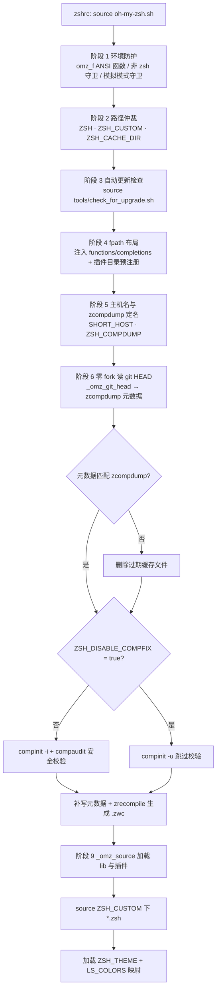
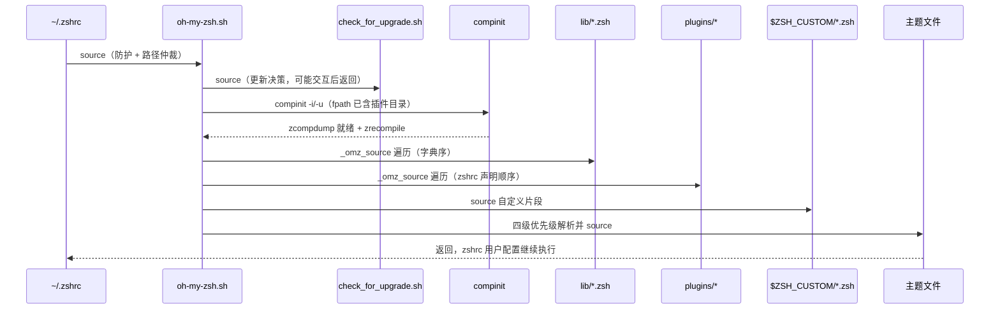

当 zsh 启动时，`~/.zshrc` 中的 `source $ZSH/oh-my-zsh.sh` 是整个框架的点火时刻——此后不到 350 行的 zsh 脚本，将完成执行环境校验、路径仲裁、自动更新检查、补全系统初始化、库文件与插件加载、主题挂载的全部工作。本文面向高级开发者，以**逐段解读**的方式拆解 [oh-my-zsh.sh](oh-my-zsh.sh) 的完整执行流，重点揭示每一段的**设计动机**（为何存在）、**副作用**（改写了什么）与**可定制点**（你能干预什么）。阅读前建议先浏览 [整体架构与目录职责划分](9-zheng-ti-jia-gou-yu-mu-lu-zhi-ze-hua-fen) 建立目录全景，并熟悉 [掌握 .zshrc：主题、插件与核心配置项详解](3-zhang-wo-zshrc-zhu-ti-cha-jian-yu-he-xin-pei-zhi-xiang-xiang-jie) 中的配置变量含义。

Sources: [oh-my-zsh.sh](oh-my-zsh.sh#L1-L348), [zshrc.zsh-template](templates/zshrc.zsh-template#L78)

## 全景：一次启动的九个阶段

oh-my-zsh.sh 的执行是严格线性的：前半段（约第 1–265 行）为 compinit 做一切准备——环境防护、路径仲裁、fpath 注入、补全缓存校验；后半段（约第 267–348 行）则按 **lib → plugins → custom → theme** 的固定次序执行真正的配置加载。这一顺序不可颠倒：插件的 `_command` 补全文件必须在 `compinit` 运行前进入 `fpath`，而主题必须最后加载以覆盖此前的一切外观定义。

Sources: [oh-my-zsh.sh](oh-my-zsh.sh#L66-L98), [oh-my-zsh.sh](oh-my-zsh.sh#L267-L348)

Sources: [oh-my-zsh.sh](oh-my-zsh.sh#L1-L348)

下表是九个阶段的速查索引，后续小节将逐一展开：

| 阶段 | 行号区间 | 关键动作 | 主要产物 / 副作用 |
|---|---|---|---|
| 1. 环境防护 | L1–48 | ANSI 格式化函数、非 zsh 执行守卫、模拟模式守卫 | 错误提前退出（`return 1`） |
| 2. 路径仲裁 | L50–68 | 解析 `ZSH`/`ZSH_CUSTOM`/`ZSH_CACHE_DIR` 缺省值 | 创建缓存 completions 目录 |
| 3. 更新检查 | L70–71 | source `check_for_upgrade.sh` | 可能触发更新提示/后台更新 |
| 4. fpath 布局 | L75–98 | 注入 OMZ 与插件目录、`autoload` compinit | 插件补全可被 compinit 发现 |
| 5. 主机名与 dump 路径 | L100–132 | 计算 `SHORT_HOST`、`ZSH_COMPDUMP` | 跨平台一致的缓存文件名 |
| 6. 零 fork 读 HEAD | L134–216 | 纯 shell 解析 git commit | `zcompdump_revision` |
| 7. compinit 执行 | L218–257 | 校验元数据、安全分支、补写元数据 | 补全缓存生效 |
| 8. 缓存编译 | L259–265 | `zrecompile` 生成 `.zwc` | 加速补全脚本解析 |
| 9. 配置加载 | L267–348 | lib → plugins → custom → theme | 全部别名/函数/提示符就绪 |

Sources: [oh-my-zsh.sh](oh-my-zsh.sh#L1-L348)

## 阶段 1：环境防护——为什么启动前先"验明正身"（第 1–48 行）

脚本开篇定义了一个极小的 ANSI 格式化函数 `omz_f`，它将多个颜色代码拼接为 `\033[<code>m` 转义序列（如 `omz_f 1 31` 产生加粗红色）。关键在第 8 行：若 stdout 不是终端（`[ -t 1 ]`），该函数被替换为空实现——这是**管道安全**设计，确保错误信息被重定向到日志时不会混入控制字符。

Sources: [oh-my-zsh.sh](oh-my-zsh.sh#L1-L8)

接下来的守卫是 OMZ 启动中最经典的防御之一：`[ -n "$ZSH_VERSION" ]` 检测当前解释器是否为 zsh。这一段刻意使用 **POSIX 语法**（`[` 而非 `[[`），因为它必须在 bash、dash 等任何 shell 中都能正确解析执行。检测失败时，脚本不仅报错，还通过 `omz_ptree` 打印完整进程树——跨 Linux/Darwin/Busybox 三种 `ps` 实现兼容——帮助用户定位"到底是哪个父进程用错了 shell"。诊断输出全部导向 stderr 并以 `return 1` 终止。

Sources: [oh-my-zsh.sh](oh-my-zsh.sh#L10-L39)

第二个守卫针对更隐蔽的场景：zsh 以 **emulation mode** 运行（如 `emulate sh`）。此时 `[ -n "$ZSH_VERSION" ]` 会通过（解释器确实是 zsh），但大量 OMZ 脚本依赖 zsh 原生语法，在 sh/ksh 模拟下必然崩溃。第 43–46 行用 `[[ "$(emulate)" = zsh ]]` 直接拒绝加载并引用了相关 issue（#11686）。最后第 48 行 `unset -f omz_f` 清理临时函数——整个防护段的函数都不污染全局命名空间。

Sources: [oh-my-zsh.sh](oh-my-zsh.sh#L41-L48)

## 阶段 2：路径变量仲裁——三个变量的缺省逻辑（第 50–68 行）

`ZSH` 的缺省推导是本段最精妙的单行：`${${(%):-%x}:a:h}`。`(%)` 标志触发 prompt expansion，`%x` 展开为**当前被 source 的脚本文件名**，`:a` 修饰符将其绝对化，`:h` 取目录部分——整条链不 fork 任何外部进程，即可得到 oh-my-zsh 的安装目录。这解释了为什么用户在 zshrc 中 `export ZSH` 后，即使换了安装位置脚本也能自适应。模板文件中的 `export ZSH="$HOME/.oh-my-zsh"` 只是显式声明了同一事实。

Sources: [oh-my-zsh.sh](oh-my-zsh.sh#L50-L51), [zshrc.zsh-template](templates/zshrc.zsh-template#L5)

随后是两个派生变量的缺省化：`ZSH_CUSTOM` 默认指向 `$ZSH/custom`（自定义插件与主题的安置地），`ZSH_CACHE_DIR` 默认指向 `$ZSH/cache`。值得注意第 62–64 行的**可写性回退**：若缓存目录不可写（典型场景是 OMZ 装在 root 拥有的路径下、而普通用户启动 shell），则改用 `${XDG_CACHE_HOME:-$HOME/.cache}/oh-my-zsh`，避免以只读缓存目录静默失败。

Sources: [oh-my-zsh.sh](oh-my-zsh.sh#L53-L64)

本段以一个**幂等的 fpath 操作**收尾：第 67 行确保 `$ZSH_CACHE_DIR/completions` 目录存在，第 68 行通过 zsh 的反向下标语法 `fpath[(Ie)...]` 检查该路径是否已在数组中，不存在才前插。将其置于 `fpath` 首位的目的是让用户在缓存目录放置的自定义补全文件拥有最高优先级。下表汇总此段仲裁的四个核心变量：

| 变量 | 缺省值 | 仲裁规则 | 用途 |
|---|---|---|---|
| `ZSH` | 脚本自身所在目录 | 仅在未设置时由 `%x` 推导 | 框架安装根 |
| `ZSH_CUSTOM` | `$ZSH/custom` | 未设置即用缺省 | 自定义插件/主题/片段 |
| `ZSH_CACHE_DIR` | `$ZSH/cache` | 不可写时回退 `~/.cache/oh-my-zsh` | zcompdump、更新戳等 |
| `ZSH_COMPDUMP` | `~/.zcompdump-<host>-<ver>` | 阶段 5 定名（见下文） | 补全缓存文件 |

Sources: [oh-my-zsh.sh](oh-my-zsh.sh#L50-L68)

## 阶段 3：自动更新检查的挂载点（第 70–71 行）

`source "$ZSH/tools/check_for_upgrade.sh"` 虽只占两行，却在启动路径上引入了完整的更新决策链。该脚本被 source 时**同步执行**以下逻辑：先把旧版的 `~/.zsh-update` 迁移到 `$ZSH_CACHE_DIR`；再从 zstyle `':omz:update' mode` 读取更新模式（缺省 `prompt`，并兼容旧环境变量 `DISABLE_UPDATE_PROMPT`/`DISABLE_AUTO_UPDATE`）；随后串行应用三道取消闸门——模式为 disabled、用户对 `$ZSH` 无写权限或非属主、stdout 非 tty（Powerlevel10k instant prompt 场景除外）。

Sources: [oh-my-zsh.sh](oh-my-zsh.sh#L70-L71), [check_for_upgrade.sh](tools/check_for_upgrade.sh#L1-L31)

通过闸门后还有一道**频率闸门**：一个匿名函数读取 `.zsh-update` 中的 `LAST_EPOCH`，与 `':omz:update' frequency`（或旧变量 `UPDATE_ZSH_DAYS`，缺省 13 天）比较，未到期就直接返回。注释明确指出此检查被刻意放在 git 检查**之前**——因为 git 子命令会 fork，"未到期"时可以完全避免这两个 fork。频率与 git 检查都通过后，脚本尾部按模式分派：`background-alpha` 实验模式注册 `precmd` 钩子将更新放入后台子进程；其余模式**内联调用** `handle_update`，即更新交互（询问/提醒/自动）发生在 shell 启动路径上。完整的模式矩阵与频率/冷却语义请参见 [自动更新机制全解：更新模式与频率控制](22-zi-dong-geng-xin-ji-zhi-quan-jie-geng-xin-mo-shi-yu-pin-lu-kong-zhi)。

Sources: [check_for_upgrade.sh](tools/check_for_upgrade.sh#L33-L55), [check_for_upgrade.sh](tools/check_for_upgrade.sh#L294-L347)

## 阶段 4：fpath 布局与插件预注册——compinit 之前必须完成的事（第 75–98 行）

第 76 行将四个目录前插到 `fpath`：`$ZSH/functions`、`$ZSH/completions` 及 `ZSH_CUSTOM` 下的对应目录。第 79 行随后 `autoload -U compaudit compinit zrecompile`——`-U` 阻止别名展开污染函数体，三者分别负责补全目录审计、补全初始化与字节码编译。这是**本脚本与 zsh 补全系统的唯一交互契约**，细节在 [补全系统：compinit 与 zcompdump 缓存优化](11-bu-quan-xi-tong-compinit-yu-zcompdump-huan-cun-you-hua) 中展开。

Sources: [oh-my-zsh.sh](oh-my-zsh.sh#L75-L79)

`is_plugin` 辅助函数（第 81–86 行）定义了插件的**物理识别标准**：目录下存在 `<name>.plugin.zsh` **或** `_<name>`（补全专用插件）即视为有效。紧随其后的循环遍历 zshrc 中定义的 `$plugins` 数组，把每个插件目录**前插**进 `fpath`——自定义插件优先于官方插件。找不到的插件仅打印警告 `[oh-my-zsh] plugin '<name>' not found`，不中断启动。注释中反复强调这必须在 `compinit` 之前完成：compinit 扫描 `fpath` 时才能将插件携带的 `_command` 补全文件纳入 `zcompdump`，这就是"补全注册窗口"。

Sources: [oh-my-zsh.sh](oh-my-zsh.sh#L81-L98), [zshrc.zsh-template](templates/zshrc.zsh-template#L76)

## 阶段 5：SHORT_HOST 与 ZSH_COMPDUMP——缓存文件名的稳定性设计（第 100–132 行）

`SHORT_HOST` 的唯一消费者是 zcompdump 文件名，但它的计算在 macOS 上被特别优化：Darwin 的 `$HOST` 会随 DHCP 变化，导致缓存文件名漂移，因此优先使用 `scutil --get LocalHostName`。由于 `scutil` 每次调用都产生一次 fork，OMZ 将其结果缓存到 `$ZSH_CACHE_DIR/localhostname` 文件中，并用 glob 限定符 `(Nm-1)` 检查文件是否在一天内修改过——命中则直接 `read` 两行（第一行是校验键 `$HOST`，第二行是主机名），只有 `$HOST` 变化或缓存缺失时才重新 fork `scutil`。若 `scutil` 失败则回退到 `${HOST/.*/}`（截取第一个点之前的部分）。非 Darwin 平台则始终使用纯参数展开，零 fork。

Sources: [oh-my-zsh.sh](oh-my-zsh.sh#L100-L127)

随后 `ZSH_COMPDUMP` 缺省定名为 `${ZDOTDIR:-$HOME}/.zcompdump-${SHORT_HOST}-${ZSH_VERSION}`——**主机名 + zsh 版本**双维度命名，使同一 `$HOME` 被多台机器共享（如 NFS 场景）或升级 zsh 后缓存不会互相污染。若用户已在 zshrc 中自定义该变量，则完全尊重用户值。

Sources: [oh-my-zsh.sh](oh-my-zsh.sh#L129-L132)

## 阶段 6：零 fork 的 git HEAD 解析——性能哲学的集中体现（第 134–216 行）

`_omz_git_head` 是整个脚本最长的函数（约 70 行），其存在理由写在注释里：把 `$ZSH` 当前检出的 commit 解析进 `$REPLY`，**避免每次启动 fork 一个 git 进程**。这是 OMZ 启动性能优化的代表案例，与 [启动性能优化：减少 fork 与缓存策略](23-qi-dong-xing-neng-you-hua-jian-shao-fork-yu-huan-cun-ce-lue) 中的策略一脉相承。函数处理了四种 git 仓库形态：`.git` 为文件（worktree/submodule，需解析 `gitdir:` 前缀）、worktree 的 `commondir`、分离 HEAD（文件内容即 commit）、以及常规 `ref: refs/...`。

Sources: [oh-my-zsh.sh](oh-my-zsh.sh#L134-L161)

对常规引用的解析体现了**防御性验证**的极致：先校验引用名是格式良好的全限定名（`refs/?*` 且不含 `..`、`//`、`@{`、控制字符、`.lock` 后缀等），注释说明这是为了防止**畸形的 HEAD 文件逃逸 git 目录**（路径穿越防护）；随后区分 `refs/bisect/*`、`refs/worktree/*`、`refs/rewritten/*` 这些每个 worktree 私有的命名空间（只在本 gitdir 解析）与共享命名空间（在 common 目录或 `packed-refs` 中解析，后者用 `${(@f)...}` 按行拆分后线性查找）。最终结果必须通过两道校验：非空、且**只含十六进制字符**、长度为 40 或 64（SHA-1/SHA-256）——任何意外都 `return 1` 落回 git 回退路径。

Sources: [oh-my-zsh.sh](oh-my-zsh.sh#L162-L206)

第 208–216 行消费这个函数：匿名函数 `() { ... }` 把 `$REPLY` 封装在私有作用域中（失败时回退 `git rev-parse HEAD`），产出全局变量 `zcompdump_revision="#omz revision: <commit>"`；第 215 行再产出 `zcompdump_fpath="#omz fpath: $fpath"`。这两个以注释形式存在的字符串，是下一阶段校验缓存新鲜度的**元数据指纹**——commit 变了或 fpath 变了，缓存就必须重建。

Sources: [oh-my-zsh.sh](oh-my-zsh.sh#L208-L216)

## 阶段 7：元数据校验与 compinit 分支（第 218–257 行）

`_omz_compdump_has_metadata` 读入 zcompdump 全文并检查两个元数据行是否**同时**存在（`${lines[(Ie)...]}` 反向查找）。校验失败时置 `zcompdump_refresh=1` 并 `rm -f` 删除旧缓存——这意味着**任何插件增删（改变 fpath）或 OMZ 版本变化（改变 commit）都会触发缓存重建**，这是缓存一致性的根基。

Sources: [oh-my-zsh.sh](oh-my-zsh.sh#L218-L231)

接下来是安全分叉点，由 `ZSH_DISABLE_COMPFIX` 决定：

| 分支 | 条件 | compinit 参数 | 行为 |
|---|---|---|---|
| 安全模式（默认） | `ZSH_DISABLE_COMPFIX != true` | `-i -d $ZSH_COMPDUMP` | 忽略不安全目录；第 240 行以 `&|`（后台 + disown）调用 `handle_completion_insecurities` 给出修复指引，不阻塞启动 |
| 信任模式 | `ZSH_DISABLE_COMPFIX = true` | `-u -d $ZSH_COMPDUMP` | 跳过审计，加载所有目录的补全 |

安全模式下的细节值得玩味：第 237 行先 `unset _comp_secure`——这是 compinit 在 `-i` 模式排除不安全条目时设置的内部标志，先清空才能确保只捕获**本次运行**的信号；`handle_completion_insecurities`（定义于 `lib/compfix.zsh`，此处被提前 source）通过 `compaudit` 列出不安全目录、展示权限详情并给出 `compaudit | xargs chmod g-w,o-w` 修复命令。完整的安全审计逻辑请参见 [安全防线：compfix 与补全目录权限检查](12-an-quan-fang-xian-compfix-yu-bu-quan-mu-lu-quan-xian-jian-cha)。

Sources: [oh-my-zsh.sh](oh-my-zsh.sh#L233-L244), [compfix.zsh](lib/compfix.zsh#L5-L44)

compinit 运行后还有一道**元数据补偿**：若此前删除过缓存、或 compinit 自身重建了文件导致元数据丢失，第 250–254 行用 `tee -a` heredoc 把两行元数据追加回文件尾部。选用 `tee` 而非 `print >` 的原因在注释中：当 `$ZSH_COMPDUMP` 文件名非法时（重定向发生在 shell 解析层，报错无法抑制），`tee` 作为外部命令能静默吞掉错误。本段结尾成对 `unset` 全部辅助变量与函数，保持全局环境洁净。

Sources: [oh-my-zsh.sh](oh-my-zsh.sh#L246-L257)

## 阶段 8：zrecompile——补全缓存的字节码化（第 259–265 行）

zsh 加载纯文本的 zcompdump 需要逐行解析，而 `zrecompile` 可将其编译为 `zcompdump-*.zwc` 字节码，二次启动时直接 mmap 加载。条件判断 `[[ ! "${ZSH_COMPDUMP}.zwc" -nt "$ZSH_COMPDUMP" ]]` 只在 `.zwc` **不比**文本新（过期或缺失）时才执行编译，且以 `mkdir "${ZSH_COMPDUMP}.lock"` 作为跨并发 shell 的互斥锁——注释强调先测试后加锁，缓存新鲜时连锁目录的开销都省掉。编译完成后清理 `.zwc.old` 备份与锁目录。

Sources: [oh-my-zsh.sh](oh-my-zsh.sh#L259-L265)

## 阶段 9：_omz_source——统一加载器与 zstyle 别名开关（第 267–306 行）

`_omz_source` 是 lib 与插件加载的**唯一通道**，它做了两件事。其一是**自定义覆盖**：第 287–291 行优先 source `$ZSH_CUSTOM/<filepath>`，不存在才回退 `$ZSH/<filepath>`——你可以在 custom 目录放置同名文件整体替换任何官方模块。其二是**别名开关协议**：根据文件路径构造 zstyle 上下文（`lib/xxx.zsh` → `:omz:lib:xxx`；`plugins/yyy/...` → `:omz:plugins:yyy`），第 277 行 `zstyle -T ':omz:<context>' aliases` 检查（`-T` 表示未设置时默认为真）；若被用户显式置为 false，则在 source 前**快照**全局与普通别名的关联数组（`aliases`/`galiases`），source 后恢复快照——等效于"该模块定义的所有别名被静默丢弃"。这套机制的完整语义与使用示例见 [别名体系与 zstyle 定制开关（按模块跳过别名）](15-bie-ming-ti-xi-yu-zstyle-ding-zhi-kai-guan-an-mo-kuai-tiao-guo-bie-ming)。

Sources: [oh-my-zsh.sh](oh-my-zsh.sh#L267-L306)

## 阶段 9（续）：lib → plugins → custom → theme 的最终序列（第 308–348 行）

三个加载循环是启动流程的**实际产出段**。第一个循环用 glob `"$ZSH"/lib/*.zsh` 按**字典序**加载全部库文件（async_prompt、cli、completion、directories、functions、git、history、key-bindings、theme-and-appearance……），每个都经过 `_omz_source`，因此都可被 `zstyle ':omz:lib:<name>' aliases false` 摘除别名。`omz` 命令行工具正是在此处由 [cli.zsh](lib/cli.zsh) 定义的。第二个循环对 `$plugins` 数组逐个调用 `_omz_source "plugins/$plugin/$plugin.plugin.zsh"`，执行真正的插件逻辑——插件命名约定与编写规范详见 [插件加载机制与开发命名约定](16-cha-jian-jia-zai-ji-zhi-yu-kai-fa-ming-ming-yue-ding)。第三个循环加载 `$ZSH_CUSTOM/*.zsh`，glob 限定符 `(N)`（NULL_GLOB）保证目录为空时不报错——这是用户别名片段的官方安置点。

Sources: [oh-my-zsh.sh](oh-my-zsh.sh#L308-L325), [cli.zsh](lib/cli.zsh#L3-L21)

主题加载被刻意放在**一切之后**：`is_theme` 校验后按四级优先级解析——`$ZSH_CUSTOM/<name>.zsh-theme` → `$ZSH_CUSTOM/themes/` → `$ZSH/themes/` → 报警 `theme '<name>' not found`（注意 `ZSH_THEME` 为空字符串时直接跳过，什么都不加载）。最后第 347 行把 `LS_COLORS` 映射为补全列表颜色（`zstyle ':completion:*' list-colors`），注释点明必须在主题之后执行——主题可能定义颜色相关的 zstyle，此行保证 `ls` 与补全列表配色一致。至此 `oh-my-zsh.sh` 返回，控制流交回 zshrc 中 `source` 之后的用户配置区，用户在此定义的别名将覆盖框架的一切。

Sources: [oh-my-zsh.sh](oh-my-zsh.sh#L327-L348)

加载顺序本身就是一个 API 契约，下图以时序视角总结了控制流的完整旅程：

Sources: [oh-my-zsh.sh](oh-my-zsh.sh#L50-L348)

## 设计要点回顾：三条贯穿始终的工程原则

纵观全脚本，OMZ 的启动设计可以归纳为三条可迁移的原则。**第一，零 fork 优先**：从 `%x` 推导安装路径、到 70 行纯 shell 解析 git HEAD、再到 macOS 主机名的一日缓存，凡是能用 zsh 内建能力（参数展开、glob 限定符、关联数组）完成的绝不 fork 子进程——这是高级用户排查启动耗时时的首要审视维度。**第二，幂等与自愈**：fpath 插入先查重、缓存目录先建后用、zcompdump 以元数据指纹自校验并自动重建、zrecompile 带锁编译——多 shell 并发与异常中断都能收敛到一致状态。**第三，一切皆可定制且默认安全**：路径三变量可覆盖、每个 lib/插件的别名可经 zstyle 关闭、`ZSH_DISABLE_COMPFIX` 可显式换取消融安全审计——定制点全部集中在 zshrc 中 `source` 之前声明。理解这三条原则后，你就能预判任何 OMZ 行为的根源；下一步可深入 [补全系统：compinit 与 zcompdump 缓存优化](11-bu-quan-xi-tong-compinit-yu-zcompdump-huan-cun-you-hua) 剖析阶段 4–8 的细节，或转向 [主题编写规范：从 robbyrussell 到 agnoster](20-zhu-ti-bian-xie-gui-fan-cong-robbyrussell-dao-agnoster) 了解流程终点——主题——的编写方法。