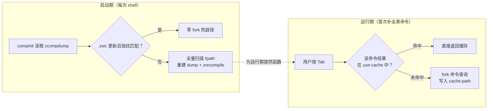
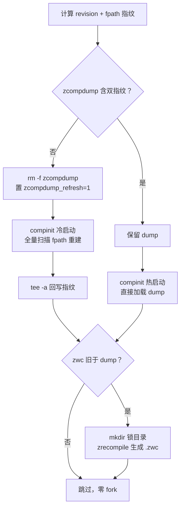

补全（completion）是 zsh 交互体验的核心，也是 shell 启动耗时的大头。oh-my-zsh 对补全系统的全部编排集中在一个文件里：`oh-my-zsh.sh`。它负责装配 `fpath`、计算缓存文件路径、用双重元数据指纹判断 `zcompdump` 是否过期、调用 `compinit`、回写元数据，并对 dump 文件做字节码预编译。本页将逐段拆解这条初始化链路，解释两级缓存模型的设计动机，并梳理该模块近期一系列"消灭 fork"的性能演进。补全目录的安全审计细节属于独立主题，见[安全防线：compfix 与补全目录权限检查](12-an-quan-fang-xian-compfix-yu-bu-quan-mu-lu-quan-xian-jian-cha)；启动全流程的上下文见[启动加载流程：oh-my-zsh.sh 主脚本逐段解读](10-qi-dong-jia-zai-liu-cheng-oh-my-zsh-sh-zhu-jiao-ben-zhu-duan-jie-du)。

## 两级缓存模型：zcompdump 与 completion cache

oh-my-zsh 的补全性能依赖两个相互独立的缓存层，混淆它们是理解该模块最常见的障碍。**第一级是 `zcompdump`**：`compinit` 需要扫描整个 `fpath`，找出所有形如 `_command` 的补全函数文件并登记其关联关系，这一扫描在 `fpath` 庞大时非常昂贵；zsh 将扫描结果序列化到 dump 文件（默认 `~/.zcompdump-<主机名>-<zsh版本>`），下次启动直接加载，跳过全量扫描。oh-my-zsh 又在此之上叠加了 `.zwc` 字节码编译——zsh 会优先加载 dump 文件的编译版本，进一步省去解析纯文本 dump 的开销。

**第二级是命令级补全缓存**：某些命令（典型如 `apt`、`dpkg`）的补全函数需要 fork 子进程调用命令本身的查询接口，结果通过 `zstyle` 的 `use-cache` 机制缓存在 `$ZSH_CACHE_DIR` 下。`lib/completion.zsh` 显式开启了这一机制并将其指向缓存目录。两级缓存的生命周期完全不同：前者在插件列表或 oh-my-zsh 版本变化时整体失效，后者按命令自行管理过期。



Sources: [oh-my-zsh.sh](oh-my-zsh.sh#L129-L132), [lib/completion.zsh](lib/completion.zsh#L43-L45)

## 启动时序：compinit 之前发生什么

`compinit` 的调用位置是刻意安排的，它之前发生的一切决定了 dump 文件的内容与位置。第一步是**缓存目录决策**：`ZSH_CACHE_DIR` 默认取 `$ZSH/cache`，若该目录不可写则降级到 `${XDG_CACHE_HOME:-$HOME/.cache}/oh-my-zsh`；随后创建 `$ZSH_CACHE_DIR/completions` 子目录并将其**置于 fpath 首位**——这是一个给用户和第三方工具投放补全文件的逃生舱口，无需触碰仓库本体。第二步是 **fpath 装配**：脚本将 `$ZSH/{functions,completions}` 与 `$ZSH_CUSTOM/{functions,completions}` 前插，再遍历 `plugins` 数组，把每个已启用插件目录前插到 fpath 头部。源码注释明确写道 *"This must be done before running compinit"*——compinit 只认调用时刻的 `fpath`，插件若在 compinit 之后才进入 `fpath`，其 `_command` 文件不会出现在本次 dump 中。

| 顺序 | 追加到 fpath 的路径 | 目的 |
| --- | --- | --- |
| 1 | `$ZSH_CACHE_DIR/completions` | 用户/工具投放补全的免侵入目录 |
| 2 | `$ZSH/functions`、`$ZSH/completions` | 仓库自带函数与补全 |
| 3 | `$ZSH_CUSTOM/functions`、`$ZSH_CUSTOM/completions` | 用户自定义 |
| 4 | 各插件目录（后启用的在前） | 插件 `_command` 文件 |

第三步是**解析 dump 文件名**：`ZSH_COMPDUMP` 默认为 `${ZDOTDIR:-$HOME}/.zcompdump-${SHORT_HOST}-${ZSH_VERSION}`，按主机名与 zsh 版本命名空间隔离。在 macOS 上 `SHORT_HOST` 取自 `scutil --get LocalHostName`，由于 DHCP 环境下 `$HOST` 会漂移，脚本将查询结果连同 `$HOST` 键值缓存到 `$ZSH_CACHE_DIR/localhostname` 一天，避免每次启动 fork `scutil`，也避免了主机名变化导致 dump 文件名抖动。

Sources: [oh-my-zsh.sh](oh-my-zsh.sh#L57-L79), [oh-my-zsh.sh](oh-my-zsh.sh#L88-L98), [oh-my-zsh.sh](oh-my-zsh.sh#L100-L132)

## 双重元数据指纹：缓存失效的判定设计

`compinit` 自身只会因 dump 文件缺失或早于 fpath 内容而重建，它**感知不到两类关键变化**：oh-my-zsh 本体升级（fpath 里的补全文件内容变了），以及用户增删插件（fpath 成员变了）。oh-my-zsh 的解法是在 dump 文件末尾追加两行注释指纹，启动时校验：

```zsh
zcompdump_revision="#omz revision: <当前 git commit>"
zcompdump_fpath="#omz fpath: <当前 fpath 快照>"
```

`zcompdump_revision` 通过 `_omz_git_head()` 获得——该函数**纯 zsh 读取 `.git` 目录**解析当前 commit，覆盖 worktree（`.git` 为文件）、`commondir`、packed-refs、detached HEAD 等形态，只有解析失败时才降级为 fork 一次 `git rev-parse`。`zcompdump_fpath` 则直接序列化当前 `fpath` 数组。校验函数 `_omz_compdump_has_metadata()` 用 zsh 原生的数组内查找（`${lines[(Ie)...]}`）确认两行指纹同时存在——这是近期一次优化的成果：早期实现 fork 一次 `grep` 完成同样的检查。

若指纹缺失或不匹配，脚本执行 `rm -f "$ZSH_COMPDUMP"` 并置 `zcompdump_refresh=1`，强制 compinit 走冷启动全量重建路径。**指纹即失效策略**：commit 变了（更新了 oh-my-zsh）或 fpath 变了（改了 `plugins=()`）都会触发重建，其余情况一律复用。



Sources: [oh-my-zsh.sh](oh-my-zsh.sh#L134-L216), [oh-my-zsh.sh](oh-my-zsh.sh#L218-L231), [oh-my-zsh.sh](oh-my-zsh.sh#L246-L265)

## compinit 的两种调用模式与安全分支

指纹校验之后是 `compinit` 的实际调用，这里存在一条受 `ZSH_DISABLE_COMPFIX` 控制的分岔。默认路径下，脚本先 source `lib/compfix.zsh`，然后以 `compinit -i -d "$ZSH_COMPDUMP"` 调用：`-d` 显式指定 dump 路径，`-i` 表示**静默忽略**安全审计发现的不安全目录（组/其他用户可写的目录），只从可信路径加载。关键细节在 `-i` 与后台警告的协作方式：脚本先 `unset _comp_secure` 复位标志（防止用户环境残留旧值），compinit 运行时若确有条目因安全原因被排除，会设置该标志；脚本随后仅在标志为 `yes` 时才以 `handle_completion_insecurities &|` 发出警告——`&|` 使函数在后台运行并脱离作业表，安全审计（其内部的 `compaudit` 会再次遍历 fpath）不再阻塞启动。此前版本无条件在后台调用该函数，这次改造（commit `a4a224b`）让无安全问题的绝大多数用户连这一次后台审计也省去了。

若用户设置 `ZSH_DISABLE_COMPFIX=true`，则走 `compinit -u` 分支：完全跳过安全检查，从所有发现的目录加载。该变量的取舍与 `handle_completion_insecurities` 的完整诊断输出属于安全主题，见[安全防线：compfix 与补全目录权限检查](12-an-quan-fang-xian-compfix-yu-bu-quan-mu-lu-quan-xian-jian-cha)。

| 分支 | 调用 | 行为 |
| --- | --- | --- |
| 默认 | `compinit -i -d` | 排除不安全目录；若发生排除，后台脱管运行警告函数 |
| `ZSH_DISABLE_COMPFIX=true` | `compinit -u -d` | 无安全检查，加载所有目录 |

Sources: [oh-my-zsh.sh](oh-my-zsh.sh#L233-L244), [lib/compfix.zsh](lib/compfix.zsh#L1-L44)

## 元数据回写与 zrecompile 字节码锁

compinit 结束后还有两段收尾。第一段处理**指纹回写**：条件是 `zcompdump_refresh` 已置位，或指纹仍然缺失——后一个条件看似冗余，实则必要，注释说明了原因：compinit 可能在冷启动中重新生成了 dump 文件，把之前追加的指纹冲掉了。回写用 `tee -a` 而非重定向，是为兼容 `$ZSH_COMPDUMP` 文件名非法的边角情况（用 `tee` 的失败被静默吞掉）。

第二段是**字节码编译**：条件 `[[ ! "${ZSH_COMPDUMP}.zwc" -nt "$ZSH_COMPDUMP" ]]` 判断 `.zwc` 是否缺失或早于 dump 本体，仅在过期时才继续——这是一次专门的性能修复，此前每次启动都会无条件创建锁目录并尝试编译。真正的编译动作由 `zrecompile -q -p` 完成，前后用 `command mkdir "${ZSH_COMPDUMP}.lock"` 作互斥守卫：`mkdir` 在 POSIX 语义下是原子操作，多个并发 zsh 会话同时启动时只有一个能创建锁目录并执行编译，其余直接跳过，编译产物 `.zwc.old` 备份与锁目录随后清理。

Sources: [oh-my-zsh.sh](oh-my-zsh.sh#L246-L265)

## lib/completion.zsh：compinit 之后的补全行为定制

注意一个容易误判的顺序：`lib/completion.zsh` 是在 compinit **之后**才被加载的（它位于 lib 循环中，晚于主脚本第 244 行的 compinit 调用）。这意味着它不参与补全函数的登记，只负责通过 `zstyle` 与选项定制补全的**运行时行为**。核心配置如下表：

| 配置项 | 值/机制 | 效果 |
| --- | --- | --- |
| `menu select`（zstyle） | 配合 `zmodload zsh/complist` | Tab 弹出可交互高亮菜单，方向键选择 |
| `setopt auto_menu / complete_in_word / always_to_end` + `unsetopt menu_complete` | 选项组合 | 不自动选中首项、词中可补全、补全后光标移到词尾 |
| `matcher-list`（zstyle） | 受 `CASE_SENSITIVE`/`HYPHEN_INSENSITIVE` 控制 | 默认大小写不敏感 + 子串/前后缀匹配；两个变量在 `.zshrc` 中设为 `true` 可收紧 |
| `use-cache` / `cache-path`（zstyle） | `yes` / `$ZSH_CACHE_DIR` | 第二级缓存：apt/dpkg 等命令补全结果落盘缓存 |
| `special-dirs true`（zstyle） | — | 允许补全 `.` 与 `..` |
| `ignored-patterns`（zstyle） | 系统账户列表 | 用户名补全时屏蔽 daemon 类账户 |
| `COMPLETION_WAITING_DOTS` | 环境变量触发 widget 包装 | 补全计算期间显示红色省略号动画 |
| `bashcompinit` | `autoload +X` 后调用 | 让 bash 风格补全脚本（`complete -F`）可用 |

主题加载完成后还有一处补全联动：若 `$LS_COLORS` 非空，主脚本会将其同步到补全列表的颜色，使文件名补全的着色与 `ls` 一致。此外，`_omz_source` 的别名剥离机制对 lib 文件同样生效，可用 `zstyle ':omz:lib:completion' aliases skip` 跳过该文件定义的别名——这属于别名体系主题，见[别名体系与 zstyle 定制开关（按模块跳过别名）](15-bie-ming-ti-xi-yu-zstyle-ding-zhi-kai-guan-an-mo-kuai-tiao-guo-bie-ming)。

Sources: [lib/completion.zsh](lib/completion.zsh#L1-L26), [lib/completion.zsh](lib/completion.zsh#L43-L79), [templates/zshrc.zsh-template](templates/zshrc.zsh-template#L19-L53), [oh-my-zsh.sh](oh-my-zsh.sh#L346-L347)

## 性能演进：消灭热启动路径上的每一个 fork

该模块近期经历了密集的优化迭代，设计目标高度一致：**热启动（指纹匹配、缓存新鲜）时应做到零 fork**。下表整理了可从 git 历史直接验证的演进：

| Commit | 优化内容 | 被消灭的开销 |
| --- | --- | --- |
| `40bddc3` | `_omz_git_head` 纯 zsh 读 `.git` 解析 revision | 每次 fork 一次 `git rev-parse` |
| `39334a0` | 指纹校验改用 zsh 原生数组查找 | 每次 fork 一次 `grep` |
| `0da7919` | `.zwc` 新鲜时跳过锁目录与 `zrecompile` | 每次 `mkdir` + `zrecompile` 检查 |
| `992edcc` | 缓存 completions 目录仅缺失时 `mkdir` | 每次 fork 一次 `mkdir` |
| `e785204` | macOS `LocalHostName` 缓存一天 | 每次 fork 一次 `scutil`，兼修 dump 文件名稳定性 |
| `a4a224b` | 仅在 `_comp_secure` 置位时后台审计 | 常规环境的一次后台 `compaudit` 遍历 |

冷启动与热启动的路径差异由此拉满：冷启动（更新 oh-my-zsh 后、增删插件后、首次安装）需要全量扫描 fpath、重建 dump、回写指纹、zrecompile 编译；热启动则只做两次纯 zsh 的字符串比对与一次文件时间戳判断，全程无子进程。理解这一差异是诊断"shell 突然变慢"的第一把钥匙——如果每次启动都是冷路径，通常是某个环节导致指纹持续失配。

| 场景 | 实际执行的工序 |
| --- | --- |
| 热启动 | 指纹匹配 → compinit 加载 `.zwc` → 结束 |
| 更新/改插件后 | 删 dump → compinit 全量扫描重建 → 回写指纹 → zrecompile |
| 缓存目录不可写 | 降级到 `~/.cache/oh-my-zsh` 后走正常路径 |

Sources: [oh-my-zsh.sh](oh-my-zsh.sh#L134-L265)

## 运维启示与阅读路径

对高级用户而言，这套机制引出三条实践结论。其一，**手动失效缓存有精准手段**：修改插件列表或更新 oh-my-zsh 后无需任何操作（指纹自动失配）；若怀疑 dump 损坏，删除 `~/.zcompdump-*` 后重启 shell 即可触发重建。其二，**fpath 指纹意味着插件启用顺序无关紧要但时机致命**——在 `.zshrc` 中 source oh-my-zsh 之后再往 fpath 塞补全目录，必须手动删除 dump 才能生效。其三，**`.zwc` 与锁目录是正常产物**，出现在 `$HOME` 下的 `.zcompdump-*.zwc` 与偶发的 `.zcompdump-*.lock` 均为设计行为，后者在编译完成后即被清理。

继续深入的方向取决于你的角色：想看 compinit 在整个启动流程中的位置，读[启动加载流程：oh-my-zsh.sh 主脚本逐段解读](10-qi-dong-jia-zai-liu-cheng-oh-my-zsh-sh-zhu-jiao-ben-zhu-duan-jie-du)；关注安全审计的完整机制，读[安全防线：compfix 与补全目录权限检查](12-an-quan-fang-xian-compfix-yu-bu-quan-mu-lu-quan-xian-jian-cha)；要为自己的插件编写能进入 zcompdump 的 `_command` 文件，读[补全脚本（_command 文件）编写实践](17-bu-quan-jiao-ben-_command-wen-jian-bian-xie-shi-jian)；想系统性压缩启动耗时，读[启动性能优化：减少 fork 与缓存策略](23-qi-dong-xing-neng-you-hua-jian-shao-fork-yu-huan-cun-ce-lue)。