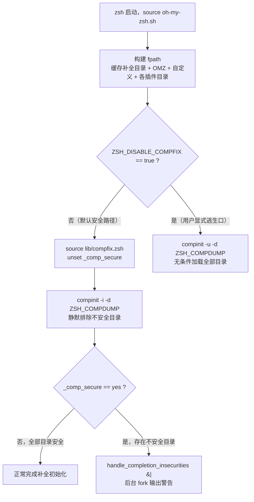
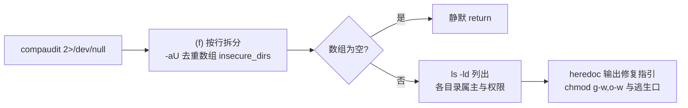

每一台多用户系统上，你的 zsh 补全系统都在从一组目录加载以 shell 代码形式编写的补全脚本——如果其中某个目录对所有用户可写，任何本地用户都能在其中植入恶意补全文件，并让它在你的交互式 shell 中被执行。oh-my-zsh 为此构建了一条轻量但完整的安全防线：由 zsh 原生的 `compaudit`/`compinit` 完成审计与排除，由 `lib/compfix.zsh` 中的 `handle_completion_insecurities` 完成人性化告警，由 `oh-my-zsh.sh` 主脚本中的双分支逻辑决定加载策略。本文逐一解剖这三层结构，并给出权限修复与逃生口（`ZSH_DISABLE_COMPFIX`）的实践指引。

Sources: [compfix.zsh](lib/compfix.zsh#L1-L44)、[oh-my-zsh.sh](oh-my-zsh.sh#L233-L244)

## 威胁模型：补全目录为何是攻击面

zsh 的补全初始化会扫描 `fpath` 中的所有目录，发现 `_command` 形式的补全文件后将其作为 shell 代码加载进补全系统——这意味着补全目录拥有与 `.zshrc` 同级的执行权限。判断标准由 zsh 的 `compaudit` 定义，oh-my-zsh 在告警文案中对其做了精确复述：目录的"组"与"其他"不可有写权限，且目录属主必须是 root 或当前用户。任何一条不满足，该目录中的补全文件就构成了一个本地提权面：同机的其他用户可以写入补全脚本，在你下一次启动 shell 或触发补全时以你的身份执行。

理解这一点后，oh-my-zsh 的安全立场就不难读懂了——`compfix.zsh` 的告警原文是"出于安全考虑，在这些目录的权限与属主被修复并重启 zsh 之前，我们不会从这些目录加载补全"。注意这是**默认排除**而非默认放行：安全策略的取向是宁可缺失补全功能，也不引入代码执行风险。

Sources: [compfix.zsh](lib/compfix.zsh#L29-L37)

## zsh 原生基石：compaudit 与 compinit 的分工

值得澄清的一个常见误解是：`compinit` 并不在 `lib/completion.zsh` 中调用——通读该文件会发现它只负责补全行为配置（zstyle 菜单、大小写匹配、bash 补全兼容），真正的初始化发生在主脚本 `oh-my-zsh.sh` 中。第 79 行的 `autoload -U compaudit compinit zrecompile` 表明这两个审计函数是按需从 `fpath` 解析加载的；而 oh-my-zsh 仓库根目录下并不存在 `functions/` 或 `completions/` 目录，因此实际解析到的是 zsh 发行版自带的实现，oh-my-zsh 并不重写审计逻辑本身。

`compinit` 提供了三种与安全相关的调用模式，oh-my-zsh 精确使用了其中两种非交互模式：

| 模式 | 调用形式 | 遇到不安全目录时的行为 | oh-my-zsh 是否使用 |
|------|----------|------------------------|---------------------|
| 交互模式 | `compinit`（无标志） | 逐个目录询问用户是否忽略，阻塞启动等待输入 | 否 |
| 排除模式 | `compinit -i` | 静默排除不安全目录，并将标志变量 `_comp_secure` 置为 `yes` | 是（默认路径） |
| 不安全模式 | `compinit -u` | 无条件从所有目录加载，完全跳过审计 | 是（`ZSH_DISABLE_COMPFIX=true` 时） |

排除模式与不安全模式之间的关键桥梁是 `_comp_secure` 标志：根据 `oh-my-zsh.sh` 第 236-237 行注释的约定，`compinit -i` 在排除不安全条目时会设置该标志。这个设计的巧妙之处在于它是**布尔信号**而非目录清单——compinit 只告诉调用者"是否存在问题"，而把"问题是什么"的枚举工作留给了 oh-my-zsh 的包装函数（下文详述）。另外，选择 `-i`/`-u` 两种非交互模式本身就排除了启动过程被 y/n 询问挂起的可能。

Sources: [oh-my-zsh.sh](oh-my-zsh.sh#L76-L79)、[oh-my-zsh.sh](oh-my-zsh.sh#L233-L238)、[completion.zsh](lib/completion.zsh#L1-L79)

## 决策中枢：oh-my-zsh.sh 的双分支加载逻辑

安全检查的完整决策流程发生在主脚本的核心分支中。下图描述了从 shell 启动到补全加载的完整路径：

这段 12 行代码（第 233-244 行）有三个值得逐字品读的细节。其一是 `unset _comp_secure`：注释明确说明这是为了复位 compinit 设置的标志——如果用户在同一会话中重新 source 过 `oh-my-zsh.sh`，残留的 `yes` 值会让一次完全干净的审计仍然触发过期告警。其二是 `compinit -i -d "$ZSH_COMPDUMP"`：`-d` 参数将补全缓存重定向到按主机名与 zsh 版本命名的 dump 文件，缓存机制本身属于上一篇的议题。其三则是告警调用末尾的 `&|`——这是 zsh 的"后台执行并脱离作业表"语法，`handle_completion_insecurities` 被放进一个 fork 出的后台进程中运行，即使 `compaudit` 需要遍历大量目录，也不会阻塞提示符的出现。

Sources: [oh-my-zsh.sh](oh-my-zsh.sh#L233-L244)

## 告警解剖：handle_completion_insecurities 的实现

`lib/compfix.zsh` 全文只有一个 44 行的函数，但它解决了一个 compinit 留下的信息缺口：`-i` 模式只暴露 `_comp_secure` 布尔标志，不暴露被排除的目录清单，因此 oh-my-zsh 只能重新调用一次 `compaudit` 来枚举问题目录。函数的执行路径如下图：

实现中的每一处技术选择都有明确的防御意图。第 18 行的 `${(f@):-"$(compaudit 2>/dev/null)"}` 一举完成了命令替换、按行拆分（`(f)` 标志）与压制 stderr 三个动作——注释解释了压制 stderr 的原因：`compaudit` 会把 "There are insecure directories:" 这样的标题行打到 stderr，若不压制会作为噪音泄漏给用户，而 stdout 中的纯路径列表才是函数真正想要的输入。承接输出的容器 `local -aU insecure_dirs` 同样精打细算：`-a` 声明数组、`-U` 保证唯一性（`compaudit` 可能输出同一目录的多个层级路径，注释示例中 `/usr/share/zsh` 与其子目录同时出现），`local` 则把状态封锁在函数作用域内。

若数组为空，函数在第 21 行即刻返回——这是零开销的正常路径。一旦检测到问题，第 25 行的 `ls -ld` 会把每个不安全目录的属主与权限位直接展示给用户，让"哪里不安全"成为可自行验证的事实；随后的大段 heredoc 给出可复制的修复命令 `compaudit | xargs chmod g-w,o-w`，并在结尾交代了唯一的逃生口：在 source oh-my-zsh 之前设置 `ZSH_DISABLE_COMPFIX="true"`。

Sources: [compfix.zsh](lib/compfix.zsh#L5-L25)、[compfix.zsh](lib/compfix.zsh#L27-L43)

## 审计范围：fpath 的构建顺序决定了检查什么

安全检查的对象是最终进入 `compinit` 视野的整个 `fpath`，因此主脚本在调用 compinit 之前的目录注入顺序，就是审计范围的边界。oh-my-zsh 依次注入四类路径，且全部插在 `fpath` 头部以获得最高优先级：

| 注入顺序 | 路径 | 代码位置 | 说明 |
|----------|------|----------|------|
| 1 | `$ZSH_CACHE_DIR/completions` | [oh-my-zsh.sh L66-L68](oh-my-zsh.sh#L66-L68) | 缓存目录，不存在则 `mkdir -p` 创建，属主必然是当前用户 |
| 2 | `$ZSH/functions`、`$ZSH/completions` 与 `$ZSH_CUSTOM` 对应目录 | [oh-my-zsh.sh L76](oh-my-zsh.sh#L76) | 发行版内置与用户自定义目录 |
| 3 | 各启用插件的目录 | [oh-my-zsh.sh L90-L98](oh-my-zsh.sh#L90-L98) | 在 compinit 之前注入，保证插件自带的 `_plugin` 补全文件纳入审计扫描 |

这里有一个对插件作者与安全审计者都重要的时序细节：插件目录在 compinit 之前进入 `fpath`（其 `_*` 补全文件由 compinit 扫描并接受权限审计），但插件主文件 `.plugin.zsh` 是在 compinit 之后才被 source 的——插件运行时通过 `compdef` 向已初始化的补全系统注册函数。换言之，审计只覆盖 fpath 中静态存在的补全文件，而不是运行时注册行为；这些 `_plugin` 文件通常位于用户自己的 `$ZSH`/`$ZSH_CUSTOM` 目录树下，属主条件天然满足。

Sources: [oh-my-zsh.sh](oh-my-zsh.sh#L66-L68)、[oh-my-zsh.sh](oh-my-zsh.sh#L76-L98)

## 修复实践与逃生口：ZSH_DISABLE_COMPFIX

当你看到 `[oh-my-zsh] Insecure completion-dependent directories detected` 告警时，正确的处置顺序是先修复、后逃生。优先方案是按告警中的指引收紧权限——移除"组"与"其他"的写位，并把属主改回 root 或当前用户：

| 场景 | 命令 | 效果 |
|------|------|------|
| 标准修复 | `compaudit \| xargs chmod g-w,o-w` | 逐个移除不安全目录的组写与其他写权限 |
| 属主漂移 | `compaudit \| xargs chown $(whoami)` | 将目录属主改回当前用户（需对应目录权限） |
| 验证 | `compaudit` | 输出为空即表示全部目录通过审计，重启 zsh 后告警消失 |

只有当权限模型与审计假设根本性不匹配时——例如网络文件系统或容器/Windows 挂载把目录属主映射为无法对应到当前用户的身份，导致告警无法通过合法手段消除——才应考虑逃生口。启用方式是把 `ZSH_DISABLE_COMPFIX="true"` 写在 `.zshrc` 中 **source oh-my-zsh.sh 之前**（该检查在主脚本第 233 行进行，晚设置无效），效果是彻底走 `-u` 分支：`lib/compfix.zsh` 甚至不会被 source，补全将从所有目录无条件加载。这也意味着告警文案本身就是该变量在仓库内的唯一文档——zshrc 模板与 README 均未提及它，设计者显然有意让这个开关只能通过阅读告警或源码获得，提高了误用的门槛。需要明确的是：逃生口免除的是"告警"，不是"风险"，开启后恶意目录中的补全脚本将以你的 shell 权限执行。

Sources: [compfix.zsh](lib/compfix.zsh#L33-L41)、[oh-my-zsh.sh](oh-my-zsh.sh#L233-L244)

## 工程复盘与延伸阅读

从架构视角回看，这条安全防线体现了三层职责分离：zsh 原生函数负责**判定**（compaudit 审计标准与 compinit 排除行为）、`compfix.zsh` 负责**呈现**（枚举、展示与修复指引）、主脚本负责**策略**（默认安全、显式逃生、后台告警不伤启动性能）。唯一可见的代价是不安全环境下 `compaudit` 会被执行两次——一次在 `compinit -i` 内部用于排除决策，一次在告警函数中用于枚举清单——但通过 `&|` 后台化，这个代价被完全移出了启动关键路径。若你想深入补全缓存与 zcompdump 的再生机制，或了解压缩启动 fork 数量的整体策略，请继续阅读：

- 前置知识：[补全系统：compinit 与 zcompdump 缓存优化](11-bu-quan-xi-tong-compinit-yu-zcompdump-huan-cun-you-hua)
- 相邻主题：[键绑定、历史记录与目录导航体验](13-jian-bang-ding-li-shi-ji-lu-yu-mu-lu-dao-hang-ti-yan)
- 性能视角：[启动性能优化：减少 fork 与缓存策略](23-qi-dong-xing-neng-you-hua-jian-shao-fork-yu-huan-cun-ce-lue)
- 故障排查：[诊断转储 omz_diagnostic_dump 与故障排查](24-zhen-duan-zhuan-chu-omz_diagnostic_dump-yu-gu-zhang-pai-cha)