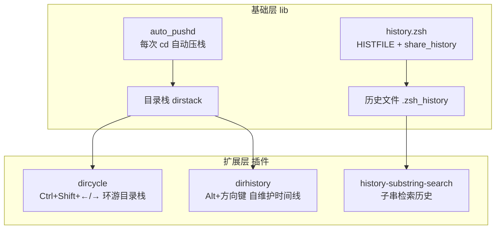

oh-my-zsh 除了主题与插件两大明星特性之外，真正决定"手感"的是 `lib/` 目录下的三个交互体验文件：`key-bindings.zsh`（行编辑键绑定）、`history.zsh`（历史记录策略）与 `directories.zsh`（目录导航）。本页从架构视角逐一解析这三个文件的实现机制、设计意图与可定制入口，并说明目录栈相关插件（如 `dircycle`、`dirhistory`）如何在这套地基之上扩展出进阶体验。理解它们是诊断"按键不生效"、"历史丢失"或"目录跳转混乱"这类问题的基础。

## 体验层的加载位置与顺序

三个文件并非被单独引用，而是由主脚本通过一条通配循环统一加载的：`for lib_file ("$ZSH"/lib/*.zsh)` 按**字母序**依次 source，因此实际顺序为 `directories.zsh` → `history.zsh` → `key-bindings.zsh`，且全部位于插件和主题加载之前。这个顺序是一个刻意的设计杠杆——键绑定、历史选项与目录别名先建立"基线"，随后加载的插件和主题可以合法地覆盖它们（例如 `vi-mode` 插件会在之后重新绑定按键切换为 vi 模式）。加载入口 `_omz_source` 还提供了两个机制：优先从 `$ZSH_CUSTOM/lib/` 读取同名文件实现**用户级覆盖**，以及通过 `zstyle ':omz:lib:<name>' aliases` 开关控制该文件中的别名是否生效（后者详见 [别名体系与 zstyle 定制开关（按模块跳过别名）](15-bie-ming-ti-xi-yu-zstyle-ding-zhi-kai-guan-an-mo-kuai-tiao-guo-bie-ming)）。

Sources: [oh-my-zsh.sh](oh-my-zsh.sh#L308-L313)
Sources: [oh-my-zsh.sh](oh-my-zsh.sh#L287-L291)
Sources: [oh-my-zsh.sh](oh-my-zsh.sh#L276-L277)

## 键绑定：terminfo 感知的行编辑基线

`key-bindings.zsh` 的第一件事是解决终端按键序列的可靠性问题。它注册了 `zle-line-init` / `zle-line-finish` 两个 ZLE 钩子，在行编辑器激活时执行 `echoti smkx`（进入应用模式）、退出时执行 `echoti rmkx`（恢复）——因为只有应用模式下 `$terminfo` 中的按键码（如 `kcuu1` 上箭头）才会被终端真正发送。这是许多"Home/End/PageUp 不工作"问题的官方修复方案。随后 `bindkey -e` 将默认键位设为 **emacs 模式**，作为所有后续绑定的基线。

Sources: [key-bindings.zsh](lib/key-bindings.zsh#L5-L16)
Sources: [key-bindings.zsh](lib/key-bindings.zsh#L18-L19)

文件中最能体现工程质量的是一套**三键位映射统一绑定模式**：所有与方向键相关的绑定都会同时在 `emacs`、`viins`、`vicmd` 三个 keymap 中注册，保证用户切换到 vi 插件后方向键行为依然一致。同时每处绑定都遵循"硬编码转义序列 + terminfo 查询双保险"策略：先绑定字面序列 `"^[[A"`，再在 `terminfo[kcuu1]` 非空时补充绑定，以覆盖不同终端类型的转义码差异。核心键位全貌如下：

| 按键 | 绑定的 Widget | 作用 |
|---|---|---|
| ↑ / ↓ | `up-line-or-beginning-search` / `down-line-or-beginning-search` | **前缀模糊搜历史**：光标后无内容时翻历史，有内容时按已输入前缀检索 |
| PageUp / PageDown | `up-line-or-history` / `down-line-or-history` | 逐行翻阅历史 |
| Home / End | `beginning-of-line` / `end-of-line` | 行首 / 行尾 |
| Shift-Tab | `reverse-menu-complete` | 补全菜单反向选择 |
| Backspace / Delete | `backward-delete-char` / `delete-char` | Delete 在 `terminfo[kdch1]` 缺失时回退绑定 `^[[3~` 与 `^[3;5~` |
| Ctrl-Delete | `kill-word` | 向前删除整个单词 |
| Ctrl-← / Ctrl-→ | `backward-word` / `forward-word` | 按词移动 |
| Ctrl-r | `history-incremental-search-backward` | 增量反查历史 |
| Ctrl-X Ctrl-E | `edit-command-line` | 在 `$VISUAL`/`$EDITOR` 中编辑当前命令行 |
| Esc-m | `copy-prev-shell-word` | 复制上一条命令的最后一个词（改文件名的经典快捷方式） |
| Esc-w / Esc-l | `kill-region` / `^q ls\n` | 区域删除 / 快速执行 `ls` |
| 空格 | `magic-space` | 立即展开 `!$` 等历史扩展，所见即所得 |

Sources: [key-bindings.zsh](lib/key-bindings.zsh#L21-L45)
Sources: [key-bindings.zsh](lib/key-bindings.zsh#L54-L71)
Sources: [key-bindings.zsh](lib/key-bindings.zsh#L73-L97)
Sources: [key-bindings.zsh](lib/key-bindings.zsh#L99-L111)
Sources: [key-bindings.zsh](lib/key-bindings.zsh#L114-L123)
Sources: [key-bindings.zsh](lib/key-bindings.zsh#L126)

其中 ↑/↓ 的 `up-line-or-beginning-search` 值得单独强调：它是**键绑定层与历史层的桥梁**。与 zsh 默认的 `up-line-or-history`（机械逐条回溯）不同，这个 widget 在命令行已有内容时只匹配以该内容开头的历史命令——输入 `git` 后按 ↑，只会在历史中的 `git` 命令间循环，无需进入 Ctrl-r 的交互搜索。此外，`misc.zsh` 通过将 `self-insert` widget 替换为 `url-quote-magic`、并注册 `bracketed-paste-magic`，让粘贴 URL 时自动转义特殊字符，是同一"输入体验层"的姊妹机制。

Sources: [key-bindings.zsh](lib/key-bindings.zsh#L34-L45)
Sources: [misc.zsh](lib/misc.zsh#L8-L12)

## 历史记录：omz_history 包装器与六项去重策略

`history.zsh` 分为两半：上半部分定义 `omz_history` 函数并按 `$HIST_STAMPS` 生成 `history` 别名，下半部分设置历史文件参数与 setopt。配置策略遵循**只抬升不下压**原则——`[ "$HISTSIZE" -lt 50000 ] && HISTSIZE=50000` 意味着仅在用户未设置或设得更小时才启用默认值（50000 条内存 / 10000 条落盘），用户在 `.zshrc` 中提前设置的更大值会被尊重。历史文件默认落在 `$HOME/.zsh_history`。

| setopt | 效果 |
|---|---|
| `extended_history` | 历史文件记录每条命令的时间戳与执行时长 |
| `hist_expire_dups_first` | 超出容量时优先淘汰重复条目 |
| `hist_ignore_dups` | 连续重复的命令只记一条 |
| `hist_ignore_space` | **空格开头**的命令不入史（输入密码、token 的隐私保护手段） |
| `hist_verify` | 执行 `!!` 等历史扩展前先回显展开结果，回车确认才真正运行 |
| `share_history` | 多终端**实时共享**历史：A 窗口的命令 B 窗口按 ↑ 即可看到 |

Sources: [history.zsh](lib/history.zsh#L37-L40)
Sources: [history.zsh](lib/history.zsh#L42-L48)

`history` 命令本身被重定向到 `omz_history` 包装器，解决两个原生痛点。其一，原生 `history` 不带参数时行为含糊，包装器在无参数时强制 `fc -l 1` 显示**从第 1 条开始的完整历史**。其二，`-c` 清空历史是危险操作，包装器加入了交互确认（"This action will irreversibly delete your command history"），确认后用 `print -nu2 >| "$HISTFILE"` 清空文件并 `fc -p` 重挂载。参数解析用 `zparseopts -E -D` 完成，将 `-f`/`-E`/`-i`/`-t` 时间戳选项透传给底层 `fc`。

Sources: [history.zsh](lib/history.zsh#L1-L26)

时间戳格式是用户在 `.zshrc` 中的标准定制入口，模板文件对此有完整注释说明。`HIST_STAMPS` 的取值在 case 分支中映射为不同的 `fc` 时间戳选项，进而生成不同的 `history` 别名：

| HIST_STAMPS 取值 | 生成的别名 | 显示格式 |
|---|---|---|
| （未设置） | `omz_history` | 纯序号 |
| `"mm/dd/yyyy"` | `omz_history -f` | 月/日/年 |
| `"dd.mm.yyyy"` | `omz_history -E` | 日.月.年 |
| `"yyyy-mm-dd"` | `omz_history -i` | ISO 8601 |
| 自定义 strftime 串 | `omz_history -t '<格式>'` | 任意 strftime 格式 |

Sources: [history.zsh](lib/history.zsh#L28-L35)
Sources: [zshrc.zsh-template](templates/zshrc.zsh-template#L60-L66)

## 目录导航：auto_pushd 目录栈与数字跳转

`directories.zsh` 用四个 setopt 把 zsh 的目录栈（dirstack）变成默认行为，这是整个导航体验的核心。`auto_cd` 允许直接输入目录名代替 `cd 目录名`；`auto_pushd` 让**每一次 cd 都自动压栈**，从此"你去过哪里"有了系统级记录；`pushd_ignore_dups` 去除栈中重复项；`pushdminus` 将 `pushd +N/-N` 的语义对齐 `cd -N` 的直觉方向。在此基础上叠加两层别名：全局别名 `...` 到 `......` 逐级回退多级父目录；普通别名 `-` 跳回上一个目录，而数字别名 `1` 到 `9` 直接执行 `cd -1` 到 `cd -9`，按编号跳转到目录栈中的任意一站。

| 机制 | 示例 | 行为 |
|---|---|---|
| `auto_cd` | `projects` | 等价于 `cd projects` |
| `auto_pushd` | 任意 `cd` | 目录自动压入目录栈 |
| `cd -` / 别名 `-` | `-` | 返回上一个目录 |
| `cd -3` / 别名 `3` | `3` | 跳转到 `dirs -v` 列表第 3 项 |
| 全局别名 `...` | `ls ...` | 展开为 `../..`，可在任意命令中使用 |
| `d` 函数 | `d` | 显示目录栈前 10 项（带编号），`d -c` 等参数透传给 `dirs` |
| `md` / `rd` | `md a/b/c` | `mkdir -p` / `rmdir` 简写 |

Sources: [directories.zsh](lib/directories.zsh#L2-L5)
Sources: [directories.zsh](lib/directories.zsh#L8-L25)
Sources: [directories.zsh](lib/directories.zsh#L27-L34)

`d` 函数是这套体系的**可视化入口**：无参数时执行 `dirs -v | head -n 10`，把当前目录栈以带编号列表的形式展示出来，这些编号正是 `1`-`9` 别名所对应的目标。文件末尾的 `lsa`/`l`/`ll`/`la` 四个 `ls` 变体虽然属于列目录体验，但严格说是浏览行为而非导航行为，此处仅作定位说明。同样的加载机制下，这些别名同样受 `zstyle ':omz:lib:directories' aliases no` 开关控制（机制详见 [别名体系与 zstyle 定制开关（按模块跳过别名）](15-bie-ming-ti-xi-yu-zstyle-ding-zhi-kai-guan-an-mo-kuai-tiao-guo-bie-ming)）。

Sources: [directories.zsh](lib/directories.zsh#L27-L34)
Sources: [directories.zsh](lib/directories.zsh#L37-L40)

## 从地基到进阶：目录栈插件的扩展路径

`auto_pushd` 维护的目录栈是后续导航插件的公共数据源，理解这一点就能看清插件体系的分层。`dircycle` 插件把"栈内环游"绑到 Ctrl+Shift+方向键上：`insert-cycledleft` 执行 `pushd +1` 换到栈中下一站，并手动触发 `chpwd` 钩子与 `zle reset-prompt` 刷新提示符；`switch-to-dir` 函数还处理了目标目录已被删除的边界情况——自动 `popd` 掉失效条目后重试。`dirhistory` 插件则不依赖 dirstack，而是维护独立的 `dirhistory_past`/`dirhistory_future` 数组（容量 `DIRHISTORY_SIZE=30`），实现 Alt+←/→ 的时间线式前进后退，以及 Alt+↑/↓ 的目录层级上下移动。

| 插件 | 数据源 | 按键 | 导航模型 |
|---|---|---|---|
| 内置（lib） | dirstack | `1`-`9`、`-` | 编号直达 + 单步回退 |
| dircycle | dirstack | Ctrl+Shift+←/→/↑/↓ | 环形循环 + 层级移动 |
| dirhistory | 自维护数组 | Alt+←/→/↑/↓ | 浏览器式前进/后退 + 层级移动 |

Sources: [dircycle.plugin.zsh](plugins/dircycle/dircycle.plugin.zsh#L33-L41)
Sources: [dircycle.plugin.zsh](plugins/dircycle/dircycle.plugin.zsh#L84-L87)
Sources: [dirhistory.plugin.zsh](plugins/dirhistory/dirhistory.plugin.zsh#L1-L14)
Sources: [dirhistory.plugin.zsh](plugins/dirhistory/dirhistory.plugin.zsh#L38-L58)

按频度选型即可：偶尔回跳用内置的 `-` 和数字别名足够；多项目间频繁切换装 `dircycle`；需要"撤销误 cd"的时间线语义则选 `dirhistory`。历史检索同理——前缀搜索已内置于 ↑ 键，需要**任意子串**匹配再启用 `history-substring-search`，按目录隔离历史则是 `per-directory-history`。这些插件的加载机制本身见 [插件加载机制与开发命名约定](16-cha-jian-jia-zai-ji-zhi-yu-kai-fa-ming-ming-yue-ding)，经典工具类插件的深度解析见 [经典插件解析：git、extract、fzf 与实用工具类](18-jing-dian-cha-jian-jie-xi-git-extract-fzf-yu-shi-yong-gong-ju-lei)。

## 定制入口速查

三个文件的定制方式各不相同，取决于修改目标是"数值"、"策略"还是"行为替换"。数值类（历史容量、时间戳格式）在 `~/.zshrc` 中 `source $ZSH/oh-my-zsh.sh` **之前**设置即可被尊重；行为替换（改键位、换函数）优先使用 `$ZSH_CUSTOM/lib/` 同名文件覆盖机制，避免直接改动仓库文件导致升级冲突。

| 定制目标 | 方法 | 生效位置 |
|---|---|---|
| 历史时间戳格式 | `.zshrc` 中设 `HIST_STAMPS="yyyy-mm-dd"` | `history.zsh` 的 case 分支 |
| 历史容量上限 | `source` 前设 `HISTSIZE=100000` | `history.zsh` 的只抬升逻辑放行 |
| 关闭某文件别名 | `zstyle ':omz:lib:directories' aliases no` | `_omz_source` 加载包装 |
| 增删键绑定 | `.zshrc` 尾部直接 `bindkey`（最晚加载，拥有最终覆盖权） | 覆盖 emacs 基线 |
| 整体替换某个 lib 文件 | 在 `$ZSH_CUSTOM/lib/` 放同名文件 | `_omz_source` 优先读取 custom |

Sources: [history.zsh](lib/history.zsh#L37-L40)
Sources: [oh-my-zsh.sh](oh-my-zsh.sh#L287-L291)
Sources: [oh-my-zsh.sh](oh-my-zsh.sh#L308-L313)

至此，omz 的三个体验基石——按键如何映射到 ZLE widget、历史如何在多会话间流动、目录如何被自动记录与跳转——已经完整呈现。建议的下一步阅读：想理解这些文件加载前的补全系统初始化，请前往 [补全系统：compinit 与 zcompdump 缓存优化](11-bu-quan-xi-tong-compinit-yu-zcompdump-huan-cun-you-hua)；想全面掌握 `zstyle` 定制体系，请前往 [别名体系与 zstyle 定制开关（按模块跳过别名）](15-bie-ming-ti-xi-yu-zstyle-ding-zhi-kai-guan-an-mo-kuai-tiao-guo-bie-ming)。