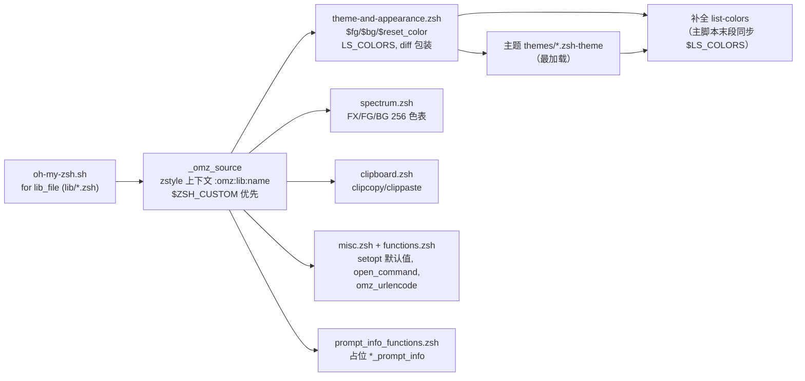
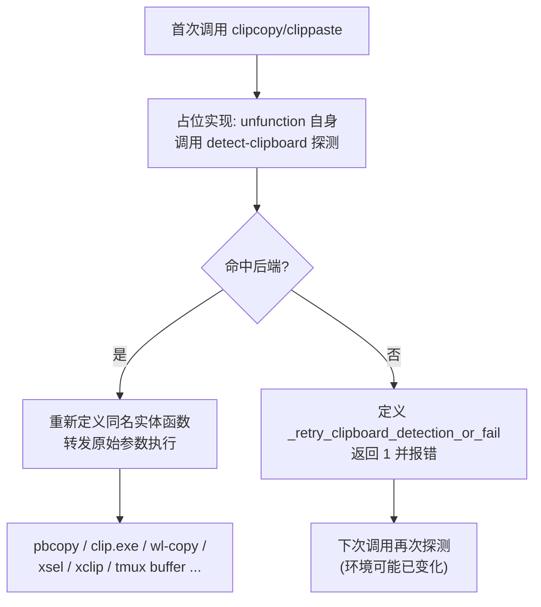
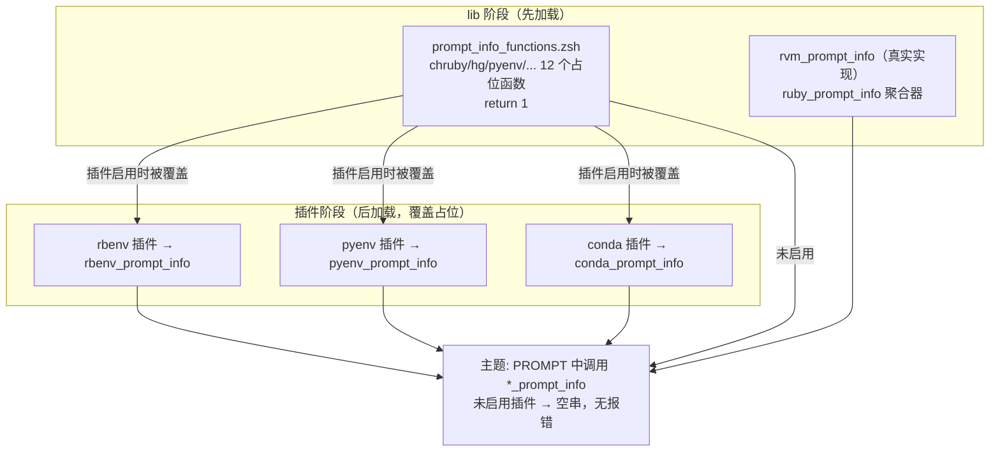

本页解读 oh-my-zsh 中承担"基础设施层"角色的五个 lib 模块：`theme-and-appearance.zsh`（颜色变量与 ls/diff 外观）、`spectrum.zsh`（256 色频谱表）、`clipboard.zsh`（跨平台剪贴板抽象）、`misc.zsh` 与 `functions.zsh`（通用辅助函数），以及 `prompt_info_functions.zsh`（提示符占位函数）。它们本身不直接改变用户可见行为，而是为**主题**和**插件**提供可复用的底层服务——理解这一层，是编写主题与插件的前置知识。

## 加载上下文：字母序加载与模块级 zstyle 上下文

这五个文件没有独立的加载入口——主脚本 `oh-my-zsh.sh` 按 glob 字母序遍历 `lib/*.zsh` 并逐一 source，因此 `spectrum.zsh` 先于 `theme-and-appearance.zsh` 无关紧要，各文件之间不存在顺序耦合。加载时 `_omz_source` 会为每个文件构造 `:omz:lib:<文件名>` 的 zstyle 上下文，并优先从 `$ZSH_CUSTOM/lib/` 覆盖加载同名文件，这让用户可以无侵入地替换任意 lib 模块。此外，主题加载完成后，主脚本会把 `$LS_COLORS` 同步给补全系统的 `list-colors`，使补全菜单颜色与 `ls` 着色保持一致——这正是本页外观模块的输出被框架末段消费的直接证据。

关于 `_omz_source` 中按模块禁用别名的 `zstyle ':omz:lib:<名称>' aliases no` 开关，属于别名体系范畴，详见 [别名体系与 zstyle 定制开关（按模块跳过别名）](15-bie-ming-ti-xi-yu-zstyle-ding-zhi-kai-guan-an-mo-kuai-tiao-guo-bie-ming)；整体加载流程的逐段解读见 [启动加载流程：oh-my-zsh.sh 主脚本逐段解读](10-qi-dong-jia-zai-liu-cheng-oh-my-zsh-sh-zhu-jiao-ben-zhu-duan-jie-du)。

Sources: [oh-my-zsh.sh](oh-my-zsh.sh#L267-L313), [oh-my-zsh.sh](oh-my-zsh.sh#L346-L347)

## 颜色变量与外观基础：theme-and-appearance.zsh

文件第一行注释即其职责声明："Sets color variable such as $fg, $bg, $color and $reset_color"。它通过 `autoload -U colors && colors` 初始化 zsh 内建的颜色系统，随后立即执行 `setopt prompt_subst`——这是所有主题能工作的前提：没有它，`PROMPT` 中的变量和命令替换不会被展开。文件同时定义了主题可覆盖的提示符片段默认值：`ZSH_THEME_GIT_PROMPT_PREFIX/SUFFIX/DIRTY/CLEAN` 与 `ZSH_THEME_RUBY_PROMPT_PREFIX/SUFFIX`，主题加载在 lib 之后，因此主题中的同名赋值会自然覆盖这些默认值。

Sources: [theme-and-appearance.zsh](lib/theme-and-appearance.zsh#L1-L13)

## 命令探测缓存：一天有效期的探针结果

该文件的核心工程亮点是 `__omz_test_cmd_args` 探测函数。判断"系统里是否支持 `diff --color`"或"`gls --color` 是否可用"这类问题需要实际 fork 一个进程执行命令，而答案在同一台机器上一整天都不会变——因此文件用 `typeset -A __omz_probes` 关联数组缓存结果，并把缓存持久化到 `$ZSH_CACHE_DIR/appearance-probes` 文件（通过 glob `(Nm-1)` 只接受一天内的缓存文件，过期即重新探测）。缓存写入前还检查 `$ZSH_CACHE_DIR` 可写性，避免在只读环境下报错。所有探测结束后，`unfunction` 与 `unset` 把这些临时符号从全局命名空间清除——不留任何运行时痕迹。

Sources: [theme-and-appearance.zsh](lib/theme-and-appearance.zsh#L16-L38), [theme-and-appearance.zsh](lib/theme-and-appearance.zsh#L103-L104)

探测结果的第一个消费者是 `diff`：若 `diff --color /dev/null /dev/null` 探测成功，则定义一个自动附加 `--color` 的 `diff` 包装函数。这与 `lib/grep.zsh` 中的探测缓存是同一套模式，属于 oh-my-zsh 减少 shell 启动 fork 的系统性策略（详见 [启动性能优化：减少 fork 与缓存策略](23-qi-dong-xing-neng-you-hua-jian-shao-fork-yu-huan-cun-ce-lue)）。

Sources: [theme-and-appearance.zsh](lib/theme-and-appearance.zsh#L40-L45)

## ls 着色策略：按 $OSTYPE 分支的兼容层

ls 着色逻辑被包在一个匿名函数 `() { ... }` 中执行，注释明确说明这样做的目的：让函数体内的提前 `return` 仍能落到文件末尾的清理代码。整个逻辑遵循三条规则：用户设置 `DISABLE_LS_COLORS=true` 时整体跳过；BSD 系 `ls` 用 `$LSCOLORS`、GNU 系用 `$LS_COLORS`，其中 `$LS_COLORS` 优先通过 `dircolors` 生成（尊重用户已有的 `~/.dircolors` 配置），无 `dircolors` 时回退到一段与 LSCOLORS 等价的硬编码默认值；最后按 `$OSTYPE` 分支决定 `ls` 别名的形式。

| `$OSTYPE` 分支 | 策略 | 实现要点 |
|---|---|---|
| `netbsd*` | 仅当装了 `gls` 才启用 | NetBSD 自带 ls 不支持 `-G`，探测 `gls --color` 后别名 `ls='gls --color=tty'` |
| `openbsd*` | 优先 `colorls`，回退 `gls` | base 系统的 `colorls` 支持色彩与多字节，明确安装的不被 coreutils 抢占 |
| `(darwin\|freebsd)*` | 默认 `ls -G` 走 LSCOLORS | 仅当用户用 zstyle 显式开启 `gnu-ls` 且 `gls` 存在时才改用 `gls --color=tty` |
| 其他（Linux 等） | 探测式降级 | 先试 `ls --color`，失败再试 `ls -G` |

特别值得注意的是 darwin/freebsd 分支中的 `zstyle -t ':omz:lib:theme-and-appearance' gnu-ls`——这是 lib 层少见的用户可配置开关，展示了 lib 模块如何通过 zstyle 暴露定制点而非环境变量。默认 LSCOLORS 值 `Gxfxcxdxbxegedabagacad` 是 oh-my-zsh 自有的配色方案。

Sources: [theme-and-appearance.zsh](lib/theme-and-appearance.zsh#L47-L101)

## 256 色频谱：spectrum.zsh

`spectrum.zsh` 提供 `FX`、`FG`、`BG` 三个全局关联数组（`typeset -AHg`），将 256 色终端的 ANSI 转义码包装成可读的哈希键：`FX` 存放 `bold`、`dim`、`italic`、`underline`、`blink`、`reverse` 等属性及其 `no-` 反向形式；`FG[$code]` 与 `BG[$code]` 分别生成 `\e[38;5;<code>m` 前景与 `\e[48;5;<code>m` 背景序列，且两端包裹 `%{ %}` 以防止转义码污染提示符宽度计算。工程上值得学习的是第 17–26 行：作者用 zsh 数组切片操作（`${^codes}` 逐元素引用 + `${codes:^fg}` 交错合并）替代传统的 256 次循环来建表，这是纯 zsh 语义下的性能优化。

两个诊断函数供用户交互式选色：`spectrum_ls` 逐行打印全部 256 种前景色样张，`spectrum_bls` 同理打印背景色。样张文本可通过 `ZSH_SPECTRUM_TEXT` 变量自定义，默认取自维吉尔《埃涅阿斯纪》开篇 "Arma virumque cano…"。主题作者用它预览配色，是 [主题编写规范：从 robbyrussell 到 agnoster](20-zhu-ti-bian-xie-gui-fan-cong-robbyrussell-dao-agnoster) 的配套调试工具。

Sources: [spectrum.zsh](lib/spectrum.zsh#L5-L26), [spectrum.zsh](lib/spectrum.zsh#L29-L44)

## 剪贴板抽象：clipcopy 与 clippaste

`clipboard.zsh` 定义两个面向用户的函数并声明了完整契约：`<command> | clipcopy` 将管道输入复制到剪贴板，`clipcopy <file>` 复制整个文件内容；`clippaste` 将剪贴板内容写到 stdout，可接管道或重定向。文件头注释明确说明其后端探测启发式"essentially the same as neovim"，即按环境特征依次匹配十种后端，直到命中为止：

| 优先级 | 探测条件 | 后端命令 |
|---|---|---|
| 1 | `$OSTYPE` 为 `darwin*` 且 pbcopy/pbpaste 存在 | `pbcopy` / `pbpaste` |
| 2 | `$OSTYPE` 为 `cygwin*`/`msys*` | 写 `/dev/clipboard` 设备 |
| 3 | `clip.exe` 与 `powershell.exe` 同时存在（WSL） | `clip.exe` / PowerShell `Get-Clipboard` |
| 4 | `$WAYLAND_DISPLAY` 非空且 wl-copy/wl-paste 存在 | `wl-copy` / `wl-paste --no-newline` |
| 5–6 | `$DISPLAY` 非空且存在 xsel 或 xclip | `xsel --clipboard` / `xclip -selection clipboard` |
| 7–8 | 存在 lemonade 或 doitclient | SSH 远程剪贴板转发 |
| 9 | 存在 win32yank | 原生 Windows 剪贴板工具 |
| 10 | Android（`linux-android*`）且有 termux 工具 | `termux-clipboard-set/get` |
| 11 | `$TMUX` 非空且 tmux 存在 | `tmux load-buffer -w` / `save-buffer` |

设计上最精妙的是**惰性探测 + 重试**机制（第 103–107 行）：初次调用时占位实现先 `unfunction` 自身、执行探测、再用 `"$0"` 以原始函数名重新分发调用；若探测失败则返回 1，但下次调用仍会重试——因为用户可能在调用间隙装上了 `xclip` 或进入了 tmux。这套抽象的直接消费者是三个官方插件：`copybuffer`（Ctrl+O 复制当前命令行）、`copyfile`（复制文件内容）与 `copypath`（复制文件绝对路径），它们全部只调用 `clipcopy` 而不关心后端差异。

Sources: [clipboard.zsh](lib/clipboard.zsh#L23-L50), [clipboard.zsh](lib/clipboard.zsh#L51-L107), [copybuffer.plugin.zsh](plugins/copybuffer/copybuffer.plugin.zsh#L1-L14), [copyfile.plugin.zsh](plugins/copyfile/copyfile.plugin.zsh#L1-L12)

## misc.zsh：输入体验与环境的合理默认值

`misc.zsh` 只有 39 行，但集中了四类"体验补丁"。其一是 ZLE 魔法部件：当 `$fpath` 中存在 `url-quote-magic` 且 `DISABLE_MAGIC_FUNCTIONS` 未禁用时，将 `self-insert` 替换为 `url-quote-magic`（自动转义粘贴 URL 中的特殊字符），zsh ≥ 5.1 时还启用 `bracketed-paste-magic`（粘贴内容不被别名展开）；其二是三个 `setopt`：`multios`（支持 `echo >f1 >f2` 多重定向）、`long_list_jobs`、`interactivecomments`（交互式命令行中允许 `#` 注释）；其三是 pager 探测——优先 `less`（并设 `LESS=-R` 支持色彩），回退 `more`，全部通过 `functions.zsh` 提供的 `env_default` 完成以尊重用户已有导出；其四是两个别名：`_`（即 `sudo `）与 `afind`（仅当存在 `ack-grep`/`ack` 时定义）。

Sources: [misc.zsh](lib/misc.zsh#L1-L28), [misc.zsh](lib/misc.zsh#L30-L38)

url-quote-magic 与 bracketed-paste-magic 的按键绑定机制、以及它们与安全粘贴的交互，属于键绑定体验范畴，深入分析见 [键绑定、历史记录与目录导航体验](13-jian-bang-ding-li-shi-ji-lu-yu-mu-lu-dao-hang-ti-yan)。

## functions.zsh：主题与插件的公共工具箱

`functions.zsh` 是 lib 中最大的文件（286 行），按功能可分为四组。第一组是元工具：`zsh_stats` 统计历史记录中使用频率最高的前 20 条命令；`uninstall_oh_my_zsh` 调用卸载脚本；`upgrade_oh_my_zsh` 已废弃，仅打印黄色警告后转发给 `omz update`——函数迁移时保留旧入口并重定向是新命令体系的标准做法（`omz` CLI 详见 [omz 命令行工具：更新、插件与主题管理](6-omz-ming-ling-xing-gong-ju-geng-xin-cha-jian-yu-zhu-ti-guan-li)）。

Sources: [functions.zsh](lib/functions.zsh#L1-L14)

第二组是跨平台 `open_command`：按 `$OSTYPE` 选择打开文件/URL 的命令——macOS 用 `open`、Cygwin 用 `cygstart`、Linux 用 `xdg-open`，但在 WSL（内核含 "icrosoft"）下切换为 `cmd.exe /c start`，且需用 `wslpath -w` 转换路径、对 URL 中的 shell 元字符做 `^` 转义；MSYS 直接用 `start`。此外当 `$BROWSER` 已设置且参数是 http(s) URL 时优先走 `$BROWSER`，注释援引 issue #11098 说明这是为了 SSH 远程场景下转发到本地浏览器。

Sources: [functions.zsh](lib/functions.zsh#L16-L44)

第三组是 `take` 家族的"下载即进入"函数集：`take` 按 URL 形态分发——`.tar.(gz|bz2|xz)` 与 `.tgz` 走 `takeurl`（mktemp 下载、tar 解包、取首个路径成员 cd 进入）、`.zip` 走 `takezip`、git 仓库地址走 `takegit`（clone 后 cd）、否则 `takedir`（`mkdir -p` 并 cd 到最后一个参数）。`mkcd` 是 `takedir` 的别名式等价物。

| 函数 | 输入形态 | 行为 |
|---|---|---|
| `takedir`/`mkcd` | 目录路径 | `mkdir -p` 后 cd 进入 |
| `takeurl` | tar 系压缩包 URL | 下载→解包→cd 进首个成员目录 |
| `takezip` | zip URL | 下载→解包→按 zip 清单解析顶层目录 cd |
| `takegit` | git 远程地址 | clone 后 cd 进仓库 |
| `take` | 任意 | 正则识别后分发至上述四者 |

Sources: [functions.zsh](lib/functions.zsh#L46-L88)

第四组是编程辅助原语：`alias_value`/`try_alias_value` 读取别名展开值（后者无别名时回退原词）；`default` 为未定义变量赋默认值、`env_default` 为未导出变量设默认导出（二者返回值语义化：已存在返回 0，新设置返回 3）——`misc.zsh` 设置 `PAGER` 用的正是后者；最后是 `omz_urlencode`/`omz_urldecode` 这对 RFC 2396 编解码函数。`omz_urlencode` 支持 `-r`（转义保留字符）、`-m`（转义 mark 字符）、`-P`（空格编码为 `%20` 而非 `+`）三个选项，内部先用 `zsh/langinfo` 检测当前编码、非 UTF-8 时经 `iconv` 转换，再用 `LC_ALL=C` 逐字节扫描，并特意用单次 `printf` 与无子 shell 的循环来优化性能（注释点名 Windows 平台 fork 开销）。

Sources: [functions.zsh](lib/functions.zsh#L100-L146), [functions.zsh](lib/functions.zsh#L176-L239), [functions.zsh](lib/functions.zsh#L255-L285)

这对编解码函数是标准的"lib 供插件消费"范例：官方 `web-search` 插件在构造搜索引擎 URL 时调用 `omz_urlencode`（根据目标 URL 是否已有查询参数动态决定是否传 `-P`），拿到完整 URL 后再交给同文件的 `open_command` 打开——两个 lib 函数在一次 `google foo` 别名调用中协同完成整条链路。

Sources: [web-search.plugin.zsh](plugins/web-search/web-search.plugin.zsh#L55-L72)

## prompt_info_functions.zsh：防止主题报错的占位实现

主题作者常希望在提示符中展示 ruby 版本、virtualenv 名称、k8s 上下文等信息，但对应的 `*_prompt_info` 函数由各插件提供——若插件未启用而主题无条件调用，就会触发 `command_not_found` 报错。`prompt_info_functions.zsh` 的解法是预定义一组返回 1 的同名空函数（chruby、rbenv、hg、pyenv、svn、vi_mode、virtualenv、jenv、azure、tf、conda、go 共 12 个），文件头注释明确邀请插件作者把自己的 `*_prompt_info` 加入该清单；插件加载时（lib 之后）其真实实现覆盖占位版本。文件同时提供两个真实实现：`rvm_prompt_info` 检测 `~/.rvm/bin/rvm-prompt` 并按 `ZSH_THEME_RVM_PROMPT_OPTIONS`（默认 "i v g"）取版本信息、用主题前后缀包裹；`ruby_prompt_info` 则是聚合器——依次尝试 rvm、rbenv、chruby 三套版本管理器，任一成功即返回，主题作者因此只需调用一个函数即可兼容三种生态。

Sources: [prompt_info_functions.zsh](lib/prompt_info_functions.zsh#L1-L27), [prompt_info_functions.zsh](lib/prompt_info_functions.zsh#L31-L46)

## 依赖关系总览

五个模块的输出构成一张清晰的消费网络：外观变量与 `setopt prompt_subst` 被所有主题依赖；`$LS_COLORS` 被主脚本同步进补全系统；`clipcopy/clippaste` 被 copybuffer/copyfile/copypath 插件消费；`omz_urlencode` 与 `open_command` 被 web-search 等插件消费；`env_default` 被 misc.zsh 自身消费；占位 `*_prompt_info` 被主题与各版本管理器插件共同消费。这张网络印证了本页标题的定位——**通用辅助层**，它们是框架中"被依赖最多、自身最不显眼"的一层。

Sources: [clipboard.zsh](lib/clipboard.zsh#L1-L21), [functions.zsh](lib/functions.zsh#L143-L146), [theme-and-appearance.zsh](lib/theme-and-appearance.zsh#L1-L5)

## 延伸阅读

- 理解这些 lib 文件在整个启动时序中的位置（compinit → lib → 插件 → 主题），请继续阅读 [启动加载流程：oh-my-zsh.sh 主脚本逐段解读](10-qi-dong-jia-zai-liu-cheng-oh-my-zsh-sh-zhu-jiao-ben-zhu-duan-jie-du)
- 按 lib 模块禁用别名（含本页 misc.zsh 中的 `_`、`afind`）的 zstyle 开关，见 [别名体系与 zstyle 定制开关（按模块跳过别名）](15-bie-ming-ti-xi-yu-zstyle-ding-zhi-kai-guan-an-mo-kuai-tiao-guo-bie-ming)
- 将本页的颜色变量与 `*_prompt_info` 函数用于实际主题编写，请参阅 [主题编写规范：从 robbyrussell 到 agnoster](20-zhu-ti-bian-xie-gui-fan-cong-robbyrussell-dao-agnoster)
- 消费 `clipcopy` 的剪贴板三插件（copybuffer/copyfile/copypath）的使用细节，见 [经典插件解析：git、extract、fzf 与实用工具类](18-jing-dian-cha-jian-jie-xi-git-extract-fzf-yu-shi-yong-gong-ju-lei)