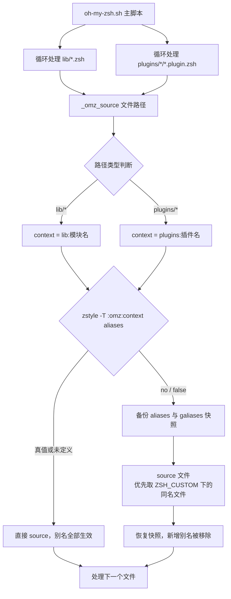
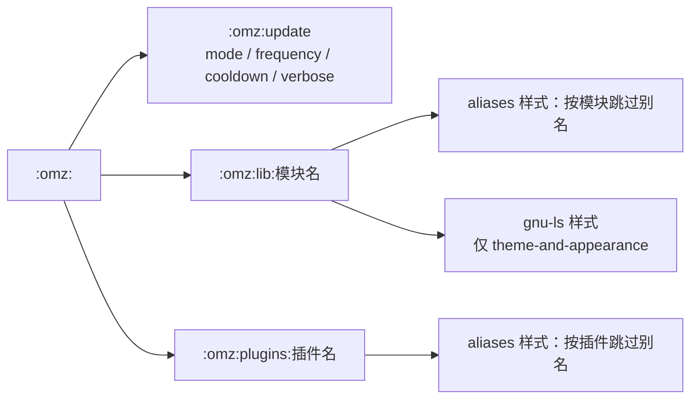

别名是 oh-my-zsh 为用户提供的最直接效率收益，但"一次启用、全量注入"的默认行为常常与用户既有习惯冲突：你可能早已习惯自己的 `ll`，也可能觉得 git 插件的上百个别名污染了命令空间。oh-my-zsh 对此给出的答案是一套精细的**按模块跳过机制**——通过 zsh 原生的 `zstyle` 配置系统，以 `:omz:` 命名空间为每个 lib 模块和插件提供独立的别名开关。本页将从别名的分布入手，逐层拆解 `_omz_source` 函数的快照-回滚设计，并给出可直接落地的定制配置方法。

Sources: [oh-my-zsh.sh](oh-my-zsh.sh#L267-L306)

## 别名的三层来源：lib、插件与用户自定义

oh-my-zsh 启动时，别名从三个层面注入 shell：**lib 核心库**提供基础体验别名，**插件**提供领域别名，**用户自定义**（`.zshrc` 与 `$ZSH_CUSTOM` 下的 `.zsh` 文件）最后加载且拥有最高优先级。加载顺序为：所有 lib 文件 → 所有插件 → 用户自定义 → 主题，前两者分别经由循环调用 `_omz_source` 完成，这正是 zstyle 开关能够覆盖它们的原因。

Sources: [oh-my-zsh.sh](oh-my-zsh.sh#L308-L319)

lib 层的别名集中在少数几个模块中，且多数是条件定义（依赖环境变量或命令探测结果）。下表是完整的 lib 别名清单，也是决定"要跳过哪个模块"时的查询手册：

| lib 模块 | 定义的别名 | 类型 | 用途 |
|---|---|---|---|
| directories.zsh | `...` `....` `.....` `......` | 全局别名（`alias -g`） | 命令行任意位置展开为上 N 级目录 |
| directories.zsh | `-` 及 `1`–`9` | 普通 | 基于目录栈的快速跳转（`cd -N`） |
| directories.zsh | `md` `rd` | 普通 | `mkdir -p` 与 `rmdir` |
| directories.zsh | `lsa` `l` `ll` `la` | 普通 | `ls` 各种详细程度变体 |
| theme-and-appearance.zsh | `ls` | 普通（按平台探测） | 附加颜色参数（`--color`/`-G`/`gls`） |
| misc.zsh | `_` `afind` | 普通（条件） | `sudo ` 前缀；ack 文件内容搜索 |
| correction.zsh | `cp` `man` `mkdir` `mv` `sudo` `su` | 普通（需 `ENABLE_CORRECTION`） | 加 `nocorrect` 前缀避免拼写纠错干扰 |
| grep.zsh | `grep` `egrep` `fgrep` | 普通（能力探测 + 缓存） | 自动着色并排除 VCS 目录 |
| history.zsh | `history` | 普通 | 包装为 `omz_history`，支持时间戳格式 |

Sources: [directories.zsh](lib/directories.zsh#L8-L25), [directories.zsh](lib/directories.zsh#L36-L40)

插件层的别名规模要大得多。以 git 插件为例，文件中设有专门的 "Aliases" 注释分区，从 `g='git'`、`ga='git add'` 一路延伸到文件末尾——整个文件约 450 行，别名占据了大半篇幅。这正是许多用户希望对单个插件整体关闭别名、只保留其函数（如 `git_main_branch`）的动机。

Sources: [git.plugin.zsh](plugins/git/git.plugin.zsh#L97-L135)

## 核心机制：_omz_source 的快照-回滚设计

`_omz_source` 是理解整个开关体系的钥匙。它没有采用粗暴的"先 source 再 `unalias -m '*'`"方案——那会连用户在 `.zshrc` 中提前定义的别名一并清除——而是使用了**快照-回滚**（snapshot-rollback）模式：source 之前备份 zsh 的两个特殊关联数组 `aliases`（普通别名）与 `galiases`（全局别名），source 之后用备份恢复原状。由于恢复操作本质上是一次赋值，source 期间新增的所有别名条目自然消失，而快照中已存在的用户别名完好无损。

Sources: [oh-my-zsh.sh](oh-my-zsh.sh#L279-L305)

回滚的触发由一行 zstyle 查询决定。`zstyle -T ":omz:${context}" aliases` 在样式**未定义或为真值**时返回成功（别名照常保留），只有当用户显式写入假值（`no`/`false`/`off`/`0`）时才置位 `disable_aliases` 标志。这意味着该机制是"默认开启、按需关闭"的设计——不写任何配置的用户行为完全不变。

```zsh
# oh-my-zsh.sh 中的判定逻辑（节选）
local disable_aliases=0
zstyle -T ":omz:${context}" aliases || disable_aliases=1
```

Sources: [oh-my-zsh.sh](oh-my-zsh.sh#L276-L284)

完整的处理流程如下图所示。注意回滚阶段有一个细节分叉：若快照非空，直接用 `aliases=("${(@kv)aliases_pre}")` 重新赋值即可整体覆盖；若快照为空（用户此前没有任何别名），则遍历当前所有别名键显式 `unalias`——两个分支殊途同归，都保证"source 前有的还在，source 中加的没了"。



Sources: [oh-my-zsh.sh](oh-my-zsh.sh#L267-L306)

`_omz_source` 还隐藏了一个次要但实用的行为：source 时**优先查找 `$ZSH_CUSTOM/$filepath`**，存在则用自定义版本替代官方文件。结合别名开关，这构成了两级定制手段——只想屏蔽别名用 zstyle，想彻底改写模块内容则放一个同名文件进 `$ZSH_CUSTOM`。

Sources: [oh-my-zsh.sh](oh-my-zsh.sh#L286-L291)

## `:omz:` 命名空间：上下文构造规则

zstyle 的配置寻址依赖"上下文-样式"二元组。oh-my-zsh 为自己保留的命名空间是 `:omz:`，其下按加载路径自动派生子上下文：lib 文件映射为 `lib:<模块名>`（取文件名去掉 `.zsh` 扩展名），插件映射为 `plugins:<插件名>`（取插件目录名）。构造过程完全自动化，用户只需记住命名规则即可反推出任意模块的开关地址。



Sources: [oh-my-zsh.sh](oh-my-zsh.sh#L271-L274)

命名空间中还存在第三类成员：`:omz:update` 家族控制自动更新行为（`mode`/`frequency`/`cooldown`），由升级脚本在运行时读取。它与别名开关同属 `:omz:` 体系，但属于"更新与运维"主题，本页仅做命名空间层面的定位，细节参见自动更新专页。

Sources: [templates/zshrc.zsh-template](templates/zshrc.zsh-template#L26-L35), [check_for_upgrade.sh](tools/check_for_upgrade.sh#L14-L17)

需要特别区分的是 zsh 补全系统原生的 `:completion:*` 上下文——`lib/completion.zsh` 中大量 `zstyle ':completion:*' ...` 语句（菜单选择、大小写匹配、缓存路径等）服务的是 compinit 补全体系，与 `:omz:` 命名空间互不相干。混写两者是新手常见的配置错误来源。

Sources: [completion.zsh](lib/completion.zsh#L14-L45)

## 三个 zstyle 标志位的语义差异

oh-my-zsh 代码中出现的 `-T`、`-t`、`-s` 三个 zstyle 标志决定了开关的"默认朝向"，这是编写自定义开关时最易混淆的点。差异集中在**样式未定义时的返回值**上：

| 标志 | 语义 | 样式未定义时 | 在 oh-my-zsh 中的角色 |
|---|---|---|---|
| `-T` | 样式为真值则成功 | 返回**真**（视为开启） | 关闭型开关：`aliases`，默认保留别名 |
| `-t` | 样式为真值则成功 | 返回**假**（视为关闭） | 开启型开关：`gnu-ls`，需显式 opt-in |
| `-s` | 将样式字符串值存入变量 | 存入空串 | 取值型配置：`:omz:update` 的 mode/frequency 等 |

Sources: [oh-my-zsh.sh](oh-my-zsh.sh#L276-L277), [theme-and-appearance.zsh](lib/theme-and-appearance.zsh#L89-L91), [check_for_upgrade.sh](tools/check_for_upgrade.sh#L14-L17)

`gnu-ls` 是理解 opt-in 模式的最佳实例：在 macOS/FreeBSD 上，oh-my-zsh 默认用 BSD `ls -G` 着色；只有当用户写入 `zstyle ':omz:lib:theme-and-appearance' gnu-ls yes` 且系统装有 GNU coreutils 的 `gls` 时，才切换为 `alias ls='gls --color=tty'`。这种"写 yes 才生效"的保守策略与 `aliases` 的"写 no 才失效"恰好构成一对镜像。

Sources: [theme-and-appearance.zsh](lib/theme-and-appearance.zsh#L69-L99)

## 实战：按模块跳过别名的配置方法

配置的核心约束只有一条：**所有 zstyle 语句必须写在 `source $ZSH/oh-my-zsh.sh` 之前**。因为 `_omz_source` 在主脚本加载 lib 和插件的过程中就完成了样式查询，写在之后的语句对当次启动无效。操作步骤如下：

1. 打开 `~/.zshrc`，定位到 `source $ZSH/oh-my-zsh.sh` 一行；
2. 在其上方按需写入 zstyle 语句（见下表）；
3. 重启 shell 或执行 `exec zsh`；
4. 用 `whence -v <别名>` 验证：被跳过的模块其别名应显示为 "not found"，函数仍应存在。

常用配置场景速查：

| 需求 | 配置语句 | 效果 |
|---|---|---|
| 跳过目录导航别名（`...`、`1`–`9`、`l`/`ll`） | `zstyle ':omz:lib:directories' aliases no` | `directories.zsh` 的别名全部不生效，`setopt` 行为保留 |
| 跳过 git 插件全部别名 | `zstyle ':omz:plugins:git' aliases no` | `g`、`ga` 等别名消失，`git_main_branch` 等函数保留 |
| 跳过所有插件的别名 | `zstyle ':omz:plugins:*' aliases no` | zstyle 通配符匹配任意插件名 |
| 跳过 lib 全部模块的别名 | `zstyle ':omz:lib:*' aliases no` | 同理，通配符匹配任意 lib 模块 |
| 跳过纠错保护别名 | `zstyle ':omz:lib:correction' aliases no` | `cp`/`mv` 等不再被 `nocorrect` 包裹 |
| 在 macOS 上启用 GNU ls | `zstyle ':omz:lib:theme-and-appearance' gnu-ls yes` | opt-in 开关，需已安装 coreutils |

Sources: [oh-my-zsh.sh](oh-my-zsh.sh#L271-L277)

一个值得知道的细节：`zstyle` 上下文天然支持模式匹配，因此既能精确到单个模块，也能用 `*` 一次性覆盖一族。利用"特化优先于泛化"的 zstyle 查找规则，还可以组合出"全部插件关别名、唯独 git 保留"这类策略——先写 `:omz:plugins:*` 的 `no`，再写 `:omz:plugins:git` 的 `yes` 即可。此外，跳过 `grep` 模块时无需担心其缓存文件：`grep.zsh` 会把别名定义写入 `$ZSH_CACHE_DIR/grep-alias` 并在下次启动 source，但该 source 同样发生在 `_omz_source` 的 source 阶段，其中的别名照样会被快照回滚清除。

Sources: [grep.zsh](lib/grep.zsh#L24-L33), [oh-my-zsh.sh](oh-my-zsh.sh#L293-L305)

## 边界与陷阱

**别名开关只管别名**。这是该机制最重要的边界：`_omz_source` 的快照-回滚仅作用于 `aliases` 与 `galiases` 两个数组，模块在 source 期间定义的函数与设置的 `setopt` 原样保留。例如关闭 `correction` 模块的别名后，其 `setopt correct_all` 依然生效（拼写纠错行为不变，只是不再通过别名绕过）；关闭 `directories` 模块后，`auto_cd`、`auto_pushd` 等 setopt 与 `d` 函数同样还在。如果你的目标是彻底禁用一个模块的行为，跳过别名不足以达成。

Sources: [oh-my-zsh.sh](oh-my-zsh.sh#L279-L305), [correction.zsh](lib/correction.zsh#L1-L10), [directories.zsh](lib/directories.zsh#L1-L5)

**用户既有别名受快照保护，但有时序要求**。在 `.zshrc` 中先于 `source` 语句定义的别名会进入快照，即使匹配的模块开着别名也不会被覆盖——不过由于自定义文件在 lib 和插件之后加载，常规做法仍是在 `$ZSH_CUSTOM/*.zsh` 或 `.zshrc` 尾部定义覆盖别名，这在顺序上天然安全。

Sources: [oh-my-zsh.sh](oh-my-zsh.sh#L315-L325), [templates/zshrc.zsh-template](templates/zshrc.zsh-template#L97-L103)

**主题不在开关覆盖范围内**。主题加载不走 `_omz_source`（独立于 lib/插件循环之后直接 `source`），因此 zstyle 别名开关对主题中定义的别名无效。同时记住历史模块的 `history` 别名虽可跳过，`omz_history` 函数与 `HIST_STAMPS` 时间戳逻辑分属两个层面——跳过别名只是让 `history` 命令回归 zsh 内建行为。

Sources: [oh-my-zsh.sh](oh-my-zsh.sh#L327-L344), [history.zsh](lib/history.zsh#L29-L35)

## 小结与延伸阅读

oh-my-zsh 的别名体系本质上是一个"默认全量、按需裁剪"的两层设计：lib 与插件的别名经由 `_omz_source` 统一注入，zstyle `:omz:` 命名空间则提供模块粒度的关闭开关，快照-回滚机制保证了裁剪过程不会误伤用户既有配置。掌握 `aliases` 样式的地址规则（`lib:<模块名>` / `plugins:<插件名>`）与三个标志位的默认朝向，就掌握了这套体系的全部操作面。

想继续深入，建议按以下路径阅读：

- 回到加载全景：[启动加载流程：oh-my-zsh.sh 主脚本逐段解读](10-qi-dong-jia-zai-liu-cheng-oh-my-zsh-sh-zhu-jiao-ben-zhu-duan-jie-du)
- 理解另一套 zstyle 体系：[补全系统：compinit 与 zcompdump 缓存优化](11-bu-quan-xi-tong-compinit-yu-zcompdump-huan-cun-you-hua)
- 深入别名密集的模块：[键绑定、历史记录与目录导航体验](13-jian-bang-ding-li-shi-ji-lu-yu-mu-lu-dao-hang-ti-yan)
- 机制如何应用于插件开发：[插件加载机制与开发命名约定](16-cha-jian-jia-zai-ji-zhi-yu-kai-fa-ming-ming-yue-ding)
- 查看最大别名集合实例：[经典插件解析：git、extract、fzf 与实用工具类](18-jing-dian-cha-jian-jie-xi-git-extract-fzf-yu-shi-yong-gong-ju-lei)
- `:omz:update` 家族全解：[自动更新机制全解：更新模式与频率控制](22-zi-dong-geng-xin-ji-zhi-quan-jie-geng-xin-mo-shi-yu-pin-lu-kong-zhi)