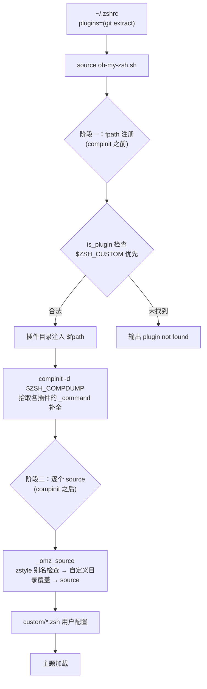

当你在 `.zshrc` 中写下 `plugins=(git)` 时，这行声明如何变成 shell 里真实可用的函数、别名与补全？本页从源码层面回答这个问题：完整追踪 `plugins` 数组从声明到生效的两阶段加载管线，剖析 `omz plugin` 命令族提供的运行时管理能力，并归纳出一个插件若想被 Oh My Zsh 正确识别，其目录与文件必须遵守的命名契约。理解这套机制是编写自定义插件、排查"插件未找到"类问题的前置知识。

## 全景：两阶段加载管线

插件加载被刻意拆分为**两个时序严格的阶段**。阶段一发生在 `compinit` 之前，只做一件事：把每个合法插件的目录注入 `$fpath`，让补全系统稍后能发现其中的 `_<command>` 补全脚本；阶段二发生在 `compinit` 之后，逐个 `source` 插件入口文件，执行其中的别名、函数与键绑定定义。这个拆分不是随意的——补全文件的注册依赖 `$fpath` 先于 `compinit` 就位，而插件行为的注入又依赖补全系统已经初始化完毕。



整个管线的入口由 `.zshrc` 模板固定：`plugins=(git)` 数组声明必须出现在 `source $ZSH/oh-my-zsh.sh` 之前，因为主脚本在第 90 行的 `for plugin ($plugins)` 循环中就直接消费这个数组。模板注释同时给出了官方忠告——"Add wisely, as too many plugins slow down shell startup"（审慎添加，过多插件会拖慢 shell 启动）。

Sources: [oh-my-zsh.sh](oh-my-zsh.sh#L88-L98), [zshrc.zsh-template](templates/zshrc.zsh-template#L71-L78)

## 阶段一：is_plugin 校验与 fpath 注册

阶段一的核心是一个仅 6 行的谓词函数 `is_plugin`，它定义了"什么是一个合法插件"的判定标准：插件目录 `$base_dir/plugins/$name/` 下，只要存在 `<name>.plugin.zsh` **或** `_<name>` 两者之一即判定合法。这个 OR 逻辑对应了仓库中真实存在的三种插件形态——稍后详述的"仅补全型"插件（如 `celery`）正是依赖这条备选路径被识别的。

查找顺序体现了明确的**自定义优先**设计：循环先以 `$ZSH_CUSTOM` 为基准目录调用 `is_plugin`，命中则把 `$ZSH_CUSTOM/plugins/$plugin` 前插到 `$fpath`；未命中再查内置的 `$ZSH/plugins/`；两处皆无则打印 `[oh-my-zsh] plugin '$plugin' not found` 但**不中断加载流程**——写错插件名不会导致 shell 启动失败，只会收到一条提示。这意味着自定义插件可以整体覆盖同名内置插件。

一个容易被忽略的架构细节：插件增删会**自动触发补全缓存失效**。主脚本在构造 `zcompdump` 元数据时，把当前的 `$fpath` 内容写入了 `#omz fpath: ...` 元数据行；启动时若检测到元数据与当前环境不匹配，就删除旧的 zcompdump 强制 `compinit` 重建。由于插件目录正是通过 `$fpath` 参与这一元数据的，增删插件必然改变 `$fpath`，从而保证下次启动时新插件的补全一定被收录。这套缓存校验机制的完整分析见 [补全系统：compinit 与 zcompdump 缓存优化](11-bu-quan-xi-tong-compinit-yu-zcompdump-huan-cun-you-hua)。

Sources: [oh-my-zsh.sh](oh-my-zsh.sh#L81-L98), [oh-my-zsh.sh](oh-my-zsh.sh#L213-L231)

## 阶段二：source 循环与 _omz_source 封装

真正的插件代码执行发生在 `_omz_source` 函数封装的 source 循环中。先看全局加载顺序——这是理解符号覆盖问题的关键时序：lib 库文件最先加载，随后是插件，然后才是 `$ZSH_CUSTOM/*.zsh` 用户自定义配置，最后加载主题。因此**后加载者的同名函数与别名将覆盖先加载者**：插件可以覆盖 lib 的行为，用户配置可以覆盖一切。

`_omz_source` 本身做了三件值得注意的事。第一，它为每个被加载的模块构造 `zstyle` 上下文（插件为 `:omz:plugins:<name>`），并通过 `zstyle -T ":omz:${context}" aliases` 探测是否需要跳过该模块的别名——开启时函数会先备份现有别名表，source 完成后卸载所有新增别名，实现"按模块静默别名"的开关能力（该开关的使用细节属于 [别名体系与 zstyle 定制开关](15-bie-ming-ti-xi-yu-zstyle-ding-zhi-kai-guan-an-mo-kuai-tiao-guo-bie-ming) 的范畴，此处只需知道钩子是在加载层实现的）。第二，它再次执行**自定义目录覆盖**：若 `$ZSH_CUSTOM/$filepath` 存在则优先 source 之，否则回退到 `$ZSH/$filepath`。第三，对两个路径都不存在的情形静默跳过——这正是仅补全型插件的入口文件在阶段二"无事发生"的原因。

Sources: [oh-my-zsh.sh](oh-my-zsh.sh#L267-L306), [oh-my-zsh.sh](oh-my-zsh.sh#L308-L319)

## 运行时加载：omz plugin 命令族

启动时的静态加载之外，`omz` CLI（定义于 `lib/cli.zsh`）提供了 5 个插件子命令，覆盖"查、启、停、载"的完整生命周期：

| 子命令 | 作用域 | 核心行为 |
|---|---|---|
| `omz plugin list [--enabled]` | 只读 | 列出全部插件，区分 Custom / Built-in 两组；加 `--enabled` 仅列当前 `$plugins` 中且目录存在的插件 |
| `omz plugin info <plugin>` | 只读 | 查找并渲染插件的 README.md（依次查 custom → builtin，按 glow/bat/less/cat 降级渲染） |
| `omz plugin enable <plugin>` | 持久 | 用 awk 脚本把插件名写回 `.zshrc` 的 `plugins=(...)`（支持单行与多行两种书写形式），语法校验失败自动回滚备份 |
| `omz plugin disable <plugin>` | 持久 | 同样以 awk 编辑 `.zshrc` 移除插件名，写前备份、写后 `zsh -n` 语法校验、失败回滚 |
| `omz plugin load <plugin>` | 会话级 | 不改 `.zshrc`，直接在当前 shell 中加载插件，供临时试用 |

其中 `omz plugin load` 的实现与启动加载形成有趣的对照：它同样先查 `$ZSH_CUSTOM/plugins/$plugin` 再查内置目录，同样以 `_ $plugin` 或 `$plugin.plugin.zsh` 的存在性校验合法性（对应 `is_plugin` 的语义），同样把目录前插进 `$fpath`。区别在于它运行在 `compinit` 已完成之后，因此若发现插件带有 `_*` 补全文件，会以 `compinit -D -d $_comp_dumpfile` 重扫补全——`-D` 参数避免生成新的 dump 文件覆盖现有缓存，因为会话级加载本就不该影响下次启动。

Sources: [cli.zsh](lib/cli.zsh#L57-L63), [cli.zsh](lib/cli.zsh#L441-L477), [cli.zsh](lib/cli.zsh#L479-L514), [cli.zsh](lib/cli.zsh#L516-L562), [cli.zsh](lib/cli.zsh#L251-L345)

## 开发命名约定：插件目录契约

加载机制反向定义了插件的开发契约。一个插件要被 `is_plugin`、`_omz::plugin::load` 和 `omz plugin` 补全同时识别，必须遵守以下命名规则：

| 约定项 | 规则 | 作用 |
|---|---|---|
| 目录名 | `$ZSH/plugins/<name>/` 或 `$ZSH_CUSTOM/plugins/<name>/` | 插件的唯一标识，`plugins=(...)` 中填写的名字 |
| 入口文件 | `<name>.plugin.zsh` | 承载别名、函数、键绑定；文件名必须与目录名精确一致，否则加载循环找不到入口 |
| 补全文件 | `_<name>` | 以 `_` 前缀命名的补全脚本，经 `$fpath` + `compinit` 注册；可与入口文件共存 |
| README.md | `README.md` | 仓库内全部 300 余个插件目录无一例外携带；`omz plugin info` 的数据源，也是上游贡献的文档要求 |
| 内部资源 | 任意（.sh 脚本、数据文件等） | 由入口文件在运行时加载，路径解析需遵守下述 Plugin Standard |

依据 `is_plugin` 的 OR 语义，实践中存在三种合法形态。**完整型**如 `extract`：入口文件以别名加函数为主体（`alias x=extract` + `extract()` 定义），附带 `_extract` 补全。**仅补全型**如 `celery`：目录中只有 `README.md` 和 `_celery`，没有入口文件——阶段二循环对它静默跳过，功能全部由补全系统承担。**第三方 vendored 型**如 `zsh-autosuggestions`：整个上游项目被收入插件目录，入口文件只是一个挂载点。

Sources: [oh-my-zsh.sh](oh-my-zsh.sh#L81-L86), [extract.plugin.zsh](plugins/extract/extract.plugin.zsh#L1-L3), [celery README.md](plugins/celery/README.md#L1-L9)

入口文件加载同目录其他资源时，有一个关键的**路径解析惯例**。`wd` 插件展示了社区通行的 Zsh Plugin Standard 写法：先把 `$0` 规范化为插件的绝对路径（`0="${${ZERO:-${0:#$ZSH_ARGZERO}}:-${(%):-%N}}"` 两行样板代码），再用 `${0:A:h}` 取得插件目录，从而以确定路径 source 同目录的 `wd.sh`。之所以需要这套样板，是因为入口文件被 `source` 执行时 `$0` 的语义依赖调用方，不做规范化就无法可靠定位插件自身的资源文件。这一惯例对将被收入 `$ZSH_CUSTOM` 的第三方插件尤其重要。

Sources: [wd.plugin.zsh](plugins/wd/wd.plugin.zsh#L10-L15)

## 实践：最小合规插件骨架

将上述契约收敛为可操作的模板。假设要开发名为 `hello` 的自定义插件，目录结构应为：

```
$ZSH_CUSTOM/plugins/hello/
├── README.md          # 必须：omz plugin info 的数据源
├── hello.plugin.zsh   # 必须：入口文件，名字与目录一致
└── _hello             # 可选：补全脚本（若插件提供子命令补全）
```

入口文件的最小内容：

```zsh
# hello.plugin.zsh
alias hi='echo hello'

hello() {
  echo "hello, $1"
}
```

验证路径与加载机制一一对应：重启 shell（或执行 `source ~/.zshrc`）后，`omz plugin list` 应在 Custom plugins 分组显示 `hello`；`omz plugin info hello` 应输出你的 README；若编写了 `_hello` 补全文件，由于阶段一已把目录注入 `$fpath`，无需任何额外注册即可被 `compinit` 收录。若想在 `.zshrc` 中临时屏蔽该插件的别名而不删除插件，对应的 zstyle 开关为 `zstyle ':omz:plugins:hello' aliases no`。

Sources: [oh-my-zsh.sh](oh-my-zsh.sh#L88-L98), [cli.zsh](lib/cli.zsh#L483-L495), [oh-my-zsh.sh](oh-my-zsh.sh#L271-L277)

## 延伸阅读

- 理解本文两阶段管线在整个启动流程中的位置，请回到 [启动加载流程：oh-my-zsh.sh 主脚本逐段解读](10-qi-dong-jia-zai-liu-cheng-oh-my-zsh-sh-zhu-jiao-ben-zhu-duan-jie-du)
- 深入 `compinit` 与 zcompdump 缓存的刷新判定，见 [补全系统：compinit 与 zcompdump 缓存优化](11-bu-quan-xi-tong-compinit-yu-zcompdump-huan-cun-you-hua)
- 为插件编写 `_<command>` 补全脚本的完整实践，见 [补全脚本（_command 文件）编写实践](17-bu-quan-jiao-ben-_command-wen-jian-bian-xie-shi-jian)
- `$ZSH_CUSTOM` 目录的组织方式与更多自定义案例，见 [自定义插件与主题：ZSH_CUSTOM 目录实践](26-zi-ding-yi-cha-jian-yu-zhu-ti-zsh_custom-mu-lu-shi-jian)