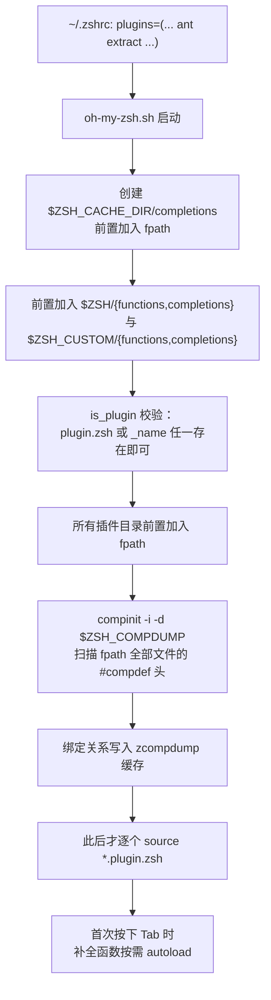
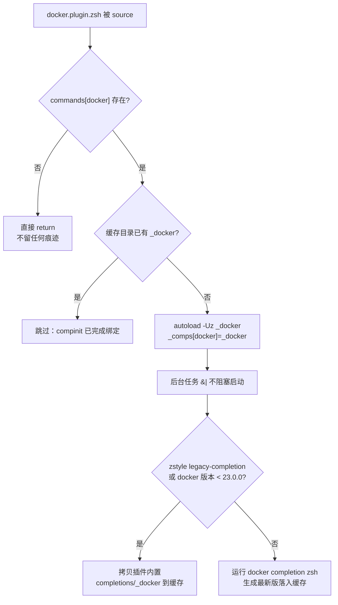

Tab 键补全是 shell 体验的半壁江山，而在 oh-my-zsh 中，为任意命令提供补全只需要一个命名正确的文件：`_command`。本文以仓库内真实代码为样本，讲清三件事——`_command` 文件**如何被发现与注册**、**有哪些可复用的实现范式**、以及**覆盖系统补全、缓存与容错的进阶手法**。所有模式均直接取自本仓库可验证的代码，读完即可着手为你的工具链编写补全脚本。

## 加载机制：`_command` 文件是如何被发现的

理解编写规范的前提，是理解 oh-my-zsh 的补全注册链路。它遵循 zsh 补全系统的原生约定：**`_command` 文件不是被执行的脚本，而是被 `compinit` 被动发现的函数库**。整个链路如下：

这条链路上有三个对编写者至关重要的细节。**第一**，每个插件目录都会被注入 `fpath`，且判定条件极为宽松——`is_plugin` 只要求 `$name.plugin.zsh` **或** `_$name` 两者任一存在：这意味着一个插件可以只由一个补全文件构成。**第二**，`compinit` 在插件 `.plugin.zsh` 被 source **之前**运行，所以 `#compdef` 头是补全注册的第一通道，`.plugin.zsh` 中写在加载期的 `compdef` 调用只是后备手段。**第三**，扫描结果缓存在 `$ZSH_COMPDUMP`（默认 `~/.zcompdump-<host>-<zsh版本>`），并在文件头部写入 OMZ 的 revision 与 fpath 元数据；一旦 fpath 发生变化，主脚本会删除转储并强制重建。

Sources: [oh-my-zsh.sh](oh-my-zsh.sh#L66-L68), [oh-my-zsh.sh](oh-my-zsh.sh#L81-L98), [oh-my-zsh.sh](oh-my-zsh.sh#L130-L132), [oh-my-zsh.sh](oh-my-zsh.sh#L215-L231), [oh-my-zsh.sh](oh-my-zsh.sh#L233-L244), [oh-my-zsh.sh](oh-my-zsh.sh#L315-L319)

## 放置位置与命名约定

命名规则只有一条铁律：**文件名必须是 `_<命令名>`，且第一行为 `#compdef <命令名>`**。`compinit` 正是依靠这个头部将文件绑定为对应命令的补全函数；第二行可选的 `#autoload` 声明函数体在首次调用时才加载，避免启动时解析整个文件。例如 `plugins/extract/_extract` 的头部仅两行：`#compdef extract` 与 `#autoload`。

放置位置则有三种策略，对应不同的复用意图：

| 策略 | 位置 | 前置条件 | 仓库实例 |
| :--- | :--- | :--- | :--- |
| 常规插件内补全 | `plugins/<name>/_<cmd>` | 插件已有 `.plugin.zsh` | [ant](plugins/ant/_ant#L1)、[extract](plugins/extract/_extract#L1)、[docker-compose](plugins/docker-compose/_docker-compose#L1) |
| 纯补全插件 | `plugins/<name>/_<name>`（无 `.plugin.zsh`） | 依赖 `is_plugin` 的 OR 判定 | [celery](plugins/celery/_celery#L1)、cpanm、gas、httpie、ipfs、lein、tmux-cssh |
| 补全函数与包装函数配对 | `plugins/<name>/_<wrapper>` + `opswd` 函数文件 | 1password 中 `opswd` 函数补全 | [_opswd](plugins/1password/_opswd#L1) |

**纯补全插件**是初学者最容易忽略的形态：`celery`、`cpanm` 等插件目录里根本没有 `.plugin.zsh`，唯一的代码文件就是 `_celery`、`_cpanm`——它们在用户 `.zshrc` 的 `plugins=(... celery ...)` 中被启用后，`is_plugin` 凭 `_$name` 文件即判定插件存在，随后该目录进入 `fpath`，`compinit` 完成注册。这是一个极轻量的贡献入口：为某个流行命令写一份补全，就是一个合法的 oh-my-zsh 插件。

Sources: [oh-my-zsh.sh](oh-my-zsh.sh#L81-L86), [plugins/extract/_extract](plugins/extract/_extract#L1-L2), [plugins/celery/_celery](plugins/celery/_celery#L1-L2), [plugins/1password/_opswd](plugins/1password/_opswd#L1-L9)

## 四种实现范式：来自仓库的实证采样

仓库中的补全脚本按“候选数据从哪来”可分为四种范式，复杂度递增。选择范式的决策依据只有一个问题：**候选列表的生成成本与时效性如何平衡**。

| 范式 | 数据来源 | 时效性 | 成本 | 代表文件 |
| :--- | :--- | :--- | :--- | :--- |
| A. 声明式 `_arguments` | 静态写出 | 永不过期 | 零 fork | [_extract](plugins/extract/_extract#L4-L58)、[_celery](plugins/celery/_celery#L16-L31) |
| B. 动态 `compadd` | 每次实查/文件缓存 | 实时或按需刷新 | 1 次外呼 | [_opswd](plugins/1password/_opswd#L3-L9)、[_ant](plugins/ant/_ant#L3-L22) |
| C. 实时解析 `--help` | 解析命令帮助文本 | 实时 | 1–2 次外呼 + 文本处理 | [_ng](plugins/ng/_ng#L5-L56) |
| D. 工程化缓存架构 | `_store_cache` 体系 + 辅助函数 | 自定义过期策略 | 首呼后近零 | [_docker-compose](plugins/docker-compose/_docker-compose#L72-L94) |

**范式 A（声明式）**是起点。`_extract` 用一个静态数组收纳 48 种扩展名，再以一条 `_arguments` 规则完成全部工作——注意其中 `*::archive file:_files -g '(#i)*.(${(j:|:)exts})(-.)'` 的手法：`_files` 动作配合 `-g` glob 限定只补全匹配扩展名的文件，`(#i)` 开启大小写不敏感，扩展名列表用 `(j:|:)` 连接符内联展开为正则交替。**范式 B（动态）**则解决“候选来自运行时状态”的问题：`_opswd` 在每次补全时执行 `op item list` 查询 1Password 的登录项，以 `2>/dev/null` 容错、空结果即放弃，最后 `compadd -a -- services` 把数组注入候选；`_ant` 进一步引入**文件缓存**——把 `ant -p` 的 target 列表写入 `.ant_targets`，仅当 `build.xml` 比缓存新时才重新生成，将高频 fork 降为低频。

Sources: [plugins/extract/_extract](plugins/extract/_extract#L54-L58), [plugins/1password/_opswd](plugins/1password/_opswd#L3-L9), [plugins/ant/_ant](plugins/ant/_ant#L3-L22), [plugins/celery/_celery](plugins/celery/_celery#L16-L31)

**范式 C（实时解析）**以 `_ng` 为样本，展示了**按光标位置分发**的经典结构：`$CURRENT` 是当前命令行词的个数（含命令本身），`$words` 是全部词。`CURRENT == 2` 时解析 `ng help` 输出并以 `_describe` 呈现带描述的子命令；`CURRENT == 3` 时改为解析 `ng <子命令> --help` 补全 flags。这种范式的好处是补全自动跟随 CLI 版本演进，代价是每次补全都付出外呼与文本处理的延迟，且对帮助输出的排版格式强耦合——`_ng` 中大量正则就是为消化 Angular 特定格式而存在。

**范式 D（工程化）**以 `_docker-compose` 为标杆，是编写大型补全的完整参照：所有辅助函数以 `__docker-compose_` 为前缀隔离命名空间；每个候选源函数以 `[[ $PREFIX = -* ]] && return 1` 开头（用户正在输入 flag 时果断放弃补全服务名）；子命令列表经 `_retrieve_cache`/`_store_cache` 缓存，并挂载自定义的 `cache-policy`——`__docker-compose_caching_policy` 用 `"$1"(Nmh+1)` glob 判断缓存文件是否超过 1 小时；子命令分发采用 `case $words[1]` 为每个子命令配独立 `_arguments` 分支，公共选项提取为 `opts_*` 变量复用。

Sources: [plugins/ng/_ng](plugins/ng/_ng#L5-L36), [plugins/docker-compose/_docker-compose](plugins/docker-compose/_docker-compose#L32-L38), [plugins/docker-compose/_docker-compose](plugins/docker-compose/_docker-compose#L72-L94), [plugins/docker-compose/_docker-compose](plugins/docker-compose/_docker-compose#L96-L122)

## 补全上下文变量与核心 API 速查

四种范式共享同一套上下文契约。编写前必须掌握三组变量与一组 API：

| 类别 | 名称 | 语义 | 仓库用例 |
| :--- | :--- | :--- | :--- |
| 上下文变量 | `$CURRENT` | 命令行当前词序号（含命令本身） | [_ng#L5](plugins/ng/_ng#L5) 位置分发 |
| 上下文变量 | `$words` | 当前命令行词数组 | [_docker-compose#L110](plugins/docker-compose/_docker-compose#L110) `case $words[1]` |
| 上下文变量 | `$PREFIX` | 光标前正在输入的词前缀 | [_docker-compose#L32](plugins/docker-compose/_docker-compose#L32) flag 守卫 |
| 核心 API | `_arguments` | 声明选项/参数的完整规格 | [_celery#L16-L26](plugins/celery/_celery#L16-L26) |
| 核心 API | `_describe` | 呈现"候选：描述"对 | [_ng#L18](plugins/ng/_ng#L18) |
| 核心 API | `compadd -a` | 直接注入数组为候选 | [_opswd#L6](plugins/1password/_opswd#L6) |
| 核心 API | `_values` / `_alternative` | 多值参数 / 多源候选 | [_celery#L58-L68](plugins/celery/_celery#L58-L68) / [_docker-compose#L35](plugins/docker-compose/_docker-compose#L35) |
| 外呼安全 | `_call_program` | 带重定向与用户可定制性的外呼 | [_coffee#L45](plugins/coffee/_coffee#L45)、[_docker-compose#L89](plugins/docker-compose/_docker-compose#L89) |

`_arguments` 规格的解剖结构值得单独记牢。以 `_celery` 的 `'(-A --app=)'{-A,--app}'[app instance to use...]:APP'` 为例：第一段 `( )` 内是互斥组（不能同时出现）；`{-A,--app}` 展开为短/长两个选项的共同声明；方括号是 Tab 时显示的描述文本；冒号后是参数占位说明。而末尾的 `'(- : *)'{-h,--help}'[...]'` 表示 `--help` 之后不再补全任何内容（`*` 清空剩余参数），`'*:: :->subcmds'` 则是**状态转移**语法——匹配不到任何规格时，把控制权交给后续 `case $words[1]` 的子命令分发，这正是范式 A 与 D 的衔接点。

此外注意版本门槛的写法：`_coffee` 通过 `_call_program` 探测 `coffee --version`，再以 `is-at-least` 条件性地向选项数组增补旧版专属 flags——这是补全脚本兼容多版本 CLI 的标准姿势。

Sources: [plugins/celery/_celery](plugins/celery/_celery#L16-L31), [plugins/coffee/_coffee](plugins/coffee/_coffee#L45-L52), [plugins/ng/_ng](plugins/ng/_ng#L5-L18), [plugins/docker-compose/_docker-compose](plugins/docker-compose/_docker-compose#L89)

## 进阶：覆盖系统补全的缓存目录模式

有些插件的需求超出"新增补全"——需要**替换** zsh 或其他来源的内置补全。`gem` 与 `docker` 插件示范了同一套成熟方案，其根基是主脚本把 `$ZSH_CACHE_DIR/completions` **前置**插入 `fpath`（先于一切系统目录），因此写入该目录的同名 `_command` 文件优先级最高。

这个模式解决了本节开头提到的**时序难题**：`compinit` 先于 `.plugin.zsh` 运行，所以加载期才出现的补全文件在本会话中不会被发现——`gem`/`docker` 的对策是双轨制：若缓存中尚无 `_docker`，立即 `autoload` 并手工写入 `_comps` 关联数组让**本会话立即生效**；同时把文件拷入缓存目录，让**下次会话**由 `compinit` 正常接管。`docker` 版还展示了三个生产级细节：以 `$+commands[docker]` 守卫避免在未安装 docker 的机器上产生副作用；以 `zstyle ':omz:plugins:docker' legacy-completion` 提供用户可控的回退开关；整个拷贝过程置于 `&|` 后台执行，不让磁盘 IO 拖慢 shell 启动。若你要覆盖的系统补全仅在特定版本以下才需要（如 `gem` 对 zsh ≥ 5.5 直接 `return 0` 放弃覆盖），条件放行即可。

Sources: [oh-my-zsh.sh](oh-my-zsh.sh#L66-L68), [plugins/gem/gem.plugin.zsh](plugins/gem/gem.plugin.zsh#L9-L32), [plugins/docker/docker.plugin.zsh](plugins/docker/docker.plugin.zsh#L42-L79)

## 别名、安全与调试：编写者必知的三件事

**别名与补全的配合**是插件编写中的高频疑问。`docker-compose` 插件的做法极具代表性：`.plugin.zsh` 定义了 `dco`、`dcb` 等十余个别名指向同一底层命令，而补全文件以 `#compdef docker-compose` 绑定真实命令名。zsh 默认（未设置 `complete_aliases` 选项时）在补全前先展开别名，因此别名命令天然继承目标命令的补全——编写时只需为**真实命令**注册补全，无需为每个别名重复工作。需要注意的是，oh-my-zsh 主脚本为每个插件提供了按模块禁用别名的 zstyle 开关（`_omz_source` 在 sourcing 前备份并按需回滚别名表），补全本身不受此开关影响。

**安全边界**由 compinit 的 `-i` 标志与 compaudit 决定：主脚本默认以 `compinit -i` 运行，凡 fpath 中属主或权限不安全的目录，其内的补全文件会被静默排除，`handle_completion_insecurities` 随后给出人话版警告。这意味着你自己编写的 `_command` 文件必须放在属主正确、其他用户不可写的目录中，否则“写对了却不生效”最可能的原因就在这里。

**调试与缓存失效**要区分两种情况。zcompdump 缓存的是**绑定关系**而非函数体——修改既有 `_command` 文件的函数内容后无需任何操作，下次补全即生效（autoload 机制每次调用都重新读取函数文件）；但**新增或改名**补全文件后，旧的 zcompdump 中并不存在新绑定，oh-my-zsh 只在 fpath 元数据变化时才自动重建转储，此时最可靠的手段是删除 `$ZSH_COMPDUMP` 文件并重启 shell。

Sources: [plugins/docker-compose/docker-compose.plugin.zsh](plugins/docker-compose/docker-compose.plugin.zsh#L5-L33), [oh-my-zsh.sh](oh-my-zsh.sh#L233-L244), [lib/compfix.zsh](lib/compfix.zsh#L1-L30), [oh-my-zsh.sh](oh-my-zsh.sh#L215-L231)

## 编写清单：从零到可提交

综合以上范式与陷阱，一份可进入 oh-my-zsh 的补全脚本应满足以下清单：

| `#` | 检查项 | 依据 |
| :--- | :--- | :--- |
| 1 | 文件名 `_<命令名>`，位于插件目录（`fpath` 覆盖范围内） | `is_plugin` 与 `compinit` 扫描机制 |
| 2 | 首行 `#compdef <命令名>`，酌情追加 `#autoload` | [_extract#L1-L2](plugins/extract/_extract#L1-L2) |
| 3 | 一切外呼带 `2>/dev/null` 与空结果守卫 | [_opswd#L5-L6](plugins/1password/_opswd#L5-L6) |
| 4 | 高开销候选列表必须有缓存（文件缓存或 `_store_cache`） | [_ant#L3-L18](plugins/ant/_ant#L3-L18)、[_docker-compose#L72-L94](plugins/docker-compose/_docker-compose#L72-L94) |
| 5 | 竞争性选项用互斥组 `( )` 声明，公共选项提为变量复用 | [_docker-compose#L99-L107](plugins/docker-compose/_docker-compose#L99-L107) |
| 6 | 多版本 CLI 用 `is-at-least` 做特性开关 | [_coffee#L48-L52](plugins/coffee/_coffee#L48-L52) |
| 7 | 覆盖内置补全时走缓存目录模式并妥善处理时序 | [_gem#L9-L15](plugins/gem/gem.plugin.zsh#L9-L15) |
| 8 | 插件目录附 README 说明用途与启用方式 | 仓库全部插件均遵循 |

若打算将补全脚本作为插件贡献回上游，还需满足贡献流程的硬性要求：大型变更（新插件即属此类）需要找到测试者为 PR 点赞认可，且提交信息遵循 Conventional Commits 规范（`feat(<plugin>): ...` 形式）。建议在动手前先通读启动加载流程，把 `_command` 文件放回它所属的完整生命周期中理解；写完自定义版本后，优先放入 `$ZSH_CUSTOM` 下的自定义插件目录验证，再考虑上游提交。

**推荐后续阅读**：[插件加载机制与开发命名约定](16-cha-jian-jia-zai-ji-zhi-yu-kai-fa-ming-ming-yue-ding) 提供本文机制细节的完整上下文；[补全系统：compinit 与 zcompdump 缓存优化](11-bu-quan-xi-tong-compinit-yu-zcompdump-huan-cun-you-hua) 深入缓存层；[安全防线：compfix 与补全目录权限检查](12-an-quan-fang-xian-compfix-yu-bu-quan-mu-lu-quan-xian-jian-cha) 详解权限安全；[自定义插件与主题：ZSH_CUSTOM 目录实践](26-zi-ding-yi-cha-jian-yu-zsh_custom-mu-lu-shi-jian) 演示本地验证的正确姿势；[贡献指南、Issue 规范与提交格式](25-gong-xian-zhi-nan-issue-gui-fan-yu-ti-jiao-ge-shi) 则是提交前的最后一站。