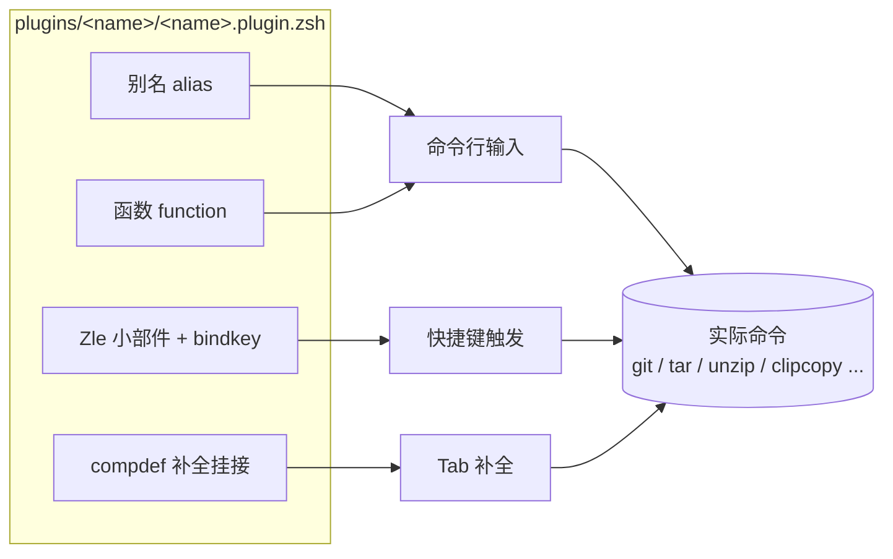
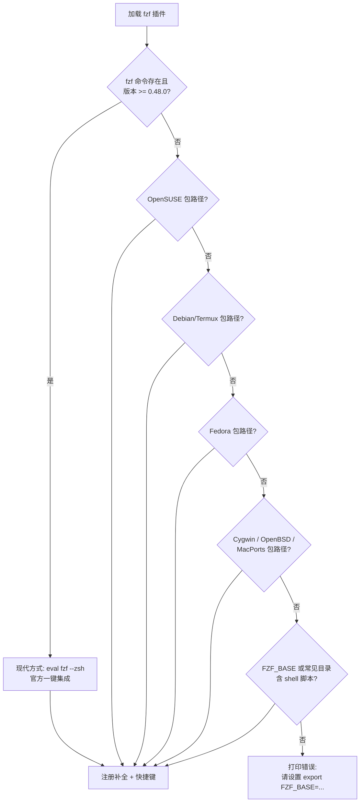

oh-my-zsh 内置了近 300 个插件，但绝大多数初学者的第一份配置都由本页的这几个"经典款"构成。它们之所以经典，不是因为功能最多，而是因为各自代表了一种典型的插件设计模式：**git 插件**展示了如何用别名体系系统化封装高频命令，**extract 插件**展示了如何用一个函数做"格式分派门面"，**fzf 插件**展示了如何兼容五花八门的安装环境，而**实用工具类**插件则展示了小而美的单点增强。理解这四种模式后，你阅读其他任何插件都能举一反三。

启用这些插件的方式完全一致：在 `~/.zshrc` 中找到 `plugins=(...)` 一行，把插件名加入数组即可，例如 `plugins=(git extract fzf sudo jsontools copybuffer)`。注意 oh-my-zsh 官方模板中默认只启用了 `git`。

Sources: [zshrc.zsh-template](templates/zshrc.zsh-template#L71-L76)

下图概括了这四类插件各自向你的 Shell 注入的能力类型，后续章节将逐一展开。初学者只需记住：**别名（alias）**是命令的短缩写，**函数（function）**是带逻辑的多步封装，**Zle 小部件（widget）**是绑定到快捷键的交互行为，**补全（compdef）**则让 Tab 键认识这些新命令。

Sources: [git.plugin.zsh](plugins/git/git.plugin.zsh#L98-L113), [copybuffer.plugin.zsh](plugins/copybuffer/copybuffer.plugin.zsh#L12-L16)

## git 插件：450 行别名体系的工程化组织

git 插件是 oh-my-zsh 中代码量最大、使用率最高的插件（官方模板默认启用），全文件共 450 行，但其组织结构极其清晰，分为五个自上而下的区块：**版本检测 → 分支探测函数 → 独立功能函数 → 别名清单 → 弃用别名警告**。这种"顺序即文档"的写法本身就是值得学习的模式。

文件开头先做一次**版本检测**：用 `git version` 提取版本号存入 `git_version` 变量，供后面的别名按版本选择不同命令形态。这是 git 插件区别于普通"别名堆"的关键——它能适配你机器上新旧不一的 git。

Sources: [git.plugin.zsh](plugins/git/git.plugin.zsh#L1-L3)

### 两个智能分支探测函数

大量 git 别名需要引用"主分支"（可能是 `main` 也可能是 `master`）。git 插件的解法是定义 `git_main_branch()`：按 `main → trunk → mainline → default → stable → master` 的顺序探测本地与 `origin`/`upstream` 远程的分支，全部落空时再查询远程 HEAD 的符号引用，最终兜底返回 `master`。对称地，`git_develop_branch()` 按 `dev → devel → develop → development` 顺序探测开发分支。此后所有别名如 `gcm`（切到主分支）、`grbm`（变基到主分支）都通过 `$(git_main_branch)` 动态求值，做到对 main/master 仓库通用。

Sources: [git.plugin.zsh](plugins/git/git.plugin.zsh#L12-L50)

### 常用别名速查

git 插件定义了 200 余个别名，全部遵循"首字母 g + 子命令缩写 + 可选拓展"的命名规律。下表按日常工作流挑选最常用的条目（完整清单见插件内 README）：

| 工作流 | 别名 | 等价命令 | 记忆线索 |
| :--- | :--- | :--- | :--- |
| 查看状态 | `gst` / `gss` / `gsb` | `git status` / `--short` / `--short --branch` | g-it s-tatus |
| 暂存提交 | `ga` / `gaa` / `gcmsg` | `git add` / `add --all` / `commit --message` | add → commit |
| 查看差异 | `gd` / `gdca` | `git diff` / `diff --cached` | diff |
| 查看历史 | `glo` / `glog` / `glol` | 单行日志 / 加图形 / 彩色图形 | log |
| 拉取推送 | `gl` / `gp` / `ggp` | `git pull` / `push` / 自动带当前分支推 | pull/push |
| 分支操作 | `gb` / `gco` / `gcb` / `gm` | branch / checkout / checkout -b / branch --move | branch/checkout |
| 变基合并 | `grb` / `gmom` | `git rebase` / `merge origin/主分支` | rebase/merge |
| 暂存工作区 | `gsta` / `gstp` / `gstl` | stash push / pop / list | stash |

Sources: [git.plugin.zsh](plugins/git/git.plugin.zsh#L116-L141), [git.plugin.zsh](plugins/git/git.plugin.zsh#L244-L256), [git.plugin.zsh](plugins/git/git.plugin.zsh#L281-L313), [git.plugin.zsh](plugins/git/git.plugin.zsh#L356-L410)

### 值得认识的包装函数

比别名更进一步的是插件中的**包装函数**——它们读取当前仓库状态后执行多步操作。`gccd <url>` 在克隆仓库后自动 `cd` 进入克隆出的目录（源码通过 zsh 的 `$_` 技巧判断目录名），并挂接了 `git-clone` 补全；`ggpnp` 一键执行"拉取当前分支 + 推送当前分支"；`gbda` 删除所有已合并入主/开发分支的本地分支（排除当前分支），`gbds` 则针对被 squash 合并的分支用 `git cherry` 判断后清理。这些函数是初学者最容易"哇"出声的部分，也最值得直接阅读源码学习 zsh 函数写法。

Sources: [git.plugin.zsh](plugins/git/git.plugin.zsh#L106-L113), [git.plugin.zsh](plugins/git/git.plugin.zsh#L143-L161), [git.plugin.zsh](plugins/git/git.plugin.zsh#L183-L196)

### 版本感知与强制推送安全网

借助开头的 `git_version` 检测，部分别名会**按 git 版本选择更安全的形态**：`gfa` 在 git ≥ 2.8 时附加 `--jobs=10` 并行拉取；`gsta` 在 git ≥ 2.13 时用新的 `stash push` 语法；最具代表性的是 `gpf`（强制推送别名）——在 git ≥ 2.30 时自动展开为 `git push --force-with-lease --force-if-includes` 而非裸 `--force`，为你挡住覆盖他人提交的经典事故。

Sources: [git.plugin.zsh](plugins/git/git.plugin.zsh#L236-L239), [git.plugin.zsh](plugins/git/git.plugin.zsh#L323-L326), [git.plugin.zsh](plugins/git/git.plugin.zsh#L403-L406)

最后，插件在收尾处还演示了**弃用别名迁移**机制：旧名 `current_branch` 被重定义为"打印黄色警告 + 转发到新名 `git_current_branch`"的别名，保证老配置平滑升级。这也是你日后重命名自己别名时可以套用的模板。

Sources: [git.plugin.zsh](plugins/git/git.plugin.zsh#L440-L449)

## extract 插件：一个函数统一所有解压命令

你再也不需要记住"tar 用 `xvf`、zip 用 `unzip`、7z 用哪个参数"——extract 插件把这一切收敛为一条命令：`extract <文件>`（并贴心地提供了单字母别名 `x`）。对初学者而言，这是"用一层抽象消灭记忆负担"的最佳范例。

Sources: [extract.plugin.zsh](plugins/extract/extract.plugin.zsh#L1-L14)

### 执行流程：安全目录 + 格式分派 + 结果整理

`extract` 函数的处理流程分为四个阶段，下图是其完整生命周期。特别注意第 2 阶段的安全设计：函数会为每个压缩包**创建同名目录**再解压进去（如 `foo.tar.gz` 解压到 `foo/`），若目录已存在则追加随机后缀避免覆盖，从机制上杜绝了"压缩包炸弹式"的文件散落。

Sources: [extract.plugin.zsh](plugins/extract/extract.plugin.zsh#L16-L78), [extract.plugin.zsh](plugins/extract/extract.plugin.zsh#L151-L186)

### 格式分派表：内建的"降级与加速"策略

核心的 `case` 分派覆盖了 30 余种扩展名，其亮点在于**每类格式都优先探测并行加速工具，缺失时回退到标准工具**。例如解压 `.tar.gz` 时若检测到 `pigz`（并行 gzip）就 `tar -I pigz`，否则退回普通 `tar zxvf`；解压 `.rar` 时按 `unrar → unar` 顺序探测，都没有则给出明确安装提示。下表列出主要格式族：

| 格式族 | 代表扩展名 | 加速/首选工具 | 回退工具 |
| :--- | :--- | :--- | :--- |
| tar + gzip | `.tar.gz` `.tgz` | pigz | tar zxvf |
| tar + bzip2 | `.tar.bz2` `.tbz2` | pbzip2 | tar xvjf |
| tar + xz/zstd | `.tar.xz` `.tar.zst` | pixz / tar --zstd | xzcat、zstdcat 管道 |
| 纯压缩流 | `.gz` `.bz2` `.xz` `.zst` | pigz / pbzip2 | gunzip、bunzip2、xzcat |
| Zip 系 | `.zip` `.jar` `.war` `.apk` `.whl` `.ipa` 等 | unzip（同一族共用） | — |
| 7-Zip 系 | `.7z` `.pk7` `.7z.001` | 7zz → 7z → 7za 逐级探测 | 报错提示安装 |
| 系统包 | `.deb` `.rpm` | ar + 递归 extract / rpm2cpio + cpio | — |
| 其他 | `.rar` `.cab` `.exe` `.cpio` `.zpaq` | unrar/unar、cabextract、cpio、zpaq | 报错提示安装 |

Sources: [extract.plugin.zsh](plugins/extract/extract.plugin.zsh#L81-L149)

其中最巧妙的细节是对 `.deb` 包的处理：先用 `ar` 解开得到 `control.tar.*` 与 `data.tar.*`，然后**递归调用 extract 自身**解压这两个 tar 包——用一个函数复用自身处理嵌套格式，是函数式思维的漂亮展示。

Sources: [extract.plugin.zsh](plugins/extract/extract.plugin.zsh#L135-L140)

## fzf 插件：一条安装环境探测链

fzf（fuzzy finder）是命令行模糊搜索神器，但它在 macOS、Debian、Fedora、Arch、Cygwin 等平台上的安装路径与补全脚本位置各不相同。oh-my-zsh 的 fzf 插件本身就是一份**环境兼容层**的教科书：它定义了 8 个探测函数，按优先级串联调用，任何一个成功即短路返回，全部失败则打印友好提示。

Sources: [fzf.plugin.zsh](plugins/fzf/fzf.plugin.zsh#L1-L12), [fzf.plugin.zsh](plugins/fzf/fzf.plugin.zsh#L254-L262)

### 两代集成方式的分水岭

探测链的第一环代表**现代集成方式**：fzf ≥ 0.48.0 自带 `fzf --zsh` 子命令，一条 `eval` 就能完成全部集成，无需再关心脚本路径。对老版本或系统包安装的场景，则回退到**传统方式**：定位 fzf 安装目录中的 `completion.zsh`（模糊 Tab 补全）与 `key-bindings.zsh`（快捷键）两个脚本并 `source`。源码中 `fzfdirs` 数组枚举了 8 个常见安装位置，还支持通过 `fzf-share` 命令或 `brew --prefix fzf` 动态发现。

Sources: [fzf.plugin.zsh](plugins/fzf/fzf.plugin.zsh#L14-L57)

### 配置变量与默认行为

fzf 插件通过环境变量提供定制开关（均需在 `source oh-my-zsh.sh` 之前设置），并附带一个体贴的默认值逻辑：若你没设置 `FZF_DEFAULT_COMMAND`，插件会自动按 `fd → rg → ag` 的顺序探测已安装的搜索工具，用它替代默认的 `find` 来生成文件列表（前提是你安装了其中之一）。

| 环境变量 | 作用 | 默认行为 |
| :--- | :--- | :--- |
| `FZF_BASE` | 手工指定 fzf 安装目录 | 自动探测 8 个常见路径 |
| `FZF_DEFAULT_COMMAND` | 模糊搜索的文件列表命令 | 自动选用 fd / rg / ag（如已安装） |
| `DISABLE_FZF_AUTO_COMPLETION` | 设为 `true` 关闭模糊 Tab 补全 | 开启 |
| `DISABLE_FZF_KEY_BINDINGS` | 设为 `true` 关闭快捷键 | 开启 CTRL-T / CTRL-R / ALT-C |

启用后你获得三个开箱即用的快捷键：**CTRL-T** 在当前命令行插入模糊选中的文件路径，**CTRL-R** 用模糊搜索翻找历史命令，**ALT-C** 模糊选择并 cd 进入子目录。

Sources: [fzf/README.md](plugins/fzf/README.md#L16-L52), [fzf.plugin.zsh](plugins/fzf/fzf.plugin.zsh#L65-L72), [fzf.plugin.zsh](plugins/fzf/fzf.plugin.zsh#L266-L274)

另一个值得注意的工程细节：所有 `fzf_setup_*` 函数在完成使命后被 `unset -f` 清理，不污染你的全局函数命名空间——这是编写"一次性初始化"插件的标准卫生习惯。

Sources: [fzf.plugin.zsh](plugins/fzf/fzf.plugin.zsh#L264)

## 实用工具类插件：小而美的单点增强

除三大经典外，oh-my-zsh 还有一批只做一件事的微型插件。它们体量小到百行以内，却是日常舒适度的最大来源。以下按能力类型分组介绍。

### sudo 插件：双击 Esc 补前缀

忘记 `sudo` 就重打整条命令？sudo 插件让你在命令行上**连按两次 Esc**，自动在行首插入（或移除）`sudo` 前缀。它的智能之处在于：空行时自动取上一条历史命令；检测到你输入的是编辑器（通过 `$SUDO_EDITOR`/`$VISUAL`/`$EDITOR` 解析，甚至能识别指向编辑器的别名）时，会改用 `sudo -e` 这一更安全的编辑方式。该小部件同时绑定在 emacs 与 vi 两种模式上。

Sources: [sudo.plugin.zsh](plugins/sudo/sudo.plugin.zsh#L32-L56), [sudo.plugin.zsh](plugins/sudo/sudo.plugin.zsh#L86-L108)

### jsontools 插件：后端无关的 JSON 工具集

`curl ... | pp_json` 即可格式化 JSON。jsontools 定义了 `pp_json`（美化打印）、`is_json`（校验）、`urlencode_json`/`urldecode_json` 四个工具，其设计亮点是**后端自动探测**：按 `node → python3 → ruby` 顺序找到你机器上已有的解释器，然后用它实现同一套接口——与 extract 的工具降级、fzf 的探测链异曲同工。它还额外提供了 NDJSON（每行一个 JSON）版本的四件套。

Sources: [jsontools.plugin.zsh](plugins/jsontools/jsontools.plugin.zsh#L5-L20), [jsontools.plugin.zsh](plugins/jsontools/jsontools.plugin.zsh#L113-L120)

### 剪贴板三件套：copybuffer / copyfile / copypath

这三个插件共享同一个基础设施——lib 目录中定义的 `clipcopy`/`clippaste` 函数（负责抹平 macOS `pbcopy`、Linux `xclip`/`wl-copy`、Windows/WSL 剪贴板的差异）：**copybuffer** 把当前命令行内容复制到剪贴板（`Ctrl-O` 触发）；**copyfile** 复制指定文件的内容（`copyfile a.txt`）；**copypath** 复制指定文件或当前目录的绝对路径。

Sources: [copybuffer.plugin.zsh](plugins/copybuffer/copybuffer.plugin.zsh#L4-L16), [copyfile.plugin.zsh](plugins/copyfile/copyfile.plugin.zsh#L4-L19), [copypath.plugin.zsh](plugins/copypath/copypath.plugin.zsh#L3-L15)

### colored-man-pages 插件：彩色手册页

启用后执行 `man` 自动获得彩色排版：关键字红色加粗、强调文字黄字蓝底、下划线绿色加粗。其原理是把颜色定义写入 `LESS_TERMCAP_*` 环境变量后包一层 `env` 再调用真正的 `man`，并强制优先使用 `less` 分页器。

Sources: [colored-man-pages.plugin.zsh](plugins/colored-man-pages/colored-man-pages.plugin.zsh#L6-L17), [colored-man-pages.plugin.zsh](plugins/colored-man-pages/colored-man-pages.plugin.zsh#L27-L54)

### 实用工具类横向对比

| 插件 | 提供的能力 | 触发方式 | 依赖 |
| :--- | :--- | :--- | :--- |
| sudo | 命令行 sudo 前缀切换 | 连按 `Esc Esc` | 无 |
| jsontools | JSON 美化/校验/URL 编解码 | 管道调用 4 个函数 | node、python3 或 ruby 之一 |
| copybuffer | 复制当前命令行 | `Ctrl-O` | `clipcopy`（lib 提供） |
| copyfile | 复制文件内容 | `copyfile <文件>` | `clipcopy` |
| copypath | 复制绝对路径 | `copypath [路径]` | `clipcopy` |
| colored-man-pages | 彩色 man 手册 | `man <命令>` | less |
| extract | 统一解压 | `extract` / `x` | 按格式按需 |
| fzf | 模糊搜索三快捷键 | `Ctrl-T` `Ctrl-R` `Alt-C` | 外部安装 fzf |

Sources: [sudo.plugin.zsh](plugins/sudo/sudo.plugin.zsh#L103-L108), [jsontools.plugin.zsh](plugins/jsontools/jsontools.plugin.zsh#L10-L19), [copybuffer.plugin.zsh](plugins/copybuffer/copybuffer.plugin.zsh#L14-L16), [colored-man-pages.plugin.zsh](plugins/colored-man-pages/colored-man-pages.plugin.zsh#L36-L39)

## 小结与延伸阅读

本页的四个"经典款"实际示范了四种插件设计范式：git 插件的**系统化别名封装**、extract 插件的**单函数格式分派**、fzf 插件的**环境探测兼容层**，以及实用工具类的**单点小部件增强**。掌握它们之后，建议按以下路径继续深入：

- 想了解这些插件是如何被 oh-my-zsh 加载、以及 `$ZSH_CUSTOM` 中如何放置自己的插件，请阅读 [插件加载机制与开发命名约定](16-cha-jian-jia-zai-ji-zhi-yu-kai-fa-ming-ming-yue-ding)；
- 想理解插件目录中 `_command` 补全文件（如 extract 的 `_extract`）如何工作，请阅读 [补全脚本（_command 文件）编写实践](17-bu-quan-jiao-ben-_command-wen-jian-bian-xie-shi-jian)；
- 想进一步引入语法高亮与自动建议这对"补全生态双子星"，请阅读 [内置生态：语法高亮与自动建议第三方框架](19-nei-zhi-sheng-tai-yu-fa-gao-liang-yu-zi-dong-jian-yi-di-san-fang-kuang-jia)；
- 想动手封装属于自己的第一个插件，请阅读 [自定义插件与主题：ZSH_CUSTOM 目录实践](26-zi-ding-yi-cha-jian-yu-zhu-ti-zsh-custom-mu-lu-shi-jian)。