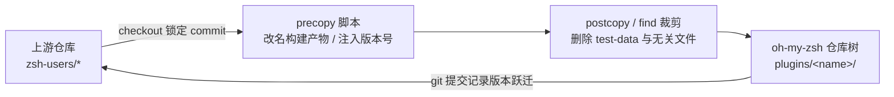
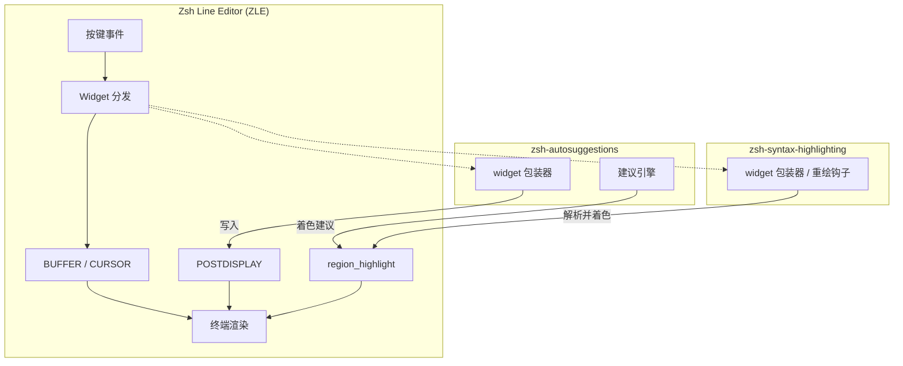
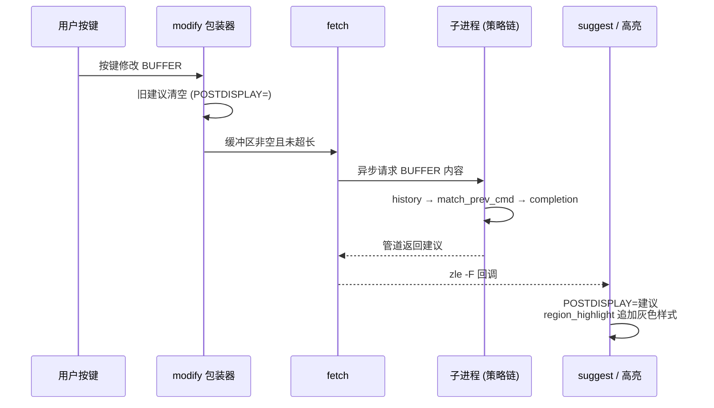
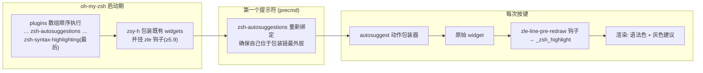

在 oh-my-zsh 的 300 余个官方插件中，有两个特殊的成员：`zsh-syntax-highlighting` 与 `zsh-autosuggestions`。它们并非 oh-my-zsh 原创，而是社区中最流行的两个 Zsh 命令行增强框架的直接内嵌（vendored）副本——前者提供 Fish 风格的实时语法高亮，后者提供 Fish 风格的灰色幽灵建议（ghost suggestion）。本页从第一性原理出发，解析这两个框架如何被纳管进仓库、它们共同依赖的 ZLE 基础机制、各自的内部架构，以及两者协同工作时的加载顺序约束。

Sources: [README.md](plugins/zsh-syntax-highlighting/README.md#L3-L16)
Sources: [README.md](plugins/zsh-autosuggestions/README.md#L3-L16)

## 从第三方项目到内置插件：Vendoring 纳管机制

这两个目录在 git 历史中由一次独立提交引入，且不作为子模块而是以源码形式直接进入仓库树——这是 oh-my-zsh 处理"强依赖"第三方项目的标准模式。纳管的单一事实来源（single source of truth）是 [.github/dependencies.yml](.github/dependencies.yml#L58-L100)：每个条目记录上游仓库、分支、以及一个**精确到 commit 的版本锁定值**，配合 `precopy`/`postcopy` 脚本完成"下载 → 裁剪 → 改名"的转换流水线。

Sources: [.github/dependencies.yml](.github/dependencies.yml#L58-L74)
Sources: [zsh-syntax-highlighting.plugin.zsh](plugins/zsh-syntax-highlighting/zsh-syntax-highlighting.plugin.zsh#L39-L49)

这个流水线有两个关键动作值得注意。其一，上游的构建产物被直接改名为主插件文件：`zsh-autosuggestions.zsh` 更名为 `zsh-autosuggestions.plugin.zsh`，`zsh-syntax-highlighting.zsh` 更名为 `zsh-syntax-highlighting.plugin.zsh`——这意味着 `*.plugin.zsh` 就是上游构建脚本拼接 `src/` 各模块后的完整输出，而非 oh-my-zsh 的薄封装。其二，`sed` 注入会改写内嵌的版本元数据（例如把语法高亮的 `ZSH_HIGHLIGHT_REVISION` 固定为 `HEAD`），并剔除上游的测试数据以减小仓库体积。

Sources: [.github/dependencies.yml](.github/dependencies.yml#L75-L100)
Sources: [zsh-autosuggestions.plugin.zsh](plugins/zsh-autosuggestions/zsh-autosuggestions.plugin.zsh#L1-L3)

| 插件 | 上游仓库 | 锁定版本 | 内嵌版本标识 |
| :--- | :--- | :--- | :--- |
| `zsh-autosuggestions` | zsh-users/zsh-autosuggestions | `85919cd` | v0.7.1 |
| `zsh-syntax-highlighting` | zsh-users/zsh-syntax-highlighting | `e6683f20` | 0.8.1-dev |

对用户而言，这两个框架被当作**普通插件**启用：写入 `.zshrc` 的 `plugins` 数组即可。加载入口在主脚本中，所有插件先被加入 `fpath`（以便补全系统能发现其 `_command` 文件），随后在 compinit 之后由 `_omz_source` 逐一 source——`_omz_source` 还会优先查找 `$ZSH_CUSTOM` 下的同名文件，为用户覆写内嵌代码留出通道。

Sources: [oh-my-zsh.sh](oh-my-zsh.sh#L88-L98)
Sources: [oh-my-zsh.sh](oh-my-zsh.sh#L267-L306)

## 共享地基：两大框架共同依赖的 ZLE 原语

理解这两个框架的架构，先要理解它们操作的四样东西。**第一是 `BUFFER` 与 `CURSOR`**：ZLE 中当前命令行文本与光标位置。**第二是 `POSTDISPLAY`**：一个"缓冲区之后追加显示"的特殊变量——zsh 会把它渲染在 `BUFFER` 之后，这正是自动建议实现"灰色幽灵文本"的全部秘密：建议内容永远不写入 `BUFFER`，只写入 `POSTDISPLAY`。**第三是 `region_highlight`**：一个数组，每个元素形如 `"start end 样式"`，zsh 据此给行内区间着色——这是两大框架共享的渲染通道，语法高亮和建议文本着色都向它追加条目。**第四是 Widget 包装（widget wrapping）**：`zle -N` 可以用一个 shell 函数替换同名 widget，原 widget 被保存后可在函数内回调，从而在不修改 zsh 本体的前提下拦截每一次按键。

Sources: [widgets.zsh](plugins/zsh-autosuggestions/src/widgets.zsh#L96-L107)
Sources: [highlight.zsh](plugins/zsh-autosuggestions/src/highlight.zsh#L16-L26)

从这个地基看，两个框架本质上是同一模式的两种应用：**在 ZLE widget 链上挂载回调**。语法高亮在每次缓冲区变化后调用 `_zsh_highlight`，把解析结果写入 `region_highlight`；自动建议在每次缓冲区变化后调用建议引擎，把结果写入 `POSTDISPLAY` 并追加自己的 `region_highlight` 条目。它们共用渲染通道这一事实，正是后面"加载顺序"问题的根源。

Sources: [zsh-syntax-highlighting.plugin.zsh](plugins/zsh-syntax-highlighting/zsh-syntax-highlighting.plugin.zsh#L114-L130)
Sources: [widgets.zsh](plugins/zsh-autosuggestions/src/widgets.zsh#L38-L83)

## zsh-syntax-highlighting：可插拔高亮器架构

语法高亮框架的核心是一个**两级调度结构**：顶层调度器 `_zsh_highlight` 负责在正确的时机被调用，并把工作分发给一组可插拔的"高亮器"（highlighter）；每个高亮器只负责一个语义维度。调度器首先做防御性检查——通过 `memo=` 探测当前 zsh 是否支持在 `region_highlight` 条目上打标记（zsh ≥ 5.9 特性，用于与他人插件互操作），然后清空属于自己的高亮条目而非整个数组，避免抹掉其他插件的着色。

Sources: [zsh-syntax-highlighting.plugin.zsh](plugins/zsh-syntax-highlighting/zsh-syntax-highlighting.plugin.zsh#L118-L174)

随后是调度主循环，体现了一个经典的**谓词/绘制（predicate/paint）协议**：对 `ZSH_HIGHLIGHT_HIGHLIGHTERS` 数组中的每个高亮器，先调用 `_zsh_highlight_highlighter_<名字>_predicate` 判断是否需要工作，再调用 `_zsh_highlight_highlighter_<名字>_paint` 执行着色，结果缓存到专属数组中并在下一次调用时恢复。调度器还内置了性能护栏：缓冲区超过 `ZSH_HIGHLIGHT_MAXLENGTH`、或存在待处理的粘贴输入（`KEYS_QUEUED_COUNT`/`PENDING > 0`）时直接跳过高亮——避免在粘贴大段文本时做无谓的解析。

Sources: [zsh-syntax-highlighting.plugin.zsh](plugins/zsh-syntax-highlighting/zsh-syntax-highlighting.plugin.zsh#L209-L254)
Sources: [docs/highlighters.md](plugins/zsh-syntax-highlighting/docs/highlighters.md#L26-L37)

| 高亮器 | 职责 | 默认激活 |
| :--- | :--- | :--- |
| `main` | 命令词法解析：命令、别名、内建、路径、引号、glob 等 | ✅ |
| `brackets` | 括号/圆括号匹配与配对着色 | ❌ |
| `pattern` | 用户自定义 glob 模式着色（`ZSH_HIGHLIGHT_PATTERNS`） | ❌ |
| `regexp` | 用户自定义正则着色（`ZSH_HIGHLIGHT_REGEXP`） | ❌ |
| `cursor` | 光标位置模拟高亮 | ❌ |
| `root` | root 用户时整行变红警示 | ❌ |
| `line` | 对整行应用统一样式 | ❌ |

Sources: [docs/highlighters.md](plugins/zsh-syntax-highlighting/docs/highlighters.md#L4-L20)

`main` 高亮器定义了数十个样式键（`unknown-token`、`reserved-word`、`alias`、`path`、`command-substitution` 等），全部收敛在关联数组 `ZSH_HIGHLIGHT_STYLES` 中；用户在 `.zshrc` 中覆写条目即可改变颜色，而激活额外高亮器只需向数组追加名字。扩展协议同样是公开的：新建一个高亮器只需创建 `<名字>-highlighter.zsh`、实现 `predicate` 与 `paint` 两个函数，并在启动阶段由 `_zsh_highlight_load_highlighters` 从目录自动加载（该加载器还会校验函数存在性并兼容 0.4.x 的旧命名）。

Sources: [docs/highlighters/main.md](plugins/zsh-syntax-highlighting/docs/highlighters/main.md#L17-L97)
Sources: [zsh-syntax-highlighting.plugin.zsh](plugins/zsh-syntax-highlighting/zsh-syntax-highlighting.plugin.zsh#L501-L540)

在"何时被调用"这一点上，框架存在**双代码路径**。当 zsh ≥ 5.9 且支持 `add-zle-hook-widget` 时，采用新式路径：注册 `zle-line-pre-redraw` 与 `zle-line-finish` 两个 ZLE 钩子，每次行重绘前自动触发高亮，完全不需要包装任何 widget。旧版 zsh 则退回"包装全部 widget"路径：遍历 `widgets` 关联数组，把每一个用户定义、内建、补全 widget 都替换为"先调原 widget、再调 `_zsh_highlight`"的闭包（并跳过 `yank`、`run-help` 等特例，强制附加 `zle-line-finish` 与 `zle-isearch-update`）。启动阶段若 `ZSH_HIGHLIGHT_HIGHLIGHTERS` 为空则默认置为 `(main)`，并注册 `preexec` 钩子在命令执行前清空缓存状态。

Sources: [zsh-syntax-highlighting.plugin.zsh](plugins/zsh-syntax-highlighting/zsh-syntax-highlighting.plugin.zsh#L393-L499)
Sources: [zsh-syntax-highlighting.plugin.zsh](plugins/zsh-syntax-highlighting/zsh-syntax-highlighting.plugin.zsh#L573-L574)

## zsh-autosuggestions：策略驱动的建议引擎

自动建议框架的架构重心不同：它把"如何产生建议"抽象为**策略链**。默认配置 `ZSH_AUTOSUGGEST_STRATEGY=(history)` 声明按序尝试的策略；取建议时 `_zsh_autosuggest_fetch_suggestion` 逐个调用 `_zsh_autosuggest_strategy_<名字>`，直到某个策略给出以当前缓冲区为前缀的结果即停止。这意味着策略是即插即用的——自定义策略只需定义一个符合命名约定的函数并加入数组。

Sources: [zsh-autosuggestions.plugin.zsh](plugins/zsh-autosuggestions/zsh-autosuggestions.plugin.zsh#L42-L47)
Sources: [fetch.zsh](plugins/zsh-autosuggestions/src/fetch.zsh#L9-L27)

| 策略 | 数据来源 | 行为特征 |
| :--- | :--- | :--- |
| `history`（默认） | `$history` 关联数组 | 返回最近一条匹配前缀的历史命令，支持 `ZSH_AUTOSUGGEST_HISTORY_IGNORE` 排除模式 |
| `match_prev_cmd` | 历史序列 | 在匹配前缀的候选中，优先选其"前一条历史"恰好等于刚执行命令的那条（最多回溯 200 条） |
| `completion` | 补全引擎 | 在子 pty 中模拟 Tab 补全捕获建议，需 `zpty` 模块，开销最高 |

Sources: [strategies/history.zsh](plugins/zsh-autosuggestions/src/strategies/history.zsh#L9-L32)
Sources: [strategies/match_prev_cmd.zsh](plugins/zsh-autosuggestions/src/strategies/match_prev_cmd.zsh#L9-L67)

另一条架构主线是**按键到动作的映射体系**。配置中定义了五类 widget 名单：`CLEAR`（清空建议）、`ACCEPT`（整条接受）、`EXECUTE`（接受并执行）、`PARTIAL_ACCEPT`（部分接受）、`IGNORE`（忽略）。绑定器遍历 `zle -la` 列出的全部 widget，按名单归类为五种动作包装器，未列名的 widget 一律保守地归类为 `modify`——因为任何未声明 widget 都"可能修改缓冲区"。`_zsh_autosuggest_bind_widget` 在包装时保留原 widget 的引用（内建 widget 通过 `.widget` 形式调用、补全 widget 通过 `zle -C` 转发、用户 widget 重新以 `autosuggest-orig-<计数>-` 前缀注册），并显式传递原 widget 名而非依赖 `$WIDGET`，以规避其他插件不加 `-w` 标志调用 `zle` 的兼容性问题。

Sources: [zsh-autosuggestions.plugin.zsh](plugins/zsh-autosuggestions/zsh-autosuggestions.plugin.zsh#L49-L121)
Sources: [bind.zsh](plugins/zsh-autosuggestions/src/bind.zsh#L11-L60)

五种动作包装器是用户直接感知的行为层：`modify` 在缓冲区变化后清空旧建议并触发新一次 fetch（同时做了多项优化——有待处理按键时跳过、缓冲区只是"前缀延长"时增量调整 `POSTDISPLAY` 而非重新取建议）；`accept` 仅在光标位于行尾时把 `POSTDISPLAY` 拼回 `BUFFER`；`partial_accept` 则临时拼接建议、执行前进类 widget、再按光标位置切分回 `BUFFER` 与 `POSTDISPLAY`。另有 `autosuggest-toggle`/`enable`/`disable` 三个管理动作可供键绑定。

Sources: [widgets.zsh](plugins/zsh-autosuggestions/src/widgets.zsh#L38-L107)
Sources: [widgets.zsh](plugins/zsh-autosuggestions/src/widgets.zsh#L109-L194)

为避免同步取建议阻塞输入，框架在 zsh ≥ 5.0.8 时自动启用**异步模式**：`fetch` 不再直接调用策略链，而是 fork 一个子进程执行建议计算，通过管道与 `zle -F` 文件描述符回调把结果送回主进程（回调中再调用 `autosuggest-suggest` widget 呈现）；若前一个请求尚未完成，会先关闭旧管道并按是否开启任务控制（`MONITOR`）选择杀进程组或单个子进程。启动本身通过 `precmd` 钩子延迟到第一个提示符出现时执行，而非在插件 source 阶段。

Sources: [async.zsh](plugins/zsh-autosuggestions/src/async.zsh#L6-L77)
Sources: [start.zsh](plugins/zsh-autosuggestions/src/start.zsh#L7-L34)

## 协同工作：加载顺序与 Widget 包装链

两个框架都使用 widget 包装，就产生了**包装顺序**问题：谁包装谁，决定了调用链的最外层。oh-my-zsh 官方约束非常明确——`zsh-syntax-highlighting` 必须放在 `plugins` 数组的**最后**，因为它需要在其他插件创建或包装过 widget 之后再来包装它们。

Sources: [README.md](plugins/zsh-syntax-highlighting/README.md#L5-L12)

自动建议一侧的解法更为主动：它默认**在每个 `precmd` 上重新执行绑定**，以保证自己始终包裹住"其他包装器"（包括语法高亮在源码加载阶段建立的包装）。代码注释直言不讳地说明了动机：如果自动建议的 widget 被语法高亮的 widget 反向包裹，高亮就会出问题。由于每次 `precmd` 重新绑定有可观的性能开销，用户可设置 `ZSH_AUTOSUGGEST_MANUAL_REBIND` 关闭自动重绑——这是典型的"正确性换性能"开关。

Sources: [start.zsh](plugins/zsh-autosuggestions/src/start.zsh#L7-L19)
Sources: [zsh-autosuggestions.plugin.zsh](plugins/zsh-autosuggestions/zsh-autosuggestions.plugin.zsh#L840-L853)

最终按键的实际执行链可以概括为：**自动建议动作包装器（最外层）→ 原始 widget → 语法高亮渲染**。在 zsh ≥ 5.9 的新式高亮路径下，语法高亮改由 `zle-line-pre-redraw` 钩子驱动，不再参与 widget 包装链，两种共处方式进一步解耦。还需要注意一个边界事实：语法高亮调度器在 zsh < 5.9 时会清空整个 `region_highlight` 重建（旧代码路径注释明确标注"与其他插件互操作性不佳"），而 ≥ 5.9 的 `memo=` 机制允许它只清理自己的条目——这正是建议文本灰色着色能在新旧 zsh 上共存的原因。

Sources: [zsh-syntax-highlighting.plugin.zsh](plugins/zsh-syntax-highlighting/zsh-syntax-highlighting.plugin.zsh#L168-L174)
Sources: [zsh-syntax-highlighting.plugin.zsh](plugins/zsh-syntax-highlighting/zsh-syntax-highlighting.plugin.zsh#L407-L431)

## 配置速查表

两个框架的全部配置都遵循同一惯例：先检查变量是否已被用户定义（`(( ! ${+VAR} ))`）才写入默认值，因此任何配置只需在 `.zshrc` 的 `plugins=(...)` **之前**声明即可生效。以下按影响面列出最常用的条目。

Sources: [zsh-autosuggestions.plugin.zsh](plugins/zsh-autosuggestions/zsh-autosuggestions.plugin.zsh#L28-L47)
Sources: [zsh-syntax-highlighting.plugin.zsh](plugins/zsh-syntax-highlighting/zsh-syntax-highlighting.plugin.zsh#L111-L112)

| 变量 | 归属 | 默认值 | 作用 |
| :--- | :--- | :--- | :--- |
| `ZSH_AUTOSUGGEST_STRATEGY` | autosuggestions | `(history)` | 建议策略及优先级，可选 `completion`/`match_prev_cmd` |
| `ZSH_AUTOSUGGEST_HIGHLIGHT_STYLE` | autosuggestions | `fg=8` | 建议文本样式（256 色板第 8 号灰） |
| `ZSH_AUTOSUGGEST_BUFFER_MAX_SIZE` | autosuggestions | 空（不限） | 超长缓冲区不再取建议 |
| `ZSH_AUTOSUGGEST_MANUAL_REBIND` | autosuggestions | 未定义即关闭 | 置位后关闭每 `precmd` 重绑，换取启动性能 |
| `ZSH_AUTOSUGGEST_HISTORY_IGNORE` | autosuggestions | 空 | 排除不希望被建议的历史模式 |
| `ZSH_HIGHLIGHT_HIGHLIGHTERS` | syntax-highlighting | `(main)` | 激活的高亮器列表，可追加 `brackets pattern cursor root` |
| `ZSH_HIGHLIGHT_STYLES` | syntax-highlighting | 各高亮器内置 | 关联数组，按键名覆写颜色样式 |
| `ZSH_HIGHLIGHT_MAXLENGTH` | syntax-highlighting | 无限制 | 超过该长度的行跳过高亮 |
| `ZSH_HIGHLIGHT_DIRS_BLACKLIST` | syntax-highlighting | 空 | 跳过慢速路径的部分路径探测 |

Sources: [MANUAL.md](plugins/zsh-autosuggestions/MANUAL.md#L35-L58)
Sources: [docs/highlighters/main.md](plugins/zsh-syntax-highlighting/docs/highlighters/main.md#L91-L97)

## 小结与阅读导航

本页揭示了一个常被误解的事实：`zsh-syntax-highlighting` 与 `zsh-autosuggestions` 在 oh-my-zsh 中既非定制实现，也非 git 子模块，而是**由 `dependencies.yml` 锁定 commit、经 precopy 流水线转换的上游完整副本**；两者共享 ZLE 的 `POSTDISPLAY` 与 `region_highlight` 原语，分别以"可插拔高亮器"与"策略链 + widget 分类绑定"组织内部架构，并通过"语法高亮殿后 + 建议每 precmd 重绑"的约定解决包装顺序冲突。理解这套机制后，你可以在完全知情的条件下对它们做性能调优（如 `ZSH_AUTOSUGGEST_MANUAL_REBIND`、`ZSH_HIGHLIGHT_MAXLENGTH`）或扩展（自定义策略、自定义高亮器）。

Sources: [.github/dependencies.yml](.github/dependencies.yml#L58-L100)
Sources: [start.zsh](plugins/zsh-autosuggestions/src/start.zsh#L7-L19)

建议按以下路径继续深入：了解这两个插件是如何被通用机制 source 的，请回到[插件加载机制与开发命名约定](16-cha-jian-jia-zai-ji-zhi-yu-kai-fa-ming-ming-yue-ding)与[启动加载流程：oh-my-zsh.sh 主脚本逐段解读](10-qi-dong-jia-zai-liu-cheng-oh-my-zsh-sh-zhu-jiao-ben-zhu-duan-jie-du)；想对比其他以工具集为主的经典插件，请参阅[经典插件解析：git、extract、fzf 与实用工具类](18-jing-dian-cha-jian-jie-xi-git-extract-fzf-yu-shi-yong-gong-ju-lei)；若关心这两个常驻 ZLE 的框架对启动速度的影响与调优手段，请继续阅读[启动性能优化：减少 fork 与缓存策略](23-qi-dong-xing-neng-you-hua-jian-shao-fork-yu-huan-cun-ce-lue)。