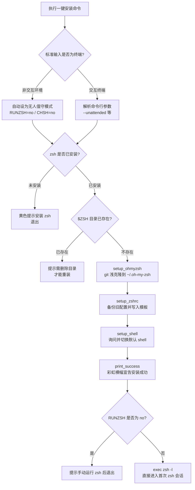
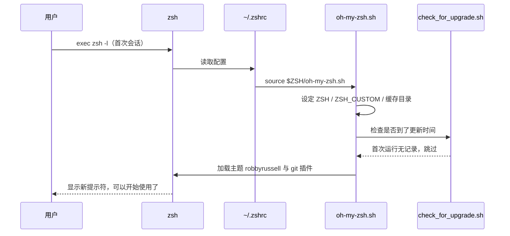

本页面向第一次接触 Oh My Zsh 的读者，完整覆盖"从零到可用"的最短路径：安装前需要准备什么、一键安装命令怎么执行、安装脚本在背后做了哪些事、已有的 `.zshrc` 如何被安全处理、默认 shell 如何切换，以及第一次进入 zsh 时你会看到什么。更深入的安装选项（如无人值守安装、自定义目录）属于进阶话题，将在 [安装脚本深度选项：环境变量与无人值守安装](7-an-zhuang-jiao-ben-shen-du-xuan-xiang-huan-jing-bian-liang-yu-wu-ren-zhi-shou-an-zhuang) 中展开；遇到报错时请转至 [升级、卸载与常见安装问题排查](8-sheng-ji-xie-zai-yu-chang-jian-an-zhuang-wen-ti-pai-cha)。

## 安装前提：三样东西，一分钟自检

Oh My Zsh 不是独立程序，它是 zsh 的配置管理框架，因此安装前必须满足三个前提条件：**zsh 本体**（建议 5.0.8 及以上，最低 4.3.9）、**下载工具**（`curl` 或 `wget` 任选其一）、以及 **git**（推荐 2.4.11 以上，因为安装的本质就是把仓库克隆到本地）。在终端里依次执行下表中的命令，三条全部有正常输出即可继续。

| 检查项 | 自检命令 | 期望结果 |
| :--- | :--- | :--- |
| zsh 是否安装 | `zsh --version` | 输出版本号（如 `zsh 5.9`） |
| curl 是否安装 | `curl --version` | 输出版本号 |
| git 是否安装 | `git --version` | 输出版本号（≥ 2.4.11） |

操作系统层面，官方支持的运行环境包括 Linux、macOS、FreeBSD、Android（Termux）以及 Windows 的 WSL2 子系统——注意原生 Windows 命令行并不在支持范围内，Windows 用户需先启用 WSL2。下表是 README 中给出的兼容性矩阵。

| 操作系统 | 支持状态 |
| :--- | :---: |
| Linux | ✅ |
| macOS | ✅ |
| Windows (WSL2) | ✅ |
| FreeBSD | ✅ |
| Android | ✅ |
| OS/2 Warp | ❌ |

Sources: [README.md](README.md#L77-L95)

## 一键安装：三种命令任选其一

安装方式本质上是同一种模式的三个变体：先用 `curl`/`wget`/`fetch` 把安装脚本下载到内存，再把脚本内容交给 `sh` 执行。以最常见的 curl 为例：

```sh
sh -c "$(curl -fsSL https://raw.githubusercontent.com/ohmyzsh/ohmyzsh/master/tools/install.sh)"
```

这里的外层 `sh -c "$(...)"` 是一个值得初学者理解的组合：`$(...)` 先执行 curl 把脚本内容取回来当作字符串，`sh -c` 再把这段字符串作为 shell 脚本运行。wget 与 fetch 版本只是下载工具不同，命令结构完全一致。

如果你的网络环境无法访问 `raw.githubusercontent.com`（部分国家和地区的 ISP 会屏蔽该域名），可以把脚本地址换成官方镜像站 `https://install.ohmyz.sh/`，命令其余部分不变：

```sh
sh -c "$(curl -fsSL https://install.ohmyz.sh/)"
```

对于安全意识较强的用户，官方也提供"先审查、后执行"的手动方式：先下载脚本到本地，通读确认无误后再运行 `sh install.sh`。这对首次接触该项目的开发者是值得推荐的习惯——安装脚本只有约六百行 POSIX shell，完全可以读完。

| 安装方式 | 适用场景 |
| :--- | :--- |
| `sh -c "$(curl -fsSL <url>)"` | 最常用，curl 环境即可 |
| `sh -c "$(wget -O- <url>)"` | 系统只有 wget 时 |
| `sh -c "$(fetch -o - <url>)"` | FreeBSD 等内置 fetch 的系统 |
| 先 `wget` 下载再 `sh install.sh` | 需要人工审查脚本内容时 |

Sources: [README.md](README.md#L97-L131)

## 安装脚本全景：一条命令背后的六个步骤

`tools/install.sh` 是整个一键安装的核心，它以 `set -e` 开头（任何一步失败立即终止），主流程集中在 `main()` 函数中。对初学者而言，理解这张流程图比逐行读脚本更重要——它解释了安装过程中每一条提示信息的来源：



脚本首先做两道**守门检查**：确认 `zsh` 命令存在，否则以黄色提示"Zsh is not installed. Please install zsh first."并退出；确认 `$ZSH` 目录（默认 `~/.oh-my-zsh`）尚未存在，避免覆盖已有安装。通过检查后，主流程按顺序调用三个 `setup_*` 函数完成实际工作。值得留意的是 `main()` 开头的智能判断：如果标准输入不是终端（典型场景是 CI/CD 管道或 `curl ... | sh` 管道执行），脚本会自动将 `RUNZSH`、`CHSH`、`OVERWRITE_CONFIRMATION` 全部置为 `no`，等价于无人值守模式，避免安装过程卡在交互提问上。

Sources: [tools/install.sh](tools/install.sh#L538-L604)

克隆阶段（`setup_ohmyzsh`）有三个对初学者不可见但很关键的细节。其一，脚本先用 `umask g-w,o-w` 收紧新文件的权限——注释明确指出，若仓库权限过于宽松，后续 compinit 会因安全检查失败而报 `command not found: compdef` 错误。其二，脚本再次确认 `git` 命令存在，缺失则直接报错退出。其三，克隆采用 `git init` + `git fetch --depth=1` 的浅克隆方式，只拉取 master 分支最新一个提交，显著减少下载量；若克隆中途失败，脚本会清理掉半成品目录后退出，不留垃圾文件。

Sources: [tools/install.sh](tools/install.sh#L307-L352)

## 已有 .zshrc？备份、确认与"保留"三重保护

如果你的家目录里已经有一份 `.zshrc`（比如之前手动配置过 zsh），安装脚本不会静默覆盖它，而是执行一套**备份优先**的保护逻辑：先把旧文件改名为 `.zshrc.pre-oh-my-zsh`（这个固定命名是刻意设计的，卸载脚本依赖它找回原配置），若该备份名已被占用，则追加日期时间戳保存更早的那份，例如 `.zshrc.pre-oh-my-zsh-2024-06-01_12-30-00`。也就是说，无论安装多少次，你的原始配置永远不会被真正销毁。

在覆盖之前，脚本还会打印一段黄色提示，展示 `templates/minimal.zshrc` 的内容并询问 `Do you want to overwrite it with the Oh My Zsh template? [Y/n]`——这实际上是在告诉用户："如果你选择保留旧配置，至少要确保里面包含这份最小骨架，否则 Oh My Zsh 不会生效。"如果确认保留（输入 `n`），安装会跳过配置写入继续进行。

下表汇总了与 `.zshrc` 处理相关的可控行为，供不同场景选用：

| 行为 | 触发条件 | 结果 |
| :--- | :--- | :--- |
| 默认覆盖 | 已有 `.zshrc` 且用户确认 | 旧配置备份为 `.zshrc.pre-oh-my-zsh`，写入官方模板 |
| 自动备份旧备份 | `.zshrc.pre-oh-my-zsh` 已存在 | 加时间戳保存后再次备份 |
| 保留现有配置 | 传参 `--keep-zshrc`（即 `KEEP_ZSHRC=yes`） | 完全不动现有 `.zshrc` |
| 跳过确认直接覆盖 | 无人值守模式 | 按默认覆盖逻辑执行，不再询问 |

写入新配置时，脚本用 `sed` 把模板中的 `export ZSH=` 一行替换为本次实际安装路径（并转换为 `$HOME/...` 形式的可移植写法），再落盘为新的 `.zshrc`——所以即使你自定义过安装目录，生成的配置也会指向正确位置。

Sources: [tools/install.sh](tools/install.sh#L354-L416)

## 切换默认 shell：唯一需要你按回车确认的环节

`setup_shell` 负责把系统默认登录 shell 从 bash（或其他）切换为 zsh，这是整个安装过程中**唯一强制交互**的环节。脚本先做三重前置判断：若 `CHSH=no`（如无人值守模式）直接跳过；若当前 `$SHELL` 已经是 zsh 则无事可做；若系统没有 `chsh` 命令则打印蓝色提示让你手动修改。一切正常时，你会看到黄色的 `Do you want to change your default shell to zsh? [Y/n]` 提问——直接回车（默认 Y）即切换，输入 `n` 则跳过。

确认切换后，脚本会先做两件保险工作：从 `/etc/shells` 文件中找到 zsh 二进制的合法路径（chsh 只允许切换到该文件中登记的 shell，这是操作系统的安全约束）；再把当前默认 shell 写入 `~/.shell.pre-oh-my-zsh` 备份，以便日后还原。实际执行 `chsh` 时，脚本会探测你是否具备 sudo 权限并据此选择 `sudo chsh` 或直接 `chsh`（无密码 sudo 的云环境也能正常工作）。若 chsh 执行失败，脚本打印红色错误并提示手动修改，但**不会中断安装**——此时手动执行 `chsh -s $(which zsh)` 可达到同样效果。

Sources: [tools/install.sh](tools/install.sh#L418-L515)

## 首次运行：彩虹横幅之后发生了什么

配置写入和 shell 切换完成后，脚本打印标志性的七彩 ASCII "Oh My Zsh! ....is now installed!" 横幅，并提示你打开 `.zshrc` 选择插件、主题与选项。紧接着最关键的一行——`exec zsh -l`——用 `exec` 把当前进程**替换**为一个以登录模式（`-l`）启动的 zsh。这一步的意义是让你无需重启终端，立即进入首次 zsh 会话开始体验。（若处于无人值守模式，`RUNZSH=no` 会使脚本在此前退出并提示 `Run zsh to try it out.`，由你手动输入 `zsh` 启动。）

Sources: [tools/install.sh](tools/install.sh#L518-L536), [tools/install.sh](tools/install.sh#L590-L604)

首次 zsh 会话的加载链条值得花一分钟理解，因为它解释了"我看到的提示符为什么变成了这样"。zsh 启动时读取 `~/.zshrc`，其中最重要的三行决定了你的初始体验：`export ZSH="$HOME/.oh-my-zsh"` 指向框架目录，`ZSH_THEME="robbyrussell"` 指定默认主题（也就是著名的绿色箭头提示符），`plugins=(git)` 启用唯一的默认插件，最后 `source $ZSH/oh-my-zsh.sh` 一行触发框架整体加载。



Sources: [templates/zshrc.zsh-template](templates/zshrc.zsh-template#L4-L11), [templates/zshrc.zsh-template](templates/zshrc.zsh-template#L71-L78), [oh-my-zsh.sh](oh-my-zsh.sh#L50-L71)

`oh-my-zsh.sh` 的第一段实际逻辑是在启动时**顺手检查更新**：它 source `tools/check_for_upgrade.sh`，后者支持五种更新模式——默认的 `prompt`（到期时询问）、`auto`（自动更新）、`reminder`（仅提醒）、实验性的 `background-alpha` 以及 `disabled`（关闭）。更新频率默认 13 天检查一次，记录存放在缓存目录的 `.zsh-update` 文件中。首次运行时由于没有任何更新记录，检查会被直接跳过——所以如果安装后第一分钟没有看到任何更新提示，这是正常现象，而非故障。这些选项的调优细节将在 [自动更新机制全解：更新模式与频率控制](22-zi-dong-geng-xin-ji-zhi-quan-mo-shi-yu-pin-lu-kong-zhi) 中展开。

Sources: [oh-my-zsh.sh](oh-my-zsh.sh#L70-L71), [tools/check_for_upgrade.sh](tools/check_for_upgrade.sh#L6-L20), [tools/check_for_upgrade.sh](tools/check_for_upgrade.sh#L36-L46)

## 装完第一件事：验证成功与认识最小配置

验证安装只需三个动作：执行 `echo $SHELL` 确认输出以 `/zsh` 结尾（默认 shell 已切换）；观察提示符外观——如果看到了 `robbyrussell` 主题的绿色箭头 `➜` 加目录名，说明主题已生效；随便进入一个 git 仓库目录，提示符会自动追加当前分支名，说明 `git` 插件已工作。若三项均正常，恭喜你完成了首次运行。

最后，建议记住这份"最小可用配置"——它在安装脚本的覆盖确认环节被特意展示给用户，也是理解 `.zshrc` 的最佳起点。整个 Oh My Zsh 生效所需的核心只有四行：指向安装目录的 `ZSH` 变量、主题名、插件列表、以及加载主脚本的 `source` 语句：

```zsh
export ZSH="$HOME/.oh-my-zsh"
ZSH_THEME="robbyrussell"
plugins=(git)

source $ZSH/oh-my-zsh.sh
```

你在 `~/.zshrc` 中看到的其余大段内容，全部是带注释的可选开关（补全大小写敏感、自动纠正、更新频率等），取消注释即可启用。至于这四行之外的世界——主题有多少种选择、插件如何按需增减、`omz` 命令如何管理一切——请沿着下面的路线继续探索。

Sources: [templates/minimal.zshrc](templates/minimal.zshrc#L1-L6), [tools/install.sh](tools/install.sh#L369-L385)

## 下一步阅读路线

安装完成只是起点，推荐按以下顺序继续：

- **[掌握 .zshrc：主题、插件与核心配置项详解](3-zhang-wo-zshrc-zhu-ti-cha-jian-yu-he-xin-pei-zhi-xiang-xiang-jie)**——逐行读懂你刚获得的配置文件，是定制一切的基础；
- **[主题的浏览、切换与随机主题](5-zhu-ti-de-liu-lan-qie-huan-yu-sui-ji-zhu-ti)**——把 `ZSH_THEME` 改成你喜欢的样子，最快获得成就感；
- **[插件的启用、禁用与日常使用](4-cha-jian-de-qi-yong-jin-yong-yu-ri-chang-shi-yong)**——在 `plugins=(git)` 的基础上按需扩展；
- **[omz 命令行工具：更新、插件与主题管理](6-omz-ming-ling-xing-gong-ju-geng-xin-cha-jian-yu-zhu-ti-guan-li)**——学会用官方命令维护框架本身；
- **[安装脚本深度选项：环境变量与无人值守安装](7-an-zhuang-jiao-ben-shen-du-xuan-xiang-huan-jing-bian-liang-yu-wu-ren-zhi-shou-an-zhuang)**——当你需要在多台机器或 CI 中批量安装时再回来读；
- **[升级、卸载与常见安装问题排查](8-sheng-ji-xie-zai-yu-chang-jian-an-zhuang-wen-ti-pai-cha)**——遇到 `chsh` 报错或想干净卸载时的求助站。