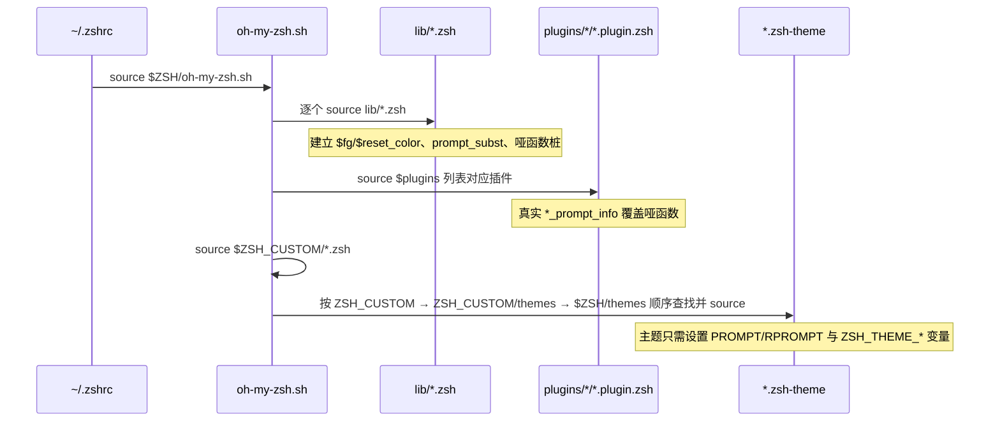

主题是 Oh My Zsh 最直观的定制层，但它的"API"薄得出奇：**一个主题就是一段在启动流程末尾被 source 的 Zsh 脚本**，没有任何框架类或注册接口。本页沿着复杂度阶梯剖析仓库中四个代表性主题——8 行的 `robbyrussell`、47 行的 `gnzh`、104 行的 `steeef`、381 行的 `agnoster`——从中提炼出可复用的编写规范：框架提供了哪些地基、主题如何逐级引入条件逻辑、`vcs_info` 集成与分段式 Powerline 架构。

## 主题的本质：启动末尾被 source 的一段脚本

先建立架构层面的第一性认知。`oh-my-zsh.sh` 主脚本按 **lib → 插件 → custom 自定义脚本 → 主题** 的顺序加载：先循环 source `lib/*.zsh`，再 source 各插件的 `*.plugin.zsh`，然后是 `$ZSH_CUSTOM` 下的顶层 `.zsh` 文件，最后才处理主题。这个顺序决定了主题作者的两个关键前提：主题可以覆盖 lib 建立的默认值（因为它最后执行），也会覆盖插件的函数（同源后定义者胜出）。



主题的查找逻辑由 `is_theme` 函数实现：依 `$ZSH_CUSTOM/$ZSH_THEME.zsh-theme`、`$ZSH_CUSTOM/themes/`、`$ZSH/themes/` 三级路径顺序探测，找不到才报 `[oh-my-zsh] theme 'xxx' not found`。这意味着**同名主题在 custom 目录天然拥有更高优先级**，这是用户无侵入定制内置主题的机制基础（具体实践见 [自定义插件与主题：ZSH_CUSTOM 目录实践](26-zi-ding-yi-cha-jian-yu-zhu-ti-zsh_custom-mu-lu-shi-jian)）。主题名本身由 `.zshrc` 中的 `ZSH_THEME` 变量指定，模板默认值为 `robbyrussell`。

Sources: [oh-my-zsh.sh](oh-my-zsh.sh#L308-L344), [zshrc.zsh-template](templates/zshrc.zsh-template#L7-L17)

## 框架地基：主题可以放心依赖的 lib 层约定

主题并非在真空中运行。`lib/theme-and-appearance.zsh` 在主题 source 之前建立了三项基础设施：其一，执行 `autoload -U colors && colors` 初始化 `$fg`、`$bg`、`$fg_bold`、`$reset_color` 等颜色数组变量；其二，开启 `setopt prompt_subst`，使 `PROMPT` 中的 `$(...)` 命令替换与 `$var` 变量替换在每次显示提示符时重新展开——**这是所有动态提示符的前提**；其三，为 git/ruby 提示符变量族设置默认值（如 `ZSH_THEME_GIT_PROMPT_PREFIX="git:("`），主题可以整体覆写。

另一项容易被忽视的设计是 `lib/prompt_info_functions.zsh` 的**哑函数桩**：框架预先定义了 `rbenv_prompt_info`、`pyenv_prompt_info`、`virtualenv_prompt_info`、`go_prompt_info` 等十余个返回 1 的空实现。这些函数的真实版本由对应插件在加载时覆盖。因此主题可以**无条件地调用** `$(virtualenv_prompt_info)` 而不必写条件判断——未装插件时它静默返回空，装了插件后自动显示信息。这是主题与插件生态解耦的核心契约。

框架级可覆写变量汇总如下：

| 变量族 | 默认值位置 | 框架消费者 | 主题覆写示例 |
|---|---|---|---|
| `ZSH_THEME_GIT_PROMPT_PREFIX/SUFFIX` | lib 默认 `git:(` / `)` | `git_prompt_info` | robbyrussell 换为彩色括号 |
| `ZSH_THEME_GIT_PROMPT_DIRTY/CLEAN` | 默认 `*` / 空 | `parse_git_dirty` | robbyrussell 换为 `✗` |
| `ZSH_THEME_GIT_PROMPT_UNTRACKED/ADDED/MODIFIED/…` | 默认为空 | `git_prompt_status` 状态映射 | 需要细粒度状态符号的主题 |
| `ZSH_THEME_RUBY_PROMPT_PREFIX/SUFFIX` | 默认 `(` / `)` | `ruby_prompt_info` | gnzh 换为 `‹›` |
| `ZSH_THEME_GIT_SHOW_UPSTREAM` | 未设置（关闭） | `git_prompt_info` 的 upstream 拼接 | 设为 1 显示 `branch -> origin/branch` |

Sources: [theme-and-appearance.zsh](lib/theme-and-appearance.zsh#L1-L13), [prompt_info_functions.zsh](lib/prompt_info_functions.zsh#L1-L46), [git.zsh](lib/git.zsh#L42-L49)

## 第一级：robbyrussell——8 行声明式提示符

默认主题 robbyrussell 是声明式风格的极致示范，全部实现仅 8 行。第 1 行的 `PROMPT` 集中了三个值得逐个拆解的 Zsh 提示符转义技巧：`%(?:…:…)` 三元条件按上一条命令的退出码选择分支（成功走绿色箭头、失败走红色箭头）；`%{$fg_bold[green]%}` 用 `%{ %}` 包裹颜色序列，将其标记为零宽内容，避免 zsh 误算光标位置；`%1{➜%}` 通过数字前缀声明该多字节箭头符号的显示宽度为 1 个字符，这是处理 Unicode 符号宽度计算的规范写法。

```zsh
# 摘自 robbyrussell.zsh-theme
PROMPT="%(?:%{$fg_bold[green]%}%1{➜%} :%{$fg_bold[red]%}%1{➜%} ) %{$fg[cyan]%}%c%{$reset_color%}"
PROMPT+=' $(git_prompt_info)'
```

第二行用 `+=` 追加 `$(git_prompt_info)`——得益于 `prompt_subst`，这个函数在每次提示符渲染时被调用。第 4–7 行覆写四个 `ZSH_THEME_GIT_PROMPT_*` 变量，将默认的 `git:(main *)` 改造为蓝色的 `git:(main ✗` 风格。注意覆写发生在**主题文件内**而非函数内，因为这些变量在 `git_prompt_info` 展开时才被读取。这个案例确立了一级规范：**纯字符串拼接 + 框架提供的 info 函数 + 覆写契约变量，零自定义函数即可完成一个合格主题**。常用转义序列的速查如下：

| 序列 | 语义 | robbyrussell 中的用法 |
|---|---|---|
| `%(?:A:B)` | 退出码为 0 取 A，否则取 B | 绿/红箭头切换（L1） |
| `%{…%}` | 声明零宽内容，不参与宽度计算 | 包裹所有颜色转义 |
| `%1{…%}` | 声明字面内容显示宽度为 n 个字符 | 声明 `➜` 宽度为 1 |
| `%c` | 当前目录最后一级（`~` 缩写路径的末段） | 青色显示目录名 |
| `%n` / `%m` | 用户名 / 短主机名 | gnzh、agnoster 的 context 段使用 |

Sources: [robbyrussell.zsh-theme](themes/robbyrussell.zsh-theme#L1-L8)

## 第二级：gnzh——条件渲染、多行布局与 RPROMPT

gnzh 展示了从"纯声明"迈向"带逻辑声明"的中间形态。它的全部逻辑包裹在一个匿名函数 `() { … }` 中——这是 Zsh 主题的**作用域卫生规范**：`local` 声明的 `PR_USER`、`PR_HOST` 等中间变量在函数结束后销毁，不会污染用户的全局命名空间。函数内部用两组 `if` 完成条件渲染：`$UID -ne 0` 区分普通用户（绿色）与 root（红色），`$SSH_CLIENT`/`$SSH2_CLIENT` 非空时主机名转红色——这两类判断是 powerline 类主题的通用惯例，agnoster 的 `prompt_context` 也是同样思路。

gnzh 的第二个特征是**多行布局与 RPROMPT**：`PROMPT` 用 `╭─` 起首行（拼接 virtualenv、user@host、目录、ruby 版本、git 分支），`╰─➤` 作输入行，同时把退出码 `%(?..%F{red}%? ↵%f)` 放到右侧的 `RPROMPT`——`%…` 中间段仅在退出码非零时渲染。第三，gnzh 主动执行了一次 `setopt prompt_subst`（L3）：尽管 lib 已设置过，主题内重复声明是防御性规范，保证主题被独立 source 时（如调试场景）依然正确。它还覆写了 `ZSH_THEME_RUBY_PROMPT_PREFIX/SUFFIX` 与 `ZSH_THEME_VIRTUALENV_PREFIX/SUFFIX`，演示了如何"接管"框架 info 函数的外观而不重写其逻辑。

Sources: [gnzh.zsh-theme](themes/gnzh.zsh-theme#L1-L47)

## 第三级：steeef——vcs_info 集成与生命周期钩子缓存

steeef 引入了 Zsh 原生的 `vcs_info` 子系统，这是与框架 `git_prompt_info` 并行的另一条 VCS 信息通道，优势在于**多后端**（`zstyle ':vcs_info:*' enable git svn` 一行启用多种版本控制）和**格式模板**（`formats`/`actionformats`/`stagedstr`/`unstagedstr` 等 zstyle 键）。steeef 用 `%F{…}` 变量拼装 `FMT_BRANCH` 格式串，最终在 `PROMPT` 中直接引用 `$vcs_info_msg_0_`——该变量由 `vcs_info` 函数填充，同样依赖 `prompt_subst`。

steeef 真正的教科书价值在于**性能缓存模式**。`vcs_info` 的 `check-for-changes` 代价高昂（源码注释直言"can be really slow"），steeef 的解法是用 `PR_GIT_UPDATE` 标志位控制重算：通过 `add-zsh-hook` 注册三个钩子——`preexec` 在执行 git/hub/svn 命令前置位标志，`chpwd` 在切换目录前置位，`precmd` 仅在标志非空时才运行 `git ls-files --other`（检测 untracked 文件，这是 vcs_info 本身不覆盖的盲区）并调用 `vcs_info`，随后清空标志。结果是**状态只在必要时刷新**，大量命令执行时提示符渲染接近零成本。此外它按 `$terminfo[colors]` 是否达到 256 色降级定义颜色变量（256 色用 `%F{81}` 等真彩码，否则回落到 `cyan`/`yellow` 等基础色名），并导出 `VIRTUAL_ENV_DISABLE_PROMPT=1` 阻止 virtualenv 自己污染 `PS1`——主题对环境的这类副作用必须显式声明在文件头部。

Sources: [steeef.zsh-theme](themes/steeef.zsh-theme#L17-L103)

## 第四级：agnoster——分段式 Powerline 架构

agnoster 代表主题复杂度的上限：381 行，Powerline 风格分段渲染，需要专用字体。它的架构与前三者有本质区别——**PROMPT 只是一个函数调用**：`PROMPT='%{%f%b%k%}$(build_prompt) '`（L380）。所有渲染逻辑收敛到 `build_prompt` 中按固定顺序串联的十个分段函数，每个分段"自己决定显示或隐藏"。`build_prompt` 第一行 `RETVAL=$?` 抢在一切子命令之前捕获上一条命令的退出码——这是分段主题的关键细节，任何中间函数调用都会覆盖 `$?`。

```mermaid
flowchart LR
    A["PROMPT 展开<br/>$(build_prompt)"] --> B["RETVAL=$?<br/>捕获退出码"]
    B --> C["prompt_status<br/>✘失败/⚡root/⚙后台任务"]
    C --> D["prompt_virtualenv"]
    D --> E["prompt_aws"]
    E --> F["prompt_terraform"]
    F --> G["prompt_context<br/>user@host"]
    G --> H["prompt_dir<br/>%~"]
    H --> I["prompt_git"]
    I --> J["prompt_bzr"]
    J --> K["prompt_hg"]
    K --> L["prompt_end<br/>闭合最后一个色块"]
```



分段渲染的核心是 `prompt_segment`/`prompt_end` 一对函数构成的**状态机**：全局变量 `CURRENT_BG` 记录上一个色块的背景色，`prompt_segment` 对比当前与上一个背景色——不同则输出一个色块切换箭头 `$'\ue0b0'`（Powerline 专用码点，以 Unicode 转义而非字面字符书写，避免源码在不同字体下不可读），相同则直接延续色块。注意 `SEGMENT_SEPARATOR` 的赋值被包裹在设置了 `LC_CTYPE="en_US.UTF-8"` 的匿名函数中（L108–L121），`prompt_git` 里的分支符号 `\ue0a0` 亦然——**多字节符号赋值必须本地化 LC 环境变量**，否则在部分 locale 下触发 "character not in range" 错误（`lib/git.zsh` 中有对同一问题的详细注释）。

agnoster 还示范了三个高阶规范。**其一，自隐藏分段**：`prompt_context` 在 `USERNAME == DEFAULT_USER` 且无 SSH 连接时直接返回不渲染；`prompt_git` 无 git 命令或处于 `oh-my-zsh.hide-status=1` 仓库时返回——"无信息即无色块"。**其二，可配置面**：全部颜色通过 `: ${AGNOSTER_DIR_BG:=blue}` 语法初始化（`:` 保证语句合法，`${VAR:=default}` 只在未设置时赋值），用户可在 `.zshrc` 的 `source oh-my-zsh.sh` **之前**覆写任意 `AGNOSTER_*` 变量，还能用 `SOLARIZED_THEME=light` 切换明暗整套配色。**其三，不信任外部数据**：分支名、AWS profile 名等来自 git/环境的字符串一律经 `${ref:gs/%/%%}` 把 `%` 翻倍转义，防止分支名中的 `%` 被提示符展开器误解析（这与 `lib/vcs_info.zsh` 为缓解 CVE-2021-45444 做的字段转义是同一防线）。最后，agnoster 的 `prompt_terraform` 直接调用插件侧的 `tf_prompt_info`——依赖的正是前文提到的哑函数桩契约，插件未启用时该分段自动消失。

Sources: [agnoster.zsh-theme](themes/agnoster.zsh-theme#L52-L148), [agnoster.zsh-theme](themes/agnoster.zsh-theme#L332-L381), [vcs_info.zsh](lib/vcs_info.zsh#L37-L44)

## 四级对比与编写守则

四个主题构成本仓库内一条完整的复杂度光谱，可对照选型或确定自己主题的起点：

| 维度 | robbyrussell | gnzh | steeef | agnoster |
|---|---|---|---|---|
| 行数 | 8 | 47 | 104 | 381 |
| PROMPT 形态 | 单行字符串 | 多行字符串 + RPROMPT | 多行字符串 + `$vcs_info_msg_0_` | 单一 `$(build_prompt)` |
| VCS 信息来源 | `git_prompt_info` | `git_prompt_info` | `vcs_info` + 钩子缓存 | 自带 `prompt_git` |
| 条件逻辑载体 | `%(?:)` 转义三元 | UID/SSH 的 if 分支 | `add-zsh-hook` 三钩子 | 分段函数自隐藏 |
| 可配置面 | 4 个 `ZSH_THEME_GIT_*` | 前后缀契约变量 | zstyle `:vcs_info` | `AGNOSTER_*` + `SOLARIZED_THEME` |
| 字体/环境要求 | 无 | 无 | 无 | Powerline 字体 |

将四个案例的共性收敛为规范清单，可指导任何新主题的编写：**默认值放 lib、覆写放主题**——契约变量的机制保证了主题与框架函数的解耦；**外部数据必转义**——所有非受控字符串（分支名、环境变量）经 `:gs/%/%%` 处理；**中间变量进匿名函数**——用 `() { … }` + `local` 保持命名空间卫生；**昂贵操作加缓存或改异步**——参照 steeef 的钩子缓存，或使用框架的异步提示符接口（`_omz_register_handler` 注册重函数、`$_OMZ_ASYNC_OUTPUT` 读回结果，详见 [异步 Git 提示符与大型仓库性能优化](21-yi-bu-git-ti-shi-fu-yu-da-xing-cang-ku-xing-neng-you-hua)）；**多字节符号声明宽度**——`%1{…%}` 与 LC 环境变量保护双管齐下；**配置通过 `${VAR:=default}` 暴露**——让用户无需改主题文件即可定制。掌握本页机制后，即可按 ZSH_CUSTOM 的主题目录约定落地自定义主题，插件的开发命名约定与主题编写共享同一套加载语义（见 [插件加载机制与开发命名约定](16-cha-jian-jia-zai-ji-zhi-yu-kai-fa-ming-ming-yue-ding)）。

Sources: [git.zsh](lib/git.zsh#L239-L265), [async_prompt.zsh](lib/async_prompt.zsh#L8-L43)

## 小结与延伸阅读

主题编写的全部契约可以压缩为一句话：**主题在启动链的最后一环被 source，向上依赖 lib 的颜色系统、`prompt_subst` 与哑函数桩，向下通过 `ZSH_THEME_*` 变量与 info 函数对接框架能力，复杂度自主决定停在四级阶梯的哪一级**。robbyrussell 证明了 8 行足够，agnoster 证明了 381 行也能保持架构清晰——两者的分水岭不在功能多少，而在是否用函数分段管理复杂度。理解了主题何时被加载、依赖什么地基后，建议继续沿两条路径深入：追踪主题之前的完整启动时序与各项 lib 的职责，阅读 [启动加载流程：oh-my-zsh.sh 主脚本逐段解读](10-qi-dong-jia-zai-liu-cheng-oh-my-zsh-sh-zhu-jiao-ben-zhu-duan-jie-du)；或将本页的主题亲手放入 custom 目录实践覆写优先级，参考 [自定义插件与主题：ZSH_CUSTOM 目录实践](26-zi-ding-yi-cha-jian-yu-zhu-ti-zsh_custom-mu-lu-shi-jian)。若你只想站在主题使用者的角度浏览与切换，则可回退到 [主题的浏览、切换与随机主题](5-zhu-ti-de-liu-lan-qie-huan-yu-sui-ji-zhu-ti)。