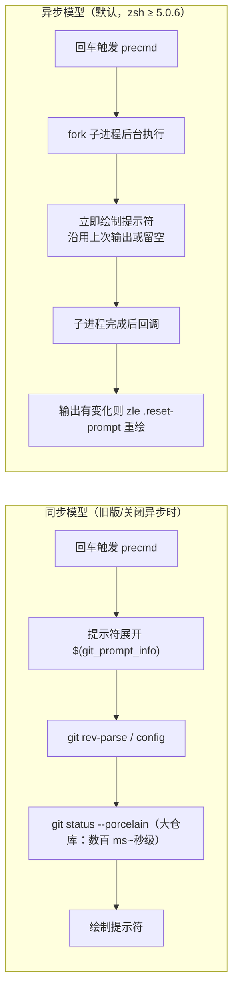
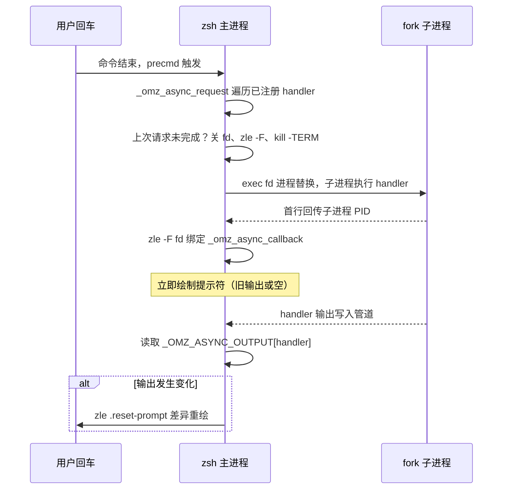
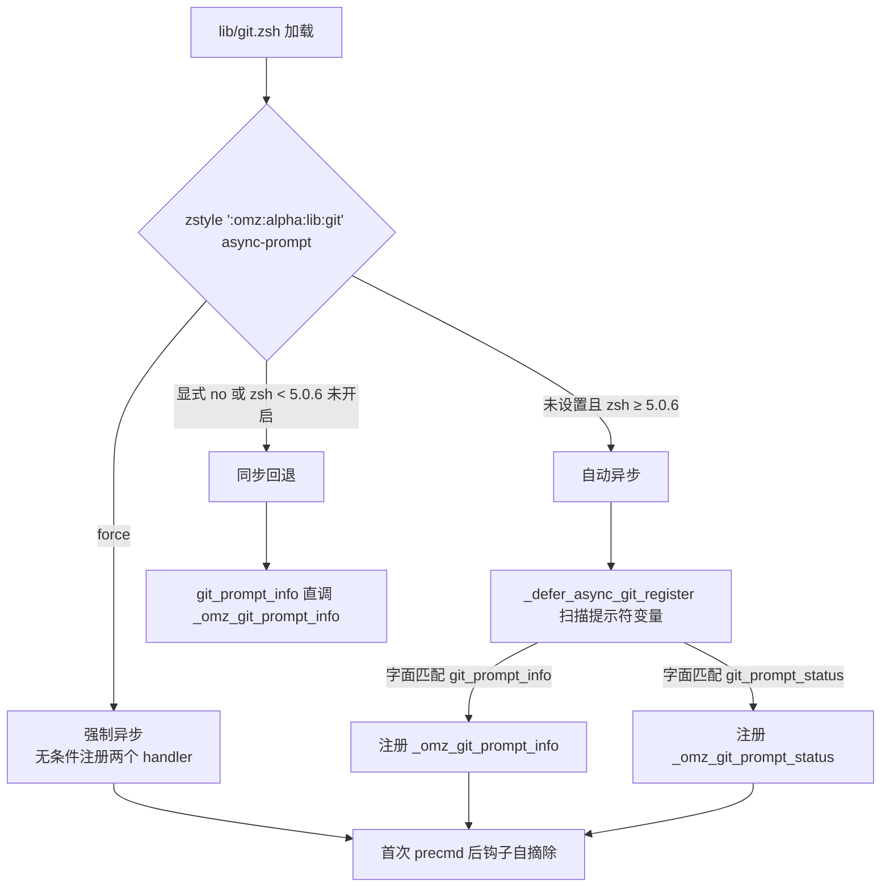

在包含数十万文件的仓库中，一次 `git status` 可能需要数百毫秒甚至数秒。oh-my-zsh 的提示符恰恰依赖这类命令来渲染分支与状态符号，若在提示符展开路径上同步执行，每次回车都会被卡住。本页从性能问题出发，剖析 oh-my-zsh 内置的**异步提示符框架**（lib/async_prompt.zsh）、git 库的三种运行模式与 zstyle 开关、逐仓库降级配置，并横向对比 git-prompt、gitfast 与 vcs_info 主题等替代实现，最后给出主题作者的异步适配实践指南。

## 同步提示符的性能瓶颈：每一次回车都是一次 git status

问题始于主题对 `git_prompt_info` 的消费方式。默认主题 robbyrussell 将 `$(git_prompt_info)` 拼进 `PROMPT`，提示符展开时会执行命令替换并阻塞后续渲染 [robbyrussell.zsh-theme](themes/robbyrussell.zsh-theme#L1-L8)。而这条调用链的成本并不低：`_omz_git_prompt_info` 串行调用 `git rev-parse --git-dir --abbrev-ref HEAD`、`git config`、`git describe`/`rev-parse --short`，再接一个 `parse_git_dirty`（内部又是一次 `git status --porcelain`）[git.zsh](lib/git.zsh#L14-L50)。真正的大头在 `_omz_git_prompt_status`：它运行 `git status --porcelain -b` 并遍历全部状态前缀，外加一次 `git rev-parse --verify refs/stash` 探测 stash [git.zsh](lib/git.zsh#L119-L131)。

更具代表性的反面教材是 agnoster 主题：`prompt_git` 在同步路径上依次执行 `rev-parse --is-inside-work-tree`、`rev-parse --git-dir`、`parse_git_dirty`、分支解析，启用 `AGNOSTER_GIT_BRANCH_STATUS` 后还要跑两条 `git log --oneline @{upstream}..` / `..@{upstream}` 来判断领先落后，最后再调用一次开启 `check-for-changes` 的 vcs_info [agnoster.zsh-theme](themes/agnoster.zsh-theme#L181-L240)。steeef 主题的注释则直接印证了成本来源："check-for-changes can be really slow. you should disable it, if you work with large repositories" [steeef.zsh-theme](themes/steeef.zsh-theme#L40-L42)。同步模型的本质缺陷在于：**提示符显示时间被最慢的 git 子命令绑架**，而用户真正需要的只是"尽快看到提示符，状态稍后补上"。



Sources: [robbyrussell.zsh-theme](themes/robbyrussell.zsh-theme#L1-L8) [git.zsh](lib/git.zsh#L14-L50)

## lib/async_prompt.zsh：通用异步执行框架

框架的设计目标是把"昂贵计算"与"提示符绘制"解耦，头部注释表明其异步实现取自 zsh-autosuggestions 的 async.zsh 与 woefe/git-prompt.zsh [async_prompt.zsh](lib/async_prompt.zsh#L1-L6)。它的公开 API 相当克制，源码注释给出了标准用法三步走：定义异步处理函数 → 用 `_omz_register_handler` 注册 → 在 `$PROMPT` 里放一个读取 `$_OMZ_ASYNC_OUTPUT[handler_name]` 的存根函数；同时明确警告 **"This API is subject to change and optimization. Rely on it at your own risk"** [async_prompt.zsh](lib/async_prompt.zsh#L8-L26)。

注册器 `_omz_register_handler` 做了严格的幂等防护：函数不存在或已注册则直接返回，注册成功后把处理函数追加进 `_omz_async_functions` 数组，并确保 `_omz_async_request` 只被挂到 precmd 钩子一次 [async_prompt.zsh](lib/async_prompt.zsh#L28-L43)。核心的 `_omz_async_request` 为每个处理函数维护独立的文件描述符与 PID：若上一次请求仍挂起（fd 仍可读），先关闭 fd、解除 `zle -F` 绑定并 `kill -TERM` 子进程——开启 MONITOR 选项时向整个进程组发信号以免 handler 内部 fork 的子进程成为孤儿，否则只杀直接子进程 [async_prompt.zsh](lib/async_prompt.zsh#L56-L77)。随后通过进程替换 `exec {fd}< <(...)` fork 子进程，子进程先回传自身 PID，再恢复上一条命令的退出码并执行 handler [async_prompt.zsh](lib/async_prompt.zsh#L84-L102)。这里还藏着一个 zsh 5.8 以下的变通：`is-at-least 5.8 || command true` 强制产生一次 fork，以规避 ^C 失效的已知 bug（引用 zsh-autosuggestions issue 364/612）[async_prompt.zsh](lib/async_prompt.zsh#L96-L99)。

回调 `_omz_async_callback` 在 fd 可读时被触发：以 NUL 为分隔符读出 handler 输出写入 `_OMZ_ASYNC_OUTPUT[handler]`，**只有输出与旧值不同才调用 `zle .reset-prompt` 重绘提示符**，最后关闭 fd 并复位全局 FD/PID 记录 [async_prompt.zsh](lib/async_prompt.zsh#L110-L142)。这一"差异重绘"策略避免了大仓库中高频无意义的屏幕刷新。



| 组件 | 类型 | 职责 |
|---|---|---|
| `_omz_async_functions` | 数组 | 已注册的异步处理函数名单 |
| `_OMZ_ASYNC_FDS` | 关联数组 | 每个 handler 的管道文件描述符 |
| `_OMZ_ASYNC_PIDS` | 关联数组 | 每个 handler 的子进程 PID，用于取消请求 |
| `_OMZ_ASYNC_OUTPUT` | 关联数组 | handler 最新输出，供提示符存根读取 |

Sources: [async_prompt.zsh](lib/async_prompt.zsh#L8-L26) [async_prompt.zsh](lib/async_prompt.zsh#L46-L107)

## git 库的接入：三种运行模式与 zstyle 开关

git 库在加载时决定自身的运行模式，判定条件由 zstyle `':omz:alpha:lib:git' async-prompt` 控制：显式开启即进入异步；未设置时，zsh ≥ 5.0.6 也默认异步——版本下限是为了规避旧版 zsh 上两个已知的异步提示符 bug（issue 12331、12360），源码还留下 CentOS 7 EOL 后移除变通的 TODO [git.zsh](lib/git.zsh#L171-L178)。异步模式下 `git_prompt_info` 与 `git_prompt_status` 被替换为存根函数，仅从 `_OMZ_ASYNC_OUTPUT[_omz_git_prompt_info]` / `_OMZ_ASYNC_OUTPUT[_omz_git_prompt_status]` 读取缓存输出 [git.zsh](lib/git.zsh#L179-L189)。

注册采用**延迟探测**：`_defer_async_git_register` 被前置插入 `precmd_functions`（而非 add-zsh-hook 追加），保证它先于 `_omz_async_request` 执行 [git.zsh](lib/git.zsh#L211-L213)。它扫描 `PS1:PS2:PS3:PS4:RPROMPT:RPS1..RPS4`，仅当字面出现 `$(git_prompt_info)` 或反引号形式时才注册对应 handler，随后自我摘除钩子 [git.zsh](lib/git.zsh#L191-L209)。这个字面匹配带来一个重要推论：**主题若用包装函数间接调用**（如 `$(_my_theme_git_info)`），探测会落空、异步输出永远为空——jj 插件文档明确记录了这一兼容性问题并给出修复方案 [jj/README.md](plugins/jj/README.md#L121-L138)。为此框架提供 `force` 值：无条件注册两个 handler，专为包装函数场景设计 [git.zsh](lib/git.zsh#L214-L228)。一切都不满足时则回退到同步直调模式 [git.zsh](lib/git.zsh#L229-L236)。



| 模式 | 触发条件 | 提示符行为 | 典型场景 |
|---|---|---|---|
| 自动异步（默认） | zsh ≥ 5.0.6 且 zstyle 未关闭 | 存根读取 `_OMZ_ASYNC_OUTPUT`，先显示后重绘 | 绝大多数用户 |
| 强制异步 `force` | `zstyle ':omz:alpha:lib:git' async-prompt force` | 无条件注册，忽略字面探测 | 主题用包装函数调用 git_prompt_info |
| 同步回退 | zsh < 5.0.6，或 `async-prompt no` | 内联执行，提示符被 git 阻塞 | 旧版 zsh、显式禁用 |

kubectx 插件是同一模式在插件侧的复制品：`kubectx_prompt_info` 读存根、同样的三分支 zstyle 判定（上下文为 `:omz:alpha:plugins:kubectx`）、同样的延迟探测与 force 分支，可作为第三方插件接入异步框架的参考实现 [kubectx.plugin.zsh](plugins/kubectx/kubectx.plugin.zsh#L17-L46)。

Sources: [git.zsh](lib/git.zsh#L171-L236) [jj/README.md](plugins/jj/README.md#L121-L138)

## 只读保证：GIT_OPTIONAL_LOCKS=0

异步化解决了"等待"，但还有一个隐患：提示符里的 git 调用若触发索引刷新会写入 index.lock，与用户同时进行的 git 操作冲突。git 库用一层薄封装解决：`__git_prompt_git` 以 `GIT_OPTIONAL_LOCKS=0` 运行所有内部 git 命令，等价于 `git --no-optional-locks`，旧版 git 不认识该变量时也会优雅降级；注释特别说明封装成函数而非直接导出变量，是为了避免污染用户手动执行的 git 命令 [git.zsh](lib/git.zsh#L3-L12)。另有一处健壮性设计值得一提：`_omz_git_prompt_status_match` 强制 C locale 做正则匹配，防止多字节 locale 下文件名含非法字节序列时 `=~` 抛出 REG_ILLSEQ 中断状态解析——且 locale 必须限定在函数内，否则会破坏调用方主题的 Unicode 符号展开（OHMYZSH-13330 / 13985）[git.zsh](lib/git.zsh#L52-L70)。

Sources: [git.zsh](lib/git.zsh#L3-L12) [git.zsh](lib/git.zsh#L52-L70)

## 大型仓库的降级开关与逐仓库配置

即便有了异步，大仓库的后台 `git status` 依然消耗 CPU。oh-my-zsh 提供了一套由粗到细的降级开关，全部有代码级落点：仓库级 git config `oh-my-zsh.hide-info=1` 会让 `_omz_git_prompt_info` 直接返回、跳过整条 rev-parse 链 [git.zsh](lib/git.zsh#L24-L26)；`oh-my-zsh.hide-status=1` 让状态函数短路，完全不碰 `git status --porcelain -b` [git.zsh](lib/git.zsh#L73-L74)；`oh-my-zsh.hide-dirty=1` 则只保留分支、跳过脏检查 [git.zsh](lib/git.zsh#L243-L244)。全局层面，`.zshrc` 模板文档化的 `DISABLE_UNTRACKED_FILES_DIRTY="true"` 会在 status 命令追加 `--untracked-files=no`，模板注释直言这让大仓库的状态检查 "much, much faster"——未跟踪文件的扫描恰是 `git status` 最昂贵的部分 [zshrc.zsh-template](templates/zshrc.zsh-template#L55-L58) [git.zsh](lib/git.zsh#L243-L246)。子仓库众多的 monorepo 还可用 `GIT_STATUS_IGNORE_SUBMODULES` 控制子模块脏检查策略，默认 `dirty`，设为 `git` 时尊重 `.gitmodules` 里的逐仓库配置 [git.zsh](lib/git.zsh#L247-L255)。

| 开关 | 配置级别 | 生效位置 | 效果 |
|---|---|---|---|
| `oh-my-zsh.hide-info=1` | git config（逐仓库） | `_omz_git_prompt_info` 入口 | 隐藏分支，跳过 rev-parse 链 |
| `oh-my-zsh.hide-status=1` | git config（逐仓库） | `_omz_git_prompt_status` 入口 | 跳过 `git status --porcelain -b` |
| `oh-my-zsh.hide-dirty=1` | git config（逐仓库） | `parse_git_dirty` | 保留分支，跳过脏检查 |
| `DISABLE_UNTRACKED_FILES_DIRTY=true` | 环境变量 / .zshrc | `parse_git_dirty` 的 FLAGS | status 加 `--untracked-files=no` |
| `GIT_STATUS_IGNORE_SUBMODULES` | 环境变量 | `parse_git_dirty` 的 FLAGS | `--ignore-submodules=dirty`（默认）或 `git` |

Sources: [git.zsh](lib/git.zsh#L238-L265) [zshrc.zsh-template](templates/zshrc.zsh-template#L55-L58)

## 替代实现对比：git-prompt、gitfast 与 vcs_info 主题

**git-prompt 插件**走的是"单次调用 + 计数缓存"路线：`gitstatus.py` 用一次 `git status --porcelain --branch`（强制 `LANG=C`）同时提取分支、ahead/behind、staged/conflicts/changed/untracked/deleted 各类计数，stash 数量直接读 `logs/refs/stash` 文件行数而非 fork git，detached HEAD 用 `for-each-ref` 解析 tag [gitstatus.py](plugins/git-prompt/gitstatus.py#L10-L44) [gitstatus.py](plugins/git-prompt/gitstatus.py#L91-L103)。它的缓存策略在 zsh 侧：默认每次提示都重新计算；设置 `ZSH_THEME_GIT_PROMPT_CACHE` 后，只有 chpwd 或 preexec 检测到刚执行过 `git*/hub*/gh*/stg*` 命令才刷新 [git-prompt.plugin.zsh](plugins/git-prompt/git-prompt.plugin.zsh#L21-L31)。代价是同步执行且**依赖 python3**（README 明确要求）[git-prompt/README.md](plugins/git-prompt/README.md#L18-L20)。注意它与内置异步是两套独立体系，自身不做异步化。

**gitfast 插件**打包了 git 上游的 git-prompt.sh，`git_prompt_info` 仅做一层 `__git_ps1` 包装 [gitfast.plugin.zsh](plugins/gitfast/gitfast.plugin.zsh#L6-L12)。其真正卖点在头部注释里：支持 zsh 下以 precmd 直写 PS1 的调用形态（"for a slightly faster prompt"），并提供 `GIT_PS1_SHOWDIRTYSTATE`、`GIT_PS1_SHOWUPSTREAM`（含 `--count` 优化与 legacy 回退）等一整套细粒度开关 [git-prompt.sh](plugins/gitfast/git-prompt.sh#L17-L72)。该插件的主场景是补全性能——README 明言其补全"much faster than the official one from zsh" [gitfast/README.md](plugins/gitfast/README.md#L1-L9)。

**vcs_info 系主题**的代表 steeef 展示了纯 zsh 手写缓存的标准范式：preexec 按命令名（git/hub/svn）置位 `PR_GIT_UPDATE`，chpwd 置位，precmd 仅在置位时调用 vcs_info，否则复用上次的 `vcs_info_msg_0_` [steeef.zsh-theme](themes/steeef.zsh-theme#L64-L99)。它还补充了 vcs_info 不覆盖的未跟踪文件检查（`git ls-files --other --exclude-standard | grep -q .`）[steeef.zsh-theme](themes/steeef.zsh-theme#L84-L93)。对比之下，agnoster 每次绘制都全量执行所有 git 调用，是大仓库下的最重负载 [agnoster.zsh-theme](themes/agnoster.zsh-theme#L181-L240)。

| 方案 | 执行模型 | 缓存/失效策略 | 外部依赖 | 大仓库适用性 |
|---|---|---|---|---|
| 内置异步 git 库 | 每次提示前 fork 后台进程 | 立即显示旧值，完成后差异重绘 | zsh ≥ 5.0.6（自动模式） | 最佳：提示符永不被阻塞 |
| git-prompt 插件 | 同步，python3 子进程 | `ZSH_THEME_GIT_PROMPT_CACHE` + preexec 命令探测 | python3 | 中：有缓存仍会阻塞提示 |
| gitfast 插件 | 同步（支持 precmd 直写 PS1） | 依赖 `GIT_PS1_*` 手动调粒度 | git-prompt.sh（随插件自带） | 中：可关脏检查降低成本 |
| vcs_info 主题 | 同步 | `PR_GIT_UPDATE` 标志按需刷新 | 无 | 取决于主题纪律（steeef 好、agnoster 差） |

Sources: [git-prompt.plugin.zsh](plugins/git-prompt/git-prompt.plugin.zsh#L21-L57) [git-prompt.sh](plugins/gitfast/git-prompt.sh#L17-L72) [steeef.zsh-theme](themes/steeef.zsh-theme#L40-L99)

## 主题作者实践清单：把你的主题改造成异步友好

第一条纪律是**保持提示符变量的字面形态**：直接写 `$(git_prompt_info)` 而不是包一层自定义函数，否则延迟探测失效，必须显式 `zstyle ':omz:alpha:lib:git' async-prompt force` 补救（放 `.zshrc` 中 oh-my-zsh 被 source 之前）[jj/README.md](plugins/jj/README.md#L128-L136)。第二条是**存根只读缓存、永不直调昂贵函数**，参照 git 库自身的实现模式：

```zsh
# 主题侧存根：异步输出未就绪时静默，就绪后由框架差异重绘
function my_theme_git_info() {
  if [[ -n "${_OMZ_ASYNC_OUTPUT[_omz_git_prompt_info]}" ]]; then
    echo -n "${_OMZ_ASYNC_OUTPUT[_omz_git_prompt_info]}"
  fi
}
PROMPT+=' $(my_theme_git_info)'
```

需要自定义异步计算（如 kubectl 上下文、jj 状态）时，按 async_prompt.zsh 头部注释的约定：定义 handler → `_omz_register_handler` 注册 → 存根读取 `_OMZ_ASYNC_OUTPUT[handler名]`，kubectx 插件是可直接照抄的完整参考 [async_prompt.zsh](lib/async_prompt.zsh#L8-L26) [kubectx.plugin.zsh](plugins/kubectx/kubectx.plugin.zsh#L1-L22)。第三条是**为重负载场景预留逃生门**：主题里对 git 段做 `commands[git]` 存在性检查（agnoster 的 `(( $+commands[git] )) || return`）并尊重 `oh-my-zsh.hide-*` 配置，让逐仓库降级开关能穿透主题生效 [agnoster.zsh-theme](themes/agnoster.zsh-theme#L181-L185)。最后切记框架 API 仍标注为不稳定，锁定行为时优先依赖 zstyle 开关而非内部变量。

Sources: [async_prompt.zsh](lib/async_prompt.zsh#L8-L26) [kubectx.plugin.zsh](plugins/kubectx/kubectx.plugin.zsh#L24-L46)

## 小结与延伸阅读

oh-my-zsh 的解法是分层收敛的：框架层用 fd + PID 握手 + 差异重绘把昂贵 git 调用移出关键路径 [async_prompt.zsh](lib/async_prompt.zsh#L46-L142)；接入层用 zstyle 三态开关与字面探测兼顾默认体验与主题兼容 [git.zsh](lib/git.zsh#L171-L236)；配置层用逐仓库 hide-* 与全局 DISABLE_UNTRACKED_FILES_DIRTY 把最贵的未跟踪扫描变成可选 [git.zsh](lib/git.zsh#L238-L265)。理解这套机制后，无论使用默认主题还是自研主题，都能在大型 monorepo 中把提示符响应时间稳定在毫秒级。

想继续深入，建议按序阅读：[主题编写规范：从 robbyrussell 到 agnoster](20-zhu-ti-bian-xie-gui-fan-cong-robbyrussell-dao-agnoster) 了解提示符变量与主题结构；[启动性能优化：减少 fork 与缓存策略](23-qi-dong-xing-neng-you-hua-jian-shao-fork-yu-huan-cun-ce-lue) 覆盖启动路径上的同类优化；[经典插件解析：git、extract、fzf 与实用工具类](18-jing-dian-cha-jian-jie-xi-git-extract-fzf-yu-shi-yong-gong-ju-lei) 介绍 git 插件的别名体系。