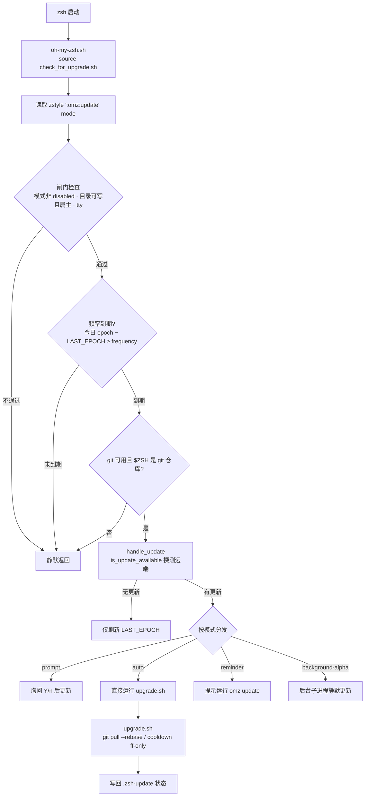
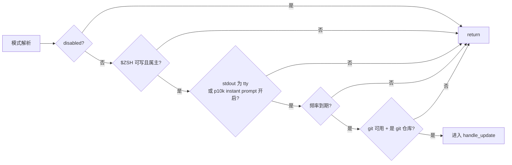
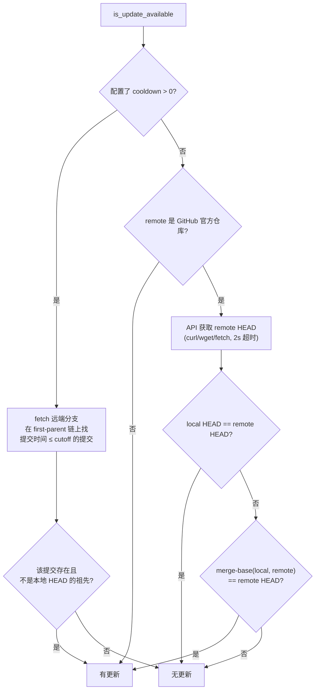
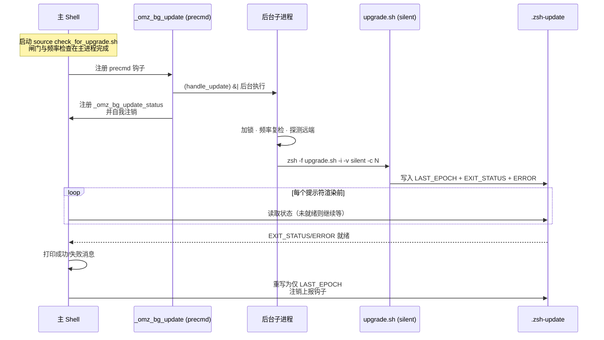

Oh My Zsh 的自动更新是一个在"不打扰用户"与"保持版本新鲜"之间寻求平衡的精密机制。本页将完整拆解这条链路：启动时的触发点、五种更新模式的分支逻辑、基于 epoch 的频率控制、远端更新探测、`cooldown` 滞后策略，以及实验性的后台更新模式。核心逻辑集中在两个脚本中——`tools/check_for_upgrade.sh`（检查与决策）和 `tools/upgrade.sh`（实际升级），并通过 `zstyle ':omz:update'` 命名空间暴露配置面。

## 机制总览：一条启动链路、两个脚本、一个状态文件

每次 zsh 启动加载 Oh My Zsh 时，主脚本 `oh-my-zsh.sh` 会在初始化早期（定义完 `ZSH_CACHE_DIR` 之后、加载插件之前）直接 `source` 更新检查脚本，注释明确写着"Check for updates on initial load..."。这意味着更新决策发生在**每次启动**，而非定时任务。

Sources: [oh-my-zsh.sh](oh-my-zsh.sh#L57-L71)

两个脚本的职责划分清晰：`check_for_upgrade.sh` 负责所有"决策"——读取模式、执行闸门检查、判断频率是否到期、探测远端是否有更新、选择交互方式；`upgrade.sh` 是一个可独立执行的"执行器"——只负责 git 操作与输出呈现。两者之间通过命令行参数（`-i -v -c`）和缓存目录中的状态文件 `${ZSH_CACHE_DIR}/.zsh-update` 传递信息。



Sources: [check_for_upgrade.sh](tools/check_for_upgrade.sh#L1-L46)

状态文件有一个向后兼容细节：旧版本将更新时间戳存放在 `~/.zsh-update`，脚本开头会自动把它迁移到 `${ZSH_CACHE_DIR}/.zsh-update`；而缓存目录本身默认是 `$ZSH/cache`，不可写时降级为 `${XDG_CACHE_HOME:-$HOME/.cache}/oh-my-zsh`。

Sources: [check_for_upgrade.sh](tools/check_for_upgrade.sh#L1-L4)，[oh-my-zsh.sh](oh-my-zsh.sh#L57-L64)

## 五种更新模式：zstyle ':omz:update' mode

模式是整个机制的第一配置项，通过 `zstyle -s ':omz:update' mode update_mode` 读取，支持五种取值，官方注释给出了精确定义：`prompt`（默认，到期后先询问）、`auto`（到期后直接更新）、`reminder`（到期后仅提醒）、`background-alpha`（实验性的后台静默更新）、`disabled`（完全关闭）。

Sources: [check_for_upgrade.sh](tools/check_for_upgrade.sh#L6-L13)

| 模式 | 到期后的行为 | 用户交互 | 适用场景 |
|---|---|---|---|
| `prompt`（默认） | 探测到更新后询问 `[Y/n]` | 单键确认；检测到用户已键入输入则自动降级为提醒 | 平衡默认值 |
| `auto` | 直接调用 `upgrade.sh` 执行更新 | 无 | 信任上游、追求零维护 |
| `reminder` | 只打印提醒信息 | 需手动运行 `omz update` | 想完全掌控更新时机 |
| `background-alpha` | 后台子进程静默更新，结果在下一个提示符报告 | 异步、无阻塞 | 实验尝鲜（alpha 状态） |
| `disabled` | 整条检查链路在闸门处终止 | 无 | 系统包管理器托管 / 隔离环境 |

Sources: [check_for_upgrade.sh](tools/check_for_upgrade.sh#L262-L287)，[zshrc.zsh-template](templates/zshrc.zsh-template#L26-L29)

`prompt` 模式的确认逻辑有两个值得注意的细节。其一，它通过 `read -r -k 1` 读取单键，接受 `Y`、`y`、回车（等价于确认）以及韩文两键式布局在 Y 键位产生的字符 `ㅛ`（U+315B），避免韩文输入法激活时误取消更新；其二，在询问之前会先调用 `has_typed_input` 检测终端缓冲区中是否已有用户键入的内容——如果有，就放弃询问、退化为一条提醒，防止打断正在敲命令的用户。`has_typed_input` 的实现关闭了 stty 的规范模式（`stty -icanon`），用 `zselect -t 0 -r 0` 轮询标准输入是否就绪，并始终恢复原始终端设置。

Sources: [check_for_upgrade.sh](tools/check_for_upgrade.sh#L262-L287)，[check_for_upgrade.sh](tools/check_for_upgrade.sh#L178-L201)

在 `zstyle` 模式未设置时，机制还保留了对两个**旧式环境变量**的兼容映射，且仅在 zstyle 缺省时生效：`DISABLE_UPDATE_PROMPT=true` 等价于 `mode auto`，`DISABLE_AUTO_UPDATE=true` 等价于 `mode disabled`。新配置应统一迁移到 zstyle 写法。

| 旧式环境变量 | 等效 zstyle | 语义 |
|---|---|---|
| `DISABLE_AUTO_UPDATE=true` | `zstyle ':omz:update' mode disabled` | 关闭自动更新 |
| `DISABLE_UPDATE_PROMPT=true` | `zstyle ':omz:update' mode auto` | 免询问直接更新 |
| `UPDATE_ZSH_DAYS=<N>` | `zstyle ':omz:update' frequency <N>` | 检查间隔天数 |

Sources: [check_for_upgrade.sh](tools/check_for_upgrade.sh#L14-L20)，[check_for_upgrade.sh](tools/check_for_upgrade.sh#L41)

## 更新闸门：从环境检查到频率早退

模式解析之后，脚本按固定顺序执行一系列"闸门"，任何一道不通过都会 `unset update_mode` 后直接 `return`，即本次启动完全不触碰 git。第一道闸门检查三件事：模式是否为 `disabled`；`$ZSH` 目录是否**可写且属于当前用户**（`-w` 与 `-O` 双重判断，防止用 sudo 装完后普通用户反复更新失败）；标准输出是否为终端（非 tty 环境如脚本调用时跳过更新——但有一个例外，见下文 powerlevel10k instant prompt）。

Sources: [check_for_upgrade.sh](tools/check_for_upgrade.sh#L22-L31)

接下来是一个刻意**提前**执行的频率早退检查。代码注释明确说明：这个检查要放在 git 检查之前，因为后面的 git 探测"每次启动都会 fork"，绝大多数启动里频率根本没到，先廉价地短路掉可以显著减少无谓的子进程。该检查只在 `.zsh-update` 存在、`LAST_EPOCH` 非空且**没有**待报告的 `EXIT_STATUS` 时生效（后台更新结果尚未上报时强制放行，保证状态能被消费）。

Sources: [check_for_upgrade.sh](tools/check_for_upgrade.sh#L33-L46)

最后一道前置闸门确认 `git` 命令可用、且 `$ZSH` 是一个 git 工作树（`git rev-parse --is-inside-work-tree`）。从这里可以提炼出机制的**保守设计哲学**：环境不满足时宁可沉默放弃，绝不在启动路径上制造错误输出。



Sources: [check_for_upgrade.sh](tools/check_for_upgrade.sh#L48-L55)

## 频率控制：epoch 计数与 .zsh-update 状态文件

频率控制的度量单位是"天"，通过一个简单的换算获得：`current_epoch()` 返回 `EPOCHSECONDS / 60 / 60 / 24`，即 Unix 时间戳除以 86400。间隔天数由 `zstyle ':omz:update' frequency` 指定，缺省回退到旧变量 `UPDATE_ZSH_DAYS`，再缺省为 **13 天**——这是连续两层 `||` 回退链的终点。

Sources: [check_for_upgrade.sh](tools/check_for_upgrade.sh#L57-L60)，[check_for_upgrade.sh](tools/check_for_upgrade.sh#L41-L42)

频率检查实际上在链路中出现了**两次**：一次是上文提到的启动早退（第 41-42 行），另一次在 `handle_update` 进入加锁区之后（第 243-248 行）。两次重复并非冗余——早退检查为了让后台更新结果有机会被上报而带有条件豁免（`EXIT_STATUS` 非空时放行），而加锁区内的复检保证了真正发起更新前间隔确实已满，两者语义略有差异。

Sources: [check_for_upgrade.sh](tools/check_for_upgrade.sh#L33-L46)，[check_for_upgrade.sh](tools/check_for_upgrade.sh#L243-L248)

状态文件 `${ZSH_CACHE_DIR}/.zsh-update` 是频率控制的载体，由 `update_last_updated_file` 函数统一写入。它有两种形态：成功/常规路径只写 `LAST_EPOCH=<天数>`；发生错误时追加 `EXIT_STATUS` 与 `ERROR` 字段（错误文本中的单引号会被替换为 `'` 以保证可安全 source）。首次启动时若文件缺失或损坏，`handle_update` 会直接写入当前 epoch 并返回——也就是说，**新装环境的 13 天倒计时从第一次启动开始计**。

| 字段 | 含义 | 写入时机 |
|---|---|---|
| `LAST_EPOCH` | 上次检查/更新时的天数 epoch | 每次检查结束（无论是否有更新） |
| `EXIT_STATUS` | 上次升级的退出码（0 表示成功） | 升级失败，或后台模式记录结果 |
| `ERROR` | 升级错误文本（单引号已转义） | 与 `EXIT_STATUS` 同时写入 |

Sources: [check_for_upgrade.sh](tools/check_for_upgrade.sh#L136-L149)，[check_for_upgrade.sh](tools/check_for_upgrade.sh#L237-L241)

并发防护由**目录锁**实现：`handle_update` 首先尝试 `mkdir "$ZSH/log/update.lock"`，已存在则直接放弃本次更新（说明另一个 zsh 会话正在更新）。为防锁文件因异常残留永久阻塞，超过 24 小时（`mtime + 3600*24 < EPOCHSECONDS`）的陈旧锁会被自动清理；同时通过 `trap ... EXIT INT QUIT` 确保正常退出、Ctrl+C 时都移除锁并注销本次加载的全部辅助函数。

Sources: [check_for_upgrade.sh](tools/check_for_upgrade.sh#L209-L221)，[check_for_upgrade.sh](tools/check_for_upgrade.sh#L223-L235)

## 更新探测：is_update_available 如何判断"落后了"

频率到期后，机制并不盲目升级，而是先回答"远端真的有新提交吗"。`is_update_available` 首先从本地 git 配置读取分支与远端——`oh-my-zsh.branch`（默认 `master`）与 `oh-my-zsh.remote`（默认 `origin`），这两个键使得从 fork 安装的用户可以固定自己的更新源。

Sources: [check_for_upgrade.sh](tools/check_for_upgrade.sh#L62-L68)

探测策略按远端类型分流，默认路径对**非官方仓库采取保守假设**：解析 `remote_url` 时，只识别 `https://github.com/*` 与 `git@github.com:*` 两种形式；若远端不是 GitHub，或者仓库不是 `ohmyzsh/ohmyzsh`，函数直接返回"有更新"——宁可多试一次，也不错过 fork 用户的私有更新。

Sources: [check_for_upgrade.sh](tools/check_for_upgrade.sh#L90-L101)

对官方仓库则走 GitHub API 轻量探测：用 `curl`/`wget`/`fetch`（按可用性依次回退，均设 2 秒超时）请求 `https://api.github.com/repos/ohmyzsh/ohmyzsh/commits/<branch>` 拿到远端 HEAD 的 SHA，与本地 HEAD 比较；不相等时再做一次 `git merge-base` 确认本地确实是远端的祖先（防止本地领先或分叉时误报）。任何网络错误都按"跳过本次更新"处理，而非强制升级。

Sources: [check_for_upgrade.sh](tools/check_for_upgrade.sh#L102-L134)



Sources: [check_for_upgrade.sh](tools/check_for_upgrade.sh#L62-L134)

## cooldown：面向稳定性的滞后更新

`zstyle ':omz:update' cooldown <天数>` 是频率体系中最容易被忽视的第三维度：它让更新**落后于上游 N 天**，只应用已经"沉淀"过的提交，规避刚合入的破坏性变更。模板文件中的注释准确描述了它的作用域——"更新必须有多旧才会被应用，手动或自动更新均受影响"。

Sources: [zshrc.zsh-template](templates/zshrc.zsh-template#L34-L35)

cooldown 在两处生效。探测端：当 cooldown 大于 0 时跳过 GitHub API 路径，改为 `git fetch` 后在 **first-parent 合并线**上用 `awk` 找出第一条提交时间早于 `EPOCHSECONDS - cooldown_days * 86400` 的提交，再判断该提交是否已包含在本地 HEAD 中——不包含才算"有更新"。限定 first-parent 是关键细节：cooldown 以合并/直接提交的粒度计算，不会被上游 PR 内部的零散提交干扰。

Sources: [check_for_upgrade.sh](tools/check_for_upgrade.sh#L70-L88)

执行端：`upgrade.sh` 在 cooldown 模式下不走 `git pull --rebase`，而是 `git merge --ff-only "$cooldown_ref"`——快进到那条"足够旧"的提交，绝不越界。该参数通过命令行 `-c <days>` 显式传入，且两个脚本都会校验它必须是合法的非负整数（`<->` 模式匹配），非法值静默归零。

Sources: [check_for_upgrade.sh](tools/check_for_upgrade.sh#L151-L156)，[upgrade.sh](tools/upgrade.sh#L40-L49)，[upgrade.sh](tools/upgrade.sh#L245-L265)

## 升级执行：upgrade.sh 的内部流程

`upgrade.sh` 是唯一真正改动 `$ZSH` 目录的组件，其命令行接口由 `getopts` 解析：`-i`（交互模式，影响是否打印 changelog）、`-v <mode>`（输出档位，仅接受 `default`/`minimal`/`silent`）、`-c <days>`（cooldown 天数）。它还防御了两种错误用法：用非 zsh 执行时 `exec zsh` 自举重跑；被 `source` 时检测 `$ZSH_EVAL_CONTEXT` 并拒绝。

Sources: [upgrade.sh](tools/upgrade.sh#L1-L49)

升级正式开始前有一段**自愈代码**：遍历所有 remote，把历史遗留的 `robbyrussell/oh-my-zsh` 地址（含 git:// 明文协议）重写为 `ohmyzsh/ohmyzsh` 的 https/git 地址，并把确认无误的 remote 写入 `git config oh-my-zsh.remote`；随后设置一组已知能规避 git 报错的配置——`core.eol=lf`、`core.autocrlf=false`、三处 `fsck.zeroPaddedFilemode=ignore`（修复 #4069、#4963），以及临时开启 `rebase.autoStash`（修复 #7172，更新前自动 stash 未提交改动，结束后恢复原值）。

Sources: [upgrade.sh](tools/upgrade.sh#L205-L237)

执行主体采用**分支保护模式**：先用 `git symbolic-ref` 记下用户当前所在分支/提交（`last_head`），切到更新分支执行更新，结束后 `git checkout -q "$last_head" --` 切回——即使你停在一个 detached HEAD 或其他分支上，更新也不会改变你的工作位置。默认更新动作是 `git pull --quiet --rebase $remote $branch`。

Sources: [upgrade.sh](tools/upgrade.sh#L259-L272)，[upgrade.sh](tools/upgrade.sh#L334-L341)

成功后的输出按 `verbose` 三档呈现。`default` 档打印彩虹色 ASCII 艺术字、结果消息与社区链接，且仅在交互模式下额外调用 `tools/changelog.sh` 打印本次更新范围内的变更日志（更新前的提交 SHA 会先存入 `git config oh-my-zsh.lastVersion`）；`minimal` 档只输出一行结果；`silent` 档完全静默。

| 档位 | ASCII banner | 结果消息 | changelog | 典型用途 |
|---|---|---|---|---|
| `default` | ✅ | ✅ 详细 | ✅（交互模式） | 手动 `omz update` |
| `minimal` | ❌ | ✅ 一行 | ❌ | 减少启动噪音 |
| `silent` | ❌ | ❌ | ❌ | 后台更新 / p10k instant prompt |

Sources: [upgrade.sh](tools/upgrade.sh#L275-L332)，[upgrade.sh](tools/upgrade.sh#L289-L298)

调用方 `update_ohmyzsh` 的封装逻辑同样有讲究：非后台模式先以用户指定的档位执行，**失败后立即以 `silent` 档重跑一次**，把错误输出捕获进 `.zsh-update` 的 `ERROR` 字段持久化；此外，若检测到 powerlevel10k 的 instant prompt 已启用（该特性会重复渲染提示符，任何启动期输出都会造成视觉故障），verbose 会被强制降为 `silent`，闸门检查中对 `-t 1` 的判断也随之放行。

Sources: [check_for_upgrade.sh](tools/check_for_upgrade.sh#L151-L176)，[check_for_upgrade.sh](tools/check_for_upgrade.sh#L157-L160)

## 手动更新：omz update 与 shell 重启

`omz update` 命令由 `lib/cli.zsh` 中的 `_omz::update` 实现，与自动更新共享同一执行器但走独立路径。它先做三项前置检查：`git` 命令存在；拒绝已废弃的 `--unattended` 旗标并提示改用 `upgrade.sh` 脚本（这是无人值守场景的官方替代方案）；`$ZSH` 确为 git 仓库。

Sources: [cli.zsh](lib/cli.zsh#L911-L929)

随后它同样继承 `verbose` 与 `cooldown` 两个 zstyle 配置，执行 `zsh -f "$ZSH/tools/upgrade.sh" -i -v $verbose_mode -c $cooldown_days`。成功后的收尾动作有三步：把 `.zsh-update` 重写为仅含 `LAST_EPOCH`（顺带清空任何待上报的后台错误状态）；删除可能残留的 `update.lock`；最后比较更新前后的 HEAD——**若发生了实际变更，直接 `exec` 一个新的 zsh 替换当前进程**（保留登录 shell 属性），让新版本立即生效，无需用户手动重开终端。

Sources: [cli.zsh](lib/cli.zsh#L931-L953)

## background-alpha：实验性后台更新的完整生命周期

`background-alpha` 模式把"检查"与"更新"彻底移出启动关键路径。在 `check_for_upgrade.sh` 末尾的模式分发中，该模式不直接执行 `handle_update`，而是注册一个 `precmd` 钩子 `_omz_bg_update`；它只在**第一个提示符渲染前**触发一次，以 `(handle_update) &|` 把整个更新流程放入后台子进程（`&|` 即 disown，不随 shell 退出而终止），随后注册结果上报钩子 `_omz_bg_update_status` 并自我注销。

Sources: [check_for_upgrade.sh](tools/check_for_upgrade.sh#L294-L308)

后台子进程完整执行 `handle_update`——包括加锁、频率复检与可用性探测——最终走 `update_ohmyzsh` 的后台分支：以 `silent` 档执行 `upgrade.sh`，把退出码与错误文本写入 `.zsh-update`。这正是前文频率早退检查中"`EXIT_STATUS` 非空时放行"的原因：主 shell 每次渲染提示符前，上报钩子都会读取该文件，一旦发现 `EXIT_STATUS` 与 `ERROR` 就绪便打印绿色成功消息或红色错误详情，然后在 `always` 块中把状态文件重置为仅 `LAST_EPOCH`，并注销自身——保证报告只出现一次。



Sources: [check_for_upgrade.sh](tools/check_for_upgrade.sh#L310-L341)，[check_for_upgrade.sh](tools/check_for_upgrade.sh#L162-L175)

需要强调该模式名称中的 `alpha`：它仍在演进中，实践中 `prompt`/`auto`/`reminder` 三种稳定模式已覆盖绝大多数需求。

Sources: [check_for_upgrade.sh](tools/check_for_upgrade.sh#L8-L13)

## 配置速查与推荐实践

所有更新行为都收敛在 `zstyle ':omz:update'` 命名空间下，四个键覆盖模式、频率、滞后与输出。以下速查表可直接对照 `.zshrc` 使用：

| zstyle 键 | 取值 | 默认值 | 作用 |
|---|---|---|---|
| `':omz:update' mode` | `disabled` / `prompt` / `auto` / `reminder` / `background-alpha` | `prompt` | 更新触发模式 |
| `':omz:update' frequency` | 非负整数（天） | 13（或 `UPDATE_ZSH_DAYS`） | 两次检查的最小间隔 |
| `':omz:update' cooldown` | 非负整数（天） | 0 | 只应用 N 天前的提交（含手动更新） |
| `':omz:update' verbose` | `default` / `minimal` / `silent` | `default` | 升级输出详细程度 |

Sources: [zshrc.zsh-template](templates/zshrc.zsh-template#L26-L35)，[check_for_upgrade.sh](tools/check_for_upgrade.sh#L151-L156)，[cli.zsh](lib/cli.zsh#L932-L936)

一个典型的高稳定性配置示例——每 30 天检查一次，只应用 7 天前已合入的提交，并在后台静默完成：

```zsh
zstyle ':omz:update' mode auto
zstyle ':omz:update' frequency 30
zstyle ':omz:update' cooldown 7
zstyle ':omz:update' verbose minimal
```

从架构角度看，这套机制的每个设计决策都围绕两个原则：**启动路径零成本**（频率早退先于 git 探测、目录锁防并发、错误一律静默放弃）与**状态可恢复**（`.zsh-update` 单一事实源、锁文件 24 小时自愈、分支位置在更新后还原）。理解了这两条主线，其余细节都是它们的自然推论。

## 延伸阅读

- 自动更新只是更新途径之一，`omz` 工具族还提供 changelog 查看等能力，详见 [omz 命令行工具：更新、插件与主题管理](6-omz-ming-ling-xing-gong-ju-geng-xin-cha-jian-yu-zhu-ti-guan-li)
- 安装阶段的环境变量与无人值守参数，见 [安装脚本深度选项：环境变量与无人值守安装](7-an-zhuang-jiao-ben-shen-du-xuan-xiang-huan-jing-bian-liang-yu-wu-ren-zhi-shou-an-zhuang)
- 更新失败、权限报错等问题的排查思路，见 [升级、卸载与常见安装问题排查](8-sheng-ji-xie-zai-yu-chang-jian-an-zhuang-wen-ti-pai-cha)
- 本文提到的"频率早退先于 git 探测"等设计，与整体启动性能优化一脉相承，见 [启动性能优化：减少 fork 与缓存策略](23-qi-dong-xing-neng-you-hua-jian-shao-fork-yu-huan-cun-ce-lue)