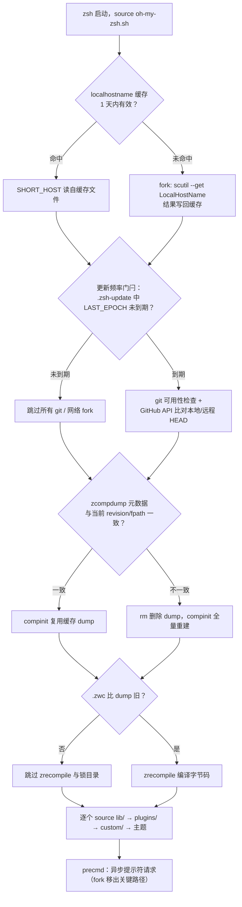
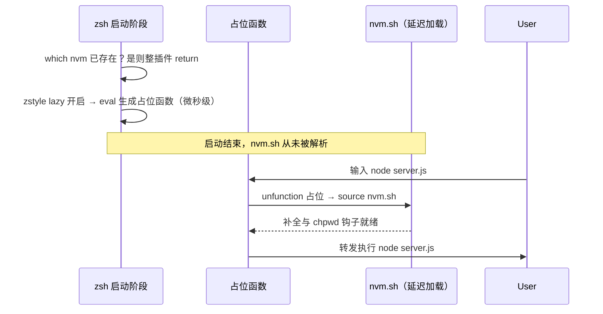

启动性能是 oh-my-zsh 架构中一条贯穿始终的设计约束。本页从 **fork 成本模型** 出发，剖析主脚本 `oh-my-zsh.sh` 与更新子系统中的 fork 消除手法，梳理 `$ZSH_CACHE_DIR` 下的多级缓存协议（zcompdump 元数据、主机名缓存、grep 别名缓存、更新纪元文件），并以 nvm 插件的 lazy 模式展示插件级延迟加载的工程范式。阅读本页前建议先浏览 [启动加载流程：oh-my-zsh.sh 主脚本逐段解读](10-qi-dong-jia-zai-liu-cheng-oh-my-zsh-shi-zhu-jiao-ben-zhu-duan-jie-du)。

## Fork 成本模型：为什么外部进程是启动瓶颈

zsh 启动时间的构成可以分为两类：解释器自身解析脚本与函数定义的 CPU 时间，以及 **进程创建开销**——每当 shell 调用外部命令（`git`、`scutil`、`curl`、`tee` 等）时，内核需要完成 fork（复制进程）与 exec（加载可执行映像）两个阶段，其成本比执行 builtin 高出数个量级。oh-my-zsh 的源码注释直接把这一成本写成了设计目标：macOS 上获取短主机名的 `scutil` "costs a fork on every start"，因此必须缓存；更新检查的纪元判断被刻意安排在 git 检查之前，因为 "those fork on every startup"。

由此形成四条可复用的工程原则：**builtin 优先**（能用 `test`/`read`/参数展开解决就不派生进程）、**纯 zsh 解析替代外部工具**（如直接读取 git 目录文件代替 `git rev-parse`）、**带 TTL 的文件缓存**（缓存失效条件精确到一天或版本变更）、**惰性求值**（把工作推迟到首次真正需要时）。这四条原则在后续小节中都有对应实现。

Sources: [oh-my-zsh.sh](oh-my-zsh.sh#L100-L104), [oh-my-zsh.sh](oh-my-zsh.sh#L134-L137), [tools/check_for_upgrade.sh](tools/check_for_upgrade.sh#L33-L35)

## 启动关键路径与 fork 决策点

下面的流程图概括了从 shell 启动到首个提示符出现之间，oh-my-zsh 为控制 fork 数量设置的各道"门闩"（gate）。菱形节点代表**低成本判断**（读缓存文件、文件测试、builtin 比较），只有判断失败才会进入右侧的**高成本路径**（git 子进程、网络请求、compinit 重建）：

这条路径上有两个关键排序决策。其一，插件目录在 `compinit` 之前就被加入 `fpath`，且 `is_plugin` 用 `builtin test` 探测文件存在性，保证补全系统一次性看到全部补全定义，避免后续二次扫描。其二，`autoload -U compaudit compinit zrecompile` 使这三个函数以未解析状态登记，只有真正调用时才被解析——这是 zsh 原生的函数级惰性加载。

Sources: [oh-my-zsh.sh](oh-my-zsh.sh#L70-L98), [oh-my-zsh.sh](oh-my-zsh.sh#L79)

## 缓存目录体系：ZSH_CACHE_DIR 的解析与居民

所有缓存都收敛到 `$ZSH_CACHE_DIR` 一个根目录：默认为 `$ZSH/cache`；若该目录不可写（例如以只读方式挂载或权限收窄），则回退到 `${XDG_CACHE_HOME:-$HOME/.cache}/oh-my-zsh`。主脚本还会确保 `$ZSH_CACHE_DIR/completions` 存在并将其**置于 `fpath` 头部**，使用户自定义补全脚本天然纳入 compinit 的缓存体系。

| 缓存对象 | 生成者 | 失效条件（TTL） | 用途 |
|---|---|---|---|
| `localhostname` | oh-my-zsh.sh | 文件 mtime 超过 1 天，或 `$HOST` 变化 | 免去每次启动 fork `scutil` |
| `.zcompdump-<host>-<zshver>` + `.zwc` | compinit / zrecompile | 元数据不匹配或 fpath 变化 | 补全函数注册表缓存与字节码 |
| `grep-alias` | lib/grep.zsh | mtime 超过 1 天 | 免去每次启动探测 grep 选项 |
| `.zsh-update` | check_for_upgrade.sh | 内容被覆盖时 | 记录上次更新纪元与结果 |
| `update.lock`（目录） | handle_update | 超过 1 天自动清除 | 防止并发更新 |

Sources: [oh-my-zsh.sh](oh-my-zsh.sh#L57-L68), [tools/check_for_upgrade.sh](tools/check_for_upgrade.sh#L1-L4)

`lib/grep.zsh` 是 1 天 TTL 惯例的最小完整样本：启动时先用 zsh glob 限定符 `"$__GREP_CACHE_FILE"(Nm-1)` 测试缓存文件是否在**最近一天内修改过**（不产生任何进程），命中则直接 `source`；未命中才执行 grep 能力探测，并通过 `alias -L grep egrep fgrep` 将别名**可重新求值的序列化形式**写入缓存，且仅在目录可写时落盘。这一"探测一次、缓存一天、mtime 自然过期"的模式被主脚本的 SHORT_HOST 缓存复用。

Sources: [lib/grep.zsh](lib/grep.zsh#L1-L9), [lib/grep.zsh](lib/grep.zsh#L24-L33)

## 消除确定性 fork：SHORT_HOST 与 _omz_git_head

### SHORT_HOST：把 scutil 的答案钉住一天

macOS 的 `$HOST` 会随 DHCP 变化，因此主脚本改用 `scutil --get LocalHostName` 获取稳定短主机名——但每次启动 fork 一次 scutil 不可接受。实现采用**带键缓存**：缓存文件第一行记录当时的 `$HOST` 作为失效键，第二行记录 SHORT_HOST；`(Nm-1)` 限定符保证缓存至多生存一天。两个细节值得注意：只有当 scutil 真正给出非空答案时才写缓存，避免瞬态失败把回退名 `${HOST/.*/}` 钉死一天；非 darwin 平台完全不进入这条路径，直接做纯参数展开。

Sources: [oh-my-zsh.sh](oh-my-zsh.sh#L100-L127)

### _omz_git_head：不 fork git 也能读出 HEAD

zcompdump 元数据需要 OMZ 当前签出的 commit 号，惯常做法是 `git rev-parse HEAD`——一次必现的 fork。`_omz_git_head` 用纯 zsh 文件读取复刻了 git 的引用解析算法：处理 `.git` 为文件的情形（worktree、submodule 指向真实 git 目录）、经 `commondir` 定位 worktree 共享目录、区分 `ref: ` 符号引用与 detached HEAD、在 `refs/` 文件缺失时回退解析 `packed-refs`。函数内置严格的引用名校验（拒绝 `..`、`//`、`.lock`、`@{`、控制字符等），防止畸形 HEAD 让路径逃逸出 git 目录；最终只有 40/64 位纯十六进制对象 ID 被视为有效答案，任何一步异常都返回 1，由调用方回退到真正的 `git rev-parse`——**正确性优先，fork 只是回退而非依赖**。

Sources: [oh-my-zsh.sh](oh-my-zsh.sh#L134-L137), [oh-my-zsh.sh](oh-my-zsh.sh#L144-L206), [oh-my-zsh.sh](oh-my-zsh.sh#L210-L214)

## 补全缓存：zcompdump 元数据协议与 zrecompile 门闩

compinit 的 dump 文件默认命名为 `~/.zcompdump-${SHORT_HOST}-${ZSH_VERSION}`，将主机名与 zsh 版本编码进文件名本身就消除了跨环境串缓存的可能。在此之上，oh-my-zsh 实现了一个**元数据协议**：启动时构造两行——`#omz revision: <commit>`（来自上一节的纯 zsh 解析）与 `#omz fpath: <fpath 快照>`（插件增删会改变它）——然后 `_omz_compdump_has_metadata` 用 `$(<"$ZSH_COMPDUMP")` 把 dump 读入数组（注意这是 zsh 的内建读文件语法，连 `cat` 的 fork 都省了），检查两行元数据是否同时存在。不匹配即意味着 OMZ 版本升级或插件列表变化，直接 `rm -f` 删除缓存迫使 compinit 全量重建；匹配则 compinit 完全跳过重新扫描。元数据在 compinit 之后用 `tee -a` 追加回去（用 `tee` 而非重定向是为了在 dump 文件名非法时静默容错）。

Sources: [oh-my-zsh.sh](oh-my-zsh.sh#L129-L132), [oh-my-zsh.sh](oh-my-zsh.sh#L208-L231), [oh-my-zsh.sh](oh-my-zsh.sh#L246-L255)

zrecompile 层面还有第二道门闩：先做 `[[ ! "${ZSH_COMPDUMP}.zwc" -nt "$ZSH_COMPDUMP" ]]` 文件新旧测试，字节码仍然新鲜时连锁目录 `mkdir` 与 `zrecompile` 调用都一并跳过——源码注释明确指出 "Test that first so the lock directory and zrecompile are skipped when it's fresh"。compinit 之后的补全运行期也启用了函数级缓存：`zstyle ':completion:*' use-cache yes` 配合 `cache-path $ZSH_CACHE_DIR`，让 `apt`、`dpkg` 这类昂贵补全把结果缓存到磁盘。补全系统本身的机制深读见 [补全系统：compinit 与 zcompdump 缓存优化](11-bu-quan-xi-tong-compinit-yu-zcompdump-huan-cun-you-hua)。

Sources: [oh-my-zsh.sh](oh-my-zsh.sh#L259-L265), [lib/completion.zsh](lib/completion.zsh#L43-L45)

## 更新检查：用缓存门闩挡住 git 与网络 fork

`check_for_upgrade.sh` 的门闩顺序是性能设计的关键。第一道门在**任何 fork 之前**：匿名函数读取 `${ZSH_CACHE_DIR}/.zsh-update`（不存在或格式畸形即视为到期），比较 `(EPOCHSECONDS/86400 - LAST_EPOCH) < epoch_target`，未到期直接 `return`——此时连 git 是否安装都尚未检查，因为 "those fork on every startup"。后续门闩依成本递增排列：目录可写性与 tty 检查（纯 builtin）→ `git --version` 与仓库探测（fork git）→ GitHub API 比对（网络 I/O）。典型启动中，364 天里约 351 天在第一道门就被放行。

| 更新模式（zstyle `:omz:update` mode） | 到期时的启动成本 | 行为 |
|---|---|---|
| `prompt`（默认） | git fork + 1 次网络请求；用户已敲键则降级为提醒 | 询问 `Would you like to update? [Y/n]` |
| `auto` | 同上 | 直接在子 shell `zsh -f upgrade.sh` 中升级 |
| `reminder` | 同上，无网络升级动作 | 仅打印 `omz update` 提醒 |
| `background-alpha` | fork 延迟到首个 precmd 后台执行 | 结果经 `.zsh-update` 的 `EXIT_STATUS` 在下次 precmd 报告 |
| `disabled` | 零 fork | 完全跳过 |

Sources: [tools/check_for_upgrade.sh](tools/check_for_upgrade.sh#L14-L20), [tools/check_for_upgrade.sh](tools/check_for_upgrade.sh#L26-L46), [tools/check_for_upgrade.sh](tools/check_for_upgrade.sh#L294-L347)

网络路径本身也做了三层成本约束：`is_update_available` 只对官方 `ohmyzsh/ohmyzsh` 仓库走 GitHub API（第三方 fork 一律假定有更新并交由用户手动处理）；HTTP 客户端带 `--connect-timeout 2` / `-T 2`，断网时 2 秒内放弃且宁可跳过更新也不阻塞启动；比较采用本地 HEAD、远程 HEAD、`merge-base` 三点判定，本地领先远程时不会误报。配置了 `cooldown` 时才启用最贵的 `git fetch` 路径，并用 awk 在 `FETCH_HEAD` 的一等亲链上找早于截止纪元的提交。此外 `has_typed_input` 用 `zselect` 轮询 stdin（配合 `stty -icanon` 切换规范模式），在用户已经开始输入时自动把升级请求降级为纯提醒——性能机制直接服务于交互不打扰。

Sources: [tools/check_for_upgrade.sh](tools/check_for_upgrade.sh#L62-L134), [tools/check_for_upgrade.sh](tools/check_for_upgrade.sh#L111-L121), [tools/check_for_upgrade.sh](tools/check_for_upgrade.sh#L178-L201), [tools/check_for_upgrade.sh](tools/check_for_upgrade.sh#L209-L235)

## 插件级延迟加载：nvm 的 lazy 模式

nvm 是最典型的"启动毒药"插件——`nvm.sh` 体积大且启动即定义大量函数。oh-my-zsh 内置的 nvm 插件提供了教科书式的 lazy 实现。启动时它先用 `which nvm` 探测（nvm 是 shell 函数而非二进制，`command -v` 语义不够用），已可用则整个插件提前 `return`；`NVM_DIR` 解析失败同样零成本退出。当 `zstyle ':omz:plugins:nvm' lazy` 开启时，插件**不加载 nvm.sh**，而是用 `eval` 动态生成一组占位函数（默认覆盖 `nvm node npm npx pnpm pnpx yarn corepack`，可经 `lazy-cmd` 追加）。首次调用任一占位函数时才执行真正的加载序列：`unfunction` 移除全部占位 → `source $NVM_DIR/nvm.sh` → 安装 bash 补全（刻意置空 `ZSH_VERSION` 绕过 nvm 补全脚本内部的 compinit 调用）→ 重建 `.nvmrc` 自动切换钩子 → 以原始参数转发首次调用。

时序图展示了延迟加载的核心契约：**启动路径只支付"定义空函数"的成本，真实成本转嫁给第一次调用**。这一模式同样适用于其他重插件，社区通用做法是在 `$ZSH_CUSTOM/plugins/<name>/` 中按需封装（实践见 [自定义插件与主题：ZSH_CUSTOM 目录实践](26-zi-ding-yi-cha-jian-yu-zhu-ti-zsh_custom-mu-lu-shi-jian)）。

Sources: [plugins/nvm/nvm.plugin.zsh](plugins/nvm/nvm.plugin.zsh#L1-L3), [plugins/nvm/nvm.plugin.zsh](plugins/nvm/nvm.plugin.zsh#L19-L21), [plugins/nvm/nvm.plugin.zsh](plugins/nvm/nvm.plugin.zsh#L23-L37), [plugins/nvm/nvm.plugin.zsh](plugins/nvm/nvm.plugin.zsh#L74-L99)

## 异步提示符：把 fork 移出启动与提示符关键路径

提示符是启动之后最频繁的代码路径，`git status` 在大型仓库中的 fork 是卡顿主因。`lib/async_prompt.zsh` 提供了通用框架：主题/库通过 `_omz_register_handler` 注册昂贵函数，`_omz_async_request`（precmd 钩子）用 `exec {fd}< <(handler)` 为每个 handler 打开一条子进程管道，立即返回；输出经 `zle -F` 回调送达，仅在内容变化时 `zle .reset-prompt` 重绘。`lib/git.zsh` 据此改造：zsh ≥ 5.0.6 时 `git_prompt_info`/`git_prompt_status` 默认切换为异步版本，且通过扫描 prompt 变量**按需注册**——提示符根本没引用这些函数时连子进程都不 fork。配套的 `GIT_OPTIONAL_LOCKS=0` 保证提示符的 git 调用永不与用户操作争锁。大仓库还可叠加 `DISABLE_UNTRACKED_FILES_DIRTY="true"` 跳过未跟踪文件扫描。异步机制与主题侧优化的完整展开见 [异步 Git 提示符与大型仓库性能优化](21-yi-bu-git-ti-shi-fu-yu-da-xing-cang-ku-xing-neng-you-hua)。

Sources: [lib/async_prompt.zsh](lib/async_prompt.zsh#L46-L107), [lib/git.zsh](lib/git.zsh#L10-L12), [lib/git.zsh](lib/git.zsh#L171-L236), [lib/git.zsh](lib/git.zsh#L244-L246)

## 测量与调优：从证据到动作

优化前先建立基线。两种互补的测量手段：其一是标准 zsh 的剖析模块——在 `.zshrc` 顶部 `zmodload zsh/zprof`、底部 `zprof`，得到每个函数的调用次数与耗时排序（这是 zsh 内建能力，oh-my-zsh 仓库本身不内置 profile 命令）；其二是 `time zsh -i -c exit` 获取端到端总耗时。定位到热点后再对照下表选择手段。完整的环境快照（fpath、compaudit、zstyle 全量输出）可由 `omz_diagnostic_dump` 采集，流程见 [诊断转储 omz_diagnostic_dump 与故障排查](24-zhen-duan-zhuan-chu-omz_diagnostic_dump-yu-gu-zhang-pai-cha)。

| 调优手段 | 作用层面 | 配置位置 | 代价/权衡 |
|---|---|---|---|
| 精简 `plugins=(...)` | 减少 source 量与 fpath 扫描面 | `~/.zshrc` | 功能取舍（模板注释原话："Add wisely, as too many plugins slow down shell startup."） |
| `zstyle ':omz:update' mode disabled` 或调低 `frequency` | 消除到期日的 git/网络 fork | `~/.zshrc` | 放弃自动更新，需手动 `omz update` |
| `zstyle ':omz:plugins:nvm' lazy` | nvm.sh 解析成本后移 | `~/.zshrc` | 首次 node/npm 调用有一次加载延迟 |
| `DISABLE_UNTRACKED_FILES_DIRTY="true"` | 大仓库 `git status` 扫描量 | `~/.zshrc` | 未跟踪文件不计入 dirty 标记 |
| `ZSH_DISABLE_COMPFIX="true"` | `compinit -u` 跳过 insecure 目录处理 | `~/.zshrc` | 关闭安全防线，权衡见 [安全防线：compfix 与补全目录权限检查](12-an-quan-fang-xian-compfix-yu-bu-quan-mu-lu-quan-xian-jian-cha) |
| 保持 `$ZSH_CACHE_DIR` 可写 | 让全部缓存协议生效 | 环境部署 | 不可写时自动回退 `~/.cache`，行为不变但缓存分散 |

Sources: [templates/zshrc.zsh-template](templates/zshrc.zsh-template#L26-L35), [templates/zshrc.zsh-template](templates/zshrc.zsh-template#L55-L58), [templates/zshrc.zsh-template](templates/zshrc.zsh-template#L71-L76), [oh-my-zsh.sh](oh-my-zsh.sh#L233-L244)

值得强调的是，这套体系的深层一致性在于：**每个缓存都绑定了精确的失效键**（mtime 一天、`$HOST` 值、OMZ commit、fpath 快照、纪元天数），从而在不牺牲正确性的前提下把"每次启动的确定成本"压缩为"每 N 天一次的批量成本"。这一思想也贯穿于更新运维（频率、冷却期与后台模式的完整剖析见 [自动更新机制全解：更新模式与频率控制](22-zi-dong-geng-xin-ji-zhi-quan-jie-geng-xin-mo-shi-yu-pin-lu-kong-zhi)），并延伸到 shell 运行期的提示符重绘路径——理解了 fork 门闩与 TTL 缓存，你就掌握了 oh-my-zsh 性能模型的全部分形结构。