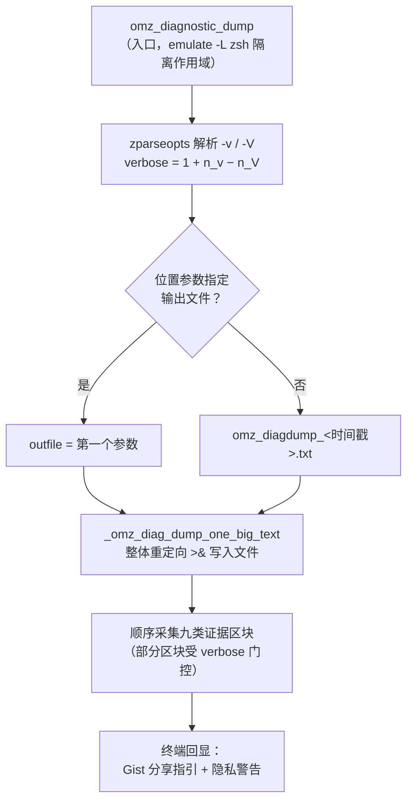
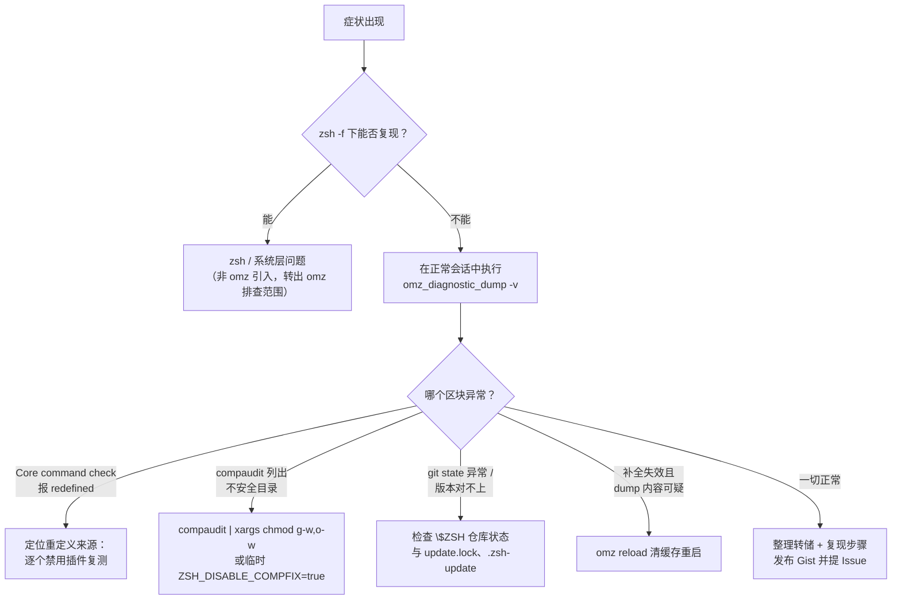

当 shell 出现"说不清哪里不对"的问题——补全失灵、提示符异常、命令行为诡异——最重要的一步是把**运行环境的完整快照**固化成一份可分享的证据文件。oh-my-zsh 内置的 `omz_diagnostic_dump` 函数正是为此而生：它在 `lib/diagnostics.zsh` 中实现，以单文件形式输出系统信息、zsh 状态、omz 配置与 git 状态，可直接作为 GitHub Gist 或 Issue 评论附上。本页从该函数的实现出发，讲清它的调用方式、详细度分级、转储内容构成，并给出一套"从症状到修复"的故障排查工作流。

## 定位与加载：为什么每个会话都能直接调用

`omz_diagnostic_dump` 并不需要手动加载——oh-my-zsh 启动时主脚本会遍历 `lib` 目录下所有 `.zsh` 文件并通过 `_omz_source` 逐一 source，`diagnostics.zsh` 自然包含其中。这意味着任何交互式 zsh 会话中该函数都是开箱即用的，无需 autoload 或额外配置。这种"随库加载"的设计让它成为故障现场的第一响应工具。

Sources: [oh-my-zsh.sh](oh-my-zsh.sh#L308-L312)

该文件有两条刻在设计里的约束。**其一是防御式编程**：注释明确写道"almost everything is invoked with builtin or command"，即几乎所有内建命令和外部命令调用都加了 `builtin` 或 `command` 前缀，保证即使 `echo`、`which` 这类基础命令已被用户重定义，诊断工具本身依然能正常工作——诊断器不能被它要诊断的环境破坏。**其二是诚实的工程边界**：文件头声明这是一个"work in progress"，接口和行为的变更不保证向后兼容；输出是人类可读文本，格式随时可能调整，**不适合脚本解析**。

Sources: [lib/diagnostics.zsh](lib/diagnostics.zsh#L13-L14), [lib/diagnostics.zsh](lib/diagnostics.zsh#L21-L34)

输出被刻意收拢为**单一文本文件**：注释解释说 GitHub 不支持给 Issue 附 tar 压缩包，否则本可以为配置与自定义文件生成归档，现在只能把所有内容 cat 进一个文件，方便作为 Gist 或 Issue 评论发布。转储的生成流程如下图所示：

理解上图需要两个前提：入口函数先做参数解析与详细度计算（详见下一节），真正的采集工作全部委托给内部函数 `_omz_diag_dump_one_big_text`，且输出**始终直接写入文件而非终端**——注释给出的理由是终端转义序列能被干净地捕获，避免颜色码污染转储内容。

Sources: [lib/diagnostics.zsh](lib/diagnostics.zsh#L58-L88), [lib/diagnostics.zsh](lib/diagnostics.zsh#L22-L26)

## 调用语法与详细度分级

函数的用法签名为 `omz_diagnostic_dump [-v] [-V] [file]`。参数解析通过 `zparseopts -A opts -D` 完成：`-v` 和 `-V` 均可**重复指定**，最终详细度按公式 `verbose = 1 + n_v − n_V` 计算，即默认值为 1，每多一个 `-v` 加一级，每多一个 `-V` 减一级。输出文件默认取当前目录下 `omz_diagdump_YYYYMMDD-HHMMSS.txt`（时间戳到秒），传入位置参数则覆盖之；但若传入超过一个参数，函数报错 "too many arguments" 并返回 1。

Sources: [lib/diagnostics.zsh](lib/diagnostics.zsh#L9-L11), [lib/diagnostics.zsh](lib/diagnostics.zsh#L63-L81), [lib/diagnostics.zsh](lib/diagnostics.zsh#L36-L48)

| 详细度 | 触发方式 | 额外采集内容 | 代码位置 |
| --- | --- | --- | --- |
| 0 | 一个 `-V` | 基础信息、shell 状态、omz 配置、git 状态 | 头部注释定义 |
| 1（默认） | 不加参数或抵消后为 1 | 追加键绑定（`bindkey`、`infocmp -L`）与全部配置文件内容 | `verbose >= 1` 门控 |
| 2 | 一个 `-v` | 再追加 zcompdump 缓存文件内容 | `verbose >= 2` 门控 |

Sources: [lib/diagnostics.zsh](lib/diagnostics.zsh#L41-L47), [lib/diagnostics.zsh](lib/diagnostics.zsh#L196-L198), [lib/diagnostics.zsh](lib/diagnostics.zsh#L212-L219), [lib/diagnostics.zsh](lib/diagnostics.zsh#L233-L247)

详细度门控体现在四处：git `reflog` 中的 pull 记录、键绑定与终端能力信息、配置文件内容、以及 compdump 内容分别要求 `verbose >= 1` 或 `>= 2`。选择建议很直接：**普通问题用默认级别**即可，涉及补全系统疑难杂症时用 `omz_diagnostic_dump -v` 把 `.zcompdump*` 的内容一并带走，便于复核 dump 缓存的元数据——补全缓存机制的原理参见[补全系统：compinit 与 zcompdump 缓存优化](11-bu-quan-xi-tong-compinit-yu-zcompdump-huan-cun-you-hua)。

Sources: [lib/diagnostics.zsh](lib/diagnostics.zsh#L239-L247)

## 转储内容全景：九类证据区块

采集函数 `_omz_diag_dump_one_big_text` 按固定顺序输出九类信息，每一类都对应一类典型的故障面。采集过程严格使用 `command`/`builtin` 前缀调用外部与内建命令，探测程序路径时还会在 `shasum` 可用时计算可执行文件 SHA、在文件为符号链接时解析真实指向（` -> 目标`）。

Sources: [lib/diagnostics.zsh](lib/diagnostics.zsh#L102-L150), [lib/diagnostics.zsh](lib/diagnostics.zsh#L121-L143)

| 区块 | 采集内容 | 故障指向 |
| --- | --- | --- |
| 系统与 zsh 基础 | `date`、`uname -a`、`OSTYPE`、`ZSH_VERSION`、`USERNAME`、`umask`，外加操作系统专属版本 | 环境识别、版本错配 |
| 已安装程序 | `sh zsh ksh bash sed cat grep ls find git posh` 的路径、SHA 与符号链接指向 | PATH 污染、工具被替换 |
| 命令版本 | `zsh --version` **与当前会话 `$ZSH_VERSION` 分列**，另附 bash/git/grep 版本 | 多版本共存导致的"版本幻觉" |
| 核心命令检查 | 保留字/内建命令/外部命令是否被重定义 | "命令行为诡异"类问题 |
| 进程状态 | `pwd`、`pstree -p $$`（无 pstree 则 `ps -fT`）、过滤后的 `set` 输出、导出变量名列表、`locale` | 嵌套 shell、环境变量与本地化问题 |
| zsh 配置 | `setopt`、全部 `zstyle`、`compaudit` 输出、`$fpath` 目录列表 | 补全失效、选项被改写 |
| omz 安装状态 | `~/.z*` 与 `~/.oh*` 目录、`$ZSH` 的 git HEAD/remote/status（详细度 1 追加 pull reflog）、`$ZSH_CUSTOM` 目录树 | 安装损坏、手动改动、自定义目录混乱 |
| 键绑定与终端 | `bindkey` 全量输出、`infocmp -L` | 按键映射冲突、终端能力异常 |
| 配置文件与缓存 | /etc 与 `$ZDOTDIR` 下的 zsh 启动文件清单、bash 配置文件、`~/.zsh.pre-oh-my-zsh`，详细度 1 追加文件内容；详细度 2 追加 `.zcompdump*` 内容 | 配置残留、bash 与 zsh 行为差异 |

Sources: [lib/diagnostics.zsh](lib/diagnostics.zsh#L110-L119), [lib/diagnostics.zsh](lib/diagnostics.zsh#L144-L150), [lib/diagnostics.zsh](lib/diagnostics.zsh#L156-L173), [lib/diagnostics.zsh](lib/diagnostics.zsh#L176-L187), [lib/diagnostics.zsh](lib/diagnostics.zsh#L189-L209), [lib/diagnostics.zsh](lib/diagnostics.zsh#L211-L219), [lib/diagnostics.zsh](lib/diagnostics.zsh#L221-L247)

两处细节值得展开。第一，**进程状态区块对 `set` 输出做了正则过滤**，只保留 `ZSH`、`plugins`、`TERM`、`LC_`、`LANG`、`precmd`、`chpwd`、`preexec`、`FPATH`、`TTY`、`DISPLAY`、`PATH` 及含 `OMZ` 的行——这些正是绝大多数 shell 怪异行为的嫌疑人名单；导出变量则只列名字不列值，兼顾信息量与文件体积。第二，**操作系统版本采集按平台分支**：macOS 用 `sw_vers`，Cygwin 用 `systeminfo`，有 `lsb_release` 时输出发行版描述，最后兜底 cat 所有 `/etc/*-release`、`/etc/*-version` 类文件。

Sources: [lib/diagnostics.zsh](lib/diagnostics.zsh#L157-L173), [lib/diagnostics.zsh](lib/diagnostics.zsh#L329-L352)

## 核心命令完整性检查：重定义探测

`_omz_diag_dump_check_core_commands` 是整份转储中最具诊断价值的区块。它维护三份清单——zsh **保留字**（`if`、`for`、`while`、`[[` 等）、**内建命令**（`alias`、`autoload`、`bindkey`、`zle` 等约百个非模块内建）、**外部命令**（目前仅 `zsh` 自身）——然后逐一用 `builtin whence -w` 检查每个名字的分类是否符合预期（`reserved`、`builtin`、`command`）。任何分类不符即判定"被重定义"，并打印 `builtin which` 的定义位置，最后汇总输出 `SOME CORE COMMANDS HAVE BEEN REDEFINED: ...` 或 `All core commands are defined normally`。

Sources: [lib/diagnostics.zsh](lib/diagnostics.zsh#L251-L306), [lib/diagnostics.zsh](lib/diagnostics.zsh#L280-L300)

清单本身还处理了一个版本兼容细节：`declare`、`export`、`integer`、`float`、`local`、`readonly`、`typeset` 这组声明类命令，在 zsh 5.1 及以上是保留字、更早版本则是内建命令，函数通过 `autoload -Uz is-at-least`（文件加载时已注册）按运行中的 zsh 版本动态归入正确清单——这也是防御式风格的又一例证：检查工具自身依赖的分类基准必须随版本校准。

Sources: [lib/diagnostics.zsh](lib/diagnostics.zsh#L56), [lib/diagnostics.zsh](lib/diagnostics.zsh#L261-L277)

当这一区块报出重定义时，故障根因通常是某个插件或自定义脚本覆盖了同名命令（omz 自身就有重定义 `history` 的已知先例，故将其排除在内建清单之外）。结合同一转储中的 `bindkey` 全量输出与 `plugins` 环境行，通常能把嫌疑范围收窄到具体插件。

Sources: [lib/diagnostics.zsh](lib/diagnostics.zsh#L256-L260), [lib/diagnostics.zsh](lib/diagnostics.zsh#L211-L215)

## 采集的配置文件与隐私边界

配置文件清单特意**纳入了 zsh 并不使用的 bash 文件**（`/etc/bashrc`、`~/.bashrc`、`~/.profile` 等），注释言明目的：帮助诊断 bash 与 zsh 之间的行为差异——"在 bash 里好好的，在 zsh 里就不行"是最高频的求助场景之一，清单并排呈现让差异一目了然。清单同时覆盖 `~/.zsh.pre-oh-my-zsh`（安装脚本创建的原始配置备份）。

Sources: [lib/diagnostics.zsh](lib/diagnostics.zsh#L221-L237)

详细度 1 时，每个配置文件都会经由 `_omz_diag_dump_echo_file_w_header` 以 `========== 文件路径 ==========` 标头形式完整嵌入转储；该辅助函数能正确处理三种边界：符号链接（附解析后的真实目标）、目录（注明是目录）、不存在的文件（注明不存在），保证长清单中不会出现静默失败。

Sources: [lib/diagnostics.zsh](lib/diagnostics.zsh#L310-L327)

运行结束后，函数在终端打印两条关键提示：一是**分享方式**——把转储文件发布为 Gist 并附链接；二是**隐私警告**——"This dump file contains all your zsh and omz configuration files"，转储完整收录了你的配置文件内容，其中可能包含敏感信息（内网地址、token 环境变量名、公司代理设置等），公开发布前应先审阅脱敏。这不是可选的礼貌提示，而是使用此工具的必要步骤。

Sources: [lib/diagnostics.zsh](lib/diagnostics.zsh#L90-L98)

## 故障排查工作流：从症状到修复

单点工具的价值在于嵌入系统化的排查流程。下图给出一条以最小化复现为骨架的工作流，其核心分界是 `zsh -f`（跳过所有启动文件）能否复现问题——这是区分"omz 引入"与"zsh/系统层"问题的最快手术刀：

Sources: [lib/diagnostics.zsh](lib/diagnostics.zsh#L5-L54), [lib/cli.zsh](lib/cli.zsh#L758-L769)

| 常见症状 | 转储中先看哪里 | 自查与修复动作 | 关联页面 |
| --- | --- | --- | --- |
| 启动时警告不安全补全目录 | `compaudit output:` 区块 | `compaudit | xargs chmod g-w,o-w`；确要跳过检查则设 `ZSH_DISABLE_COMPFIX=true` | [安全防线：compfix 与补全目录权限检查](12-an-quan-fang-xian-compfix-yu-bu-quan-mu-lu-quan-xian-jian-cha) |
| Tab 补全失效或行为异常 | `Zsh compdump files:` 与 `zstyle:` 区块 | `omz reload` 删除 `$ZSH_COMPDUMP` 后重启会话 | [补全系统：compinit 与 zcompdump 缓存优化](11-bu-quan-xi-tong-compinit-yu-zcompdump-huan-cun-you-hua) |
| 命令行为与预期不符 | `Core command check:` 区块 | 依据重定义名单排查插件与自定义脚本 | [插件的启用、禁用与日常使用](4-cha-jian-de-qi-yong-jin-yong-yu-ri-chang-shi-yong) |
| 更新报错或长期不更新 | `oh-my-zsh git state:` 区块 | 检查 `.zsh-update` 中的 `EXIT_STATUS`/`ERROR` 字段；`$ZSH/log/update.lock` 超过一天会被自动清除，卡死可手动删除 | [自动更新机制全解：更新模式与频率控制](22-zi-dong-geng-xin-ji-zhi-quan-jie-geng-xin-mo-shi-yu-pin-lu-kong-zhi) |
| 键位被抢占、快捷键失灵 | `bindkey:` 区块（详细度 1） | 与默认绑定对照定位抢占者 | [键绑定、历史记录与目录导航体验](13-jian-bang-ding-li-shi-ji-lu-yu-mu-lu-dao-hang-ti-yan) |

Sources: [lib/compfix.zsh](lib/compfix.zsh#L24-L43), [oh-my-zsh.sh](oh-my-zsh.sh#L233-L244), [tools/check_for_upgrade.sh](tools/check_for_upgrade.sh#L144-L148), [tools/check_for_upgrade.sh](tools/check_for_upgrade.sh#L209-L216)

更新类故障值得补充一条证据链：自动更新检查在 `$ZSH` 不可写、非属主、无 git 或非 tty 等条件下会静默跳过；更新结果与错误信息会写入 `${ZSH_CACHE_DIR}/.zsh-update` 的 `EXIT_STATUS` 与 `ERROR` 字段，转储中的 git 状态区块（HEAD、remote、status、详细度 1 时的 pull reflog）则能揭示仓库是否处于损坏或被手动改动的状态。这些机制的完整展开见[自动更新机制全解](22-zi-dong-geng-xin-ji-zhi-quan-jie-geng-xin-mo-shi-yu-pin-lu-kong-zhi)，更新降级场景另见[升级、卸载与常见安装问题排查](8-sheng-ji-xie-zai-yu-chang-jian-an-zhuang-wen-ti-pai-cha)。

Sources: [tools/check_for_upgrade.sh](tools/check_for_upgrade.sh#L26-L31), [tools/check_for_upgrade.sh](tools/check_for_upgrade.sh#L48-L55), [lib/diagnostics.zsh](lib/diagnostics.zsh#L194-L198)

## 提交 Issue 前的证据清单

omz 的 Bug 报告模板要求一组固定字段：操作系统/发行版、zsh 版本（提示运行 `echo $ZSH_VERSION`）、**Oh My Zsh 版本（提示运行 `omz version`）**、终端模拟器，以及 Windows WSL 场景下的 WSL 版本。`omz version` 的实现会依次尝试 `git describe --tags`、分支名、`git name-rev` 推导版本，再附上 HEAD 短哈希，输出形如 `master (bf303965)`——与转储中 git state 区块记录的 HEAD 互相印证。

Sources: [.github/ISSUE_TEMPLATE/bug_report_omz.yml](.github/ISSUE_TEMPLATE/bug_report_omz.yml#L41-L73), [lib/cli.zsh](lib/cli.zsh#L956-L976)

模板还有一条自查铁律：**"Make sure this bug only happens with Oh My Zsh enabled"**——只在使用 omz 时才出现的 bug 才属于 omz 的责任范围，这也正是前文 `zsh -f` 隔离测试的意义。一份完整的 Issue 证据包因此可以归纳为：`omz version` 输出 + `$ZSH_VERSION` + 操作系统与终端信息 + `omz_diagnostic_dump -v` 产出的转储 Gist 链接 + 最小复现步骤。Issue 规范与提交格式的完整约定参见[贡献指南、Issue 规范与提交格式](25-gong-xian-zhi-nan-issue-gui-fan-yu-ti-jiao-ge-shi)，`omz` 命令行工具其余子命令的用法参见[omz 命令行工具：更新、插件与主题管理](6-omz-ming-ling-xing-gong-ju-geng-xin-cha-jian-yu-zhu-ti-guan-li)。

Sources: [.github/ISSUE_TEMPLATE/bug_report_omz.yml](.github/ISSUE_TEMPLATE/bug_report_omz.yml#L8-L11), [.github/ISSUE_TEMPLATE/bug_report_omz.yml](.github/ISSUE_TEMPLATE/bug_report_omz.yml#L74-L77)

最后提示一点工程预期：由于 `omz_diagnostic_dump` 接口可能在不兼容的前提下演进，依赖其输出做自动化解析并不可取；把它当作"人读的诊断档案"来用，才是与上游设计意图一致的方式。若你的诉求是性能层面的体检而非功能故障的取证，请转向[启动性能优化：减少 fork 与缓存策略](23-qi-dong-xing-neng-you-hua-jian-shao-fork-yu-huan-cun-ce-lue)。