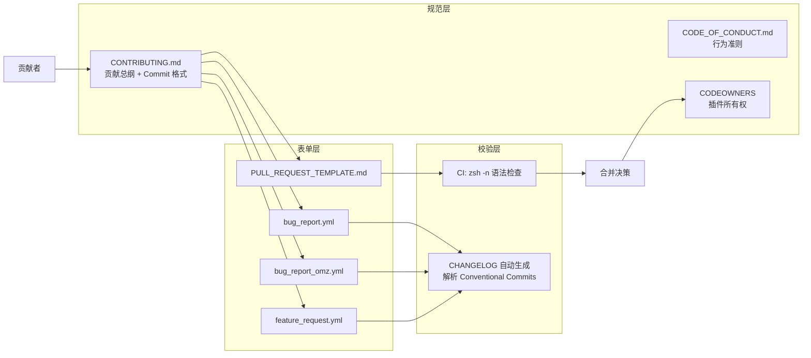
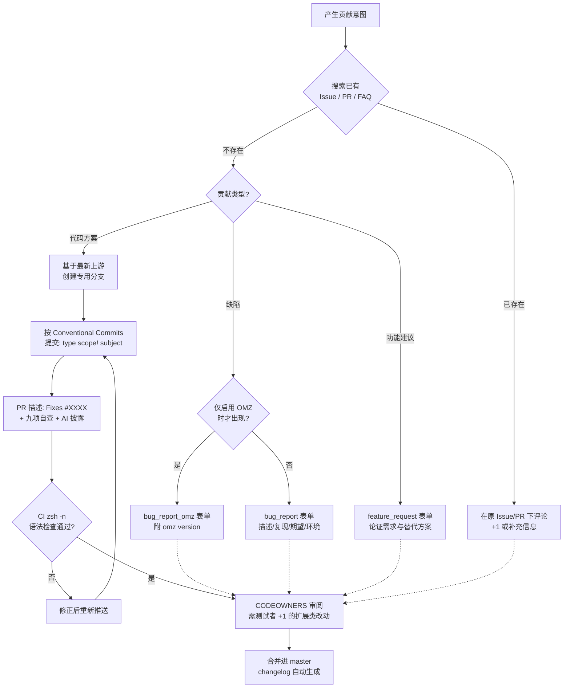

oh-my-zsh 作为一个社区驱动项目，其可持续性完全建立在贡献者的规范化协作之上。本页面向计划向项目提交 Issue 或 Pull Request 的开发者，系统解析仓库中的贡献基础设施：以 [CONTRIBUTING.md](CONTRIBUTING.md#L1-L8) 为主纲领的行为准则与贡献流程、由 `.github/ISSUE_TEMPLATE/` 下 YAML 表单驱动的 Issue 分类规范、PR 模板中的强制自查清单，以及基于 Conventional Commits 的提交信息格式。阅读本页后，你将能以维护者预期的方式参与协作，最大化贡献被合并的概率。

## 贡献基础设施的架构总览

oh-my-zsh 的贡献管控并非单一文件，而是由一组分工明确的配置文件构成的治理体系。其协作关系可以抽象为三层：**规范层**（定义行为边界与决策依据）、**表单层**（结构化采集贡献信息）、**校验层**（自动化质量门槛）。理解这一分层，有助于你在贡献前快速定位应遵循的具体规则。



这一体系的两个核心设计意图值得注意：其一，Issue 表单采用 GitHub Issue Forms（YAML 结构化表单）而非传统 Markdown 模板，强制贡献者在提交时填写结构化字段，从源头减少"无法复现"的低质量 Issue；其二，Commit 信息遵循 Conventional Commits 规范并非形式主义，而是**自动化变更日志工具的解析输入**——格式错误的提交将直接丢失进入 changelog 的资格。

Sources: [CONTRIBUTING.md](CONTRIBUTING.md#L1-L8), [main.yml](.github/workflows/main.yml#L1-L44)

## 行为准则与"先搜索"原则

所有贡献的第一道门槛是行为准则（Code of Conduct）。CONTRIBUTING.md 开篇即要求贡献者先阅读 [CODE_OF_CONDUCT.md](CODE_OF_CONDUCT.md#L1-L10)，该文件采用 Contributor Covenant 标准：pledge 承诺营造无骚扰环境，standards 部分列举了受欢迎行为（包容性语言、尊重分歧）与不可接受行为（人身攻击、公开他人隐私信息），enforcement 部分规定违规可通过 `ohmyzsh@planetargon.com` 举报并由维护团队调查处理。行为准则的适用范围覆盖所有项目空间，包括 Issue、PR、代码与 wiki 编辑。

Sources: [CODE_OF_CONDUCT.md](CODE_OF_CONDUCT.md#L1-L77)

贯穿全部贡献类型的第二条元规则是"Use the Search, Luke"（源自《星球大战》的调侃）。CONTRIBUTING.md 明确指出：在提交任何形式的贡献之前先搜索已有 Issue 和 PR，"90% 的情况下都能解决问题"。重复贡献不仅浪费志愿者维护者的有限审阅时间，也会稀释有效讨论的集中度。搜索的推荐路径依次为：GitHub Issues（含已关闭）、项目 FAQ wiki，确认无覆盖后才进入新建 Issue 或 PR 环节。

Sources: [CONTRIBUTING.md](CONTRIBUTING.md#L155-L168)

## Issue 规范：三种表单的职责边界

仓库通过 `.github/ISSUE_TEMPLATE/config.yml` 配置了 Issue 入口的路由策略：`blank_issues_enabled: true` 表示仍允许绕过模板提交空白 Issue，但同时提供了两个替代渠道链接——GitHub Discussions（社区支持问答）与 Discord 服务器（快速提问）。这一设计的意图是分流：**使用疑问走社区渠道，缺陷报告与功能建议走结构化表单**。

Sources: [config.yml](.github/ISSUE_TEMPLATE/config.yml#L1-L9)

两个缺陷报告表单的核心差异在于归因边界。`bug_report.yml` 用于"非 oh-my-zsh 引起"的缺陷（如 zsh 本身、终端模拟器的问题），而 `bug_report_omz.yml` 则要求报告者首先自证**该缺陷仅在启用 Oh My Zsh 时出现**——这是表单 Self Check 区块中的加粗强调项。两者共同的结构化字段如下表所示：

| 字段 | bug_report.yml | bug_report_omz.yml | 是否必填 |
|------|:---:|:---:|:---:|
| 缺陷描述 | ✅ | ✅ | 必填 |
| 复现步骤 | ✅ | ✅ | 必填 |
| 期望行为 | ✅ | ✅ | 必填 |
| 截图/asciinema 录制 | ✅ | ✅ | 可选 |
| OS / Linux 发行版 | ✅ | ✅ | 必填 |
| Zsh 版本（`echo $ZSH_VERSION`） | ✅ | ✅ | 必填 |
| Oh My Zsh 版本（`omz version`） | ❌ | ✅ | 必填 |
| 终端模拟器 | ✅ | ✅ | 必填 |
| WSL 版本下拉（WSL1/WSL2） | ✅ | ✅ | 可选 |
| 附加上下文 | ✅ | ✅ | 可选 |
| 自动打标签 | ❌ | `Bug` | — |

Sources: [bug_report.yml](.github/ISSUE_TEMPLATE/bug_report.yml#L1-L69), [bug_report_omz.yml](.github/ISSUE_TEMPLATE/bug_report_omz.yml#L1-L78)

注意两个版本检查命令的对应关系：Zsh 版本用 `echo $ZSH_VERSION` 获取，而 Oh My Zsh 版本用 `omz version` 获取（占位符示例为 `master (bf303965)` 格式）。复现步骤字段的占位符给出了维护者期望的粒度模板——"1. 启用插件 '...'，2. 运行命令 '...' 或尝试补全命令 '...'，3. 观察错误"——这提示报告者应将问题定位到**具体插件与具体命令**层面，而非笼统描述"shell 出问题了"。

Sources: [bug_report_omz.yml](.github/ISSUE_TEMPLATE/bug_report_omz.yml#L18-L60)

功能请求表单 `feature_request.yml` 的结构则围绕"论证需求价值"设计：仅"描述建议功能"一个字段必填，其余字段——目标插件/主题指认、待解决的问题、已考虑的替代方案、相关 Issue 链接——均为可选但被明确引导。表单同样在 Self Check 区块要求先检索已有 Issue。这与 CONTRIBUTING.md 中"You have a suggestion"章节的策略一致：发现已有同类建议时，**在原 Issue 下评论以扩大支持基数**，而非另开新帖。

Sources: [feature_request.yml](.github/ISSUE_TEMPLATE/feature_request.yml#L1-L38), [CONTRIBUTING.md](CONTRIBUTING.md#L56-L64)

对于缺陷报告，CONTRIBUTING.md 补充了表单之外的叙事要求：Issue 应包含"如何复现问题、正确行为应是什么、实际行为是什么"三要素，并参照 wiki 的 Troubleshooting 页面预先收集诊断数据；同时，应通过 `@` 提及相关插件的维护者 GitHub 句柄，将通知精确送达最有能力处理的人。

Sources: [CONTRIBUTING.md](CONTRIBUTING.md#L32-L54)

## Pull Request 提交规范

### 分支纪律与 Issue 关联

CONTRIBUTING.md 对 PR 的创建方式有一条大写的强制约束："You MUST always create PRs with _a dedicated branch_ based on the latest upstream tree"——即必须**基于最新上游树创建专用分支**，禁止直接从 master 分叉长期开发或从过时的 fork 提交。此外，若 PR 旨在解决已有 Issue，必须在 PR 描述正文中使用 GitHub 的关闭语法（如 `Fixes #XXXX`）建立关联，使合并时自动关闭对应 Issue。

Sources: [CONTRIBUTING.md](CONTRIBUTING.md#L66-L79)

### PR 模板的九项自查清单

每个 PR 的描述区会自动填充 [PULL_REQUEST_TEMPLATE.md](.github/PULL_REQUEST_TEMPLATE.md#L1-L22)，其中 Standards checklist 是维护者审阅前的第一道过滤网。九项检查覆盖了从描述质量到代码来源的完整维度：

| 清单项 | 审查意图 |
|--------|----------|
| PR 标题具有描述性 | changelog 与检索可用性 |
| 不与已开启的 PR 重复 | 避免重复劳动 |
| 已阅读并遵循贡献指南 | 流程合规 |
| 代码遵循 wiki 代码风格指南 | 一致性 |
| 代码为自己所写或来源 MIT 兼容许可 | 法律合规 |
| 如使用了 AI 工具辅助，已在下方披露 | AI 披露（新增项） |
| 代码高效、不浪费计算资源 | 运行时开销 |
| 代码稳定且已亲自测试 | 质量门槛 |
| 新增别名须为所有插件用户提供有效用例 | 别名准入（见下节） |

模板的"Changes"区要求以列表形式说明改动内容，"Other comments"区用于补充测试环境等信息。

Sources: [PULL_REQUEST_TEMPLATE.md](.github/PULL_REQUEST_TEMPLATE.md#L1-L22)

### AI 辅助贡献的披露义务

这是 CONTRIBUTING.md 中较新的专章，反映了小团队志愿者维护模式与 AI 编程工具普及之间的张力。项目对 AI 工具持开放态度（维护者自己也在使用），但设置了明确的披露要求：**若 AI 工具实质性地参与了贡献（代码生成、agentic 编程助手等），必须在 PR 描述中声明**——基础自动补全不算，AI 撰写了实质性代码部分则必须说明。表单给出的合格披露示例包括"使用 ChatGPT 生成了 git status 解析的正则初稿"、直接写"AI-assisted"等。

维护者真正在意的是三点：贡献者**能够解释自己的代码**做了什么及如何工作；提供问题上下文、测试方式与相关文档链接；质量优先于数量。该章节的执行后果同样明确——看似未经审阅的 AI 产出、或贡献者无法解释的代码，**可能在不给详细反馈的情况下被直接关闭**。

Sources: [CONTRIBUTING.md](CONTRIBUTING.md#L129-L151)

### 新增插件的准入门槛

"扩展类"贡献（新插件等）有额外的验证要求：大型改动（如新插件）需要贡献者**自行找到测试者为其 PR 点赞（+1）**，以证明改动在真实环境中可用。同时官方明确表示**现阶段不接受主题贡献**。对新增别名这一高频争议点，项目设定了五项条件：别名将被许多人使用；用于高频常见任务；宁可一个通用别名也不要多个特定别名；论证时描述工作流场景（尤其是与其他别名的组合使用）；与现有命令重名时更换别名。这五条的核心逻辑是：别名将进入全球无数用户的 shell 环境，其存在必须为"所有人"而非"作者个人"创造价值。

Sources: [CONTRIBUTING.md](CONTRIBUTING.md#L93-L127)

### 方案类 PR 的协作礼仪

若你的解决方案与已有 PR 重合，规范给出的路径是：先试用对方的方案，可用则为其 +1；若你认为自己的方案更优，应**引用对方 PR 并提交以便对比**，而非各自为战。这一规则配合"搜索先行"，共同防止社区精力在平行方案上碎片化。

Sources: [CONTRIBUTING.md](CONTRIBUTING.md#L81-L91)

## 提交信息格式：Conventional Commits 深度解析

### 为什么是 Conventional Commits

oh-my-zsh 采用 [Conventional Commits v1.0.0](https://www.conventionalcommits.org/en/v1.0.0/) 规范的根本原因在 [CONTRIBUTING.md](CONTRIBUTING.md#L172-L177) 中直接言明：**自动化 changelog 工具依据提交信息生成变更日志**。换言之，提交格式不是风格偏好，而是发布流水线的机器可读契约——不合规的提交意味着用户在 changelog 中永远看不到这个改动。

格式骨架为：

```
type(scope)!: subject
```

Sources: [CONTRIBUTING.md](CONTRIBUTING.md#L179-L183)

### type：十种变更类型

| type | 语义 | 进入 changelog |
|------|------|:---:|
| `feat` | 新功能 | ✅ |
| `fix` | 缺陷修复 | ✅ |
| `docs` | 文档变更 | ✅ |
| `refactor` | 不引入新功能或修复的重构 | ✅ |
| `style` | 代码风格改进 | ✅ |
| `perf` | 性能改进 | ✅ |
| `test` | 测试套件变更 | ✅ |
| `ci` | CI 系统变更 | ✅ |
| `build` | 构建系统变更（项目暂无，基本不适用） | ✅ |
| `chore` | 其余杂项变更 | ❌ 明确不进 |

Sources: [CONTRIBUTING.md](CONTRIBUTING.md#L185-L198)

### scope：精确到插件或主题名

scope 表示提交影响的代码区域，改动涉及多个区域或无特定区域时省略括号。对插件和主题的改动，**scope 必须是插件/主题名本身**，而非路径前缀。官方给出的正误对照极具辨析价值：

- ✅ `fix(agnoster): commit subject`
- ❌ `fix(theme/agnoster): commit subject`

示例：修改单个 git 插件的提交写作 `feat(git): add alias for \`git commit\``；横跨多个插件的风格统一提交则写作 `style: fix inline declaration of arrays`（scope 留空）。

Sources: [CONTRIBUTING.md](CONTRIBUTING.md#L200-L217)

### `!` 与 BREAKING CHANGE：破坏性变更协议

紧跟 scope（或 type，若 scope 为空）之后的 `!` 标记表示该提交**引入破坏性变更**。其完整用法支持附一段面向用户的迁移说明：changelog 解析器会持续读取直到提交信息结束或遇到空行，因此破坏性说明与后续的 issue 引用、署名等内容需用空行分隔。官方构造的完整示例如下：

```
style(agnoster)!: change dirty git repo glyph

BREAKING CHANGE: the glyph to indicate when a git repository is dirty has
changed from a Powerline character to a standard UTF-8 emoji. You can
change it back by setting `ZSH_THEME_DIRTY_GLYPH`.

Fixes #420

Co-authored-by: Username <email>
```

注意此示例展示了格式规范的完整生态：`!` 标记破坏性、`BREAKING CHANGE:` 段落向用户解释影响与应对方式（可通过 `ZSH_THEME_DIRTY_GLYPH` 恢复旧行为）、`Fixes #420` 关联 Issue、`Co-authored-by` 署名协作者。

Sources: [CONTRIBUTING.md](CONTRIBUTING.md#L219-L239)

### subject：面向 changelog 的写作技巧

subject 是唯一会显示在 changelog 中的部分，提交正文虽可承载细节但不会展示。因此官方给出两个"格式化技巧"：其一，subject 中写 `#issue` 编号会被 changelog 工具高亮为链接，如 `feat(archlinux): add support for aura AUR helper (#9467)`；其二，反引号包裹的行内代码同样会被高亮，如 `feat(shell-proxy): enable unexported \`DEFAULT_PROXY\` setting (#9774)`。风格要求上，首行应尽量简短，不够用时扩展到提交正文，且 subject 必须精确到"用户仅看 changelog 就知道改了什么"。

Sources: [CONTRIBUTING.md](CONTRIBUTING.md#L241-L261)

## 校验层：CI 与代码所有权

贡献流程的自动化闭环由两个机制完成。其一是 CI 工作流 [main.yml](.github/workflows/main.yml#L2-L24)：在向 master 分支开启或同步 PR 时触发 `tests` 作业，对 `oh-my-zsh.sh`、全部 `lib/*.zsh`、全部 `plugins/*/*.plugin.zsh` 与 `_*` 补全文件、全部 `themes/*.zsh-theme` 执行 `zsh -n` 语法检查——这意味着任何 PR 中存在语法错误的 shell 文件都会被自动拦截。作业仅在 `ohmyzsh/ohmyzsh` 上游仓库运行（fork 中不执行），并配置了并发组以取消同分支的过期运行。

其二是 [CODEOWNERS](.github/CODEOWNERS#L1-L21) 文件：为约二十个插件指定了所有者（如 `plugins/kubectl/` 归 @mcornella、`plugins/gitfast/` 归 @felipec），这些所有者会被自动请求审阅对应路径的 PR。这也呼应了 Issue 规范中"用 `@` 抄送相关插件维护者"的要求——两处共同构成"谁的插件谁负责"的所有权路由机制。志愿参与维护则可参阅 CONTRIBUTING.md 末尾指向的 wiki Volunteer 页面。

Sources: [main.yml](.github/workflows/main.yml#L35-L44), [CODEOWNERS](.github/CODEOWNERS#L1-L21), [CONTRIBUTING.md](CONTRIBUTING.md#L265-L271)

## 贡献决策全流程

将上述规范串联为一份可操作的决策流程图：



整个流程中，格式规范的违反不会总是硬性失败——但会以两种方式惩罚贡献者：CI 拦截语法错误这类硬门槛，以及维护者因信息不足而关闭 Issue/PR 这类软性淘汰。对于以复用数千行社区 shell 代码为日常的中级开发者而言，掌握这套规范的意义不仅是"让 PR 被合并"，更是理解一个大型开源社区如何用最少的强制机制维持万人级协作秩序。

Sources: [CONTRIBUTING.md](CONTRIBUTING.md#L1-L271), [main.yml](.github/workflows/main.yml#L1-L44)

## 延伸阅读

贡献规范的价值需放置在插件与测试体系中才能完整兑现。建议按以下路径继续深入：开发新插件前先掌握命名与加载约定，参见[插件加载机制与开发命名约定](16-cha-jian-jia-zai-ji-zhi-yu-kai-fa-ming-ming-yue-ding)；编写补全脚本参见[补全脚本编写实践](17-bu-quan-jiao-ben-_command-wen-jian-bian-xie-shi-jian)；了解 CI 中测试作业的运行细节参见[测试体系与 CI 工作流解析](27-ce-shi-ti-xi-zunit-yu-ci-gong-zuo-liu-jie-xi)；若希望在不动上游的前提下扩展功能，参见[自定义插件与主题：ZSH_CUSTOM 目录实践](26-zi-ding-yi-cha-jian-yu-zhu-ti-zsh_custom-mu-lu-shi-jian)。