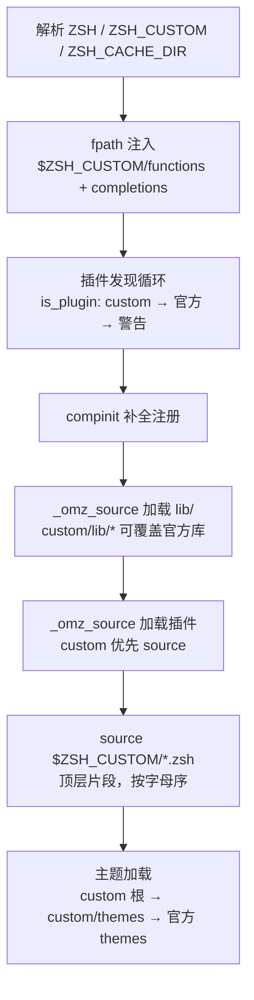
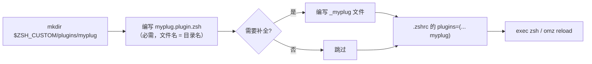

`ZSH_CUSTOM` 是 Oh My Zsh 为用户私有扩展预留的"覆盖层"（overlay）：官方仓库的所有文件都随 `omz update` 变动，而你的个性化代码则隔离在这个目录中，永不升级冲突。本页聚焦该目录的目录结构、加载管线中的注入点，以及自定义插件、第三方插件与自定义主题的完整实践，是 [整体架构与目录职责划分](9-zheng-ti-jia-gou-yu-mu-lu-zhi-zhe-hua-fen) 的续篇与 [插件加载机制与开发命名约定](16-cha-jian-jia-zai-ji-zhi-yu-kai-fa-ming-ming-yue-ding)、[主题编写规范：从 robbyrussell 到 agnoster](20-zhu-ti-bian-xie-gui-fan-cong-robbyrussell-dao-agnoster) 的实操前置。

## 目录解剖：约定优于配置的用户层

`ZSH_CUSTOM` 在主脚本加载时解析，若未在 `.zshrc` 中预先设置，则默认取 `$ZSH/custom`——这一行兜底逻辑位于启动流程的最前端，先于一切资源加载执行，因此后续所有机制都可以无条件引用该变量。

Sources: [oh-my-zsh.sh](oh-my-zsh.sh#L53-L55)

`.zshrc` 模板同样暴露了这一开关：取消注释 `ZSH_CUSTOM=/path/to/new-custom-folder` 即可把整个自定义层迁移到任意位置（例如放入独立的 dotfiles 仓库）。值得注意的是，模板还在注释层面明确了两个关键约定——自定义插件放入 `$ZSH_CUSTOM/plugins/`，而顶层 `.zsh` 文件（如 `$ZSH_CUSTOM/aliases.zsh`、`$ZSH_CUSTOM/macos.zsh`）是存放个人别名的推荐位置。

Sources: [templates/zshrc.zsh-template](templates/zshrc.zsh-template#L68-L69), [templates/zshrc.zsh-template](templates/zshrc.zsh-template#L97-L103)

这个目录在 Git 层面被整体忽略：`.gitignore` 的第一行就是 `custom/`。这意味着 `omz update`（本质是 `git pull`）永远不会触碰你的用户文件，官方升级与个人定制实现了彻底的写时隔离。

Sources: [.gitignore](.gitignore#L1-L2)

一个容易误解的细节是：**安装器从不创建 `custom/` 的子目录结构**。`install.sh` 的 `setup_ohmyzsh` 仅执行裸 git clone，`setup_zshrc` 仅复制模板文件，全程没有针对 custom 的 `mkdir`。目录及其子结构完全由使用过程中的第一次实际需要来孵化。

Sources: [tools/install.sh](tools/install.sh#L329-L352), [tools/install.sh](tools/install.sh#L403-L413)

那示例脚手架从何而来？通过 `git ls-files custom` 可以验证，仓库中恰好有三个 custom 文件是被 Git 追踪的——`custom/example.zsh`、`custom/plugins/example/example.plugin.zsh`、`custom/themes/example.zsh-theme`（被追踪的文件不受 gitignore 规则影响，会随 clone 一起落地）。它们是官方提供的"说明书文件"，其余一切内容都是用户的自由领地。当前这台机器的真实 custom 目录即呈现了这一生态的典型形态：

```text
custom/
├── example.zsh                          # 官方脚手架（Git 追踪）：顶层配置片段示例
├── plugins/
│   ├── example/                         # 官方脚手架（Git 追踪）：插件占位说明
│   │   └── example.plugin.zsh
│   ├── zsh-autosuggestions/             # 用户安装的第三方插件（完整 git clone）
│   └── zsh-syntax-highlighting/         # 同上
└── themes/
    ├── example.zsh-theme                # 官方脚手架（Git 追踪）：主题最小示例
    └── robbyrussell.zsh-theme           # 用户复制的主题副本 → 可直接魔改
```

Sources: [custom/example.zsh](custom/example.zsh#L1-L13), [custom/plugins/example/example.plugin.zsh](custom/plugins/example/example.plugin.zsh#L1-L4), [custom/themes/example.zsh-theme](custom/themes/example.zsh-theme#L1-L7)

## 加载管线：ZSH_CUSTOM 的五个注入点

理解该目录的关键，是看清它在 `oh-my-zsh.sh` 启动序列中的五个精确位置。整条管线呈严格的单向顺序，且**每一处资源解析都以 custom 优先于官方**：



第一个注入点是 `fpath`：`$ZSH/{functions,completions}` 与 `$ZSH_CUSTOM/{functions,completions}` 被前置插入。官方仓库根目录实际并不存在这两个子目录（非存在的 fpath 条目会被 zsh 静默忽略），因此这行代码的真实意图就是给用户留出标准挂钩——往 `$ZSH_CUSTOM/functions/` 放可 `autoload` 的函数文件、往 `$ZSH_CUSTOM/completions/` 放 `_<命令>` 补全脚本，后者会被随后运行的 compinit 自动扫描注册。

Sources: [oh-my-zsh.sh](oh-my-zsh.sh#L76), [oh-my-zsh.sh](oh-my-zsh.sh#L79)

第二个注入点是插件发现。`is_plugin` 定义了插件目录的合法性契约：存在 `<插件名>.plugin.zsh` **或** `_<插件名>` 补全文件之一即可。发现循环对 `plugins=()` 数组中的每个名字，先探测 `$ZSH_CUSTOM/plugins/`、再探测 `$ZSH/plugins/`，两者皆失败则打印 `[oh-my-zsh] plugin '...' not found`。探测成功者的目录被加入 `fpath`，且此步刻意安排在 compinit 之前，保证补全脚本可用。

Sources: [oh-my-zsh.sh](oh-my-zsh.sh#L81-L98)

第三、四个注入点收敛在同一辅助函数 `_omz_source` 中：它以 `lib/*` 与 `plugins/*` 路径为参数，先检查 `$ZSH_CUSTOM/$filepath` 是否存在，存在则 source 之，否则回落到 `$ZSH/$filepath`。lib 加载循环与插件加载循环都经由它，这带来了一个官方注释之外的强力特性——把同名文件放进 `$ZSH_CUSTOM/lib/`（如 `lib/history.zsh`）即可整体替换某个核心库。

Sources: [oh-my-zsh.sh](oh-my-zsh.sh#L267-L306), [oh-my-zsh.sh](oh-my-zsh.sh#L308-L319)

第五个注入点是主题：`is_theme` 检查 `<名字>.zsh-theme` 文件的存在性，随后按 **`$ZSH_CUSTOM/<名字>.zsh-theme` → `$ZSH_CUSTOM/themes/<名字>.zsh-theme` → `$ZSH/themes/<名字>.zsh-theme`** 三级链查找，全 miss 才报 `theme '...' not found`。注意第一级允许自定义主题散放在 custom 根目录，第二级才是规范的 `themes/` 子目录。

Sources: [oh-my-zsh.sh](oh-my-zsh.sh#L327-L344)

各注入点的时序与行为对比如下：

| 注入点 | 位置（相对顺序） | custom 参与形式 | 典型用途 |
|---|---|---|---|
| `fpath` 前置 | 最先 | `$ZSH_CUSTOM/{functions,completions}` | 惰性函数、独立补全脚本 |
| 插件发现 | compinit 之前 | `plugins/<名>/<名>.plugin.zsh` 或 `_<名>` | 启用自定义/第三方插件 |
| lib 加载 | 插件之前 | `$ZSH_CUSTOM/lib/<同名>.zsh` 覆盖 | 深度魔改核心库（慎用） |
| 插件加载 | lib 之后 | `_omz_source` custom 优先 | 同名插件影子覆盖 |
| 顶层 `*.zsh` | 插件之后、主题之前 | `$ZSH_CUSTOM/*.zsh` 按字母序全量 source | 别名、环境变量、快捷函数 |
| 主题 | 最后 | 三级查找链 | 自定义/魔改主题 |

Sources: [oh-my-zsh.sh](oh-my-zsh.sh#L90-L98), [oh-my-zsh.sh](oh-my-zsh.sh#L321-L325)

## 实践一：顶层 *.zsh 配置片段

最低成本的定制方式是向 `$ZSH_CUSTOM/` 扔散装 `.zsh` 文件：加载循环使用 `(N)` glob 限定符遍历顶层所有 `.zsh` 文件逐一 source。官方脚手架 `example.zsh` 的注释精炼概括了三条行为规则——按字母序自动加载、在 lib 内建内容之后加载（因此可以覆盖）、默认被 git 忽略。

Sources: [oh-my-zsh.sh](oh-my-zsh.sh#L321-L325), [custom/example.zsh](custom/example.zsh#L1-L13)

由于这批文件晚于所有插件加载，它们是覆盖插件别名的理想位置；又早于主题加载，因此也能在主题求值前修改变量。实际操作只需 `touch $ZSH_CUSTOM/aliases.zsh` 写入个人别名即可生效，无需任何注册动作。

## 实践二：编写自定义插件

自定义插件的本质是一个满足命名契约的目录。以官方最简插件 `encode64` 为解剖样本——28 行内完成全部生命周期：定义三个函数、绑定三个别名，无任何初始化钩子：

```zsh
encode64() {
    if [[ $# -eq 0 ]]; then
        cat | base64
    else
        printf '%s' $1 | base64
    fi
}
# ... decode64 / encodefile64 同理
alias e64=encode64
alias ef64=encodefile64
alias d64=decode64
```

创建自定义插件的标准流程由此推导为四步：



需要留意 `is_plugin` 与 `_omz_source` 之间的契约差异：发现阶段接受"仅补全文件"的目录（`_名字` 即可通过 `is_plugin`），但加载阶段 `_omz_source` 只认 `<名字>.plugin.zsh`——若你的目录只有 `_<名字>` 而没有插件主文件，它会被注册进 `fpath` 使补全生效，但不会有任何脚本被执行。这个特性可用来做"纯补全插件"，反过来说，如果你期望插件执行逻辑，主文件不可省略。

Sources: [oh-my-zsh.sh](oh-my-zsh.sh#L81-L86), [oh-my-zsh.sh](oh-my-zsh.sh#L315-L319)

同名覆盖是官方明文支持的语义：`custom/plugins/example/example.plugin.zsh` 的注释直书"Plugins placed here will override ones with the same name in the main plugins directory"。因此你可以复制 `plugins/git/git.plugin.zsh` 到 `$ZSH_CUSTOM/plugins/git/` 并删改个别别名，`plugins=(git)` 无需任何改动即可切换到你的版本。

Sources: [custom/plugins/example/example.plugin.zsh](custom/plugins/example/example.plugin.zsh#L1-L4), [oh-my-zsh.sh](oh-my-zsh.sh#L286-L291)

补全脚本的编写细节（`_command` 文件的 `#compdef` 头、`_describe` 用法等）属于独立主题，参见 [补全脚本（_command 文件）编写实践](17-bu-quan-jiao-ben-_command-wen-jian-bian-xie-shi-jian)；插件生命周期与命名约定的更多约束见 [插件加载机制与开发命名约定](16-cha-jian-jia-zai-ji-zhi-yu-kai-fa-ming-ming-yue-ding)。

## 实践三：安装第三方插件

第三方插件没有独立的注册机制——它们就是"别人写好的自定义插件"，安装即 git clone 到 `$ZSH_CUSTOM/plugins/`。当前环境的 `custom/plugins/` 中恰好有两个活体样本：`zsh-autosuggestions` 与 `zsh-syntax-highlighting`，目录内保留着完整的上游仓库结构（README、src、测试与构建文件），证实了 clone-into-custom 这一工作流。

标准命令模式如下（官方 README 的惯用写法，利用 `ZSH_CUSTOM` 兜底展开）：

```zsh
git clone https://github.com/zsh-users/zsh-autosuggestions \
  "${ZSH_CUSTOM:-~/.oh-my-zsh/custom}/plugins/zsh-autosuggestions"

git clone https://github.com/zsh-users/zsh-syntax-highlighting.git \
  "${ZSH_CUSTOM:-~/.oh-my-zsh/custom}/plugins/zsh-syntax-highlighting"
```

随后在 `.zshrc` 中启用即可。由于 custom 目录不被 git 追踪，`omz update` 不会动这些 clone；但若启用的插件名同时存在于官方与 custom（如本仓库已内置 vendored 版本的 `zsh-autosuggestions`），加载管线会无条件选择你的 custom 副本——想切换回官方版，删除 custom 目录即可，无需改配置。这两个插件的原理与配置项详见 [内置生态：语法高亮与自动建议第三方框架](19-nei-zhi-sheng-tai-yu-fa-gao-liang-yu-zi-dong-jian-yi-di-san-fang-kuang-jia)。

Sources: [custom/plugins/zsh-autosuggestions/zsh-autosuggestions.plugin.zsh](custom/plugins/zsh-autosuggestions/zsh-autosuggestions.plugin.zsh#L1), [oh-my-zsh.sh](oh-my-zsh.sh#L90-L98)

## 实践四：编写自定义主题

主题只是一个设置 `PROMPT` 与若干 `ZSH_THEME_*` 钩子变量的 `.zsh-theme` 脚本。官方脚手架 `custom/themes/example.zsh-theme` 给出了最小可用形态——单行 PROMPT，用 `%{$fg[...]%}` 转义序列着色：

```zsh
PROMPT="%{$fg[red]%}%n%{$reset_color%}@%{$fg[blue]%}%m %{$fg[yellow]%}%~ %{$reset_color%}%% "
```

Sources: [custom/themes/example.zsh-theme](custom/themes/example.zsh-theme#L1-L7)

默认主题 `robbyrussell` 则展示了进阶模式：PROMPT 分段拼接（`+=`），Git 状态通过调用 `git_prompt_info` 函数嵌入，该函数读取 `ZSH_THEME_GIT_PROMPT_PREFIX/SUFFIX/DIRTY/CLEAN` 四个变量来渲染前后缀——主题与 Git 信息之间是纯粹的"变量契约"耦合，主题作者无需接触任何 git 命令。

Sources: [themes/robbyrussell.zsh-theme](themes/robbyrussell.zsh-theme#L1-L8), [lib/git.zsh](lib/git.zsh#L49)

实践时有一个现成的活体样本：当前 `custom/themes/robbyrussell.zsh-theme` 就是从官方 `themes/robbyrussell.zsh-theme` 复制来的副本。得益于三级查找链，只要 `ZSH_THEME="robbyrussell"`，加载器命中的将是 **custom 副本而非官方原件**——你可以放心魔改副本，官方原件在升级时保持原样，随时可作参照或恢复源。

Sources: [oh-my-zsh.sh](oh-my-zsh.sh#L334-L344)

自定义主题还会自动融入随机主题机制：`themes/random.zsh-theme` 在 `ZSH_THEME_RANDOM_CANDIDATES` 未显式指定时，构建候选池的来源恰好是 `$ZSH_CUSTOM/*.zsh-theme`、`$ZSH_CUSTOM/themes/*.zsh-theme` 与 `$ZSH/themes/*.zsh-theme` 三处 glob 的并集，随后通过 `$RANDOM` 抽取并按同样的优先级链 source，选中者记录在 `$RANDOM_THEME` 中，可用 `ZSH_THEME_RANDOM_QUIET=true` 静默。随机主题与候选列表的完整行为见 [主题的浏览、切换与随机主题](5-zhu-ti-de-liu-lan-qie-huan-yu-sui-ji-zhu-ti)。

Sources: [themes/random.zsh-theme](themes/random.zsh-theme#L11-L25), [themes/random.zsh-theme](themes/random.zsh-theme#L33-L47)

主题内部的 prompt 变量契约、右侧提示符与 agnoster 风格的 powerline 实现属于进阶内容，参见 [主题编写规范：从 robbyrussell 到 agnoster](20-zhu-ti-bian-xie-gui-fan-cong-robbyrussell-dao-agnoster)。

## 覆盖策略全景：三种影子机制对比

将前述机制收拢，custom 目录提供三种不同粒度的"影子覆盖"，各有明确的升级安全边界：

| 覆盖对象 | 存放位置 | 生效机制 | 官方升级影响 |
|---|---|---|---|
| 顶层片段 | `$ZSH_CUSTOM/*.zsh` | 字母序全量 source，晚于插件 | 无冲突（官方无对应物） |
| 同名插件 | `$ZSH_CUSTOM/plugins/<名>/` | fpath 发现 + `_omz_source` 均优先 custom | 官方更新被静默旁路，需自行同步 |
| 同名 lib | `$ZSH_CUSTOM/lib/<名>.zsh` | `_omz_source` custom 优先 | 魔改库可能与新版主脚本失配，风险最高 |
| 同名主题 | `$ZSH_CUSTOM/{,themes/}<名>.zsh-theme` | 三级查找链前两级优先 | 官方主题更新不再生效，完全由副本接管 |

Sources: [oh-my-zsh.sh](oh-my-zsh.sh#L286-L291), [oh-my-zsh.sh](oh-my-zsh.sh#L327-L344)

其中 lib 覆盖是双刃剑：`_omz_source` 的回落逻辑对 `lib/history.zsh` 等文件同样生效，这意味着你可以整体重写核心库行为，但 `omz update` 引入的主脚本新特性（如新的缓存字段）可能与旧版魔改副本不兼容。相对地，同名插件/主题覆盖的维护成本更低——因为被覆盖对象的接口面通常很小。三者共同的安全网是 git 隔离：无论哪种覆盖，官方侧文件都随升级滚动，你的副本原地不动。

## omz CLI 对自定义目录的支持

`omz` 命令行工具在补全与子命令两个层面深度感知 custom 目录。补全函数会同时枚举两处来源——例如 `omz plugin enable` 的候选列表就是官方与 custom 插件的并集（去重后）：

Sources: [lib/cli.zsh](lib/cli.zsh#L79-L88), [lib/cli.zsh](lib/cli.zsh#L95-L96)

| 命令 | custom 相关行为 | 关键源码 |
|---|---|---|
| `omz plugin list` | 分 **Custom plugins** / **Built-in plugins** 两节展示；`--enabled` 时按目录归属分类已启用插件 | [lib/cli.zsh](lib/cli.zsh#L479-L514) |
| `omz plugin info <名>` | README 先查 `$ZSH_CUSTOM/plugins/<名>/README.md` 再查官方 | [lib/cli.zsh](lib/cli.zsh#L441-L477) |
| `omz plugin load <名>` | 运行时加载（不改 `.zshrc`），custom 目录优先，校验契约后 source，含 `_<名>` 时重跑 compinit | [lib/cli.zsh](lib/cli.zsh#L516-L562) |
| `omz theme list` | 递归枚举 `$ZSH_CUSTOM/**/*.zsh-theme`，名字归一化后单列 **Custom themes** 节 | [lib/cli.zsh](lib/cli.zsh#L792-L820) |
| `omz theme set <名>` | 先在 custom 根/custom themes/官方三处验证存在，才改写 `.zshrc`（带备份与语法回滚） | [lib/cli.zsh](lib/cli.zsh#L822-L886) |
| `omz theme use <名>` | 运行时按同一条三级链 source，更新 `$ZSH_THEME` 并清理 `$RANDOM_THEME` | [lib/cli.zsh](lib/cli.zsh#L888-L909) |

这组命令意味着自定义资产的"验证—预览—切换"可以完全脱离手工编辑 `.zshrc`：`omz plugin load myplug` 试运行无副作用，确认无误后再写入 `plugins=()` 持久化。CLI 工具的完整命令面见 [omz 命令行工具：更新、插件与主题管理](6-omz-ming-ling-xing-gong-ju-geng-xin-cha-jian-yu-zhu-ti-guan-li)。

## 排错速查

| 症状 | 根因 | 处置 |
|---|---|---|
| `[oh-my-zsh] plugin 'x' not found` | 两处 `plugins/` 均无 `x.plugin.zsh` 与 `_x` | 核对目录名与 `plugins=()` 拼写完全一致 |
| 插件启用但无补全 | 只有 `.plugin.zsh` 缺 `_<名>`，或目录名≠插件名（compinit 按文件名注册） | 补齐 `_<名>` 文件，或 `exec zsh` 重建 zcompdump |
| `[oh-my-zsh] theme 'x' not found` | 三级链全 miss | 确认文件名精确为 `x.zsh-theme` 且位于链上任一位置 |
| 改了 custom 主题副本不生效 | 正被 `random` 模式覆盖，或改的是官方原件 | `echo $ZSH_THEME`/$RANDOM_THEME 检查当前模式 |
| 第三方插件升级后报错 | custom 副本旁路了官方 vendored 版本 | `omz update` 官方侧，手动 `git pull` custom 副本 |

Sources: [oh-my-zsh.sh](oh-my-zsh.sh#L90-L98), [oh-my-zsh.sh](oh-my-zsh.sh#L327-L344)

## 下一步

至此你已掌握用户层的全部扩展面。建议按以下路径继续深入：理解插件生命周期细节前往 [插件加载机制与开发命名约定](16-cha-jian-jia-zai-ji-zhi-yu-kai-fa-ming-ming-yue-ding)；动手写补全前往 [补全脚本（_command 文件）编写实践](17-bu-quan-jiao-ben-_command-wen-jian-bian-xie-shi-jian)；把主题写得更专业前往 [主题编写规范：从 robbyrussell 到 agnoster](20-zhu-ti-bian-xie-gui-fan-cong-robbyrussell-dao-agnoster)；若要保证自定义代码的质量，[测试体系（zunit）与 CI 工作流解析](27-ce-shi-ti-xi-zunit-yu-ci-gong-zuo-liu-jie-xi) 展示了官方如何为插件编写测试。