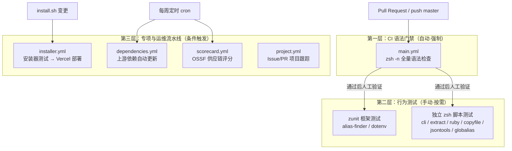
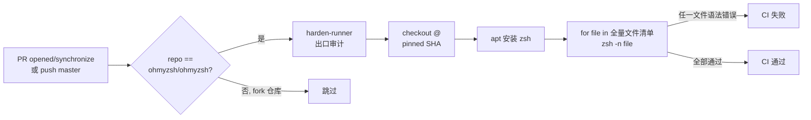
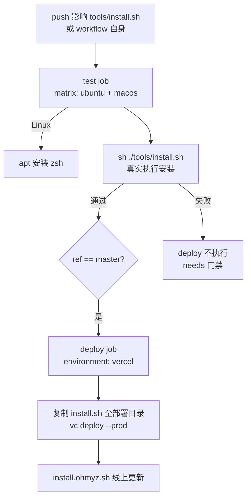

oh-my-zsh 作为一个拥有数千个 zsh 文件、数百名贡献者的社区项目，其质量保障策略呈现出鲜明的"分层防御"特征：**CI 层做全量廉价的语法门禁，测试层做插件级的按需行为验证，运维层做供应链安全审计**。本页将从测试技术的双轨制入手，逐层拆解 `.github/workflows/` 下的五个工作流，还原这个"无框架重依赖"项目的工程化真相。所有结论均基于对当前代码树与 git 历史的逐一验证，无任何推测成分。

## 一、总体分层模型：三层质量防线

理解 oh-my-zsh 的质量体系，关键是先看清"什么在什么时机被谁运行"。通过考古 `git log -S zunit -- .github/workflows/`（结果为空）可以确认一个反直觉的事实：**zunit 框架测试从未被 CI 自动执行过**，它们是纯粹依赖贡献者自律的本地工具。真正的自动化门禁只有 `zsh -n` 语法检查——这是一种零依赖、全量覆盖、毫秒级完成的"最大公约数"策略，完美适配一个由异构插件组成的松耦合仓库。



这一分层模型的本质是**成本-收益权衡**：zsh 脚本的绝大多数回归（语法错误、括号不匹配）可以被 `zsh -n` 零成本捕获，而行为正确性高度依赖运行环境（是否有 git、node、lzma 等外部命令），强行放入 CI 会带来大量环境维护成本且收益有限。

Sources: [.github/workflows/main.yml](.github/workflows/main.yml#L21-L44)

## 二、测试双轨制：zunit 框架 vs 独立脚本

仓库中现存 8 个测试文件，分属两条技术路线。理解它们的差异是给 oh-my-zsh 写测试的前提：

| 维度 | zunit 框架路线 | 独立脚本路线 |
|---|---|---|
| 采用位置 | `plugins/alias-finder`、`plugins/dotenv` | `lib/tests`、`plugins/{extract,ruby,copyfile,jsontools,globalias}/tests` |
| 前置配置 | 插件根目录 `.zunit.yml` | 无，shebang 直接声明解释器 |
| 外部依赖 | 需安装 zunit + Revolver | 仅需 zsh 本身（部分需 node/lzma） |
| 断言风格 | `assert ... equals/same_as` DSL | 手写 if 比较 + PASS/FAIL 打印 |
| 生命周期 | `@setup`/`@teardown` 钩子 | 手动 mktemp + trap 清理 |
| CI 集成 | **无**（本地手动运行） | **无**（本地手动运行） |
| 运行方式 | `cd plugins/xxx && zunit` | `zsh -df plugins/xxx/tests/xxx.test.zsh` |

Sources: [plugins/alias-finder/.zunit.yml](plugins/alias-finder/.zunit.yml#L1-L10), [plugins/extract/tests/extract.test.zsh](plugins/extract/tests/extract.test.zsh#L1-L3)

两条路线的分野反映了项目的演进史：早期测试都是独立脚本，zunit 只在后来需要复杂断言能力的两个插件（alias-finder 的别名匹配排序、dotenv 的变量展开语义）中引入，且作者为 dotenv 编写了一套相当成熟的测试基础设施。

## 三、zunit 深度解析：以 dotenv 为范本

### 3.1 配置文件约定

每个采用 zunit 的插件在根目录放置 `.zunit.yml`，声明测试目录布局与执行策略：

```yaml
directories:
  tests: tests          # 测试文件目录
  output: tests/_output # 输出产物（被 .gitignore/.gitkeep 占位）
  support: tests/_support # bootstrap 引导脚本
time_limit: 0    # 不限时
fail_fast: false # 失败不中断
```

dotenv 与 alias-finder 的配置仅一处差异——`verbose`（false vs true），这直接影响测试失败时的输出粒度。`_output` 目录以 `.gitkeep`/`.gitignore` 占位，保证克隆后目录结构完整。

Sources: [plugins/dotenv/.zunit.yml](plugins/dotenv/.zunit.yml#L1-L10), [plugins/alias-finder/.zunit.yml](plugins/alias-finder/.zunit.yml#L1-L10)

### 3.2 测试文件结构与生命周期

zunit 脚本以 `#!/usr/bin/env zunit` 开头，通过 `@setup`/`@teardown` 块定义每个用例的前后置动作，用 `@test '描述' { ... }` 定义用例。dotenv 的 `basic-parsing.zunit` 是理解这套机制的最佳样本：

```zsh
@setup {
  typeset -g fixture="$(_create_temp_fixture)"   # 每个用例新建临时文件
  typeset -gA expected_vars=()                   # 期望值关联数组
}
@teardown {
  [[ -f "$fixture" ]] && command rm -f "$fixture"
  unset DOTENV_TEST_VARS DOTENV_SOURCE_VARS 2>/dev/null
}
```

用例内部遵循"heredoc 构造输入 → 调用被测函数 → 断言变量状态"的三段式，例如验证基本赋值解析时，将 `BASIC=basic` 写入 fixture 后调用 `_parse_dotenv_test`，再以 `assert "DOTENV_TEST_VARS" var_same_as "expected_vars"` 完成语义级比较。该文件共 399 行，覆盖空值、单双引号、换行展开、变量引用展开等解析语义的每个分支。

Sources: [plugins/dotenv/tests/basic-parsing.zunit](plugins/dotenv/tests/basic-parsing.zunit#L1-L12), [plugins/dotenv/tests/basic-parsing.zunit](plugins/dotenv/tests/basic-parsing.zunit#L118-L135)

### 3.3 bootstrap：自定义断言扩展层

zunit 原生断言不足以比较关联数组的键值结构，dotenv 在 `tests/_support/bootstrap` 中实现了扩展。这个 140 行的引导脚本做了两件事：其一是环境准备——加载被测插件并关闭交互确认（`ZSH_DOTENV_PROMPT=false`），提供 `_parse_dotenv_test`、`_create_temp_fixture`、`_source_with_allexport` 等工具函数；其二是断言桥接——实现 `var_same_as`、`function_exists`、`var_is_set` 等断言，其中关联数组比较通过 `${(Pt)}` 取类型、`${(P@kv)}` 展开键值逐键比对，类型不匹配时以 exit 78 硬失败。源码中甚至留有作者的自嘲注释："Don't try to understand this or change it unless you have to. Debugging is a nightmare."——这是 null 分隔符序列化技巧的真实代价。

Sources: [plugins/dotenv/tests/_support/bootstrap](plugins/dotenv/tests/_support/bootstrap#L1-L21), [plugins/dotenv/tests/_support/bootstrap](plugins/dotenv/tests/_support/bootstrap#L59-L140)

### 3.4 安全语义回归：security.zunit

dotenv 的 `security.zunit`（210 行）体现了测试驱动安全设计的范式：每个被 README 声明的安全防线都有对应回归用例。例如验证反引号与 `$(...)` 命令替换会被静默跳过：

```zsh
@test 'skip dangerous backtick command substitution' {
  > "$fixture" <<'EOF'
DANGEROUS_BACKTICK=`whoami`
EOF
  _parse_dotenv_test "$fixture"
  assert "DOTENV_TEST_VARS" var_same_as "expected_vars"  # 期望为空 = 未被解析
}
```

同文件还覆盖了嵌套替换、引号内注入、特殊变量覆盖（如 `LD_PRELOAD`、`ZDOTDIR`）等攻击面。此外 `basic-parsing.zunit` 中有两个非常规用例：用 `mkfifo` 命名管道配合后台写入子进程，验证插件不会因 FIFO 阻塞而挂起，以及超长 FIFO（>10MiB）会被拒绝——这类用例需要 `sleep 2` 的 killer 进程做超时保护，展示了 zsh 测试中并发控制的实战写法。

Sources: [plugins/dotenv/tests/security.zunit](plugins/dotenv/tests/security.zunit#L14-L24), [plugins/dotenv/README.md](plugins/dotenv/README.md#L129-L144), [plugins/dotenv/tests/basic-parsing.zunit](plugins/dotenv/tests/basic-parsing.zunit#L44-L105)

### 3.5 alias-finder：状态注入式测试范式

alias-finder 的 `test_run.sh` 展示了另一种范式——**在 `@setup` 中构造别名状态，每个用例调用 `set_git_aliases` 重建环境**（先 `unalias -a` 清空再定义 `g`/`gc`/`gcv`/`gcvs` 四级别名），然后以 `run alias-finder "git commit -v"` 捕获输出行，断言 `${#lines[@]}`（行数）与 `${lines[n]}`（具体行内容）。9 个用例系统性覆盖了 `-e`（精确匹配）、`-l`（含更长别名）、`-c`（排除昂贵别名）三个选项的组合语义，例如 `-l git` 应返回全部 4 条按长度升序排列的别名。

Sources: [plugins/alias-finder/tests/test_run.sh](plugins/alias-finder/tests/test_run.sh#L4-L12), [plugins/alias-finder/tests/test_run.sh](plugins/alias-finder/tests/test_run.sh#L42-L63)

## 四、独立脚本路线：无框架的轻量测试

### 4.1 核心库测试：lib/tests/cli.test.zsh

这是仓库中唯一针对核心库的测试，170 行，保护的是 `omz plugin disable` 命令背后的 awk 文本替换逻辑。其架构是两级函数：`run_awk` 动态生成 awk 脚本（用 `${(j:|:)dis_plugins}` 将插件名列表拼接为正则的 `|` 交替分支），`run_awk_and_test` 则执行"输出非空校验 → `zsh -n` 语法校验 → `diff -u` 期望值比对"三重检查。8 个用例穷举了 `plugins=()` 的单行/多行/混合格式下删除单个与多个插件的场景——这正是 zsh 生态中典型的"元编程文本处理"测试法：被测对象不是 shell 函数，而是生成 shell 配置的文本变换本身。

Sources: [lib/tests/cli.test.zsh](lib/tests/cli.test.zsh#L1-L7), [lib/tests/cli.test.zsh](lib/tests/cli.test.zsh#L73-L107), [lib/tests/cli.test.zsh](lib/tests/cli.test.zsh#L109-L170)

### 4.2 插件级独立脚本的模式库

六个插件的独立测试脚本各有侧重，合在一起构成一份"zsh 测试模式库"：

| 测试脚本 | 核心技法 | 外部依赖 |
|---|---|---|
| `extract.test.zsh` | 构造真实压缩包 → 解压 → `cmp` 字节比对 | lzma/unlzma/uncompress |
| `ruby/tests/rfind.test.zsh` | 穷举特殊文件名（空格/引号/换行/Unicode）做边界测试 | 无 |
| `copyfile.test.zsh` | **mock `clipcopy` 函数**劫持剪贴板调用 | 无（剪贴板被替身化） |
| `jsontools.test.zsh` | 构造 256KiB 超参数边界输入 | Node.js |
| `globalias.test.zsh` | `zpty` 伪终端驱动真实 ZLE 交互 | zsh/zpty 模块 |
| `cli.test.zsh` | awk 文本变换 + 期望 diff | awk |

其中两个技法值得展开。copyfile 的 mock 是隔离外部副作用的教科书示例：直接重定义 `clipcopy` 捕获传入参数写入文件，使测试无需任何图形环境即可验证复制语义。globalias 的 `zpty` 方案则更激进——它解决了"ZLE widget 只在交互式 shell 中存在"这一根本性测试难题，通过 `zmodload zsh/zpty` 启动伪终端子进程加载完整插件环境，以 `zpty -w -n` 注入按键序列（含 Ctrl-V 的 `\x18`），并用 5 秒 deadline 轮询等待标记输出，最终比对捕获的 `BUFFER` 是否完成全局别名展开。

Sources: [plugins/copyfile/tests/copyfile.test.zsh](plugins/copyfile/tests/copyfile.test.zsh#L13-L21), [plugins/globalias/tests/globalias.test.zsh](plugins/globalias/tests/globalias.test.zsh#L1-L30), [plugins/ruby/tests/rfind.test.zsh](plugins/ruby/tests/rfind.test.zsh#L14-L17)

### 4.3 统一的输出协议

尽管无框架约束，独立脚本收敛出了共同协议：`PASS: 描述` / `FAIL: 描述 + stderr 明细`，以 `failures` 计数器在退出时汇总（`(( failures == 0 ))` 作为退出码），用 `trap ... EXIT` 保证临时目录清理。这让任何脚本可以无适配地接入未来的聚合 runner。

Sources: [plugins/ruby/tests/rfind.test.zsh](plugins/ruby/tests/rfind.test.zsh#L6-L13), [plugins/extract/tests/extract.test.zsh](plugins/extract/tests/extract.test.zsh#L4-L8)

## 五、CI 工作流矩阵：五个 workflow 各司其职

`.github/workflows/` 下的五个工作流构成一张正交矩阵——触发条件、职责、权限模型互不重叠：

| Workflow | 触发条件 | 职责 | Runner | 关键权限 |
|---|---|---|---|---|
| `main.yml` | PR→master / push master | `zsh -n` 全量语法检查 | ubuntu-latest | contents: read |
| `installer.yml` | install.sh 及相关路径变更 / 手动 | 安装器冒烟测试 → Vercel 部署 | matrix: ubuntu+macos | contents: read |
| `dependencies.yml` | cron `0 6 * * 0` / 手动 | 上游依赖周更 | ubuntu-latest | contents: write |
| `scorecard.yml` | cron `20 7 * * 2` / push master / 分支保护规则变更 | OSSF 供应链安全评分 | ubuntu-latest | read-all + security-events: write + id-token: write |
| `project.yml` | issue/PR 打开或重开 | 自动归档至 Project #1 并打标 | ubuntu-latest | `{}`（凭 App Token 提权） |

Sources: [.github/workflows/main.yml](.github/workflows/main.yml#L1-L19), [.github/workflows/installer.yml](.github/workflows/installer.yml#L1-L19), [.github/workflows/dependencies.yml](.github/workflows/dependencies.yml#L1-L11), [.github/workflows/scorecard.yml](.github/workflows/scorecard.yml#L1-L27), [.github/workflows/project.yml](.github/workflows/project.yml#L1-L15)

所有 workflow 共享四项安全基线，值得在自建项目中复用：**动作 SHA 锁定**（`actions/checkout@3d3c42e... # v7.0.1`，杜绝 tag 劫持）、**harden-runner 出口审计**（`egress-policy: audit`）、**仓库条件守卫**（每个 job 均 `if: github.repository == 'ohmyzsh/ohmyzsh'`，防止 fork 触发浪费 secrets 配额）、以及 **concurrency 组取消**（`group: ${{ github.workflow }}-${{ github.head_ref || github.run_id }}`——PR 期间连续推送自动取消过期运行）。

Sources: [.github/workflows/main.yml](.github/workflows/main.yml#L14-L19), [.github/workflows/main.yml](.github/workflows/main.yml#L22-L32)

## 六、main.yml：唯一的主门禁逐段解析



主门禁的内容极其克制：一次 checkout、一次 `apt-get install zsh`、一个循环。循环的目标清单精确枚举了项目的四类可执行面——主入口 `oh-my-zsh.sh`、全部核心库 `lib/*.zsh`、全部插件主文件 `plugins/*/*.plugin.zsh`、全部补全脚本 `plugins/*/_*`、全部主题 `themes/*.zsh-theme`。`zsh -n` 是"不执行、仅解析"的语法检查模式，意味着 CI 永远不会真的 source 这些文件——既规避了任意代码执行风险，也避免了在 CI 中复刻用户千差万别的 shell 环境。

Sources: [.github/workflows/main.yml](.github/workflows/main.yml#L33-L44)

历史演变同样有信息量：通过 `git log --reverse .github/workflows/main.yml` 考古，初始版本（`4188b22`）使用 `[ubuntu-latest, macos-latest]` 矩阵跑同一份语法检查，随后被 `408330e`（"ci: remove redundant macos runner for CI tests"）裁剪为单 runner——一个"语法检查不需要跨平台"的理性决策。此后十余次提交几乎全是依赖 SHA 升级与 harden-runner 加固，CI 本体逻辑三年未动。

Sources: [.github/workflows/installer.yml](.github/workflows/installer.yml#L24-L38)

## 七、installer.yml：测试-部署串联流水线

这是仓库中唯一带"发布"语义的流水线，其设计体现了**部署必须跨过测试门槛**的纪律：



三个细节值得注意。第一，test 步骤就是一行 `sh ./tools/install.sh`——安装器测试不是单元测试而是**冒烟测试**：在干净的 runner 上真实执行安装并让非零退出码自然判定失败，矩阵化覆盖 Linux/macOS 两套包管理路径。第二，deploy job 的 `needs: test` 形成 DAG 硬依赖，配合 `if: github.ref == 'refs/heads/master'` 双重闸门。第三，部署采用 Vercel 而非 GitHub Pages，`vercel.json` 声明了关键响应头：`Content-Type: text/plain` 防止浏览器把脚本当 HTML 渲染，根路径 rewrite 到 `/install.sh` 使用户始终可以 `curl -L install.ohmyz.sh` 一键安装。

Sources: [.github/workflows/installer.yml](.github/workflows/installer.yml#L1-L10), [.github/workflows/installer.yml](.github/workflows/installer.yml#L21-L38), [.github/workflows/installer.yml](.github/workflows/installer.yml#L40-L67), [.github/workflows/installer/vercel.json](.github/workflows/installer/vercel.json#L1-L24)

## 八、辅助工作流：依赖周更与供应链审计

### 8.1 dependencies.yml：自带复制钩子的依赖机器人

oh-my-zsh 内嵌了若干"vendored"的上游项目（gitfast、gradle、history-substring-search、kube-ps1、wd、z、zsh-autosuggestions、zsh-syntax-highlighting 共 8 项），`.github/dependencies.yml` 为每项声明上游 repo、锚定版本以及 `precopy`/`postcopy` shell 钩子——钩子里全是上游产物的"整形"逻辑：删除上游自带的 plugin 包装文件、重命名 `zsh-autosuggestions.zsh` 为 `zsh-autosuggestions.plugin.zsh`、改写 README 中的安装链接、回写版本号变量等。定时任务（每周日 06:00 UTC）由 Python 脚本 `updater.py`（622 行）驱动：拉取上游 tag、以 semver 规则比较、应用钩子后自动开 PR。这是"fork-and-tame"模式上游依赖的工程化解法——比 Renovate/Dependabot 更灵活，因为集成逻辑本身也是代码。

Sources: [.github/dependencies.yml](.github/dependencies.yml#L1-L20), [.github/workflows/dependencies/updater.py](.github/workflows/dependencies/updater.py#L1-L16), [.github/workflows/dependencies.yml](.github/workflows/dependencies.yml#L31-L47)

### 8.2 scorecard.yml 与 project.yml

scorecard 工作流每周二运行 OSSF Scorecard，将 SARIF 结果同时上传 artifact 与 GitHub code-scanning，其权限拆分（`read-all` 为默认 + 按需 `security-events: write`/`id-token: write`）本身就是 Scorecard 评分项的最佳实践。project.yml 则是纯自动化运维：以 GitHub App Token（而非 PAT）认证，通过 GraphQL API 将新 issue/PR 加入 Project #1；对 PR 还会解析变更文件路径，若恰好只涉及一个插件或一个主题，则以 sanitize 后的名称填充 Project 的 Plugin/Theme 自定义字段——源码注释特别指出 "plugin and theme are values controlled by the PR author so we should sanitize them"，这行 `gsub(/[^a-zA-Z0-9._-]/, "", plugin)` 是对注入面防御的实例示范。

Sources: [.github/workflows/scorecard.yml](.github/workflows/scorecard.yml#L29-L66), [.github/workflows/project.yml](.github/workflows/project.yml#L57-L114)

## 九、贡献者实操：本地如何运行测试

由于 zunit 测试不进 CI，验证自己改动的正确姿势是显式手动运行。完整操作矩阵如下：

| 改动类型 | 本地验证命令 | CI 将自动检查的内容 |
|---|---|---|
| 任何 `.zsh` 文件 | `zsh -n <file>`（复刻 CI 行为） | 语法解析 |
| dotenv 插件逻辑 | `cd plugins/dotenv && zunit`（需安装 zunit + Revolver） | 无 |
| alias-finder 插件 | `cd plugins/alias-finder && zunit` | 无 |
| `omz plugin disable` 逻辑 | `zsh -df lib/tests/cli.test.zsh` | 无 |
| extract/jsontools/ruby/copyfile/globalias | `zsh -df plugins/<name>/tests/<name>.test.zsh` | 无 |
| install.sh | 本地 `sh tools/install.sh` + 手动全平台验证 | matrix 冒烟测试 |

Sources: [plugins/dotenv/README.md](plugins/dotenv/README.md#L123-L131), [plugins/extract/tests/extract.test.zsh](plugins/extract/tests/extract.test.zsh#L2-L3), [lib/tests/cli.test.zsh](lib/tests/cli.test.zsh#L1)

给新插件的测试建议可归纳为三条决策规则：**逻辑简单且无外部副作用时**，用独立脚本路线（零依赖、无安装成本）；**断言逻辑复杂（关联数组、类型语义、安全边界）时**，参照 dotenv 引入 zunit 并自建 bootstrap 断言层；**无论哪条路线**，都应遵循 PASS/FAIL 协议与 trap 清理约定，为未来可能的 CI 聚合预留接口。

## 十、延伸阅读

- 理解 `omz plugin disable` 被测逻辑本身的实现，见 [别名体系与 zstyle 定制开关（按模块跳过别名）](15-bie-ming-ti-xi-yu-zstyle-ding-zhi-kai-guan-an-mo-kuai-tiao-guo-bie-ming)
- 语法检查清单中各类文件的运行时职责，见 [启动加载流程：oh-my-zsh.sh 主脚本逐段解读](10-qi-dong-jia-zai-liu-cheng-oh-my-zsh-shi-zhu-jiao-ben-zhu-duan-jie-du)
- 贡献规范与提交格式（测试之外的第二道人工门禁），见 [贡献指南、Issue 规范与提交格式](25-gong-xian-zhi-nan-issue-gui-fan-yu-ti-jiao-ge-shi)
- 自定义插件的目录约定（测试文件应放置的位置），见 [自定义插件与主题：ZSH_CUSTOM 目录实践](26-zi-ding-yi-cha-jian-yu-zhu-ti-zsh-custom-mu-lu-shi-jian)