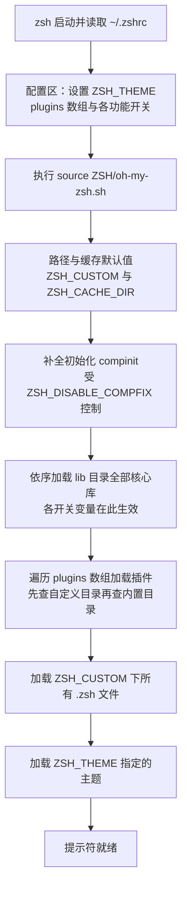
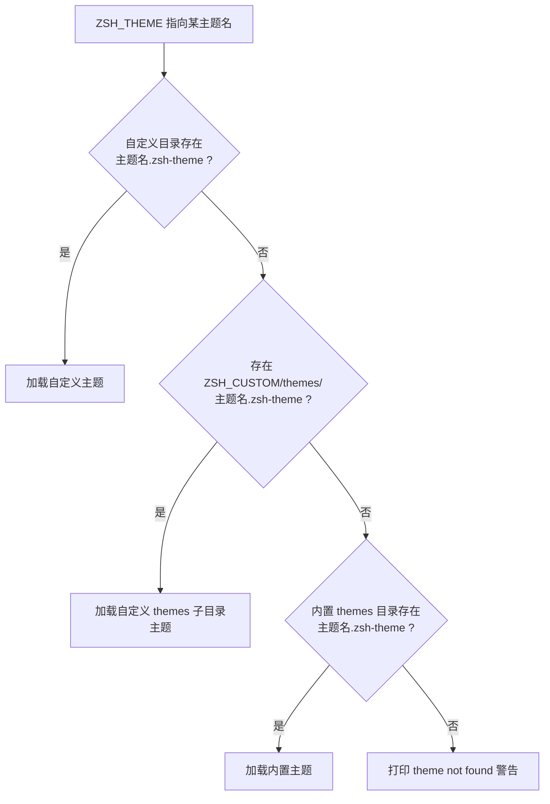
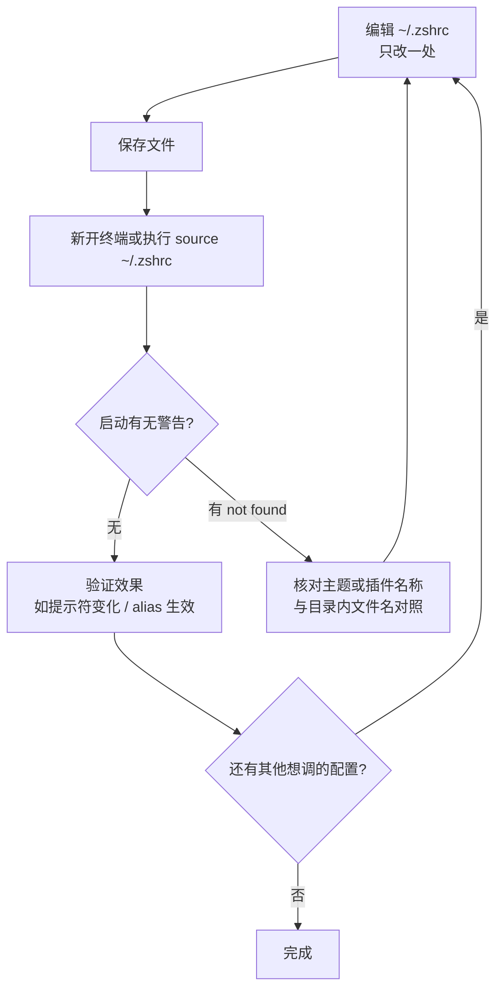

`~/.zshrc` 是 zsh 每次启动时读取的用户配置文件，也是 Oh My Zsh 唯一要求的"配置入口"。本页面向初学者，逐段拆解 Oh My Zsh 官方模板中的每一个配置项：主题变量 `ZSH_THEME`、插件数组 `plugins`，以及一批以 `DISABLE_*`、`ENABLE_*` 命名的功能开关。读完本页，你应当能够独立读懂自己的 `.zshrc`，并安全地进行个性化修改。如果你还没完成安装，请先阅读[快速开始：一键安装与首次运行](2-kuai-su-kai-shi-jian-an-zhuang-yu-shou-ci-yun-xing)。

Sources: [zshrc.zsh-template](templates/zshrc.zsh-template#L1-L11)

## 你的 ~/.zshrc 从哪里来

安装 Oh My Zsh 时，安装脚本会把你主目录下已存在的 `~/.zshrc` 备份为 `~/.zshrc.pre-oh-my-zsh`（多次安装时会追加日期后缀，永不覆盖旧备份），然后以仓库中的模板 `templates/zshrc.zsh-template` 为蓝本生成新的 `~/.zshrc`，并将模板中的 `export ZSH=...` 改写为你实际的安装路径。因此，你看到的 `~/.zshrc` 中所有被注释掉的配置项，实际上就是官方预先整理好的"功能开关清单"——取消注释即启用。模板仓库中还提供了一个只有 5 行的极简版本 `templates/minimal.zshrc`，安装器在询问是否覆盖旧配置时会把它打印出来作为参考。

Sources: [install.sh](tools/install.sh#L354-L413)
Sources: [install.sh](tools/install.sh#L373-L376)
Sources: [minimal.zshrc](templates/minimal.zshrc#L1-L6)

## .zshrc 的骨架与加载时序

一个典型的 `.zshrc` 分为三个区域：**配置区**（`source` 之前）、**加载语句**（`source $ZSH/oh-my-zsh.sh`）、**个人配置区**（`source` 之后）。这个顺序不是随意的：`oh-my-zsh.sh` 在被加载的那一刻才去读取 `ZSH_THEME`、`plugins` 等变量，所以主题和插件配置必须写在 `source` 语句**之前**；而希望覆盖 Oh My Zsh 默认值的别名和环境变量（如 `EDITOR`、`alias`）则应写在 `source` **之后**，才能"后到者优先"。个人别名的最佳实践不是直接堆在 `.zshrc` 末尾，而是放进 `$ZSH_CUSTOM` 目录下以 `.zsh` 结尾的独立文件（详见后文"个人配置的正确位置"）。

Sources: [zshrc.zsh-template](templates/zshrc.zsh-template#L78-L107)

理解三个区域后，就可以把整个启动过程画成一条流水线。下图中，前两步发生 在你的 `.zshrc` 里，后续所有步骤都发生在被 `source` 进来的 `oh-my-zsh.sh` 中——它依次初始化补全系统、加载 `lib/` 下的核心库（你的各种开关变量就是在这里生效的）、遍历 `plugins` 数组加载插件、加载自定义脚本，最后加载主题并点亮提示符。对这条流水线的逐行解读属于进阶内容，可参考[启动加载流程：oh-my-zsh.sh 主脚本逐段解读](10-qi-dong-jia-zai-liu-cheng-oh-my-zsh-sh-zhu-jiao-ben-zhu-duan-jie-du)。

Sources: [oh-my-zsh.sh](oh-my-zsh.sh#L308-L344)
Sources: [zshrc.zsh-template](templates/zshrc.zsh-template#L71-L78)

## 主题配置：ZSH_THEME 与查找顺序

`ZSH_THEME` 是整个文件中最重要的单行配置，模板默认值为 `"robbyrussell"`——这是 Oh My Zsh 的默认主题，轻量且无需特殊字体。它的查找顺序在 `oh-my-zsh.sh` 中有明确定义：先查自定义目录 `$ZSH_CUSTOM/主题名.zsh-theme`，再查其 `themes` 子目录，最后才查内置的 `$ZSH/themes/` 目录；三处都找不到时会打印 `[oh-my-zsh] theme 'xxx' not found` 警告而不是报错崩溃。这意味着你可以把下载或自写的主题放到自定义目录中，与内置主题同名也不会冲突——自定义版本会优先生效。仓库的 `themes/` 目录内置了 140 余个主题供你逐个尝试，浏览与切换的完整玩法见[主题的浏览、切换与随机主题](5-zhu-ti-de-liu-lan-qie-huan-yu-sui-ji-zhu-ti)。

Sources: [oh-my-zsh.sh](oh-my-zsh.sh#L327-L344)
Sources: [zshrc.zsh-template](templates/zshrc.zsh-template#L7-L11)

把 `ZSH_THEME` 设为字符串 `"random"` 还有一个特殊玩法：每次启动随机加载一个主题，此时可用 `echo $RANDOM_THEME` 查看本次实际加载了哪个。如果随机池太大，可以设置数组 `ZSH_THEME_RANDOM_CANDIDATES` 把候选限定在你喜欢的几个主题内（例如只从 `robbyrussell` 和 `agnoster` 中随机）。这两项在模板中均有注释说明，属于可选的进阶配置。

Sources: [zshrc.zsh-template](templates/zshrc.zsh-template#L7-L17)

## 插件配置：plugins 数组与查找规则

插件通过一个 zsh 数组声明：`plugins=(git)`。数组语法意味着你可以用空格分隔一次列出多个插件，如 `plugins=(git extract z)`。与主题相同，插件查找也是"自定义优先"：加载器会先检查 `$ZSH_CUSTOM/plugins/插件名/`，再检查内置的 `$ZSH/plugins/插件名/`，目录中必须存在 `插件名.plugin.zsh` 文件（或补全定义文件 `_插件名`）才算有效；名称写错时会在启动时打印 `[oh-my-zsh] plugin 'xxx' not found`，不会中断加载。模板中的提醒值得原样奉承："Add wisely, as too many plugins slow down shell startup"——每个插件都是一个会被完整执行的脚本，数量过多会显著拖慢启动速度。

Sources: [zshrc.zsh-template](templates/zshrc.zsh-template#L71-L76)
Sources: [oh-my-zsh.sh](oh-my-zsh.sh#L81-L98)
Sources: [oh-my-zsh.sh](oh-my-zsh.sh#L315-L319)

模板默认只启用了 `git` 一个插件，它提供大量 `gst`、`gco` 之类的 Git 别名。初学者最常添加的还有 `extract`（万能解压）、`z`（目录快速跳转）、`zsh-syntax-highlighting` 与 `zsh-autosuggestions`（后两者现已内置于仓库）等。各插件具体提供哪些命令和别名属于"用"的范畴，请继续阅读[插件的启用、禁用与日常使用](4-cha-jian-de-qi-yong-jin-yong-yu-ri-chang-shi-yong)与[经典插件解析：git、extract、fzf 与实用工具类](18-jing-dian-cha-jian-jie-xi-git-extract-fzf-yu-shi-yong-gong-ju-lei)；插件加载机制的内部细节则由[插件加载机制与开发命名约定](16-cha-jian-jia-zai-ji-zhi-yu-kai-fa-ming-ming-yue-ding)专门讲解。

Sources: [zshrc.zsh-template](templates/zshrc.zsh-template#L71-L78)

## 核心开关变量逐项详解

模板中段那一长串被注释的 `# Uncomment the following line ...` 就是 Oh My Zsh 的"开关面板"。它们共同的特点是：**取值几乎都是字符串 `"true"`，通过取消注释启用**，且各自在 `lib/` 目录的某个核心库文件中被消费。下表汇总了全部开关，"不设置时"一列即默认行为，可当作速查表使用。

| 变量 | 启用方式 | 作用 | 不设置时的默认行为 | 实际生效位置 |
| --- | --- | --- | --- | --- |
| `CASE_SENSITIVE` | 设为 `"true"` | Tab 补全改为大小写敏感 | 补全忽略大小写 | lib/completion.zsh |
| `HYPHEN_INSENSITIVE` | 设为 `"true"` | 补全时 `-` 与 `_` 互相等价 | 两者严格区分（需先关闭大小写敏感） | lib/completion.zsh |
| `DISABLE_MAGIC_FUNCTIONS` | 设为 `"true"` | 关闭粘贴 URL 时自动加引号等"魔法" | 粘贴 URL 自动转义，避免误执行 | lib/misc.zsh |
| `DISABLE_LS_COLORS` | 设为 `"true"` | 关闭 `ls` 的彩色输出 | 自动配置 `ls` 配色方案 | lib/theme-and-appearance.zsh |
| `DISABLE_AUTO_TITLE` | 设为 `"true"` | 不再自动修改终端窗口/标签标题 | 标题随当前目录和命令自动变化 | lib/termsupport.zsh |
| `ENABLE_CORRECTION` | 设为 `"true"` | 命令输错时提示"是否改为 cp/mv…？" | 不做任何纠错提示 | lib/correction.zsh |
| `COMPLETION_WAITING_DOTS` | 设为 `"true"` 或自定义字符串 | 补全等待时显示红色省略号动画 | 补全期间无提示 | lib/completion.zsh |
| `DISABLE_UNTRACKED_FILES_DIRTY` | 设为 `"true"` | 提示符不再统计未跟踪文件 | Git 提示符会扫描未跟踪文件 | lib/git.zsh |
| `HIST_STAMPS` | 设为三种格式之一或自定义 | `history` 命令输出带时间戳 | 不显示时间戳 | lib/history.zsh |

Sources: [zshrc.zsh-template](templates/zshrc.zsh-template#L19-L66)

几个开关值得补充说明。`CASE_SENSITIVE` 与 `HYPHEN_INSENSITIVE` 是互斥设计：核心库在设置补全匹配规则后，会把这两个变量从环境中**主动删除**（`unset`），所以它们只在启动阶段有意义，属于典型的一次性配置。`COMPLETION_WAITING_DOTS` 除了 `"true"` 外还可以填任意 zsh 提示符字符串，比如 `%F{yellow}waiting...%f` 会显示黄色文字，但模板同时警告：在低于 5.7.1 的 zsh 上它可能与多行主题冲突。`HIST_STAMPS` 接受 `mm/dd/yyyy`、`dd.mm.yyyy`、`yyyy-mm-dd` 三种预置格式，或任何符合 `strftime` 规范的自定义格式；无论选哪种，你的历史记录文件 `~/.zsh_history` 的容量下限都会被核心库抬高到 `HISTSIZE=50000`、`SAVEHIST=10000`。

Sources: [completion.zsh](lib/completion.zsh#L16-L26)
Sources: [completion.zsh](lib/completion.zsh#L49-L75)
Sources: [history.zsh](lib/history.zsh#L28-L40)
Sources: [zshrc.zsh-template](templates/zshrc.zsh-template#L49-L66)

## 自动更新行为：zstyle ':omz:update' 配置

模板中的更新配置不是普通变量，而是 `zstyle` 风格的设置：`zstyle ':omz:update' mode disabled` 这类语句。`mode` 支持五种取值——默认的 `prompt`（到更新周期时询问你是否更新）、`auto`（静默自动更新）、`reminder`（只提醒不执行）、实验性的 `background-alpha`（后台更新）和 `disabled`（彻底关闭）。若不写 `zstyle`，还有两个旧式变量兼容可用：`DISABLE_UPDATE_PROMPT="true"` 等价于 `mode auto`，`DISABLE_AUTO_UPDATE="true"` 等价于 `mode disabled`。更新机制的完整原理（如更新文件存放位置、`omz update` 命令）见[自动更新机制全解：更新模式与频率控制](22-zi-dong-geng-xin-ji-zhi-quan-jie-geng-xin-mo-shi-yu-pin-lu-kong-zhi)。

Sources: [zshrc.zsh-template](templates/zshrc.zsh-template#L26-L35)
Sources: [check_for_upgrade.sh](tools/check_for_upgrade.sh#L6-L20)

`mode` 之外还有两个"频率旋钮"：`zstyle ':omz:update' frequency 13` 把更新检查周期改为每 13 天一次（不设置时默认 13 天），而 `zstyle ':omz:update' cooldown 10` 则表示"即使远端已有新版本，也只接受 10 天前发布的更新"——这个冷却期设计可以避免刚发布就中招有问题的版本。两者都要求填纯数字的天数，非法值会被忽略并回落到默认行为。

Sources: [zshrc.zsh-template](templates/zshrc.zsh-template#L26-L35)
Sources: [check_for_upgrade.sh](tools/check_for_upgrade.sh#L36-L46)
Sources: [check_for_upgrade.sh](tools/check_for_upgrade.sh#L69-L74)

## 目录变量与安全开关：ZSH、ZSH_CUSTOM 与 ZSH_DISABLE_COMPFIX

模板开头的 `export ZSH="$HOME/.oh-my-zsh"` 告诉 Oh My Zsh 框架装在哪里；即使你没设置，主脚本也会回退到"当前脚本所在目录"作为默认值。`ZSH_CUSTOM` 是你的自定义目录，默认指向 `$ZSH/custom`，用于存放自定义插件、主题和配置片段；模板注释演示了如何把它改到任意路径。这两个变量加另一个内部变量 `ZSH_CACHE_DIR`（默认 `$ZSH/cache`，不可写时自动回退到 `~/.cache/oh-my-zsh`）构成了 Oh My Zsh 的三个路径锚点。`ZSH_CUSTOM` 的目录组织实践详见[自定义插件与主题：ZSH_CUSTOM 目录实践](26-zi-ding-yi-cha-jian-yu-zhu-ti-zsh-custom-mu-lu-shi-jian)。

Sources: [zshrc.zsh-template](templates/zshrc.zsh-template#L4-L5)
Sources: [zshrc.zsh-template](templates/zshrc.zsh-template#L68-L69)
Sources: [oh-my-zsh.sh](oh-my-zsh.sh#L50-L68)

模板中没有直接出现、但值得知道的开关是 `ZSH_DISABLE_COMPFIX`。默认情况下，主脚本在补全初始化时会执行**目录安全检查**：`compinit -i` 会拒绝从"组或其他用户可写"的目录加载补全，并弹出安全警告；当你确认环境安全（例如某些容器环境误报）时，才可在 `.zshrc` 中加一行 `ZSH_DISABLE_COMPFIX=true` 改用 `compinit -u` 跳过检查。这个安全防线的设计动机与处置流程由[安全防线：compfix 与补全目录权限检查](12-an-quan-fang-xian-compfix-yu-bu-quan-mu-lu-quan-xian-jian-cha)专门解析，补全缓存优化则见[补全系统：compinit 与 zcompdump 缓存优化](11-bu-quan-xi-tong-compinit-yu-zcompdump-huan-cun-you-hua)。

Sources: [oh-my-zsh.sh](oh-my-zsh.sh#L233-L244)

## 个人配置的正确位置

`source` 语句之后的部分属于你个人：`MANPATH`、`LANG`（建议 `en_US.UTF-8`）、按本地/远程会话区分的 `EDITOR`、以及编译参数 `ARCHFLAGS`，模板都给出了带注释的示例。别名部分有一条官方建议值得重视：个人别名优先放到 `$ZSH_CUSTOM` 目录下的顶层 `.zsh` 文件里（如 `$ZSH_CUSTOM/aliases.zsh`、`$ZSH_CUSTOM/macos.zsh`），因为主脚本会在加载完所有库和插件之后统一加载该目录下的这类文件——放在这里天然就能覆盖插件和主题定义的别名。想快速验证自己当前生效的全部别名，直接运行 `alias` 命令即可。

Sources: [zshrc.zsh-template](templates/zshrc.zsh-template#L80-L107)
Sources: [oh-my-zsh.sh](oh-my-zsh.sh#L321-L325)

下面用一个典型修改场景演示"配置区改开关、个人区加别名"的写法差异：

| 修改目标 | 修改前（模板默认） | 修改后 | 所属区域 |
| --- | --- | --- | --- |
| 更换主题 | `ZSH_THEME="robbyrussell"` | `ZSH_THEME="agnoster"` | 配置区（source 之前） |
| 启用自动纠错 | `# ENABLE_CORRECTION="true"` | `ENABLE_CORRECTION="true"` | 配置区（source 之前） |
| 扩充插件 | `plugins=(git)` | `plugins=(git extract zsh-syntax-highlighting)` | 配置区（source 之前） |
| 覆盖插件别名 | `# alias zshconfig="mate ~/.zshrc"` | `alias zshconfig="vim ~/.zshrc"` | 个人区（source 之后） |

Sources: [zshrc.zsh-template](templates/zshrc.zsh-template#L7-L107)

## 动手环节：安全修改 .zshrc 的标准流程

初学者最稳妥的修改循环是"小步修改、立即验证"。每次只改一处，保存后**新开一个终端窗口**验证（新窗口会重新执行整个 `.zshrc`，隔离性最好）；若当前窗口内急于生效，也可以执行 `source ~/.zshrc`。如果看到 `[oh-my-zsh] theme/plugin 'xxx' not found`，说明名称拼写或位置有误——对照 `themes/`、`plugins/` 目录内的实际文件名即可纠正；需要批量浏览主题时可借助内置的 `omz` 命令行工具，见[omz 命令行工具：更新、插件与主题管理](6-omz-ming-ling-xing-gong-ju-geng-xin-cha-jian-yu-zhu-ti-guan-li)。

Sources: [oh-my-zsh.sh](oh-my-zsh.sh#L327-L344)
Sources: [zshrc.zsh-template](templates/zshrc.zsh-template#L97-L107)

## 小结与下一步

把本页内容压缩成三句话：**配置写在 `source $ZSH/oh-my-zsh.sh` 之前，个人化写在之后**；主题是一个名字、插件是一组名字，两者都遵循"自定义目录优先、找不到只警告"的查找规则；所有功能开关都是"取消注释即启用"的一次性变量，每个都有一一对应的 `lib/` 实现文件可以溯源。建议的阅读路径是：接下来用[插件的启用、禁用与日常使用](4-cha-jian-de-qi-yong-jin-yong-yu-ri-chang-shi-yong)把 `plugins` 数组玩起来，再到[主题的浏览、切换与随机主题](5-zhu-ti-de-liu-lan-qie-huan-yu-sui-ji-zhu-ti)挑选外观；对启动流程和性能感兴趣的读者，可继续深入[启动加载流程：oh-my-zsh.sh 主脚本逐段解读](10-qi-dong-jia-zai-liu-cheng-oh-my-zsh-sh-zhu-jiao-ben-zhu-duan-jie-du)与[启动性能优化：减少 fork 与缓存策略](23-qi-dong-xing-neng-you-hua-jian-shao-fork-yu-huan-cun-ce-lue)。

Sources: [zshrc.zsh-template](templates/zshrc.zsh-template#L1-L108)