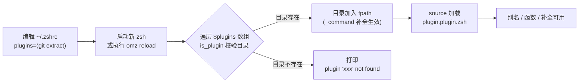
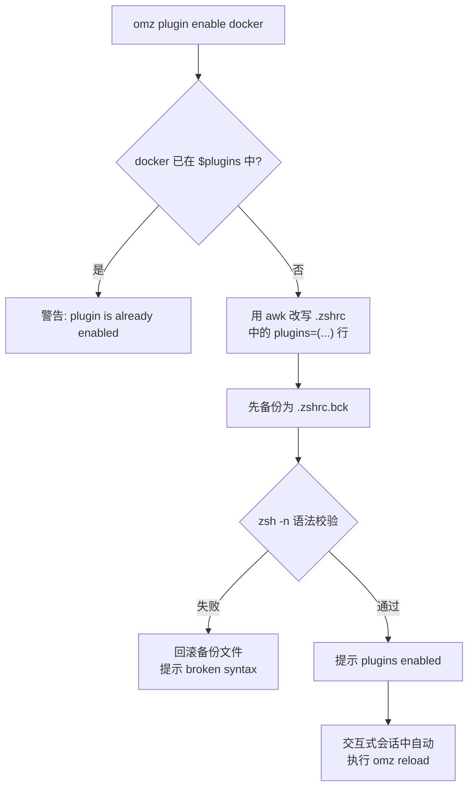
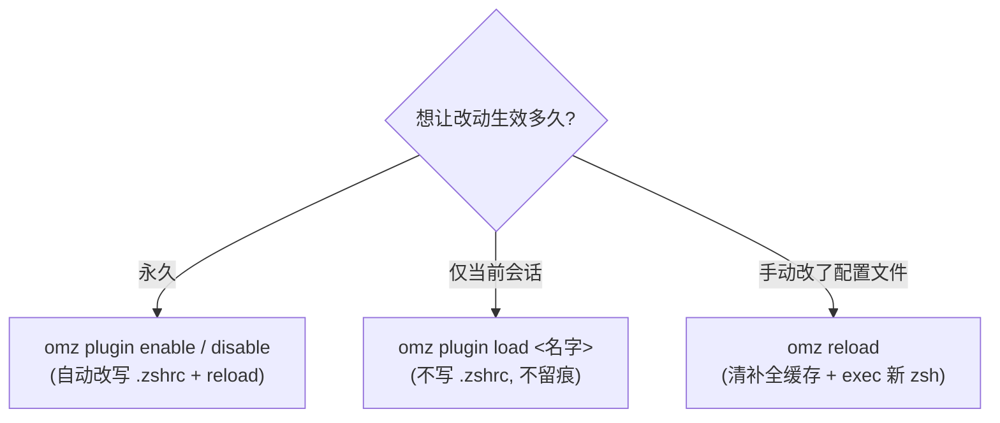

插件是 Oh My Zsh 日常价值的核心来源：一行配置就能获得数百个 Git 别名、解压万能函数或补全脚本。本页面向初学者，完整回答三个问题：**如何启用/禁用插件**（持久生效）、**如何临时加载插件**（仅当前会话），以及启用之后**如何用好一个插件**（读文档、用别名、按需关闭别名）。插件内部的加载原理与自定义插件开发不在本页展开，可参阅[插件加载机制与开发命名约定](16-cha-jian-jia-zai-ji-zhi-yu-kai-fa-ming-ming-yue-ding)与[自定义插件与主题：ZSH_CUSTOM 目录实践](26-zi-ding-yi-cha-jian-yu-zhu-ti-zsh-custom-mu-lu-shi-jian)。

Sources: [oh-my-zsh.sh](oh-my-zsh.sh#L315-L319)

## 启用的本质：plugins 数组与两条查找路径

在 `~/.zshrc` 中声明 `plugins=(git)` 是启用插件的唯一持久方式。配置模板明确指出：标准插件位于 `$ZSH/plugins/`（即安装目录的 `plugins/` 子目录），自定义插件放在 `$ZSH_CUSTOM/plugins/`（默认为 `~/.oh-my-zsh/custom/plugins/`）。模板同时给出了一条重要提醒——"Add wisely, as too many plugins slow down shell startup"，即插件数量会直接影响 shell 启动速度。默认配置只启用了 `git` 一个插件。

Sources: [zshrc.zsh-template](templates/zshrc.zsh-template#L71-L78)

当你启动 zsh（或执行 `omz reload`）时，主脚本会对 `$plugins` 数组做两轮处理。第一轮把每个插件目录加入 `$fpath`，让其中的 `_<插件名>` 补全脚本能被补全系统找到；若插件目录不存在，会打印 `[oh-my-zsh] plugin 'xxx' not found` 警告。第二轮则逐个 source 插件的主文件 `$ZSH/plugins/<名字>/<名字>.plugin.zsh`，插件中定义的别名、函数和环境变量由此进入你的会话。合法性判断由 `is_plugin` 函数完成：只要目录中存在 `<名字>.plugin.zsh` 或 `_<名字>` 文件之一即视为有效插件（后者常见于纯补全型插件）。

Sources: [oh-my-zsh.sh](oh-my-zsh.sh#L81-L98) [oh-my-zsh.sh](oh-my-zsh.sh#L315-L319)

一个值得了解的细节：如果 `$ZSH_CUSTOM/plugins/` 下存在与内置插件**同名**的目录，source 时会优先加载自定义版本。这为你覆盖官方插件行为提供了官方通道，相关实践详见[自定义插件与主题：ZSH_CUSTOM 目录实践](26-zi-ding-yi-cha-jian-yu-zhu-ti-zsh-custom-mu-lu-shi-jian)。

Sources: [oh-my-zsh.sh](oh-my-zsh.sh#L286-L291)

| 维度 | 内置插件 | 自定义插件 |
| :--- | :--- | :--- |
| 存放位置 | `$ZSH/plugins/<名字>/` | `$ZSH_CUSTOM/plugins/<名字>/`（默认 `~/.oh-my-zsh/custom/plugins/`） |
| 典型内容 | `<名字>.plugin.zsh`、`README.md`、`_<名字>` 补全 | 同左，结构与内置插件完全一致 |
| 同名冲突 | 被自定义版本覆盖 | 优先加载 |
| 数量规模 | 数百个（git、extract、docker……） | 由你自己创建或第三方克隆 |

Sources: [zshrc.zsh-template](templates/zshrc.zsh-template#L71-L76) [oh-my-zsh.sh](oh-my-zsh.sh#L286-L291)

## 启用一个插件：推荐的三步流程

对初学者而言，最稳妥的路径是"先查名、再看文档、最后启用"。`omz plugin list` 会把自定义插件与内置插件分组列出（管道输出时逐行打印，便于脚本处理）；`omz plugin info <名字>` 则直接打开该插件的 `README.md`——优先读 `$ZSH_CUSTOM` 下的版本，并自动选择 glow、bat、less 或 cat 中可用的工具来渲染。README 的第一段几乎总是告诉你"把 `xxx` 加入 plugins 数组即可使用"，这就是插件的官方说明书。

Sources: [cli.zsh](lib/cli.zsh#L441-L477) [cli.zsh](lib/cli.zsh#L479-L514)

实际启用有两种方式。**方式一（推荐给新手）**：执行 `omz plugin enable <名字>`，命令会自动改写 `.zshrc` 中的 `plugins=(...)` 行，并立即重新加载会话。**方式二**：手动编辑 `.zshrc`，把插件名追加进数组，然后重开终端或执行 `omz reload`。

这条命令的安全设计值得留意：改写前会先复制一份 `.zshrc.bck` 备份；改写后用 `zsh -n` 做纯语法检查，一旦发现改出来的配置有语法错误就自动回滚。`omz plugin enable` 与 `disable` 支持一次传多个插件名（如 `omz plugin enable docker npm`），且能正确识别单行与多行两种 `plugins=()` 写法。

Sources: [cli.zsh](lib/cli.zsh#L347-L439)

| 命令 | 作用 | 是否持久 | 关键行为 |
| :--- | :--- | :--- | :--- |
| `omz plugin list` | 列出全部插件 | — | `--enabled` 只列已启用项；管道输出为逐行 |
| `omz plugin info <名字>` | 查看插件文档 | — | 打开 README，自动选渲染工具 |
| `omz plugin enable <名字> ...` | 持久启用 | ✅ 写入 .zshrc | 备份 → awk 改写 → 语法校验 → 自动 reload |
| `omz plugin disable <名字> ...` | 持久禁用 | ✅ 改写 .zshrc | 同上，未启用的插件会警告跳过 |
| `omz plugin load <名字> ...` | 临时加载 | ❌ 不写 .zshrc | 当前会话直接 source，用 `compinit -D` 避免污染补全缓存 |

Sources: [cli.zsh](lib/cli.zsh#L251-L345) [cli.zsh](lib/cli.zsh#L516-L562)

## 禁用与临时加载：持久与临时的分界线

**持久禁用**用 `omz plugin disable <名字>`。它与 enable 互为镜像：先检查插件确实在 `$plugins` 中（不在则警告 "plugin 'xxx' is not enabled"），然后从 `.zshrc` 的数组中精确移除该名字，同样经过备份与语法校验两道防线，成功后在交互式会话中自动 reload。如果只是想暂时排查某个插件引发的问题，disable 再 enable 即可干净地往返。

Sources: [cli.zsh](lib/cli.zsh#L251-L345)

**临时加载**用 `omz plugin load <名字>`，它只对当前会话生效、不触碰 `.zshrc`。实现上它先把插件目录插入 `$fpath`、再直接 source 插件主文件；若插件带补全脚本，会以 `compinit -D` 重载补全——`-D` 参数确保不生成新的补全缓存文件，避免这个"临时启用"污染下一次正常启动。典型场景：试用一个新插件、或在调试会话中临时补充某个工具的补全而不想留下持久改动。

Sources: [cli.zsh](lib/cli.zsh#L516-L562)

手动编辑 `.zshrc` 后想立刻生效，执行 `omz reload` 即可。它的实现相当直接：删除当前补全缓存文件，然后用 `exec` 把自己替换成一个全新的登录 zsh 进程——相当于"原地重启 shell"，因此所有配置（包括你刚启用的插件）都会从头加载一遍。

Sources: [cli.zsh](lib/cli.zsh#L758-L769)

## 日常使用：README 是说明书，别名是日常主粮

插件启用之后，它的日常形态通常是三类产物：**别名**（缩短常用命令）、**函数**（封装复杂操作）和**补全脚本**（Tab 键提示参数）。判断一个插件提供了什么，最可靠的方式就是读它的 README——例如 git 插件的文档开头就声明"提供大量别名和少数实用函数"，并附上完整的别名对照表：`ga` → `git add`、`gaa` → `git add --all`、`gcmsg` → `git commit --message`、`gco` → `git checkout` 等。extract 插件则只提供一个 `extract <文件名>` 函数，自动识别 7z、rar、tar.gz、zip 等几十种压缩格式，免去记忆各种解压命令的心智负担。

Sources: [README.md](plugins/git/README.md#L1-L20) [README.md](plugins/extract/README.md#L1-L13)

反过来，如果你喜欢某个插件的功能但嫌它的别名太"霸道"（比如覆盖了你自己定义的同名别名），可以**只关闭该插件的别名、保留其余功能**：在 `.zshrc` 中加一行 `zstyle ':omz:plugins:<插件名>' aliases off`。加载器在 source 每个插件时会检查这个开关，命中后先备份现有别名、source 完再还原，使插件内定义的别名全部失效但函数与补全照常保留。这一机制的完整原理在[别名体系与 zstyle 定制开关](15-bie-ming-ti-xi-yu-zstyle-ding-zhi-kai-guan-an-mo-kuai-tiao-guo-bie-ming)中有深入解析。

Sources: [oh-my-zsh.sh](oh-my-zsh.sh#L267-L291)

## 常见问题速查

| 症状 | 原因 | 解决方案 |
| :--- | :--- | :--- |
| 启动时打印 `plugin 'xxx' not found` | 插件名拼写错误，或插件目录不在 `$ZSH/plugins/` 与 `$ZSH_CUSTOM/plugins/` 中 | 用 `omz plugin list` 核对准确名称；第三方插件需先克隆到 custom 目录 |
| 改了 `plugins=(...)` 但没生效 | `.zshrc` 只在新会话启动时读取 | 执行 `omz reload` 或重开终端 |
| `omz plugin enable` 提示 broken syntax 并回滚 | awk 改写后 `.zshrc` 语法校验失败（多为原有配置格式异常） | 检查 `.zshrc.bck` 与当前文件差异，手动修正 `plugins=()` 格式 |
| 启用了插件但别名没出现 | 同名别名被更晚加载的配置覆盖，或该插件别名被 zstyle 关闭 | `alias \| grep <名字>` 排查；检查是否设置了 `aliases off` |
| shell 启动越来越慢 | 启用插件过多，每个都要 source 并注册补全 | 按需精简 `plugins` 数组，只保留真正常用的 |

Sources: [oh-my-zsh.sh](oh-my-zsh.sh#L88-L98) [zshrc.zsh-template](templates/zshrc.zsh-template#L71-L76) [cli.zsh](lib/cli.zsh#L327-L338) [oh-my-zsh.sh](oh-my-zsh.sh#L267-L291)

## 下一步

掌握插件的启停之后，建议按需深入：想了解 `.zshrc` 中其余配置项的全貌，继续阅读[掌握 .zshrc：主题、插件与核心配置项详解](3-zhang-wo-zshrc-zhu-ti-cha-jian-yu-he-xin-pei-zhi-xiang-xiang-jie)；想理解 source 与 fpath 背后的完整加载机制，请看[插件加载机制与开发命名约定](16-cha-jian-jia-zai-ji-zhi-yu-kai-fa-ming-ming-yue-ding)；想系统了解 `omz` 家族的其他命令，见[omz 命令行工具：更新、插件与主题管理](6-omz-ming-ling-xing-gong-ju-geng-xin-cha-jian-yu-zhu-ti-guan-li)；想精读几个最常用插件的功能细节，推荐[经典插件解析：git、extract、fzf 与实用工具类](18-jing-dian-cha-jian-jie-xi-git-extract-fzf-yu-shi-yong-gong-ju-lei)。