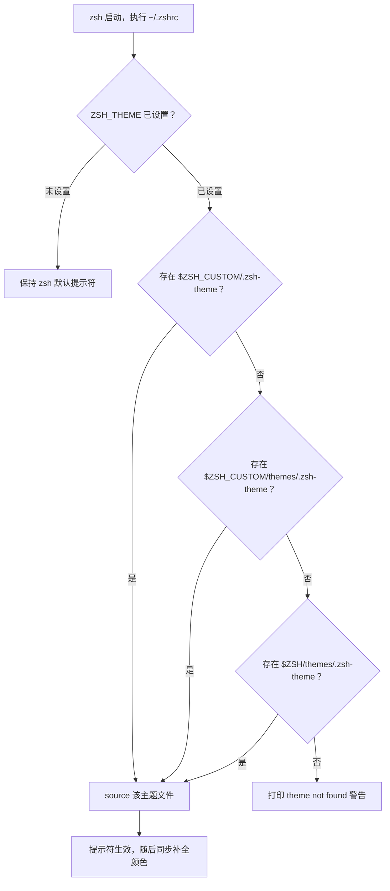
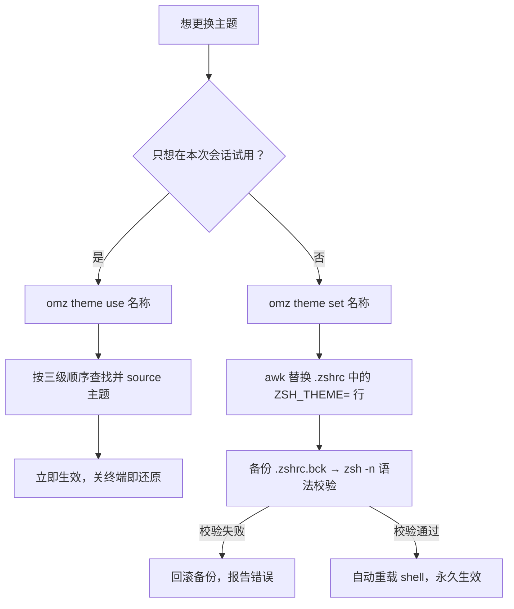
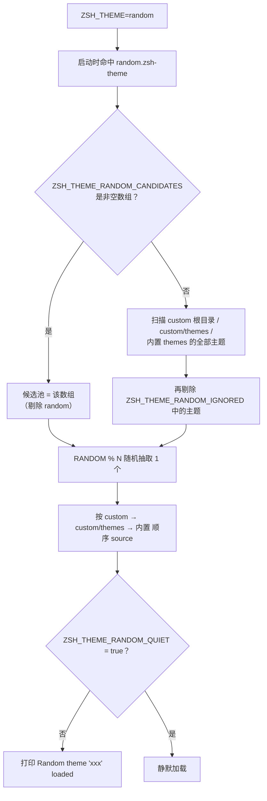

Oh My Zsh 内置了 140 余个提示符主题（themes），本页面向初学者系统讲解与主题交互的四种核心操作：**查看主题如何被加载**、**浏览与预览可用主题**、**在临时与永久两种粒度上切换主题**，以及**启用随机主题并控制其候选池**。理解这些机制后，你无需记忆任何主题列表，就能高效地找到并固定自己喜欢的外观。

## 主题是如何被加载的：从 ZSH_THEME 到提示符

一个 Oh My Zsh 主题本质上就是一段普通的 zsh 脚本：它重新定义 `PROMPT`（主提示符）以及一组外观变量，加载（source）它的瞬间提示符就会改变。以默认主题 `robbyrussell` 为例，整个文件只有 8 行：第 1-2 行定义了"绿色箭头 + 当前目录名 + git 分支"的提示符结构，第 4-7 行则定制了 git 信息片段的颜色与符号。理解了"主题 = 可被 source 的脚本"，后面所有切换命令的行为就都顺理成章了。

Sources: [robbyrussell.zsh-theme](themes/robbyrussell.zsh-theme#L1-L8)

主题的入口是 `~/.zshrc` 中的 `ZSH_THEME` 变量。安装后它的默认值为 `"robbyrussell"`，你把它改成任何主题名即可在下次启动时生效。模板文件同时用注释预告了两个进阶玩法：设为 `"random"` 时每次启动加载随机主题（可用 `echo $RANDOM_THEME` 查看本次实际加载了哪个），以及用 `ZSH_THEME_RANDOM_CANDIDATES` 数组限定随机候选池——这两点将在后文详细展开。

Sources: [zshrc.zsh-template](templates/zshrc.zsh-template#L7-L17)

启动时，`oh-my-zsh.sh` 主脚本在**所有库文件、插件和自定义配置之后**才加载主题（这是有意设计：主题可以覆盖之前的配置）。加载采用三级查找顺序，只要在任意一级找到 `<主题名>.zsh-theme` 文件就立即 source 并停止查找；三级都落空则打印 `[oh-my-zsh] theme 'xxx' not found` 警告。这个查找顺序意味着你放在 `$ZSH_CUSTOM` 下的同名主题会**遮蔽**内置主题——这是自定义主题体系的关键约定。

Sources: [oh-my-zsh.sh](oh-my-zsh.sh#L327-L344)

| 查找优先级 | 位置 | 典型用途 |
|---|---|---|
| 1（最高） | `$ZSH_CUSTOM/<主题名>.zsh-theme` | 用户直接放在 custom 根目录的主题 |
| 2 | `$ZSH_CUSTOM/themes/<主题名>.zsh-theme` | 自定义主题的标准存放处 |
| 3（兜底） | `$ZSH/themes/<主题名>.zsh-theme` | Oh My Zsh 内置的 140+ 主题 |

整个启动解析过程可以用下面的流程图概括（圆角框为判断节点）：

Sources: [oh-my-zsh.sh](oh-my-zsh.sh#L334-L348)

## 浏览可用主题：omz theme list 与 lstheme

官方推荐的浏览命令是 `omz theme list`。它在交互终端下会分三段输出：先显示 **Current theme**（当前主题——若 `ZSH_THEME=random`，还会解析并显示形如 `agnoster (via random)` 的实际主题名），再列出 **Custom themes**（`$ZSH_CUSTOM` 下递归发现的所有自定义主题，路径前缀会被剥除以匹配 `ZSH_THEME` 的写法），最后列出 **Built-in themes**（内置主题），均以多列整齐排版。当输出被管道给其他命令（如 `omz theme list | grep agn`）时，它会自动退化为每行一个主题的纯文本格式，方便脚本处理。

Sources: [cli.zsh](lib/cli.zsh#L792-L820)

如果你启用了名为 `themes` 的小插件，还会获得两个轻量工具：`lstheme` 命令输出与 `omz theme list` 等价的主题清单（custom 目录递归 + 内置目录，去重后按列显示），以及 `theme <名称>` 函数用于在当前会话即时加载主题（不带参数时默认加载 random）。该插件还为 `theme` 命令注册了 Tab 补全，输入 `theme ` 后按 Tab 即可翻阅所有主题名。

Sources: [themes.plugin.zsh](plugins/themes/themes.plugin.zsh#L1-L35)

三种浏览方式的对比如下：

| 命令 | 前置条件 | 输出内容 | 特点 |
|---|---|---|---|
| `omz theme list` | 无需任何配置 | 当前主题 + 自定义主题 + 内置主题 | 官方推荐，带高亮分节；管道模式逐行输出 |
| `lstheme` | 需在 `plugins=(...)` 中加入 `themes` | 全部主题名（多列） | 轻量、可配合 Tab 补全使用 |
| `theme_chooser.sh -l` | 手动执行脚本 | 内置主题名（逐行） | 仅扫描 `$ZSH/themes`，最原始的清单 |

Sources: [cli.zsh](lib/cli.zsh#L67)，[themes.plugin.zsh](plugins/themes/themes.plugin.zsh#L22-L35)，[theme_chooser.sh](tools/theme_chooser.sh#L50-L55)

## 预览主题外观：theme_chooser 脚本

浏览名字列表只能看到名字，`tools/theme_chooser.sh` 则能直接**渲染主题的真实外观**。它的核心函数 `theme_preview` 会先打印一条以主题名为标题的分隔线，然后 source 该主题文件，最后用 `print -P` 把 `$PROMPT` 和 `$RPROMPT` 按当前终端宽度完整渲染出来——你看到的正是切换后提示符的实际样子（左侧提示符 + 右侧提示符）。

Sources: [theme_chooser.sh](tools/theme_chooser.sh#L22-L30)

该脚本由 Oh My Zsh 作者社区成员 fox 编写，支持三种用法：无参数的**交互模式**会逐个预览内置主题，并对每个主题询问"是否加入收藏列表"；交互模式产生的收藏会追加到 `~/.zsh_favlist` 文件中（已存在则跳过），方便日后回顾心仪的主题；带上主题名参数则只预览单个主题，例如 `~/.oh-my-zsh/tools/theme_chooser.sh agnoster`。

Sources: [theme_chooser.sh](tools/theme_chooser.sh#L1-L11)，[theme_chooser.sh](tools/theme_chooser.sh#L57-L78)，[theme_chooser.sh](tools/theme_chooser.sh#L90-L98)

| 参数 | 行为 |
|---|---|
| （无参数） | 逐个预览内置主题，交互询问是否加入 `~/.zsh_favlist` 收藏 |
| `-l` | 仅列出内置主题名 |
| `-s` | 一次性预览全部内置主题，不做任何询问 |
| `-h` | 显示帮助信息 |
| `<主题名>` | 只预览指定主题，如 `theme_chooser.sh ys` |

Sources: [theme_chooser.sh](tools/theme_chooser.sh#L40-L48)，[theme_chooser.sh](tools/theme_chooser.sh#L80-L98)

## 切换主题：omz theme use（临时）与 omz theme set（持久）

Oh My Zsh 提供了两个粒度不同的切换命令。`omz theme use <名称>` 只作用于**当前会话**：它按与启动时完全相同的"custom 根目录 → custom/themes → 内置"顺序查找并 source 主题文件，随后更新 `ZSH_THEME` 变量（并清除 `RANDOM_THEME`，除非你 use 的正是 random）。关闭终端后一切还原，非常适合"试穿"主题。

Sources: [cli.zsh](lib/cli.zsh#L888-L909)

`omz theme set <名称>` 则是**永久切换**：它先在三个标准位置验证主题文件确实存在，不存在立即报错返回；存在则用一段 awk 脚本精确替换 `.zshrc` 中未被注释的 `ZSH_THEME=...` 行（若文件里根本没有这一行，会把新行前置到文件开头）。为了安全，set 采取了三重防护：写回前把原文件备份为 `.zshrc.bck`，写回后用 `zsh -n` 做语法校验，校验失败会自动回滚备份并报错。全部通过后，若处于交互会话还会自动重载 shell，提示符即刻生效——无需手动 `source ~/.zshrc`。

Sources: [cli.zsh](lib/cli.zsh#L822-L886)

两个命令的差异汇总：

| 维度 | `omz theme use <名称>` | `omz theme set <名称>` |
|---|---|---|
| 作用范围 | 仅当前会话 | 写入 `.zshrc`，永久生效 |
| 是否修改文件 | 否 | 是（原子替换 + `.zshrc.bck` 备份） |
| 生效方式 | 立即 source 主题文件 | 自动重载 shell（交互模式下） |
| 安全机制 | 主题不存在则报错返回 | 存在性检查 + `zsh -n` 语法校验 + 失败回滚 |
| 典型场景 | 试穿、临时对比几个主题 | 确定心仪主题后固定下来 |

Sources: [cli.zsh](lib/cli.zsh#L822-L909)

此外，`omz theme` 的两个子命令都注册了 Tab 补全：输入 `omz theme set ` 后按 Tab，补全系统会扫描内置与自定义主题目录并直接列出可选主题名，与浏览命令的发现逻辑保持一致。

Sources: [cli.zsh](lib/cli.zsh#L888-L909)

## 随机主题：random 的完整工作原理

将 `ZSH_THEME` 设为 `"random"` 即启用随机主题。这个特殊值会被主脚本当作普通主题名去查找，并命中内置的 `themes/random.zsh-theme`——它是一段"主题加载器"脚本：先收集候选主题池，再用 zsh 内置的 `RANDOM` 随机数（`RANDOM % 候选数 + 1`）抽出其中一个并 source。每次新开 shell 都会重新执行一遍，因此**每个终端会话的外观都可能不同**。

Sources: [zshrc.zsh-template](templates/zshrc.zsh-template#L7-L9)，[random.zsh-theme](themes/random.zsh-theme#L27-L31)

候选池的构建分两条路径：如果你在 `.zshrc` 中把 `ZSH_THEME_RANDOM_CANDIDATES` 定义为非空数组，随机范围就严格限定在该数组内（例如 `ZSH_THEME_RANDOM_CANDIDATES=("robbyrussell" "agnoster")`，且数组中的 `random` 会被自动剔除以防递归）；未定义该变量时，脚本会扫描 custom 根目录、custom/themes 和内置 themes 三个位置的全部 `.zsh-theme` 文件作为候选，并从中剔除 `random` 自身以及 `ZSH_THEME_RANDOM_IGNORED` 数组中列出的主题。也就是说，**候选池决定"玩多大"，忽略名单决定"排除谁"**。

Sources: [random.zsh-theme](themes/random.zsh-theme#L9-L25)，[zshrc.zsh-template](templates/zshrc.zsh-template#L13-L17)

每次随机加载完成后，脚本默认会在终端打印 `[oh-my-zsh] Random theme 'xxx' loaded`，告诉你本次抽中的是谁；在 `.zshrc` 中设置 `ZSH_THEME_RANDOM_QUIET=true` 可将其静默。此外，旧版变量 `ZSH_THEME_RANDOM_BLACKLIST` 已被弃用——脚本检测到它会打印弃用警告并自动映射为新的 `ZSH_THEME_RANDOM_IGNORED`，老配置不会失效但建议尽快改名。

Sources: [random.zsh-theme](themes/random.zsh-theme#L1-L6)，[random.zsh-theme](themes/random.zsh-theme#L45-L47)

随机主题相关的全部配置项汇总：

| 变量 | 类型 | 作用 |
|---|---|---|
| `ZSH_THEME="random"` | 字符串 | 启用随机主题的开关 |
| `RANDOM_THEME` | 只读输出 | 本次实际加载的主题名，`echo $RANDOM_THEME` 查看 |
| `ZSH_THEME_RANDOM_CANDIDATES` | 字符串数组 | 限定随机候选池；非空数组时优先于目录扫描 |
| `ZSH_THEME_RANDOM_IGNORED` | 字符串数组 | 从候选池中排除的主题（目录扫描模式下生效） |
| `ZSH_THEME_RANDOM_QUIET` | 布尔 | 设为 `true` 时不再打印"Random theme loaded"提示 |

Sources: [random.zsh-theme](themes/random.zsh-theme#L9-L47)

Sources: [random.zsh-theme](themes/random.zsh-theme#L27-L47)

值得注意的一个细节：`omz theme use random` 同样合法——`use` 会 source 随机加载器并保留 `RANDOM_THEME` 变量；而 use 任何具名主题时都会 `unset RANDOM_THEME`，避免残留上一次随机加载的痕迹。这让"随机模式"与"固定主题"之间可以随时自由切换。

Sources: [cli.zsh](lib/cli.zsh#L906-L908)

## 常见问题速查

| 现象 | 原因与解法 |
|---|---|
| `theme 'xxx' not found` | 主题名拼写错误，或文件不在三个查找位置之一；先用 `omz theme list` 核对名称 |
| 改了 `.zshrc` 但提示符没变 | 主题在启动流程末尾加载，需重开终端或执行 `omz reload`；或直接 `omz theme set` 让其自动重载 |
| 每次开终端外观都不同 | 这是 `ZSH_THEME="random"` 的预期行为；用 `echo $RANDOM_THEME` 查看本次主题，想固定就 `omz theme set <该名称>` |
| random 总是抽到不喜欢的主题 | 把常驻主题加入 `ZSH_THEME_RANDOM_IGNORED`，或用 `ZSH_THEME_RANDOM_CANDIDATES` 收窄候选池 |
| `omz theme set` 报 broken syntax 并回滚 | `.zshrc` 写回后未通过 `zsh -n` 语法校验，原文件已自动从 `.zshrc.bck` 恢复，检查 `.zshrc` 手写部分 |

Sources: [oh-my-zsh.sh](oh-my-zsh.sh#L341-L343)，[cli.zsh](lib/cli.zsh#L874-L879)，[random.zsh-theme](themes/random.zsh-theme#L21-L24)

## 下一步

掌握了主题的浏览、切换与随机机制后，建议按以下路径继续深入：回顾 [掌握 .zshrc：主题、插件与核心配置项详解](3-zhang-wo-zshrc-zhu-ti-cha-jian-yu-he-xin-pei-zhi-xiang-xiang-jie) 巩固配置文件全貌；在 [omz 命令行工具：更新、插件与主题管理](6-omz-ming-ling-xing-gong-ju-geng-xin-cha-jian-yu-zhu-ti-guan-li) 中了解 `omz` 家族的完整能力；若想读懂甚至编写主题，请前往 [主题编写规范：从 robbyrussell 到 agnoster](20-zhu-ti-bian-xie-gui-fan-cong-robbyrussell-dao-agnoster)；准备自建主题时，[自定义插件与主题：ZSH_CUSTOM 目录实践](26-zi-ding-yi-cha-jian-yu-zhu-ti-zsh_custom-mu-lu-shi-jian) 讲解了 `$ZSH_CUSTOM` 的存放约定——正是本页三级查找顺序中优先级最高的那两级。