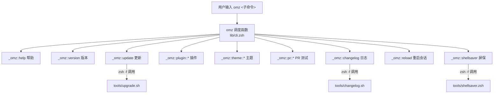
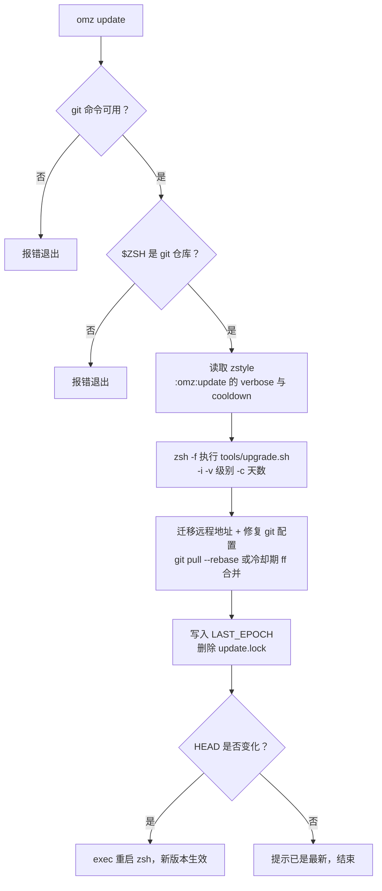
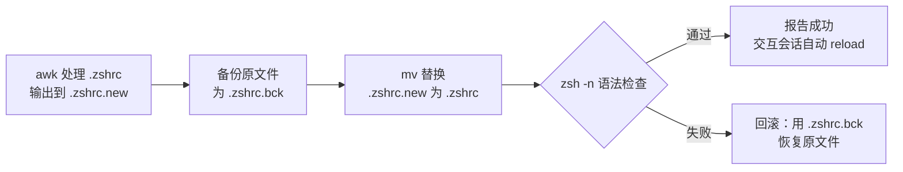

`omz` 是 Oh My Zsh 内置的命令行管理入口，覆盖版本查询、框架更新、插件启停、主题切换、PR 测试等日常运维操作。本文面向初学者，逐一拆解每条命令的行为、背后调用的脚本，以及自动修改 `.zshrc` 时内置的安全防线，帮助你把 `omz` 用成顺手的管理瑞士军刀。

## 一个"命令"的真实身份：shell 函数而非可执行文件

初学者常见的第一个困惑是：`omz` 并不安装在 `PATH` 里的任何位置，`which omz` 什么也找不到。它本质上是定义在 [lib/cli.zsh](lib/cli.zsh#L3-L21) 中的一个 **zsh 函数**，入口函数 `omz` 接到参数后，把子命令名动态拼接成 `_omz::<命令>` 的函数名并调用（例如 `omz update` 会转调 `_omz::update`）。因此它只在"已经加载了 Oh My Zsh 的 zsh 会话"里可用——如果你的终端不是 zsh，或 `.zshrc` 中没有加载框架，就会得到 `command not found`。

`omz` 函数之所以每次打开终端都能用，是因为主脚本 [oh-my-zsh.sh](oh-my-zsh.sh#L310-L312) 会在启动时用循环加载 `lib/` 下所有 `.zsh` 文件，`cli.zsh` 自然被包含在内。同时，[lib/cli.zsh](lib/cli.zsh#L128-L130) 里通过 `compdef _omz omz` 注册了补全函数：输入 `omz` 后按 Tab，就能看到全部子命令；输入 `omz plugin enable` 后按 Tab，甚至会智能列出"尚未启用"的插件名供你选择（补全逻辑见 [lib/cli.zsh](lib/cli.zsh#L70-L88)）。

整条命令分发链路可以用下图概括——注意三个标红的工具脚本：`omz` 自身只做参数校验和调度，真正干重活的逻辑委托给了 `tools/` 目录下的独立脚本：

Sources: [cli.zsh](lib/cli.zsh#L3-L21), [oh-my-zsh.sh](oh-my-zsh.sh#L310-L312), [cli.zsh](lib/cli.zsh#L128-L130)

## 命令全景与帮助信息

不带参数运行 `omz` 或运行 `omz help`，会打印完整的用法说明，这是最快的自查入口（实现见 [lib/cli.zsh](lib/cli.zsh#L179-L197)）。全部子命令在调度函数里有权威清单（[lib/cli.zsh](lib/cli.zsh#L23-L36)），汇总如下：

| 命令 | 作用 | 实现入口 |
|---|---|---|
| `omz help` | 打印用法说明 | `_omz::help` |
| `omz version` | 显示版本名 + 提交短哈希 | `_omz::version` |
| `omz update` | 更新 Oh My Zsh | `_omz::update` → `tools/upgrade.sh` |
| `omz plugin <子命令>` | 插件的列出、启停、加载 | `_omz::plugin::*` |
| `omz theme <子命令>` | 主题的列出、设置、临时使用 | `_omz::theme::*` |
| `omz pr <子命令>` | 拉取并测试社区 PR、清理分支 | `_omz::pr::*` |
| `omz changelog [版本]` | 打印更新日志 | `_omz::changelog` → `tools/changelog.sh` |
| `omz reload` | 重启当前 zsh 会话 | `_omz::reload` |
| `omz shellsaver` | 启动终端屏保 | `_omz::shellsaver` → `tools/shellsaver.zsh` |
| `omz shop` | 用浏览器打开官方周边商店 | `_omz::shop` |

`omz version` 的输出形如 `master (1a2b3c4)`：它按"git 标签 → 分支名 → name-rev 反推 → `<detached>`"的优先级确定版本名，再附上当前 HEAD 的短哈希（[lib/cli.zsh](lib/cli.zsh#L956-L976)）。提交 issue 求助时把这个输出贴上去，维护者就能立刻定位你的代码版本。

Sources: [cli.zsh](lib/cli.zsh#L179-L197), [cli.zsh](lib/cli.zsh#L23-L36), [cli.zsh](lib/cli.zsh#L956-L976)

## 更新管理：omz update

`omz update` 是手动触发更新的标准姿势。它的入口 `_omz::update` 先做三道前置检查：`git` 命令必须存在、`$ZSH` 目录必须是 git 仓库；特别值得注意的是，旧版的 `--unattended` 旗标已被**明确移除**，传入会直接报错并提示改用 `upgrade.sh` 脚本（[lib/cli.zsh](lib/cli.zsh#L911-L929)）。随后它读取两个 `zstyle` 配置——`:omz:update` 下的 `verbose`（输出详细程度）与 `cooldown`（冷却天数），再以 `zsh -f`（不加载任何 rc 文件的干净环境）调用 [tools/upgrade.sh](tools/upgrade.sh#L931-L936)。

[tools/upgrade.sh](tools/upgrade.sh#L29-L49) 用 `getopts` 解析 `-i`（交互模式）、`-v`（详细级别）、`-c`（冷却天数）三个选项。更新本体是几步稳健的 git 操作：先把过时的旧仓库地址自动迁移到 `ohmyzsh/ohmyzsh`，再临时设置一组 git 配置项修复常见的换行符、fsck 报错问题并开启 `rebase.autoStash`，最后记录当前分支——更新完成后会把 HEAD 恢复原状，绝不霸占你的工作区（[tools/upgrade.sh](tools/upgrade.sh#L205-L272)、[tools/upgrade.sh](tools/upgrade.sh#L334-L341)）。实际的拉取动作在 `perform_update` 中：无冷却时执行 `git pull --rebase`，配置了冷却天数则改为只快进合并到"不新于冷却期"的那个提交（[tools/upgrade.sh](tools/upgrade.sh#L245-L265)）。

更新成功后回到 `_omz::update` 的收尾逻辑：把当天日期写入缓存文件 `${ZSH_CACHE_DIR}/.zsh-update`（供自动更新机制计算间隔）、删除更新锁文件 `$ZSH/log/update.lock`，并且**如果 HEAD 发生了变化就自动重启当前 zsh 会话**，让新代码立即生效（[lib/cli.zsh](lib/cli.zsh#L938-L953)）。完整流程如下：

`verbose` 支持三档，建议按场景选择：日常交互用 `default`（更新成功还会自动打印这次更新包含哪些改动，见 [tools/upgrade.sh](tools/upgrade.sh#L296-L298)），脚本/CI 场景用 `silent` 完全静默：

| verbose 模式 | 输出行为 |
|---|---|
| `default` | 完整输出 + 彩虹 ASCII logo + 更新后直接打印 changelog |
| `minimal` | 只打印一行结果消息 |
| `silent` | 全程静默，只保留退出码 |

本节只覆盖"手动执行 `omz update` 时发生什么"；至于框架每次启动时如何自动检查更新、如何控制检查频率与提示行为，属于另一条独立机制，详见 [自动更新机制全解：更新模式与频率控制](22-zi-dong-geng-xin-ji-zhi-quan-jie-geng-xin-mo-shi-yu-pin-lu-kong-zhi)。

Sources: [cli.zsh](lib/cli.zsh#L911-L954), [upgrade.sh](tools/upgrade.sh#L29-L49), [upgrade.sh](tools/upgrade.sh#L205-L272), [upgrade.sh](tools/upgrade.sh#L245-L265), [upgrade.sh](tools/upgrade.sh#L334-L341)

## 插件管理：omz plugin

`omz plugin` 有五个子命令，完整用法可用 `omz plugin`（不带子命令）查看（[lib/cli.zsh](lib/cli.zsh#L228-L249)）：

| 子命令 | 作用 | 生效范围 |
|---|---|---|
| `omz plugin list [--enabled]` | 列出插件；加 `--enabled` 只显示已启用的 | 只读 |
| `omz plugin info <插件>` | 展示插件 README | 只读 |
| `omz plugin enable <插件>...` | 写入 `.zshrc` 持久启用，支持一次多个 | 永久 |
| `omz plugin disable <插件>...` | 从 `.zshrc` 持久移除 | 永久 |
| `omz plugin load <插件>...` | 仅在当前会话动态加载 | 临时 |

`list` 的输出对人和脚本做了区分：终端里按"Custom plugins / Built-in plugins"分组并分栏美化；一旦被管道（如 `omz plugin list | wc -l`）消费，则退化为每行一个名字，方便脚本处理（[lib/cli.zsh](lib/cli.zsh#L479-L514)）。`info` 会优先在 `$ZSH_CUSTOM/plugins` 下找 README，渲染时按 `glow > bat > less > cat` 的顺序选用你机器上可用的工具；同样地，被管道消费时直接输出纯文本（[lib/cli.zsh](lib/cli.zsh#L441-L477)）。

`enable` 与 `disable` 的核心是一段 **awk 脚本**，负责在 `.zshrc` 中精确改写 `plugins=(...)` 数组——无论你写成单行还是多行格式，它都能正确插入或删除对应名字，多行模式下甚至会学习现有缩进保持格式整洁（启用逻辑见 [lib/cli.zsh](lib/cli.zsh#L347-L412)，禁用逻辑见 [lib/cli.zsh](lib/cli.zsh#L251-L318)）。改写完成后若处于交互式会话，会自动调用 reload 重启会话使改动生效（[lib/cli.zsh](lib/cli.zsh#L340-L344)）。

`load` 则完全是另一条路径：它不碰 `.zshrc`，而是在**当前会话内**把插件目录插入 `fpath`、直接 `source` 插件文件；如果插件带有补全脚本（`_command` 文件），还会用 `compinit -D -d` 原地重建补全，且特意加 `-D` 避免污染磁盘上的补全缓存——因为这只是临时加载，不应影响下次启动（[lib/cli.zsh](lib/cli.zsh#L516-L562)）。想试验某个插件合不合口味时，先用 `load` 试跑、满意后再 `enable` 固化，是最稳妥的工作流。

Sources: [cli.zsh](lib/cli.zsh#L228-L249), [cli.zsh](lib/cli.zsh#L479-L514), [cli.zsh](lib/cli.zsh#L441-L477), [cli.zsh](lib/cli.zsh#L347-L412), [cli.zsh](lib/cli.zsh#L251-L318), [cli.zsh](lib/cli.zsh#L516-L562)

## 主题管理：omz theme

`omz theme` 提供三个子命令：`list` 列出可用主题、`set` 永久设置、`use` 当前会话临时体验。`omz theme list` 除了分组列出 Custom themes 与 Built-in themes，还会在顶部标注当前使用的主题；若你配置了 `ZSH_THEME=random`，它甚至会显示随机到的具体主题名及其来源（[lib/cli.zsh](lib/cli.zsh#L792-L820)）。

`set` 与 `use` 的差异是本节的关键，二者分别对应"改配置"与"试效果"两种意图：

| 维度 | `omz theme set <主题>` | `omz theme use <主题>` |
|---|---|---|
| 生效范围 | 永久，写入 `.zshrc` | 仅当前会话 |
| 实现方式 | awk 重写 `ZSH_THEME=` 行 | 直接 `source` 主题文件 |
| 安全措施 | `.zshrc.bck` 备份 + 语法检查 + 失败回滚 | 无文件写入 |
| 会话处理 | 交互式会话自动 reload | 不重启 |

`set` 用 awk 定位 `.zshrc` 中的 `ZSH_THEME=...` 行并替换为新主题（行尾会留 `# set by omz` 标记）；若文件里根本没有这一行，它会自动把配置**前置插入**文件头部（[lib/cli.zsh](lib/cli.zsh#L822-L865)）。主题查找顺序为 `$ZSH_CUSTOM/<主题>.zsh-theme` → `$ZSH_CUSTOM/themes/` → `$ZSH/themes/`，这与启动时主脚本加载主题的顺序完全一致（对比 [oh-my-zsh.sh](oh-my-zsh.sh#L334-L344) 与 [lib/cli.zsh](lib/cli.zsh#L888-L909)），因此 `omz theme use` 试过的主题在重启后表现不会有出入。

Sources: [cli.zsh](lib/cli.zsh#L792-L820), [cli.zsh](lib/cli.zsh#L822-L865), [cli.zsh](lib/cli.zsh#L888-L909), [oh-my-zsh.sh](oh-my-zsh.sh#L334-L344)

## 安全防线：自动修改 .zshrc 的备份与回滚机制

前文提到 `plugin enable/disable` 和 `theme set` 都会改写 `.zshrc`，这里专门展开它共用的**四步安全模板**，理解它能让你放心地让 `omz` 替你改配置。整个流程严格遵循"先写临时文件、再备份原件、最后原子替换"的顺序（[lib/cli.zsh](lib/cli.zsh#L320-L324)）：

要点有三处。其一，所有路径都尊重 `ZDOTDIR` 环境变量——若你把配置放在自定义目录而非 `$HOME`，`omz` 也能找对文件（[lib/cli.zsh](lib/cli.zsh#L320-L321)）。其二，替换完成后立刻执行 `zsh -n` 做**纯语法解析检查**（不实际运行任何命令），一旦发现新文件语法损坏（例如 awk 误改坏了括号配对），立即用备份文件回滚并明确报错（[lib/cli.zsh](lib/cli.zsh#L333-L338)）。其三，回滚只针对"语法损坏"这种极端情况；正常成功路径下 `.zshrc.bck` 会保留在原处，相当于一份免费的手动保险。

Sources: [cli.zsh](lib/cli.zsh#L320-L338), [cli.zsh](lib/cli.zsh#L853-L879)

## 协作与维护：omz pr 与 omz changelog

这两条命令主要服务于"想参与社区贡献"的场景。`omz pr test <编号或URL>` 能把任意一个待审 PR 拉到本地体验：它接受 PR 编号或完整 GitHub URL，先通过 GitHub API 检查该 PR 是否带有 **"testers needed" 标签**——这是维护者的安全背书；没有标签的 PR 可能未经过审查、甚至包含恶意代码，此时你必须手动输入 `yes` 才能继续（[lib/cli.zsh](lib/cli.zsh#L614-L689)）。通过检查后，PR 代码被 fetch 到本地分支 `ohmyzsh/pull-<编号>` 并 rebase 到 master，随后启动一个新的登录 zsh 让你在隔离会话里试用；退出测试后还会询问是否切回原来的分支（[lib/cli.zsh](lib/cli.zsh#L691-L746)）。测试积累的本地分支可用 `omz pr clean` 一次性清理，删除前同样有人机确认（[lib/cli.zsh](lib/cli.zsh#L584-L612)）。

`omz changelog [版本]` 用于查看更新日志，默认对比 `HEAD`，参数可以是任意合法的分支名、标签或提交哈希（校验逻辑见 [lib/cli.zsh](lib/cli.zsh#L208-L226)）。真正的排版工作由 [tools/changelog.sh](tools/changelog.sh#L12-L37) 完成：它按约定式提交规范解析每条 commit 的类型前缀，其中 `feat`、`fix`、`perf`、`docs` 各自独立成节，`refactor`、`style` 等归入"其他变更"，其余类型静默忽略——所以你在 `omz update` 后看到的整洁分组日志正是出自这里。

Sources: [cli.zsh](lib/cli.zsh#L614-L747), [cli.zsh](lib/cli.zsh#L584-L612), [cli.zsh](lib/cli.zsh#L208-L226), [changelog.sh](tools/changelog.sh#L12-L37)

## 会话重启与日常杂项：reload、shellsaver、shop

`omz reload` 解决"改了配置不想关掉终端"的问题：它先删除当前会话的补全缓存文件，然后以 `exec` 方式重启 zsh——通过 `ZSH_ARGZERO` 探测你当初如何启动 zsh（是否登录 shell、具体路径），重启后原样保留这些属性，体验上如同无缝续命（[lib/cli.zsh](lib/cli.zsh#L758-L769)）。前面看到的所有"改 `.zshrc` 后自动生效"的效果，内部调用的正是这个函数。

娱乐向的 `omz shellsaver` 会以干净环境运行 [tools/shellsaver.zsh](lib/cli.zsh#L199-L201)，提供 `aquarium`、`logo`、`hermit`、`party` 等场景，还支持 `--seconds` 定时退出、`--snapshot` 输出纯文本静帧等选项（补全定义见 [lib/cli.zsh](lib/cli.zsh#L38-L48)）；`omz screensaver` 是它的隐藏别名但不在帮助中宣传。最后，`omz shop` 只做一件事：调用 `open_command` 用默认浏览器打开官方周边商店页面（[lib/cli.zsh](lib/cli.zsh#L749-L756)）。

Sources: [cli.zsh](lib/cli.zsh#L758-L769), [cli.zsh](lib/cli.zsh#L199-L206), [cli.zsh](lib/cli.zsh#L38-L48), [cli.zsh](lib/cli.zsh#L749-L756)

## 实战速查与常见问题

把初学者最容易踩的坑汇总成一张表，绝大多数问题都能在 30 秒内定位：

| 现象 | 根本原因 | 解决办法 |
|---|---|---|
| `omz: command not found` | 当前 shell 不是 zsh，或 Oh My Zsh 未加载 | 确认用 zsh 登录、`.zshrc` 中 source 了 oh-my-zsh.sh |
| `--unattended` 报"不再支持" | `omz update` 已移除该旗标 | 改为直接运行 `$ZSH/tools/upgrade.sh` |
| `omz theme use xxx` 报 theme not found | 主题文件不在三级查找路径内 | 按查找顺序检查文件位置与文件名 |
| `omz plugin load xxx` 报 not a valid plugin | 目录里既无 `xxx.plugin.zsh` 也无 `_xxx` 补全文件 | 补齐合规文件，命名约定见插件机制篇 |
| 更新后又提示可更新 | 冷却期/cooldown 配置与期望不符 | 检查 `zstyle ':omz:update' cooldown` 设置 |

其中第三行涉及的 `$ZSH_CUSTOM` 自定义目录实践、第五行背后的自动检查频率控制，分别在专门页面展开：[自定义插件与主题：ZSH_CUSTOM 目录实践](26-zi-ding-yi-cha-jian-yu-zhu-ti-zsh_custom-mu-lu-shi-jian) 与 [自动更新机制全解：更新模式与频率控制](22-zi-dong-geng-xin-ji-zhi-quan-jie-geng-xin-mo-shi-yu-pin-lu-kong-zhi)。

Sources: [cli.zsh](lib/cli.zsh#L919-L923), [cli.zsh](lib/cli.zsh#L888-L909), [cli.zsh](lib/cli.zsh#L534-L536), [cli.zsh](lib/cli.zsh#L932-L935)

## 下一步阅读

掌握 `omz` 工具后，推荐沿两条路线继续深入：其一，沿主线读 [安装脚本深度选项：环境变量与无人值守安装](7-an-zhuang-jiao-ben-shen-du-xuan-xiang-huan-jing-bian-liang-yu-wu-ren-zhi-shou-an-zhuang)，了解 `omz update` 所依赖的 `$ZSH` 目录是如何在安装阶段确定的；其二，直入原理层，读 [插件加载机制与开发命名约定](16-cha-jian-jia-zai-ji-zhi-yu-kai-fa-ming-ming-yue-ding) 弄懂 `omz plugin load` 里 `fpath` 与补全文件的角色。当 `omz` 出现诡异行为时，别忘了还有诊断利器 [诊断转储 omz_diagnostic_dump 与故障排查](24-zhen-duan-zhuan-chu-omz_diagnostic_dump-yu-gu-zhang-pai-cha) 可以一键收集环境信息。