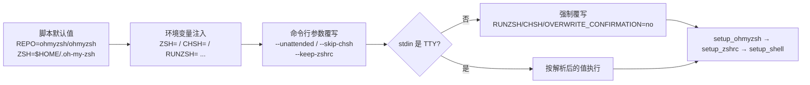
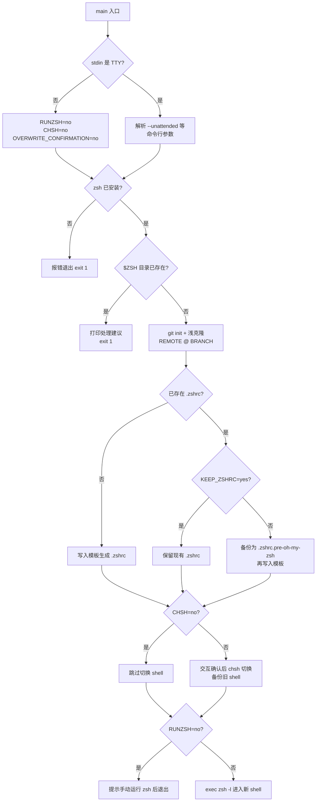

oh-my-zsh 的 `tools/install.sh` 并非一个硬编码的安装器，而是一个完全参数化的部署程序：它通过一组环境变量与命令行开关，将安装路径、克隆来源、分支、交互行为乃至安装后动作全部交给调用方控制。本页面向需要在自动化环境（CI、容器、dotfiles 引导脚本）中部署 oh-my-zsh 的开发者，系统梳理这套参数体系的注入机制、每个变量的生效位置，以及"无人值守安装"的三种触发方式与背后的判定逻辑。若你尚未完成首次安装，建议先阅读 [快速开始：一键安装与首次运行](2-kuai-su-kai-shi-jian-an-zhuang-yu-shou-ci-yun-xing) 建立整体认知。

Sources: [install.sh](tools/install.sh#L14-L41)

## 参数化架构：环境变量如何注入安装流程

安装脚本采用 POSIX Shell 中最经典的参数默认化模式 `${VAR:-默认值}`——即"变量未设置时才取默认值"。脚本头部用注释声明了它尊重的全部变量，随后在脚本入口处以 `set -e`（任一命令失败即退出）保证自动化场景下的失败可见性。这意味着所有定制都不需要修改脚本本身，只需在调用时前置赋值，例如 `ZSH=~/.zsh sh install.sh` 即可改变安装目标目录。

Sources: [install.sh](tools/install.sh#L42-L48), [install.sh](tools/install.sh#L14-L16)

参数体系实际存在**三个层级**，其优先级由代码执行顺序决定：环境变量最先被读取并赋予默认值（脚本 L44-L103），随后 `main()` 函数解析命令行参数并直接覆写对应变量（L547-L554），最后 `main()` 入口处的 TTY 检测会在 stdin 非终端时强制覆写三个交互开关（L539-L544）。因此命令行参数 > 环境变量 > 脚本默认值，而自动降级（非 TTY）的优先级又高于前两者——这是一个值得注意的设计：即使你显式设置了 `CHSH=yes`，在管道环境下它仍会被强制改为 `no`。

Sources: [install.sh](tools/install.sh#L539-L554), [install.sh](tools/install.sh#L44-L103)



Sources: [install.sh](tools/install.sh#L538-L604)

## 全部环境变量参考

下表汇总了脚本声明的全部可控变量、默认值与其在代码中的实际生效位置。前三组控制"装什么、装到哪"，后四组控制"装的过程问不问、装完做什么"。

| 变量 | 默认值 | 作用 | 生效位置 |
|------|--------|------|----------|
| `ZDOTDIR` | 未设置 | Zsh 点文件目录，同时影响 `ZSH` 默认值与 `.zshrc` 生成路径 | L84-L92, L586-L588 |
| `ZSH` | `$HOME/.oh-my-zsh`（或 `$ZDOTDIR/ohmyzsh`） | oh-my-zsh 仓库克隆目标目录 | L86-L92 |
| `REPO` | `ohmyzsh/ohmyzsh` | GitHub 仓库（`owner/repo` 形式），用于派生 `REMOTE` | L95 |
| `REMOTE` | `https://github.com/${REPO}.git` | 完整 git 远程 URL，设置后优先于 `REPO` | L96, L338 |
| `BRANCH` | `master` | 安装后立即检出的分支 | L97, L340 |
| `CHSH` | `yes` | 设为 `no` 则不改默认 shell | L100, L419-L422 |
| `RUNZSH` | `yes` | 设为 `no` 则安装完成后不启动 zsh | L101, L596-L601 |
| `KEEP_ZSHRC` | `no` | 设为 `yes` 则不替换已存在的 `.zshrc` | L102, L363-L367 |
| `OVERWRITE_CONFIRMATION` | `yes` | 设为 `no` 则跳过覆盖 `.zshrc` 前的确认提问 | L103, L369-L385 |

Sources: [install.sh](tools/install.sh#L18-L41), [install.sh](tools/install.sh#L44-L103)

## 安装路径定制：ZSH 与 ZDOTDIR 的协作

`ZSH` 是最常用的定制变量。脚本在赋默认值前先用 `${ZSH:+yes}` 记录了调用方是否显式提供了该值（存入 `custom_zsh`），这一细节的用途在失败路径上：若安装时目标目录 `$ZSH` 已存在，且调用方曾自定义过路径，脚本会给出三条针对性建议（取消设置 `ZSH`、换一个新路径、或删除旧目录后重装）；若未自定义，则只提示删除后重装。这个分支区分避免了自动化脚本在默认路径冲突时输出误导性指引。

Sources: [install.sh](tools/install.sh#L79-L80), [install.sh](tools/install.sh#L563-L583)

`ZDOTDIR` 是一个更系统化的方案：当它被设置且不等于 `$HOME` 时，`ZSH` 的默认值从 `$HOME/.oh-my-zsh` 变为 `$ZDOTDIR/ohmyzsh`，所有 zsh 配置文件（包括备份与新生成的 `.zshrc`）都落在 `$ZDOTDIR` 下，且脚本会自动 `mkdir -p` 该目录。更关键的是 `.zshrc` 生成逻辑：脚本用 `sed` 将模板中的 `export ZSH=...` 行重写为实际安装路径，并且会把路径前缀规范化为 `$ZDOTDIR/` 或 `$HOME/` 变量形式——这样用户搬家或换用户名时 `.zshrc` 依然有效。

Sources: [install.sh](tools/install.sh#L82-L92), [install.sh](tools/install.sh#L585-L588), [install.sh](tools/install.sh#L405-L413)

README 官方推荐的写法是直接前置赋值：`ZSH="$HOME/.dotfiles/oh-my-zsh" sh install.sh`，或在管道执行场景中于管道末端设置变量。若你走的是 dotfiles 管理路线（`.zshrc` 由仓库符号链接而来），`KEEP_ZSHRC=yes` 加 `ZDOTDIR` 的组合是标准做法。相关实践可延伸阅读 [掌握 .zshrc：主题、插件与核心配置项详解](3-zhang-wo-zshrc-zhu-ti-cha-jian-yu-he-xin-pei-zhi-xiang-xiang-jie)。

Sources: [README.md](README.md#L291-L296)

## 安装源定制：REPO、REMOTE 与 BRANCH

这三个变量服务于"从 fork 安装"和"测试 Pull Request"两类场景。`REPO` 接受 `owner/repository` 形式，安装器据此拼出 `https://github.com/{owner}/{repository}`；`REMOTE` 接受完整 URL，适用于非 GitHub 托管（GitLab、Bitbucket）或希望走 SSH 克隆（`git@github.com:user/project.git`）的场合。注意官方文档明确说明二者**互不兼容且 `REMOTE` 优先**——这是因为默认值表达式 `REMOTE=${REMOTE:-https://github.com/${REPO}.git}` 只在 `REMOTE` 未设置时才引用 `REPO`。

Sources: [README.md](README.md#L311-L332), [install.sh](tools/install.sh#L94-L97)

克隆过程本身是手工编排的浅克隆而非简单的 `git clone`：`git init` 后逐项写入配置——`core.eol=lf`、`core.autocrlf=false`（防止 Windows 换行符污染）、忽略 zero-padded filemode 的 fsck 配置——然后以 `--depth=1` 拉取指定 `BRANCH`。其中两条自定义 git 配置 `oh-my-zsh.remote` 与 `oh-my-zsh.branch` 被持久化在克隆出的仓库里，它们是后续自动更新机制定位升级源的数据基础。此外 `setup_ohmyzsh` 开头的 `umask g-w,o-w` 用于收紧仓库权限，注释明确指出：不这样做会导致 `compinit` 因目录权限不安全而报 `command not found: compdef`。

Sources: [install.sh](tools/install.sh#L329-L352), [install.sh](tools/install.sh#L336-L340), [install.sh](tools/install.sh#L307-L313)

典型组合示例：`REPO=apjanke/oh-my-zsh BRANCH=edge sh install.sh` 从指定 fork 的 edge 分支安装。若要测试某个 PR，将 `BRANCH` 指向 PR 分支即可；若你的 fork 托管在私有 GitLab 上，用 `REMOTE=git@gitlab.example.com:me/omz.git` 配合 SSH 密钥即可完成无人干预的认证克隆。

Sources: [README.md](README.md#L328-L332)

## 交互抑制：四个开关与三处交互点

交互式安装中存在两处会阻塞的提问，加上安装完成后的行为，共对应四个抑制开关。第一处在 `setup_shell`：若检测到当前登录 shell 已是 zsh 则静默跳过（L424-L427），否则打印 `[Y/n]` 提问是否切换默认 shell——`CHSH=no`（或 `--skip-chsh`）会让函数在提问前直接返回。第二处在 `setup_zshrc`：发现已存在的 `.zshrc` 时，先展示 `templates/minimal.zshrc` 的最小配置内容，再以 `[Y/n]` 询问是否用模板覆盖——`OVERWRITE_CONFIRMATION=no` 跳过提问但仍执行备份与覆盖，而 `KEEP_ZSHRC=yes` 则更彻底，直接保留现有 `.zshrc` 原样返回。

Sources: [install.sh](tools/install.sh#L418-L448), [install.sh](tools/install.sh#L362-L385), [minimal.zshrc](templates/minimal.zshrc#L1-L6)

理解这两个开关的差异对自动化至关重要：`KEEP_ZSHRC=yes` 适用于"配置由 dotfiles 管理，绝不触碰"的场景；`OVERWRITE_CONFIRMATION=no` 适用于"我希望获得官方模板，但不要停下来问我"的场景。值得称赞的是脚本的安全设计：无论哪种路径，原 `.zshrc` 都不会被销毁——它被改名为 `.zshrc.pre-oh-my-zsh`；若该备份已存在（重复安装），则进一步降级为带秒级时间戳的 `.zshrc.pre-oh-my-zsh-YYYY-MM-DD_HH-MM-SS`，构成一条永不覆盖旧版的备份链。

Sources: [install.sh](tools/install.sh#L354-L401), [install.sh](tools/install.sh#L387-L398)

`setup_shell` 的内部逻辑同样体现了防御式编程：它先检查系统是否存在 `chsh` 命令（不存在则打印手动切换指引后返回），再处理 Termux（无 `chsh`）等特殊平台；对常规平台则从 `/etc/shells` 中定位合法的 zsh 二进制路径；切换前会把原 shell 写入 `.shell.pre-oh-my-zsh` 备份，并借助 `user_can_sudo` 判断是否需要 `sudo` 前缀来执行 `chsh`——这套探测让脚本在 Google Cloud Shell 等免密 sudo 环境与普通环境间都能正确工作。

Sources: [install.sh](tools/install.sh#L456-L484), [install.sh](tools/install.sh#L488-L512)

## 无人值守安装：--unattended 与非 TTY 自动降级

`--unattended` 是面向自动化部署的一站式开关：它一次性等价于同时设置 `RUNZSH=no`、`CHSH=no`、`OVERWRITE_CONFIRMATION=no` 三个变量，即"不切换默认 shell、装完不启动 zsh、覆盖 `.zshrc` 前不询问"。官方推荐的管道写法中有一个容易被误解的细节：

```sh
sh -c "$(curl -fsSL https://raw.githubusercontent.com/ohmyzsh/ohmyzsh/master/tools/install.sh)" "" --unattended
```

其中空字符串 `""` 是 `$0`（脚本名）的占位符——`sh -c` 的第一个参数会成为 `$0`，后续参数才是 `$1` 及以后。漏掉这个空串会导致 `--unattended` 被当作脚本名而失效。

Sources: [README.md](README.md#L298-L309), [install.sh](tools/install.sh#L33-L40), [install.sh](tools/install.sh#L546-L554)

比 `--unattended` 更隐蔽的是**自动降级机制**：`main()` 的第一行逻辑是 `[ ! -t 0 ]` 检测——当 stdin 不是终端（典型如 `curl ... | sh` 管道执行，因为此时脚本与上游进程共享 stdin）时，同样强制设置那三个 `no`。这解释了一个常见现象：为什么"直接 curl 管道安装"天然就是无人值守的。配套的还有输出层适配：`setup_color` 在非 TTY 环境下将全部颜色格式串置空，CI 日志中不会出现转义序列污染；`is_tty` 检测则通过在子 shell 中重定义来规避 `[ -t 1 ]` 在 `$(...)` 中失效的问题。

Sources: [install.sh](tools/install.sh#L538-L544), [install.sh](tools/install.sh#L138-L150), [install.sh](tools/install.sh#L264-L275)

下表对比三种触发方式的等价性与适用场景：

| 触发方式 | 等价设置 | 交互提示 | 安装后启动 zsh | 典型场景 |
|----------|----------|----------|----------------|----------|
| 交互式运行（默认） | 无 | 保留（chsh 提问 + zshrc 覆盖提问） | `exec zsh -l` | 个人机器手动安装 |
| `--unattended` 显式传参 | 三变量 = no | 全部跳过 | 不启动，提示手动运行 | dotfiles 引导脚本（保留 TTY 反馈） |
| 管道执行（stdin 非 TTY）自动降级 | 三变量 = no | 全部跳过 | 不启动 | CI、Dockerfile、`curl \| sh` |

Sources: [install.sh](tools/install.sh#L539-L554), [install.sh](tools/install.sh#L596-L601)

完整的无人值守决策流程如下：



Sources: [install.sh](tools/install.sh#L538-L602)

## 自动化场景实战组合

以下示例覆盖三类高频部署形态。**容器镜像构建**中，zsh 需先由包管理器装好（脚本 L558-L561 会在 zsh 缺失时直接退出），随后以无人值守模式克隆框架；由于容器内通常以非 root 用户运行且没有登录 shell 切换需求，`--unattended` 与 `CHSH=no` 语义完全吻合：

```dockerfile
RUN apt-get update && apt-get install -y zsh git curl \
 && sh -c "$(curl -fsSL https://raw.githubusercontent.com/ohmyzsh/ohmyzsh/master/tools/install.sh)" "" --unattended --keep-zshrc
```

Sources: [install.sh](tools/install.sh#L556-L561), [README.md](README.md#L298-L309)

**dotfiles 引导脚本**的核心诉求是"框架归框架、配置归我"：用 `ZSH` 指定自定义路径、`KEEP_ZSHRC=yes` 保护符号链接进来的配置、`RUNZSH=no` 避免引导脚本被 zsh 接管会话。若配置文件尚不存在，也可以反过来利用安装器生成模板后再替换。**网络受限环境**（中国大陆等无法直连 `raw.githubusercontent.com` 的地区）则可将下载源替换为官方镜像 `https://install.ohmyz.sh`，再叠加 `REMOTE` 指向可达的克隆镜像源。

Sources: [README.md](README.md#L308-L309)

需要注意一个与自动更新机制的衔接点：无人值守安装后 `RUNZSH=no` 只是本次不启动 zsh，框架本身已完整就位；而克隆阶段写入的 `oh-my-zsh.remote` / `oh-my-zsh.branch` git 配置意味着后续 `omz update` 会沿 `REMOTE` 与 `BRANCH` 升级——从 fork 安装时尤其要留意这一点，否则会持续从 fork 而非上游拉取更新。更新机制的细节见 [自动更新机制全解：更新模式与频率控制](22-zi-dong-geng-xin-ji-zhi-quan-jie-geng-xin-mo-shi-yu-pin-lu-kong-zhi)。

Sources: [install.sh](tools/install.sh#L336-L337)

## 备份文件生命周期与卸载闭环

安装器在 `$ZDOTDIR`（或 `$HOME`）下最多留下两个备份文件：`.zshrc.pre-oh-my-zsh`（原 zsh 配置）与 `.shell.pre-oh-my-zsh`（原默认 shell）。它们并非残留垃圾，而是卸载流程的还原依据——`tools/uninstall.sh` 会读取 `.shell.pre-oh-my-zsh` 执行 `chsh` 切回旧 shell，并把 `.zshrc.pre-oh-my-zsh` 恢复为 `~/.zshrc`，同时将卸载时的 `.zshrc` 带时间戳另存。因此自动化脚本在卸载前不应清理这两个备份。

Sources: [uninstall.sh](tools/uninstall.sh#L1-L11), [uninstall.sh](tools/uninstall.sh#L24-L38)

至此，安装参数体系的全部可控点已覆盖。下一步建议按目录继续阅读 [升级、卸载与常见安装问题排查](8-sheng-ji-xie-zai-yu-chang-jian-an-zhuang-wen-ti-pai-cha) 了解备份还原与故障处理；若要进一步定制安装后的配置结构（`custom/` 目录、第三方插件），参见 [自定义插件与主题：ZSH_CUSTOM 目录实践](26-zi-ding-yi-cha-jian-yu-zhu-ti-zsh_custom-mu-lu-shi-jian)。