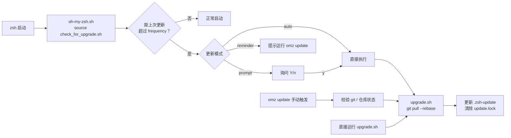
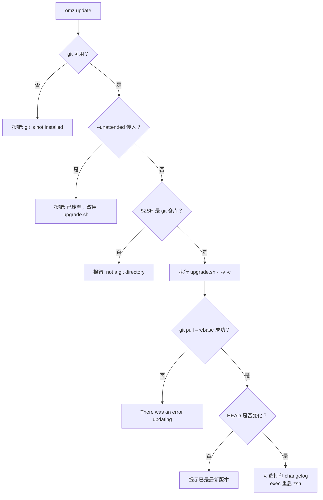
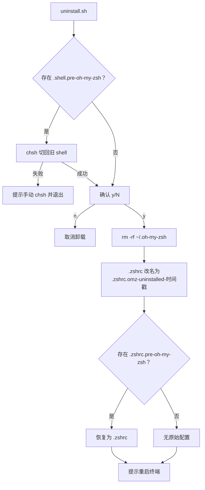
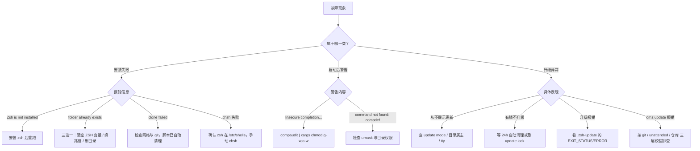

本页面向已经完成安装的 Oh My Zsh 用户，聚焦三个运维场景：**升级**（手动执行 `omz update` 或直接调用 `upgrade.sh`）、**卸载**（`uninstall.sh` 如何回滚安装产物），以及**常见安装故障的诊断与修复**（从 `$ZSH` 目录冲突到补全目录权限告警）。所有结论均基于仓库源码逐行验证，可在段末引用处核对。与自动更新策略的深度配置（更新模式、频率控制）属于 [自动更新机制全解：更新模式与频率控制](22-zi-dong-geng-xin-ji-zhi-quan-jie-geng-xin-mo-shi-yu-pin-lu-kong-zhi) 的范畴，本页只从"排错线索"的角度涉及它们。

Sources: [upgrade.sh](tools/upgrade.sh#L1-L345), [uninstall.sh](tools/uninstall.sh#L1-L42), [install.sh](tools/install.sh#L538-L602)

## 升级的三条路径与总体架构

Oh My Zsh 的仓库本体就是一个 shallow clone 的 git 仓库，因此"升级"本质上是 `git pull --rebase`，但其外围包裹了三层入口：自动更新检查器在每次 shell 启动时决定是否提示；`omz update` 是交互式手动升级的官方入口；`tools/upgrade.sh` 则是三者共用的最终执行体。理解这条调用链是排查"升级不生效""升级卡住"问题的前提。

`omz` 命令在 `lib/cli.zsh` 中注册了 `update` 子命令，与其并列的还有 `changelog`、`version` 等，它们共同构成升级排错时的信息收集工具集。`omz version` 通过 `git describe` 或分支名给出当前版本与短哈希，`omz changelog` 则调用 `tools/changelog.sh` 打印两个提交之间的变更，非常适合在升级前后对比行为差异。

Sources: [oh-my-zsh.sh](oh-my-zsh.sh#L70-L71), [cli.zsh](lib/cli.zsh#L23-L36), [cli.zsh](lib/cli.zsh#L956-L976)

## 手动升级：omz update 的完整执行链

执行 `omz update` 后，`_omz::update` 函数依次完成四件事：确认 `git` 命令存在、拒绝已废弃的 `--unattended` 标志、确认 `$ZSH` 是一个 git 仓库，然后才启动真正的升级脚本。任何一步失败都会立即中止并给出明确错误，这是排查"命令没反应"问题的第一层检查点。

Sources: [cli.zsh](lib/cli.zsh#L911-L929)

升级完成后，`_omz::update` 会读取 zstyle 中的 verbose 与 cooldown 配置传给 `upgrade.sh`，随后刷新 `${ZSH_CACHE_DIR}/.zsh-update` 中的 `LAST_EPOCH` 时间戳，并删除 `$ZSH/log/update.lock` 锁目录。如果检测到 `git rev-parse HEAD` 发生了变化，它会以 `exec` 方式重启当前 zsh 会话，让新代码立即生效——这也解释了为什么升级后终端会"自动重开"。

Sources: [cli.zsh](lib/cli.zsh#L931-L954)

`upgrade.sh` 支持三个命令行选项，手动调用时可以直接控制行为：

| 选项 | 取值 | 作用 |
|------|------|------|
| `-v` | `default` / `minimal` / `silent` | 控制输出详细程度，`silent` 完全静默 |
| `-i` | 无参数 | 升级成功后打印变更日志 |
| `-c` | 非负整数（天） | 冷却期：只合并到 N 天前的提交，规避最新提交的风险 |

Sources: [upgrade.sh](tools/upgrade.sh#L25-L49)

完整的手动升级流程如下：

Sources: [cli.zsh](lib/cli.zsh#L911-L954), [upgrade.sh](tools/upgrade.sh#L259-L332)

## upgrade.sh 的防御性设计：修复历史遗留的 git 故障

`upgrade.sh` 在执行 pull 之前会做一系列"自愈"操作，理解它们能解释很多看似诡异的现象。第一步是**远端迁移**：脚本遍历所有 git remote，把旧组织名 `robbyrussell/oh-my-zsh` 的地址自动改写为 `ohmyzsh/ohmyzsh`（同时把过时的 `git://` 协议升级为 `https`），并把最终选定的远端记录到本地 git config 的 `oh-my-zsh.remote` 键中。如果你曾从 fork 安装，这个键决定了升级源，清掉它即可回到官方源。

Sources: [upgrade.sh](tools/upgrade.sh#L205-L225)

第二步是**预设 git config**：强制 `core.eol=lf` 与 `core.autocrlf=false` 解决 Windows 换行符导致的整文件 diff（issue #4069）；将三类 `fsck.zeroPaddedFilemode` 设为 `ignore`，绕过老版本仓库对象触发 `git fetch` 报错的问题（issue #4963）；临时开启 `rebase.autoStash`，让存在本地未提交修改时 pull 也能继续（issue #7172），升级结束后恢复原值。如果你手动 `git pull` 失败而 `omz update` 成功，差异通常就在这些配置上。

Sources: [upgrade.sh](tools/upgrade.sh#L227-L237), [upgrade.sh](tools/upgrade.sh#L334-L341)

第三步是**升级范围控制**：脚本读取 `oh-my-zsh.remote` 与 `oh-my-zsh.branch`（默认 `origin` / `master`），先记下当前 HEAD 与分支，升级完成后切回原分支。指定了冷却期（`-c N`）时不再盲目 pull，而是 fetch 后从 `FETCH_HEAD` 中找到第一个不晚于 N 天前的提交，用 `git merge --ff-only` 快进到该点——保证历史线性且版本经过足够多的用户验证。

Sources: [upgrade.sh](tools/upgrade.sh#L241-L273), [upgrade.sh](tools/upgrade.sh#L245-L265)

## 自动更新的状态文件与锁：升级排错的关键线索

自动更新检查器 `tools/check_for_upgrade.sh` 维护两个排错时必须认识的文件。其一是状态文件 `${ZSH_CACHE_DIR}/.zsh-update`（由旧的 `~/.zsh-update` 迁移而来），正常时只含 `LAST_EPOCH=<天数>`；一旦升级失败，会追加 `EXIT_STATUS` 与 `ERROR` 字段，background-alpha 模式正是靠这两个字段在下一个提示符前报告失败原因。若怀疑状态损坏，直接删除该文件即可，下次启动会重建。

Sources: [check_for_upgrade.sh](tools/check_for_upgrade.sh#L1-L4), [check_for_upgrade.sh](tools/check_for_upgrade.sh#L136-L149), [check_for_upgrade.sh](tools/check_for_upgrade.sh#L310-L341)

其二是锁目录 `$ZSH/log/update.lock`，用 `mkdir` 的原子性防止多个会话并发升级。排错价值在于它的**过期清理逻辑**：锁目录存在超过 24 小时会被自动删除——如果你发现"升级永远不触发"，多半是某个异常退出的会话留下了陈锁，等待一天或手动 `rm -rf ~/.oh-my-zsh/log/update.lock` 即可解除。

Sources: [check_for_upgrade.sh](tools/check_for_upgrade.sh#L209-L221)

此外有三种情况会静默跳过更新检查，是"为什么不提示升级"的常见答案：`zstyle ':omz:update' mode disabled`（或旧变量 `DISABLE_AUTO_UPDATE=true`）显式禁用；当前用户对 `$ZSH` 目录**无写权限或非属主**（`! -w || ! -O`）；以及 stdout 不是终端。最后一项尤其容易在 CI、非交互 SSH 或 instant-prompt 环境中触发。

Sources: [check_for_upgrade.sh](tools/check_for_upgrade.sh#L14-L31)

| 现象 | 根因线索 | 处置方式 |
|------|----------|----------|
| 从不询问升级 | mode 为 disabled；或目录权限/属主不符；或非 tty | 检查 zstyle 与 `$ZSH` 权限 |
| 提示 `Can't update: not a git repository` | `$ZSH` 缺失 `.git`（如手工解压安装） | 重新用 install.sh 安装，或 `git init` + 关联远端 |
| 多终端同时升级时只有一个生效 | `update.lock` 互斥锁 | 正常行为，无需处理 |
| 升级失败后反复重试 | `.zsh-update` 中残留 `EXIT_STATUS`/`ERROR` | 查看错误内容，修复后删除该文件 |

Sources: [check_for_upgrade.sh](tools/check_for_upgrade.sh#L250-L254), [check_for_upgrade.sh](tools/check_for_upgrade.sh#L237-L241)

## 卸载：uninstall.sh 的四步回滚逻辑

`tools/uninstall.sh` 只有 42 行，却完整实现了对安装过程的逆操作。第一是**恢复默认 shell**：如果安装时记录过 `~/.shell.pre-oh-my-zsh`（由 install.sh 的 `setup_shell` 写入），脚本用 `chsh -s` 切回旧 shell，成功后删除该记录文件；`chsh` 失败时脚本会中止并提示手动修改 `/etc/passwd`，避免出现"删了 oh-my-zsh 却回不到原 shell"的中间态。

Sources: [uninstall.sh](tools/uninstall.sh#L1-L11), [install.sh](tools/install.sh#L479-L512)

第二是**删除确认与主体移除**：以 `y/N` 交互确认后 `rm -rf ~/.oh-my-zsh`。第三是**保护当前配置**：不会直接删除 `~/.zshrc`，而是将其重命名为带时间戳的 `~/.zshrc.omz-uninstalled-<日期>`，保留你在 oh-my-zsh 期间的所有定制。第四是**还原原始配置**：查找 `~/.zshrc.pre-oh-my-zsh`（安装时备份的旧配置）并恢复为 `~/.zshrc`；如果不存在则说明安装前没有 zsh 配置。最后提醒重启终端使 shell 变更生效。

Sources: [uninstall.sh](tools/uninstall.sh#L13-L42)

## 备份链约定：安装与卸载共享的文件契约

卸载能顺利回滚，依赖安装时建立的**文件命名契约**。install.sh 的 `setup_zshrc` 在覆盖 `~/.zshrc` 前先将其移到 `~/.zshrc.pre-oh-my-zsh`，代码注释明确说明"必须用这个确切的名字，uninstall.sh 才能找到它"；若该备份已存在（重复安装场景），会再带时间戳地转存一层，永不覆盖用户历史配置。同理 `setup_shell` 写入的 `~/.shell.pre-oh-my-zsh` 是卸载时切回 shell 的依据。

Sources: [install.sh](tools/install.sh#L354-L401), [install.sh](tools/install.sh#L479-L484)

由此可推出一条重要的恢复链路：如果卸载后发现配置不对，检查家目录下这三个文件——`.zshrc.omz-uninstalled-*`（oh-my-zsh 期间的配置）、`.zshrc.pre-oh-my-zsh-*`（更早的备份）、`.shell.pre-oh-my-zsh`（若未被清理，说明 chsh 回滚失败）。另外，使用 `KEEP_ZSHRC=yes`（或 `--keep-zshrc`）安装时跳过模板覆盖，卸载时也就不存在 `.zshrc.pre-oh-my-zsh` 可还原。

Sources: [install.sh](tools/install.sh#L18-L41), [uninstall.sh](tools/uninstall.sh#L24-L38)

## 常见安装问题排查速查表

安装脚本 `tools/install.sh` 内建了针对典型故障的显式检测，以下按报错原文归类给出处置方案：

| 报错 / 现象 | 源码位置 | 原因与处置 |
|---|---|---|
| `Zsh is not installed. Please install zsh first.` | [install.sh](tools/install.sh#L558-L561) | 未安装 zsh 本体，先用系统包管理器安装 |
| `The $ZSH folder already exists (...)` | [install.sh](tools/install.sh#L563-L583) | 目标目录已存在；脚本给出三个选项：`ZSH= sh install.sh` 清除变量、指定新路径、或确认无重要内容后 `rm -r` 重装 |
| `git is not installed` | [install.sh](tools/install.sh#L317-L320) | 安装依赖 git clone，先装 git |
| `Windows/MSYS Git is not supported on Cygwin` | [install.sh](tools/install.sh#L322-L327) | Cygwin 下误用 MSYS git，把 Cygwin 的 git 包排到 `$PATH` 前列 |
| `git clone of oh-my-zsh repo failed` | [install.sh](tools/install.sh#L329-L347) | clone 任一步失败会自动 `rm -rf` 半成品目录后退出，检查网络/代理后重跑 |
| 无法自动切换默认 shell | [install.sh](tools/install.sh#L429-L436) | 系统无 `chsh`，按提示手动执行 |
| `no zsh binary found or not present in '/etc/shells'` | [install.sh](tools/install.sh#L456-L476) | zsh 未登记进 `/etc/shells`，手动 `chsh -s $(which zsh)` |
| `chsh command unsuccessful` | [install.sh](tools/install.sh#L507-L512) | 脚本会先探测 sudo 能力再决定是否提权执行，失败则需手动处理 |

Sources: [install.sh](tools/install.sh#L538-L602)

启动后的另一类高频问题是**补全目录权限告警**。oh-my-zsh 在加载补全前通过 `compinit -i` 排除不安全目录，并在 `_comp_secure` 标志被置位时调用 `handle_completion_insecurities` 打印警告——根因是 `compaudit` 检测到某些补全相关目录对 group/other 可写或属主异常。官方提示的修复命令是 `compaudit | xargs chmod g-w,o-w`，同时确保目录属主为 root 或当前用户；确实无法修复时可在 `oh-my-zsh.sh` 被 source 之前设置 `ZSH_DISABLE_COMPFIX=true`，改用 `compinit -u` 跳过校验（自担风险）。

Sources: [compfix.zsh](lib/compfix.zsh#L5-L44), [oh-my-zsh.sh](oh-my-zsh.sh#L233-L244)

与之相关的一个隐蔽问题是 `command not found: compdef`：install.sh 在 clone 前显式执行 `umask g-w,o-w`，就是为了防止宽松 umask 把新克隆仓库的目录权限变得"不安全"，进而导致 compinit 拒绝加载（Cygwin 下因 Windows ACL 优先可能例外）。遇到该错误时先检查 `~/.oh-my-zsh` 的目录权限是否被特殊 umask 污染。

Sources: [install.sh](tools/install.sh#L307-L313)

还有一条针对脚本化/容器环境的规则：install.sh 检测到 stdin 不是 tty 时自动转为无人值守模式（`RUNZSH=no; CHSH=no; OVERWRITE_CONFIRMATION=no`），等价于 `--unattended`。若你在交互终端里运行却被跳过了 shell 切换与确认提问，检查是否处于管道或重定向环境中。无人值守安装的完整变量清单见 [安装脚本深度选项：环境变量与无人值守安装](7-an-zhuang-jiao-ben-shen-du-xuan-xiang-huan-jing-bian-liang-yu-wu-ren-zhi-shou-an-zhuang)。

Sources: [install.sh](tools/install.sh#L538-L554)

## 排查决策流程

把上述要点整合为一张决策图，遇到问题时自上而下定位：

Sources: [install.sh](tools/install.sh#L538-L602), [compfix.zsh](lib/compfix.zsh#L5-L44), [check_for_upgrade.sh](tools/check_for_upgrade.sh#L209-L221), [cli.zsh](lib/cli.zsh#L911-L954)

排错时最常用的三条信息收集命令可以记为固定组合：`omz version`（当前版本与提交）、`omz changelog`（两个版本间的变更）、`cat ${ZSH_CACHE_DIR:-$HOME/.cache/oh-my-zsh}/.zsh-update`（上次自动更新的时间与错误状态）。

Sources: [cli.zsh](lib/cli.zsh#L208-L226), [cli.zsh](lib/cli.zsh#L956-L976), [check_for_upgrade.sh](tools/check_for_upgrade.sh#L136-L149)

## 下一步阅读

- 若想深入 zstyle 更新模式（prompt / auto / reminder / background-alpha / disabled）与频率调节，请继续阅读 [自动更新机制全解：更新模式与频率控制](22-zi-dong-geng-xin-ji-zhi-quan-jie-geng-xin-mo-shi-yu-pin-lu-kong-zhi)；
- 若希望理解补全系统为何对目录权限如此敏感，请阅读 [安全防线：compfix 与补全目录权限检查](12-an-quan-fang-xian-compfix-yu-bu-quan-mu-lu-quan-xian-jian-cha) 与 [补全系统：compinit 与 zcompdump 缓存优化](11-bu-quan-xi-tong-compinit-yu-zcompdump-huan-cun-you-hua)；
- 若在诊断中需要生成完整环境报告，请参考 [诊断转储 omz_diagnostic_dump 与故障排查](24-zhen-duan-zhuan-chu-omz_diagnostic_dump-yu-gu-zhang-pai-cha)；
- 重新安装时的环境变量与无人值守参数细节，见 [安装脚本深度选项：环境变量与无人值守安装](7-an-zhuang-jiao-ben-shen-du-xuan-xiang-huan-jing-bian-liang-yu-wu-ren-zhi-shou-an-zhuang)。