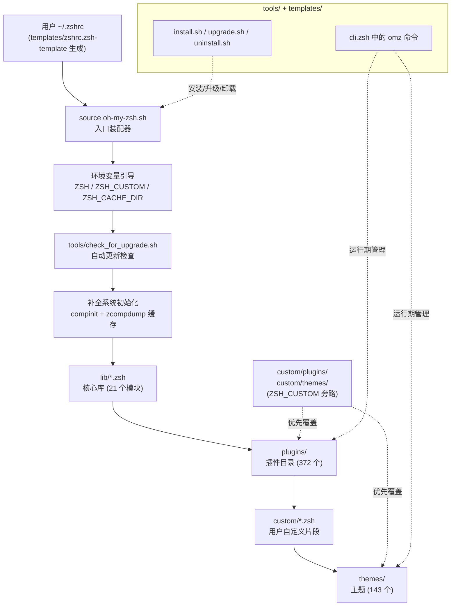
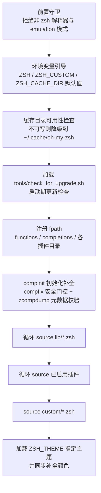

Oh My Zsh 本质上是一个**由约定驱动的装配式框架**：它本身不实现复杂功能，而是提供一条固定的启动装配线，把核心库、插件、主题与用户自定义配置按确定顺序拼装进一个 Zsh 会话。理解这套架构的关键在于分清三类角色——**入口装配器**（`oh-my-zsh.sh`）、**内容目录**（`lib/`、`plugins/`、`themes/`、`custom/`）与**生命周期工具**（`tools/`、`templates/`）。本页从整体到局部梳理各目录的职责边界与相互关系，为后续深入某个子系统的页面建立全局坐标系。

Sources: [oh-my-zsh.sh](oh-my-zsh.sh#L1-L8), [templates/zshrc.zsh-template](templates/zshrc.zsh-template#L4-L11)

## 一张图看懂分层架构

下图描述了从用户 `.zshrc` 出发的完整装配关系：入口脚本是一条流水线，各内容目录是流水线上的"原料仓"，`custom/` 目录与 `ZSH_CUSTOM` 变量则构成一条**旁路覆盖通道**——同名资源优先取自定义版本。

这张图揭示了两条设计主线：**启动期由 `oh-my-zsh.sh` 顺序装配**，**运行期由 `omz` 命令与更新脚本维护**，二者互不越界。

Sources: [oh-my-zsh.sh](oh-my-zsh.sh#L50-L71), [custom/example.zsh](custom/example.zsh#L1-L13)

## 目录职责总览

仓库根目录下的每个一级条目都有清晰的单一定位，通过下表可以建立"目录 → 职责 → 加载时机"的完整映射：

| 目录 / 文件 | 规模 | 职责 | 进入会话的时机 |
|---|---|---|---|
| `oh-my-zsh.sh` | 348 行 | 唯一入口，执行环境检查与全量装配 | 由 `.zshrc` source，最先执行 |
| `lib/` | 21 个 `.zsh` + `tests/` | 框架核心库：补全、按键、历史、Git 提示符等 | 装配线中段，全量无条件加载 |
| `plugins/` | 372 个插件目录 | 可选功能单元，按需启用 | 装配线中段，仅加载 `$plugins` 中列出的 |
| `themes/` | 143 个 `.zsh-theme` | 提示符外观定义 | 装配线末端，最后加载 |
| `templates/` | 2 个模板 | 新用户 `.zshrc` 的起点 | 安装期一次性复制，之后与框架无关联 |
| `tools/` | 8 个脚本 | 安装、升级、卸载等生命周期管理 | 安装期或更新检查时执行 |
| `custom/` | 用户扩展区 | 自定义插件、主题、配置片段 | 分散在装配线各环节，**同名优先** |
| `cache/` | 运行时产物 | zcompdump、更新时间戳等缓存 | 整个会话期间读写 |
| `log/` | 仅 `.gitkeep` | 预留的运行期日志目录 | 当前检出中为空占位 |
| `.github/`、`.devcontainer/` 等 | 仓库元数据 | CI 工作流、贡献规范、开发容器 | 不参与 Zsh 运行时 |

值得注意的细节是：入口脚本第 76 行声明了 `fpath=($ZSH/{functions,completions} $ZSH_CUSTOM/{functions,completions} $fpath)`，但本检出的根目录中并不存在 `functions/` 与 `completions/` 两个目录——它们是**约定式的扩展挂载点**，用户可将补全函数文件放入这些约定路径，Zsh 对 fpath 中不存在的条目不会报错。

Sources: [oh-my-zsh.sh](oh-my-zsh.sh#L66-L79), [custom/example.zsh](custom/example.zsh#L1-L8)

## 入口脚本：唯一且线性的装配器

`oh-my-zsh.sh` 是整个框架唯一的可执行入口，`.zshrc` 只需 `source $ZSH/oh-my-zsh.sh` 一行即可完成装配。它的内部结构遵循严格的线性时序，任何一段逻辑的位置变动都可能破坏加载语义：

几个值得展开的架构决策：

**守卫与降级**。脚本开头先定义 ANSI 格式化函数 `omz_f`（非终端输出时自动退化为空函数），随后用 POSIX 语法检测 `$ZSH_VERSION`，若在 bash 等其他 shell 中被误执行，会打印进程树并终止（[oh-my-zsh.sh](oh-my-zsh.sh#L10-L39)）；接着检测 `emulate` 模式，拒绝在兼容模式下加载（[oh-my-zsh.sh](oh-my-zsh.sh#L41-L46)）。这类守卫把"环境错误"拦截在装配开始之前，避免了半初始化状态。

**变量引导即扩展点**。`ZSH`、`ZSH_CUSTOM`、`ZSH_CACHE_DIR` 三个变量都采用"已设置则尊重、未设置则给默认"的写法：安装根默认取脚本所在目录，自定义区默认 `$ZSH/custom`，缓存区默认 `$ZSH/cache`（[oh-my-zsh.sh](oh-my-zsh.sh#L50-L59)）。缓存目录不可写时自动降级到 `${XDG_CACHE_HOME:-$HOME/.cache}/oh-my-zsh`，保证只读安装（如系统级部署）也能工作（[oh-my-zsh.sh](oh-my-zsh.sh#L61-L68)）。

**更新检查先于一切功能加载**。`tools/check_for_upgrade.sh` 在补全初始化之前就被 source（[oh-my-zsh.sh](oh-my-zsh.sh#L70-L71)），这样更新提示可以在会话其余部分构建完成前就给出反馈。

**性能意识贯穿始终**。脚本中有多处刻意规避子进程 fork 的代码：macOS 下 `scutil --get LocalHostName` 的结果按天缓存（[oh-my-zsh.sh](oh-my-zsh.sh#L100-L127)）；当前 commit 号通过纯 Zsh 函数 `_omz_git_head` 直接读取 `.git` 内部文件解析，而不是每次启动 fork 一个 `git rev-parse`（[oh-my-zsh.sh](oh-my-zsh.sh#L134-L216)）；zcompdump 通过比对头部元数据（revision + fpath）决定是否重建，再用 `zrecompile` 编译成 `.zwc` 字节码并配合锁目录防止并发写坏（[oh-my-zsh.sh](oh-my-zsh.sh#L259-L265)）。这些细节是"启动性能优化"主题的基础，将在后续页面展开。

Sources: [oh-my-zsh.sh](oh-my-zsh.sh#L233-L244), [oh-my-zsh.sh](oh-my-zsh.sh#L267-L306)

## lib/：无条件加载的核心库

`lib/` 中的 21 个 `.zsh` 文件构成框架的"内核"，由装配线中的 `for lib_file ("$ZSH"/lib/*.zsh)` 循环**全量、无条件**加载（[oh-my-zsh.sh](oh-my-zsh.sh#L308-L313)）。每个文件是一个内聚的功能模块，主要模块的职责如下：

| 模块 | 职责 | 关键证据 |
|---|---|---|
| `cli.zsh` | `omz` 命令调度器：plugin/pr/theme/update 等 10 个子命令 | [lib/cli.zsh](lib/cli.zsh#L3-L36) |
| `completion.zsh` | 补全行为 zstyle 配置：菜单选择、大小写不敏感匹配、补全缓存路径 | [lib/completion.zsh](lib/completion.zsh#L6-L45) |
| `git.zsh` | `git_prompt_info` 等供主题调用的 Git 提示符信息函数 | [lib/git.zsh](lib/git.zsh#L10-L21) |
| `history.zsh` | `omz_history` 历史命令包装器（清理/列表/时间戳） | [lib/history.zsh](lib/history.zsh#L1-L12) |
| `key-bindings.zsh` | ZLE 行编辑器按键绑定与终端 application mode 管理 | [lib/key-bindings.zsh](lib/key-bindings.zsh#L1-L11) |
| `directories.zsh` | 目录跳转 setopt（auto_cd/auto_pushd）与 `...` 等全局别名 | [lib/directories.zsh](lib/directories.zsh#L1-L12) |
| `termsupport.zsh` | 终端窗口/标签页标题设置 | [lib/termsupport.zsh](lib/termsupport.zsh#L1-L11) |
| `async_prompt.zsh` | 异步提示符基础设施：`_omz_register_handler` 注册机制 | [lib/async_prompt.zsh](lib/async_prompt.zsh#L1-L10) |
| `theme-and-appearance.zsh` | 颜色变量与 `ZSH_THEME_GIT_PROMPT_*` 等主题契约默认值 | [lib/theme-and-appearance.zsh](lib/theme-and-appearance.zsh#L1-L13) |
| `compfix.zsh` | 补全目录安全审计（由入口脚本在 compinit 前按需 source） | [oh-my-zsh.sh](oh-my-zsh.sh#L233-L238) |

这里有一个精巧的机制：所有 lib 文件与插件文件都不是直接 `source`，而是通过统一的 `_omz_source` 助手加载（[oh-my-zsh.sh](oh-my-zsh.sh#L267-L306)）。该助手做两件事——其一，**同名资源优先取 `$ZSH_CUSTOM` 下的版本**，实现自定义覆盖；其二，支持通过 `zstyle ':omz:lib:<名>' aliases no` / `zstyle ':omz:plugins:<名>' aliases no` 按模块关闭别名定义：加载前备份别名表、加载后剔除新增项。这让"关闭某个模块的别名但不关闭其他功能"成为可能。

Sources: [oh-my-zsh.sh](oh-my-zsh.sh#L276-L305), [lib/cli.zsh](lib/cli.zsh#L23-L36)

## plugins/：约定优于配置的插件生态

`plugins/` 是仓库体量最大的目录，包含 **372 个插件目录**，遵循严格的命名约定。`is_plugin` 函数（[oh-my-zsh.sh](oh-my-zsh.sh#L81-L86)）定义了插件合法性的两种形态：

1. **标准插件**：目录内含 `<名称>.plugin.zsh` 入口文件，如 `git/git.plugin.zsh`；
2. **纯补全插件**：目录内只含 `_<名称>` 补全脚本，如 `celery/_celery`——这类插件没有可执行逻辑，仅向 fpath 提供补全定义。

插件的加载分两阶段完成：**先注册、后加载**。入口脚本在 compinit 之前遍历 `$plugins` 数组，把每个插件目录插入 fpath 头部（[oh-my-zsh.sh](oh-my-zsh.sh#L88-L98)），确保补全系统能发现插件内的 `_<命令>` 文件；随后在 lib 加载完成后再逐个 source `.plugin.zsh`（[oh-my-zsh.sh](oh-my-zsh.sh#L315-L319)）。查找顺序是 **`$ZSH_CUSTOM/plugins` 优先于 `$ZSH/plugins`**，未找到时打印 `[oh-my-zsh] plugin 'x' not found` 提示。

这一约定使新增插件的成本降到最低：建目录、写入口文件、在 `.zshrc` 的 `plugins=(...)` 数组里加一个词，三步即可，这正是该生态能扩展到数百个插件的架构基础。

Sources: [templates/zshrc.zsh-template](templates/zshrc.zsh-template#L71-L78), [oh-my-zsh.sh](oh-my-zsh.sh#L90-L98)

## themes/：基于变量契约的提示符体系

`themes/` 下的 **143 个 `.zsh-theme` 文件**共享一个极简契约：主题文件本质上就是一个会被 source 的 Zsh 脚本，其职责是设置 `PROMPT` 变量以及一组 `ZSH_THEME_*` 信息段变量。以默认主题 robbyrussell 为例，全部内容只有 8 行——定义 `PROMPT` 并填充 `ZSH_THEME_GIT_PROMPT_*` 四个变量（[themes/robbyrussell.zsh-theme](themes/robbyrussell.zsh-theme#L1-L8)）。

这套契约的"接口层"由 `lib/theme-and-appearance.zsh` 定义：它在主题加载**之前**预设所有 `ZSH_THEME_GIT_PROMPT_PREFIX/SUFFIX/DIRTY/CLEAN` 等默认值（[lib/theme-and-appearance.zsh](lib/theme-and-appearance.zsh#L1-L13)），因此即使主题没有定义某个变量，`git_prompt_info` 等函数也不会报错。主题与 lib 之间是**单向依赖**：主题调用 lib 提供的信息函数，lib 通过契约变量回填主题样式。

主题的查找顺序体现了自定义优先原则：`$ZSH_CUSTOM/<名>.zsh-theme` → `$ZSH_CUSTOM/themes/<名>.zsh-theme` → `$ZSH/themes/<名>.zsh-theme`（[oh-my-zsh.sh](oh-my-zsh.sh#L334-L344)）。主题被安排在装配线**最末端**加载，确保其可以覆盖此前一切别名与函数定义；加载完成后，入口脚本还会把 `LS_COLORS` 同步到补全列表配色，使文件补全颜色与 `ls` 一致（[oh-my-zsh.sh](oh-my-zsh.sh#L346-L347)）。

Sources: [themes/robbyrussell.zsh-theme](themes/robbyrussell.zsh-theme#L1-L8), [lib/git.zsh](lib/git.zsh#L14-L21)

## tools/ 与 templates/：生命周期管理层

`tools/` 下的 8 个脚本负责框架的完整生命周期，它们与运行时会话的关系分为两类：

- **安装期工具**：`install.sh`（克隆仓库并部署 `.zshrc`）、`uninstall.sh`（还原原配置）、`theme_chooser.sh`（交互式主题预览）、`changelog.sh`（生成变更日志）；
- **会话期工具**：`check_for_upgrade.sh` 在每次启动时被 source，读取 `:omz:update` zstyle 决定更新策略——支持 `prompt`（默认，询问）、`auto`（自动执行）、`reminder`（仅提醒）、`background-alpha`（实验性后台更新）、`disabled` 五种模式，并把上次更新时间戳记录在缓存目录的 `.zsh-update` 文件中（[tools/check_for_upgrade.sh](tools/check_for_upgrade.sh#L1-L20)）；`upgrade.sh` 与 `require_tool.sh` 被更新流程调用。

与 `tools/` 的脚本不同，`lib/cli.zsh` 中定义的 `omz` 命令是**会话内**的管理入口（[lib/cli.zsh](lib/cli.zsh#L3-L21)）：`omz update` 触发更新、`omz theme use/set` 切换主题、`omz plugin list/enable/disable` 管理插件。区分这两条管理通道很重要——`tools/` 面向"框架进程外"的维护动作，`omz` 面向"当前会话内"的即时操作。

`templates/` 则是用户世界的起点：`zshrc.zsh-template` 被安装脚本复制为 `~/.zshrc`，模板内以注释形式文档化了全部核心配置项（`ZSH_THEME`、`plugins` 数组、各 `zstyle ':omz:update'` 开关等），并以 `source $ZSH/oh-my-zsh.sh` 为界分为"框架配置"与"用户个人配置"两段（[templates/zshrc.zsh-template](templates/zshrc.zsh-template#L71-L95)）。

Sources: [templates/zshrc.zsh-template](templates/zshrc.zsh-template#L26-L35), [tools/check_for_upgrade.sh](tools/check_for_upgrade.sh#L6-L31)

## custom/：覆盖优先级与扩展通道

`custom/` 目录（可通过 `ZSH_CUSTOM` 重定向）是框架留出的用户扩展区，其行为在 `custom/example.zsh` 中被明确文档化：其中的 `.zsh` 文件**按字母序自动加载、在所有 lib 内置功能之后加载、默认被 git 忽略**（[custom/example.zsh](custom/example.zsh#L1-L13)）。当前检出中它包含 `example.zsh`、`plugins/`（example、zsh-autosuggestions、zsh-syntax-highlighting）与 `themes/`（example、robbyrussell）等示例结构。

自定义资源在装配线上的**三个注入点**对应三种扩展形态：

| 扩展形态 | 注入点 | 覆盖能力 |
|---|---|---|
| `custom/<名>.plugin.zsh` 或 `custom/plugins/<名>/` | 插件加载循环的 CUSTOM 分支优先命中 | 同名时替换官方插件 |
| `custom/<名>.zsh-theme` 或 `custom/themes/<名>.zsh-theme` | 主题查找链的第一、二优先级 | 同名时替换官方主题 |
| `custom/*.zsh`（含 lib 同名覆盖，如 `custom/lib/git.zsh`） | lib/插件经 `_omz_source` 时 CUSTOM 优先；独立片段在 custom 循环中加载 | 可覆盖任何内置模块 |

这一设计把"定制"与"上游更新"解耦：用户的一切修改都留在 git 忽略的 `custom/` 中，`omz update` 拉取上游时不会产生合并冲突。完整的自定义实践（含 `ZSH_CUSTOM` 重定向）见 [自定义插件与主题：ZSH_CUSTOM 目录实践](26-zi-ding-yi-cha-jian-yu-zhu-ti-zsh_custom-mu-lu-shi-jian)。

Sources: [oh-my-zsh.sh](oh-my-zsh.sh#L286-L291), [oh-my-zsh.sh](oh-my-zsh.sh#L321-L325)

## cache/ 与 log/：运行时产物区

`cache/` 是 `ZSH_CACHE_DIR` 的默认位置，当前检出中已积累四类运行时产物：`.zsh-update`（更新检查时间戳，[tools/check_for_upgrade.sh](tools/check_for_upgrade.sh#L1-L4)）、`completions/`（入口脚本自动创建并插入 fpath 的自定义补全挂载点，[oh-my-zsh.sh](oh-my-zsh.sh#L66-L68)）、`appearance-probes/` 与 `grep-alias`（外观探测与 grep 别名缓存）。入口脚本对缓存目录做了完整的健壮性设计：不可写则整体迁移到 XDG 缓存路径，保证只读环境不阻塞启动。

`log/` 目录在当前检出中仅含一个 `.gitkeep` 占位文件，属于预留的运行期日志区，不参与启动装配逻辑。

Sources: [oh-my-zsh.sh](oh-my-zsh.sh#L57-L68), [tools/check_for_upgrade.sh](tools/check_for_upgrade.sh#L1-L4)

## 架构小结：三条不变式

回看全貌，Oh My Zsh 的架构可以压缩为三条被代码反复印证的不变式：

1. **单一入口、线性装配**——所有运行时行为都由 `oh-my-zsh.sh` 按固定顺序编排：守卫 → 变量 → 更新检查 → 补全 → lib → 插件 → custom → 主题；
2. **约定优于配置**——插件靠 `.plugin.zsh`/`_命令` 命名被发现，主题靠 `PROMPT` 与 `ZSH_THEME_*` 变量被驱动，扩展点靠 `functions/`、`completions/`、`custom/` 的约定路径存在，框架无需注册表；
3. **CUSTOM 优先覆盖**——从 lib 文件到插件再到主题，每一个查找点都是 `ZSH_CUSTOM` 在前、`ZSH` 在后，用户定制与上游更新天然隔离。

理解这三条不变式后，后续无论深入哪个子系统都能迅速定位它在装配线上的位置。建议按以下路径继续：

- 想逐行理解装配器本身 → [启动加载流程：oh-my-zsh.sh 主脚本逐段解读](10-qi-dong-jia-zai-liu-cheng-oh-my-zsh-sh-zhu-jiao-ben-zhu-duan-jie-du)
- 想深入补全与安全机制 → [补全系统：compinit 与 zcompdump 缓存优化](11-bu-quan-xi-tong-compinit-yu-zcompdump-huan-cun-you-hua) 与 [安全防线：compfix 与补全目录权限检查](12-an-quan-fang-xian-compfix-yu-bu-quan-mu-lu-quan-xian-jian-cha)
- 想开发插件或主题 → [插件加载机制与开发命名约定](16-cha-jian-jia-zai-ji-zhi-yu-kai-fa-ming-ming-yue-ding) 与 [主题编写规范：从 robbyrussell 到 agnoster](20-zhu-ti-bian-xie-gui-fan-cong-robbyrussell-dao-agnoster)
- 想理解更新体系 → [自动更新机制全解：更新模式与频率控制](22-zi-dong-geng-xin-ji-zhi-quan-jie-geng-xin-mo-shi-yu-pin-lu-kong-zhi)